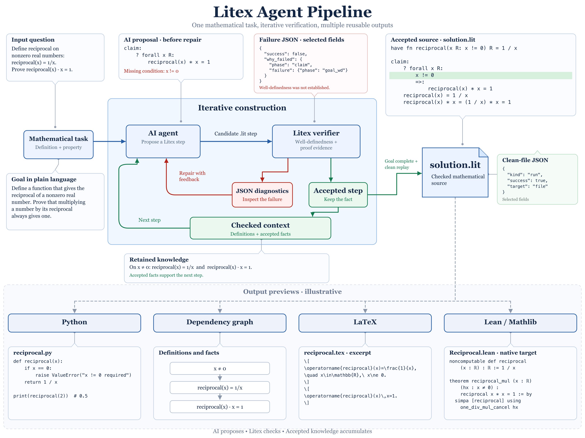

<div align="center">
  

# Litex

### Write mathematics. See why it holds.

**Pronunciation:** /ˈliːtɛk/ (“LEE-tek”, Chinese “里泰克”), not “LYE-tek” (“赖泰克”).

Created and maintained by Jiachen Shen.

_“Language is an instrument of human reason, and not merely a medium for the expression of thought.”_

_— George Boole, The Laws of Thought (1854), Chapter II (excerpt)_

[中文 README](docs/中文README.md) ·
[Official Website (官网)](https://litexlang.com) ·
[Read the Blueprint](docs/Litex_Blueprint.md) ·
[阅读中文蓝图](docs/Litex中文蓝图.md)
</div>

<a id="the-goal-of-litex"></a>

## A language for everyone who uses mathematics

Litex is a human-readable, set-theoretic, fact-oriented formal language,
with experimental Lean compilation for supported proofs.

**Language is a carrier of knowledge.** A theorem advances mathematical
knowledge; a mathematical language shapes how knowledge is expressed,
understood, checked, shared, and reused across fields. Its design concerns
everyone who uses mathematics: students, mathematicians, scientists, engineers,
and programmers.

**The more mathematics AI can produce, the more its language matters.**
Each new result needs an intelligible statement, explicit conditions, and
reasoning that others can inspect and build on. These needs reach across
mathematics and its applications. Litex's long-term goal is to help turn
growing mathematical capability into shared knowledge that more people can
understand, check, and use.

Litex explores whether familiar mathematical meanings, explicit facts, and
incremental checking can reduce the effort people and AI spend constructing,
understanding, reviewing, repairing, and reusing mathematical knowledge.
Progress toward that goal must be measured in real mathematical work; the
examples below demonstrate current capabilities within their stated limits.

**Mathematics deserves credible alternatives for its formal expression.**
Litex aims to offer another language route, with its own choices about meaning,
domains, and proof writing. A viable alternative would give users more choice
in how they learn, communicate, and apply mathematics. Interoperability with
Lean can support that goal while preserving Litex's independent language
design. The familiar expression `1 / 0` makes one such choice concrete.

<a id="familiar-mathematics"></a>

## Familiar expressions, familiar mathematics

**A familiar mathematical expression can mean something different in Lean.**
In ordinary real arithmetic, `1 / 0` is undefined; Lean/Mathlib's real division
satisfies `(1 : ℝ) / 0 = 0`. In ordinary integer arithmetic, `1 - 2 = -1`;
Lean's natural-number subtraction satisfies `(1 : Nat) - 2 = 0`.
These differences concern mathematical meaning, before proof syntax even enters
the picture.

| Expression | Usual textbook convention | Lean / Mathlib | Litex |
| --- | --- | --- | --- |
| Division by zero | `1 / 0` is undefined. | `(1 : ℝ) / 0 = 0` | Rejects `1 / 0 = 0` because the division is undefined. |
| Subtraction beyond the natural numbers | In integer arithmetic, `1 - 2 = -1`. | `(1 : Nat) - 2 = 0`: subtraction truncates at zero. | `1 - 2 = -1`; the result belongs to `Z`. |
| Real square root of a negative number | There is no real square root of `-1`. | `Real.sqrt (-1) = 0` | Rejects `sqrt(-1) = 0` because the real square root is undefined. |

These are documented defaults: [division by zero](https://leanprover-community.github.io/mathlib4_docs/Mathlib/Algebra/GroupWithZero/Basic.html#div_zero), [natural-number
subtraction](https://lean-lang.org/doc/reference/latest/Basic-Types/Natural-Numbers/#Nat.sub), and [real square roots](https://leanprover-community.github.io/mathlib4_docs/Mathlib/Analysis/Real/Sqrt.html#Real.sqrt_eq_zero_of_nonpos). In Lean, choosing `Int`
instead of `Nat` gives `(1 : Int) - 2 = -1`; the type selects a different
subtraction. Mathlib deliberately extends division and real square root beyond
their usual domains. **Recognizing the symbols is therefore not enough to know
which mathematics a formal statement expresses.** A checker validates the
statement under those definitions; the author must still check that it means
what they intended.

**Litex starts from familiar mathematical meanings and checks their conditions
of use.** Division requires a nonzero denominator; real square root requires a
nonnegative input. Subtracting two natural numbers does not silently truncate
the result at zero. These choices make ordinary meanings and domain checks
part of the language's default authoring experience.

**Writing mathematics should mean writing mathematics:** preserve its meaning,
state its conditions, and let the language check the reasoning.

## Six characteristics, one goal

These six characteristics follow one path: preserve the intended mathematics,
state it directly, build its objects, keep the results, collaborate through
feedback, and carry supported proofs into independent checking.

| Characteristic | What it means when writing mathematics |
| --- | --- |
| **1. Familiar mathematical meanings and domains** | `1 - 2 = -1`; division requires a nonzero denominator. [Meanings and domains](#familiar-mathematics). |
| **2. Write mathematical facts directly** | Write `1 + 1 = 2`; the language checks the fact and explains its grounds. [Facts](#direct-facts). |
| **3. Familiar objects, axioms, and notation** | Define sets, functions, and relations using membership, conditions, and familiar symbols. [Mathematical objects](#mathematical-objects). |
| **4. A continuous mathematical workflow** | Explore, define, prove, reuse, and turn supported results into computation or LaTeX. [Workflow](#knowledge-workflow). |
| **5. Work with AI through explicit feedback** | Propose a step, inspect the result, and repair it while retaining accepted knowledge. [Human–AI interaction](#human-ai-feedback). |
| **6. Independent Lean rechecking and interoperability** | Compile supported proof routes to Lean and connect them to Mathlib through reviewed interfaces. [Lean connection (experimental)](#lean-rechecking). |

<a id="direct-facts"></a>

## Write a fact and see what it leaves behind

**Writing mathematics should mean writing mathematics.** To state that one plus
one equals two, the Litex source is the fact itself:

```litex
1 + 1 = 2
```

A short Lean proof of the same arithmetic fact is:

```lean
example : (1 : Nat) + 1 = 2 := by rfl
```

In Litex, an ordinary fact is itself an instruction to check that fact.
The author writes the equality directly, without an `example` declaration
or a proof command for this calculation.
For harder arguments, authors still supply constructions and meaningful
intermediate steps; Litex checks the local connections it supports.

Now introduce a value and continue:

```litex
have a R = 2
a + 1 = 3
```

The first line introduces `a` as a real number: Litex records `a $in R` and
`a = 2`. It then checks `a + 1 = 3` using
the available facts and stores that equality for later steps. The author
chooses what to establish; Litex searches for supported local grounds and
reports the method it found.

> **When writing or repairing Litex code, open `-session` and keep that process
> alive. An ordinary failed statement preserves earlier accepted definitions
> and facts. Never rerun the whole file from the beginning whenever you add a
> few new lines.** See the [short comparison below](#work-with-people-and-ai-through-feedback).

The same principle extends from a calculation to a mathematical sentence.
“For every real number `x`, if `x > 0`, then `x + 1 > 1`” becomes:

```litex
forall x R:
    x > 0
    =>:
        x + 1 > 1
```

The order on the page is the order of the thought: introduce an arbitrary
real number, state the assumption, then state the conclusion. The condition
before `=>:` is an assumption; the conclusion after it must be checked.

Definitions join the same flow:

```litex
prop is_odd(x Z):
    x % 2 = 1

$is_odd(3)
```

Litex checks the concrete claim through the definition and keeps
`$is_odd(3)` in the current context. These are small examples of the
fact-oriented interface, not a claim that the verifier can invent an entire
proof from its final statement.

**How Litex works.** See the [Litex Verification Pipeline](https://litexlang.com/assets/diagrams/litex-verification-pipeline-v1.png)
for a visual overview of checking a fact, finding local grounds, and making
accepted knowledge available to later steps.

**Multilingual feedback.** The CLI can present JSON verification feedback in
several languages. The same source can be checked with `-lang zh` for Chinese
explanations or `-lang fr` for French ones. Thanks in part to AI-assisted
translation, this multilingual explanatory copy became feasible; the language
setting changes the feedback, not the mathematical statement being checked.
See the [CLI language options](docs/cli.md#basic-shape).

**Mathematical content for your tools.** `litex -lang en -f example.lit`
emits JSON with statement text, stored facts, inferred facts and proof summaries.
Use it to build your own indexes or visualizations. Normal JSON summarizes
verification and does not expose every dependency; see the
[JSON output contract](docs/cli.md#json-output-contract).

**LaTeX export (preview).** `litex -latex -document -lang zh -f example.lit`
compiles parsed source into mathematical LaTeX with prose in any of the ten
CLI languages. It preserves definitions and explicit proof steps without
executing or verifying them. See the [LaTeX compiler guide](src/compile_to_latex/README.md).

<a id="mathematical-objects"></a>

## Start from familiar mathematical objects

Litex aims for a Python-like entry into formal mathematics, where more people
can learn to build checkable knowledge.

Litex takes set theory (ZFC) as its mathematical foundation and presents sets,
elements, functions, and relations as the working vocabulary. In
`have a R = 2`, membership and equality are facts the language can use again;
the author does not first choose an abstract carrier type for `a`. Function
domains, set membership, and other well-definedness conditions still have to
be checked before a statement is accepted.

“Define distance from zero; points at `-3` and `3` have the same distance” becomes:

```litex
have fn distance_from_zero(x R) R = |x|
distance_from_zero(-3) = distance_from_zero(3) = 3
```

“Collect all positive real numbers into a set; two belongs to it” becomes:

```litex
have positive_reals set = {x R: x > 0}
2 $in positive_reals
```

Here `forall`, `have fn`, and the set-builder notation give precise forms to
familiar mathematical sentences. Litex uses a controlled formal syntax;
the correspondence is between the mathematical thought and the source, without
claiming to understand unrestricted natural-language prose.

**Symbolic input.** Litex also accepts familiar mathematical symbols as input:
`s ∩ u ⊆ t ∩ u` is the symbolic spelling of
`intersect(s, u) $subset intersect(t, u)`.
Most examples use the letter-based spelling because it is easier to type on
an ordinary keyboard. See the [supported Unicode aliases](docs/Manual.md#unicode-mathematical-input-aliases-preview).

Lean elaborates proofs into a core dependent type theory; its compiler IR for
executable programs is a separate path. Litex makes set membership and facts
the default authoring layer. Lean can express set theory too; this compares
their default interfaces, not their current coverage.

The concision of Litex source comes from the coordination among objects,
facts, statements, and verification procedures developed through sustained
iteration. It makes the mechanical work connecting common proof steps part of
the language's default checking, letting authors state mathematical steps
directly and build on existing knowledge. The Blueprint's
[systems engineering perspective](docs/Litex_Blueprint.md#systems-engineering)
follows a small reciprocal function through this design.

<a id="knowledge-workflow"></a>

## Let checked knowledge grow

_“If I have seen further it is by standing on the shoulders of Giants.”_

_— Isaac Newton, letter to Robert Hooke (1676)_

Every accepted statement extends the mathematical context for the statements
that follow.

```litex
prop is_positive(n R):
    exist a R+ st {n > a}

claim:
    ? forall x R:
        x > 10
        =>:
            $is_positive(x)
    witness exist a R+ st {x > a} from 10

have a R:
    a > 10

$is_positive(a)
```

The [checked Cantor example](docs/Litex_Blueprint.md#workflow-reuse) in the
Blueprint goes further: it defines a diagonal subset, proves a general theorem
without `trust`, then applies it to a `singleton` function to obtain
`missing != singleton(0)`.

<a id="human-ai-feedback"></a>

## Work with people and AI through feedback

A person chooses the question, constructions, and mathematical meaning. AI can
state the next mathematical fact directly. Litex checks it; structured feedback
identifies a rejected statement's phase and goal. A live `-session` keeps the
accepted definitions and facts available while AI repairs a candidate or
proposes the next step. These mechanisms support a repeated
**propose → check → read feedback → revise → continue** interaction.

An external writing tool can save attempts and feedback for later review;
that tool owns the full collaboration record.

[](assets/litex-agent-pipeline.png)

*AI proposes, Litex checks, and accepted knowledge accumulates. The output
previews illustrate possible uses of the checked source.*

**Keep the accepted context in one Session.** Start with a checked declaration:

```bash
litex -lang en -session -e 'have a R = 2'
```

Enter each next statement in that same process. The failure JSON is abbreviated:

```text
litex> a = 3
{"run_result": "failure", ..., "session_terminated": false, "termination": null}
litex> a + 1 = 3
success
```

The failed `a = 3` does not remove the accepted `a = 2`. The next calculation
uses it immediately, without repeating the declaration. For an AI author, the
rejection supplies `why_failed.phase: "search_proof"` and
`why_failed.goal: "a = 3"`: it can inspect that stopping point and propose a
supported next statement while keeping the accepted context.

Compare with two independent commands:

```bash
litex -lang en -e 'have a R = 2'
litex -lang en -e 'a + 1 = 3'
```

The first command succeeds; the second fails because its new process has no
declaration of `a`. Starting over requires reloading the accepted code.
For an existing passing file, use `litex -session -f accepted-prefix.lit`, then
submit new top-level statements one at a time. Save accepted source and run a
separate clean file check at a coherent checkpoint or at the end. Restart and
replay only when the process stops or the loaded context must change; see the
[Agent Guide](docs/AgentGuide.md) for the exact boundaries.

**Session reuse is essential for dependent reasoning.** With `N` dependent
steps each taking approximately `t` to verify, one Session costs approximately
`Nt`. Rechecking the full prefix at each new step costs
`t(1 + 2 + … + N) = tN(N + 1) / 2`. The cumulative time ratio is approximately
`(N + 1) / 2`: quadratic versus linear growth under equal per-step costs.
This models one submission per step with unchanged prerequisites, excluding
initial loading, separate checkpoint/final checks and required restart/replay.

<a id="independent-lean-rechecking-is-a-goal"></a>

<a id="lean-rechecking"></a>

## Independent Lean rechecking for a supported mathematical subset

Litex checks supported source with its own verifier. The preview
`litex -lean -f <standalone-file>` replays supported typed results into Lean
source. [`lean/Litex.lean`](lean/Litex.lean) owns the semantic interface and
[`lean/examples/`](lean/examples/) contains problem-specific source/generated
pairs. Generation and Lean kernel checking are separate gates; the current
compiler profile does not cover the complete Litex system. Development
material and the earlier compiler are local-only under ignored `scripts/`. See the
[Blueprint's Lean section](docs/Litex_Blueprint.md#compatibility).

Explore the [source/generated example collection](lean/examples/), from exact
arithmetic and guarded functions to bounded sets, theorem reuse and rational
inverse maps. The documented 2026-10-12 checkpoint checked 74 pairs with real
Lean/Mathlib. The compiler guide offers a [five-example reading path](docs/Litex_To_Lean_Compiler_Guide.md#explore-the-example-collection)
with direct links to both files in each pair, so readers can inspect the
mathematics and the implemented translation together.

<table>
<thead><tr><th>Litex</th><th>Lean (handwritten)</th></tr></thead>
<tbody>
<tr>
<td valign="top"><pre><code>forall s, t, u set:
    s $subset t
    =&gt;:
        intersect(s, u) $subset intersect(t, u)</code></pre></td>
<td valign="top"><pre><code>import Mathlib
example {α : Type*} (s t u : Set α) (h : s ⊆ t) :
    s ∩ u ⊆ t ∩ u := by
  intro x hx
  exact ⟨h hx.1, hx.2⟩</code></pre></td>
</tr>
</tbody>
</table>

Litex is an experimental beta project. Its builtin and inference rules, and
any user-written `trust` or `axiom`, are part of the present trust boundary. A successful
Litex check should be read with that scope in mind; the
[Manual's trust and strict-mode section](docs/Manual.md#trust-and-strict-mode)
explains how assumptions are handled. `-strict` rejects executed user `trust`,
`trust have`, and `axiom`, including imported dependencies; abstract predicate
signatures and named foundation releases remain allowed.

## Try Litex

Run it in the [online playground](https://litexlang.com), or install it on
macOS or Linux with Homebrew:

```bash
brew install litexlang/tap/litex
litex -e '1 + 1 = 2'
litex -lang zh -e '1 + 1 = 2'
litex -e '∅ ∩ ℕ ⊆ ℕ'
```

For other platforms and checkout builds, use the [setup guide](docs/setup.md).
Browse the [showcase index](showcases/README.md) for mathematical lectures,
textbook adaptations, proof tutorials, problems, theory libraries and feature demonstrations.
The [CLI reference](docs/cli.md) explains commands and verification output;
the [Manual](docs/Manual.md) and [examples](examples/README.md) are starting
points for writing more Litex. [Linear Algebra in Litex](showcases/linear_algebra/README.md)
is a compact mathematical introduction. The
[Tao Analysis chapter development](showcases/analysis/README.md) is a larger,
non-strict adaptation of selected Chapters 1–8; it states its four user axioms,
one abstract predicate and omitted branches explicitly. The full argument and further
source examples
are in the [Blueprint](docs/Litex_Blueprint.md) and
[中文蓝图](docs/Litex中文蓝图.md).

To understand the implementation, follow the [source reading guide](src/README.md):
start with the central data structures, then trace the component algorithms
that check statements and grow the mathematical context.

## About

_“The best way to predict the future is to invent it.”_

_— Alan Kay, “The Early History of Smalltalk” (1993)_

Jiachen Shen (沈嘉辰), creator of Litex, is a mathematics PhD student at Fudan University. Lean
showed him that mathematics and programming can meet in a real language;
Litex explores whether formal source can follow more closely the way people
construct mathematical arguments.

The Blueprint describes Litex's [mathematical values](docs/Litex_Blueprint.md#mathematical-values) ([中文](docs/Litex中文蓝图.md#mathematical-values)).

Special thanks to Wei Lin, Siqi Sun, Peng Sun, Chenxuan Huang, Yan Lu,
Sheng Xu, Keyao Zhu, and Zhaoxuan Hong for their support and advice.

Litex is released under the [Apache License 2.0](LICENSE).

## Project claims, deliverables and evidence

The table below lists the implemented features, with examples and checking
records for each.

| Current claim | Implementation | Examples and checking records | Scope |
| --- | --- | --- | --- |
| Familiar operations retain the documented meanings and domains. | Arithmetic semantics and well-definedness checks. | [Operation comparison](#familiar-mathematics) and [guarded reciprocal](docs/Litex_Blueprint.md#ordinary-mathematics). | The demonstrated subtraction, division, and real square-root interfaces; intended theorem statements still need review. |
| Authors can state mathematical facts directly and have supported connections checked. | Objects, facts, definitions, well-definedness checks and local verification procedures. | [Source examples](examples/README.md), [language manual](docs/Manual.md) and [implementation guide](src/README.md). | The implemented mathematical interfaces and proof routes, under the [documented trust boundary](docs/Manual.md#trust-boundary). |
| Accepted knowledge can support later mathematical work. | Retained facts, reusable definitions and theorems, citations and modules. | [Knowledge reuse](docs/Litex_Blueprint.md#workflow-reuse) and [mathematical developments](showcases/README.md). | Reuse under each declaration's premises, scope and import rules; individual developments identify their assumptions and checking status. |
| People and agents can repair a step while keeping earlier accepted context. | A persistent Session, structured failure feedback and JSON results. | [Executable Session demonstration](examples/agent_session_demo/README.md) and [JSON contract](docs/cli.md#json-output-contract). | The demonstrated interaction and context-retention behavior. Its effect on authoring time and proof quality requires separate measurement. |
| A defined mathematical subset can be compiled to Lean, independently rechecked and used through native Mathlib interfaces. | Typed-result replay, a Lean semantic core, generated source pairs and handwritten adapters. | [Coverage and example map](docs/Litex_To_Lean_Compiler_Guide.md#current-mathematical-coverage-and-examples), [source/generated pairs](lean/examples/) and [complete Adapter example](docs/examples/litex_to_lean/add_zero/README.md). | The reviewed routes and dated Lean checks. The 2026-10-12 checkpoint covers 74 pairs; native use additionally relies on the checked model and adapter for that interface. |
| Mathematical source and results can feed other tools. | JSON output, LaTeX export and experimental Python/C extraction. | [JSON output](docs/cli.md#json-output-contract), [LaTeX exporter](src/compile_to_latex/README.md) and [computation examples](docs/Litex_Blueprint.md#workflow-use). | Each tool's supported input and output contract. LaTeX export renders parsed source without verifying it; executable extraction handles supported computational fragments. |

For the design behind these features, read the
[Blueprint](docs/Litex_Blueprint.md#claims-deliverables-evidence)
([中文](docs/Litex中文蓝图.md#claims-deliverables-evidence)).

## A note to readers

We warmly welcome stress testing Litex—hard proofs, edge cases, and real
mathematical work are the best way to see what holds and what still needs
care. The project is small, and both people and resources are limited, so
some surfaces remain unfinished or rough. We hope readers will meet those
places with patience, share constructive feedback, and support one another
as the work matures—rather than treating every immature detail as a flaw to
score against the rest.
