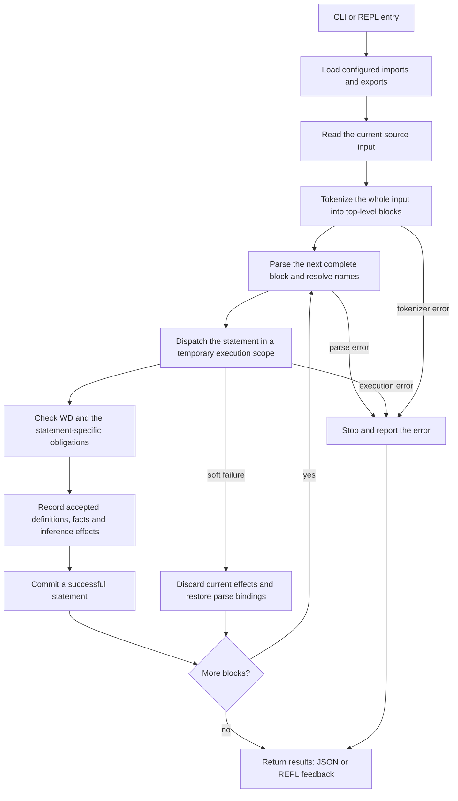

<a id="litex-manual"></a>

# Litex 手册

<a id="manual"></a>

由沈嘉辰创建和维护。

在[在线手册](https://litexlang.com/doc/Manual)中阅读并运行示例。持续维护的 [Markdown 源码](https://github.com/litexlang/golitex/blob/main/docs/Manual.md)是语言指南与详细参考的统一维护位置。

> **Litex 是一个仍处于 beta 阶段的实验性业余项目，使用中可能遇到不完善之处。**

<a id="math-is-code"></a>

## 数学本身就是源码

**Write math, get formalized code: because the math already is.**

写下数学，得到形式化代码：因为写下的数学本身就是代码。

Litex 让数学对象、定义和事实直接成为形式化源码的一部分。在[下方例子](#the-core-reading-model)中，`x + 1 = 3` 既是数学断言，也是提交给系统检查的语句。

数学写作本身就承载着逻辑结构。语句的形式及其上下文确定了讨论中的对象、可用的前提，以及需要得到支持的结论。Litex 的设计，是让这些联系成为可以执行的推理。

作者提供数学想法、条件和有意义的证明步骤。写下一个普通事实，就是请求执行器检查其条件，并从当前数学上下文中寻找依据。作者可以着重思考需要建立哪些事实，系统则恢复支持范围内连接这些事实的推理。通过检查的事实成为后续步骤可用的知识。

[内置验证规则](#builtin-verification-rules)提供可复用的数学推理模式。上下文搜索把目标与已知事实、适用的全称陈述连接起来；[推导规则](#builtin-inference)还会记录已接受事实的受支持直接后果。这些机制共同让数学语句之间的联系参与后续检查，并遵守作用域、适用条件和搜索边界。

这种分工让人和 AI 可以书写数学步骤，无需逐一写出所有形式推导。需要时，作者仍要选择关键中间事实、见证、分情形或归纳。本手册给出明确的语法、受支持的检查和边界。受支持的 Lean 编译，则进一步使用源码和验证证据。

<a id="mathematical-reading"></a>

### 日常数学句子及其形式化职责

Litex 围绕这样一个问题展开：能不能写下数学，直接得到形式化代码？熟悉的数学用语已经说明了讨论哪些对象、可以使用哪些前提，以及需要证明什么。这里对应的是这些数学职责与明确的源码形式。

| 日常数学表达 | 对应的 Litex | 逻辑职责 |
| --- | --- | --- |
| **任取**一个实数 x | **`forall`** `x R:` | 引入局部任意对象及其属于实数的前提。 |
| **假设** x 大于零 | **`=>:`** 之前的 `x > 0` | 把条件作为局部前提，供该范围内的推理使用。 |
| **因此** x 不等于零 | **`=>:`** 之后的 `x != 0` | 从前提检查结论，而不把结论当作假设。 |
| **存在**平方为 4 的实数 w，**取 2 为见证** | **`witness exist`** `w R st {w^2 = 4}` **`from`** `2` | 核对见证属于指定集合，并满足要求的等式。 |
| **由定义**，这个对象具有该性质 | **`by def`** `$is_above_two(3)` | 若该谓词定义为 t > 2，就核对代入后的这个条件。 |

前三行拆解的是下面这条完整语句：

```litex
forall x R:
    x > 0
    =>:
        x != 0
```

后两行分别使用[见证](#s35-existential-witnesses)与[定义](#s47-explicit-definition-folding)接口，并不是接在这条全称语句后的额外步骤。量词和蕴含组织 `Fact`；把事实放在语句位置，则请求验证器建立它。下文每个[语句条目](#statement-dictionary)都先给出醒目的**数学读法**，把源码形式与相应的数学动作联系起来。

数、集合与函数通过原生数学接口直接可用。作者写下 `N`、`R`、`1`、`n + 1` 或函数定义时，不必在每个证明中重新构造这些概念；它们的含义、定义域和检查规则仍有明确约定。Litex 的写作工作流，从这些可使用的数学词汇及语句间的联系出发。

<a id="manual-introduction"></a>

<a id="how-to-use-this-manual"></a>

## 如何使用本手册

阅读开头指南，理解每条语句会提供什么信息。选择数学操作、检查其定义域或寻找下一步显式证明时，使用条目词典。每个条目连接数学含义、条件、执行或验证、可复用事实、示例及其最近的边界。倒数主线说明这些部分为何相互联系：`1 / x` 要求非零性，可调用定义记录这个定义域，而后续乘积恒等式可能需要定义方程作为显式桥接。

|部分|阅读目的|从这里开始|
|---|---|---|
|核心观点|理解作者与执行器的分工|[数学本身就是源码](#math-is-code)|
|设计原则|理解数学对象模型和检查契约|[原理](#design-principles), [核心模型](#the-core-reading-model)|
|系统流水线|跟随源码输入经过完整系统，识别各部分的职责|[流水线与组件图](#system-pipeline)|
|项目组织|选择依赖项/导出并了解名称并加载序|[项目](#project-organization)|
|语法和证明/输出|书写事实，检查 WD，阅读验证结果|[语法](#syntax-reference)、[事实](#factual-statements)、[WD](#well-defined-objects)、[证明/输出](#proof-process)|
|基本证明书写|将数学句子写成恰当的声明、目标、证明块与见证|[基本决定](#basic-decisions-before-writing-a-proof)|
|词典与练习|查询原生契约，选择数学证明表述|[S](#statement-dictionary)、[O](#object-dictionary)、[F/C](#builtin-atomic-fact-dictionary-and-relationships)、[陷阱](#pitfalls-and-missing-proof-steps)、[推荐写法](#recommended-mathematical-formulations)|
|高级接口|深入阅读函数、struct 和 template 契约|[接口详情](#advanced-interface-details)|
|原生规则与推导|查找额外的带保护条件的规律、计算限制和推导触发器|[验证规则](#builtin-verification-rules)、[推导](#builtin-inference)|
|执行和提取|运行算法/eval，了解 Python/C 提取边界|[可执行路径](#execution-and-extraction)|
|兼容性和证据|理解已移除形式、假设和验证记录|[兼容性](#removed-and-renamed-public-forms)、[覆盖范围](#verification-and-coverage)、[附录](#appendix)|
|设计背景和参考|了解设计影响、数学来源和相关工作|[参考文献](#design-context-and-references)|

原生库存有 **52 个公共语句形式、93 个活动对象叶子、20 个内置原子族及其否定形式、两个原生证书谓词**，以及 32 个保留的原生定理接口。稳定的 S/O/F/C 标识符在合并后仍然存在。此清单列出了公共原生语言，而不是每个导入的定理或每个单独的内核重写。

详细语言参考集中在本手册中。S/O/F/C 条目编号用于稳定导航。预期拒绝和迁移示例带有跳过标记，不属于正向可运行示例。`trust` 与公理示例展示普通模式下的假设，不是严格证明；严格模式的拒绝行为单独说明。可运行代码块应独立执行。

<a id="the-core-reading-model"></a>

### 核心阅读模型

从上到下读取 Litex 文件。成功的语句可以引入名称、定义词汇、验证事实，或添加稍后语句可以重用的信息。


```litex
have x R = 2

x + 1 = 3
x^2 = 4
```


第一行引入实数对象 `x` 并记录 `x = 2`。接下来的两行是状态事实。 Litex 从当前上下文中检查它们并存储接受的事实以供以后使用。

对于 `x + 1 = 3`，已知等式 `x = 2` 与计算 `2 + 1 = 3` 提供了依据。作者写出数学步骤，检查器寻找它与已有知识之间受支持的联系。每个被接受的步骤，又能支持后续步骤。

将三种语言类别分开：

|类别|含义|示例|
|---|---|---|
|**对象**|数学值或表达式|`x`、`R`、`C`、`i`、`{1, 2}`、`x + 1`、`fn(t R) R`|
|**事实**|关于对象的一个命题|`x = 2`、`x $in R`、`$prime(n)`|
|**语句**|检查或更改上下文的操作|`have`、裸露事实、`prop`、`claim`、`thm`|

对于实际的语句，面向用户的结果是：

|结果|含义|下一步行动|
|---|---|---|
|Success|Litex找到了验证路线并合并了语句。|当来源很重要时检查 `proof_method`。|
|Failed (软失败)|语句未成功（搜索失败、良定义性、…）；临时环境被丢弃。|添加较小的相等、成员关系、定义域事实或引理；或修复 WD 义务。|
|SessionError|硬故障；会话必须停止。|在继续之前修复不变/错误/不可恢复的条件。|

Batch JSON 将 Success 显示为语句 `"statement_result": "accepted"`，将 Failed 显示为 `statement_results` 内的 `"statement_result": "rejected"`（不是提升的顶级 `verify_error`），将 SessionError 显示为 `"session_terminated": true` 和结构化 `termination`。请参阅 [cli.md](Litex命令行参考.md)。在检查显示的正式代码之前，AI 生成的解释和 Litex 草稿是不可信的。

一个常见的错误是将软失败读为假：


```text
have x R
x = 0
```


第二行通常在搜索阶段失败（`why_failed.phase: search_proof`）。这不证明 `x != 0`。上下文只说明 `x` 是实数。

<a id="reading-path"></a>

### 阅读路径

阅读[设计原则](#design-principles)、[系统流水线](#system-pipeline) 和[项目组织](#project-organization) 以了解系统整体图景。然后使用[语法](#syntax-reference)、[事实语法](#factual-statements)、[WD](#well-defined-objects)和[证明/输出](#proof-process)进行创作。 S/O/F/C 字典和 P/R 条目提供了详细的查找路线。

最后的技术章节继续[高级接口](#advanced-interface-details)、[原生规则](#builtin-verification-rules) 和 [推导](#builtin-inference)，然后是[执行/提取](#execution-and-extraction)。每个深度注释都链接回其字典条目；定义域、事实和作用域在两种视图中具有相同的含义。

[学习者速查表](Litex学习速查表.md) 提供紧凑的学习进展； [示例](../examples/README.md) 提供更长的可运行文件。 [蓝图](Litex中文蓝图.md) 和 [Lean–Litex 比较](Lean与Litex示例对比.md) 涵盖了基本原理和比较。安装和命令标志属于 [CLI 参考](Litex命令行参考.md)。

<a id="supported-syntax-and-recommended-source-style"></a>

### 支持的语法与推荐源码风格

本手册描述了 Litex 接受的内容。对于新的证明和普通教学示例，首选 `release thm name(args)`（不带选择的调用）、多行 `forall`、英语/ASCII 关键字和运算符。裸 `by thm`、内联全称事实和记录的 Unicode 别名仍然受支持。选择原子时保留 `by thm name(args) => fact` 后果；它的上下文效果与全结论释放不同。有关示例和原因，请参阅[学习者推荐表](Litex学习速查表.md#supported-syntax-and-recommended-writing)。这些源码-风格首选项不会强加解析器限制。

<a id="language-foundations"></a>

<a id="design-principles"></a>

## 设计原则

<a id="pure-set-object-model"></a>

### 纯集合对象模型

Litex 使用数学对象的一个域，并选择纯集合基础：每个良定义 Litex 对象满足 `$is_set`。因此，数字、函数值、用户定义的集合、函数空间以及`N`、`Z`、`Q`、`R`和`C`中的每一个都是对象。它们保留不同的数学接口，但它们不是不同的 runtime 载体类型。

成员关系是两个对象之间的事实。例如，`1`、`N` 和 `R` 为对象； `1 $in N` 和 `1 $in R` 是关于相同 `1` 的单独事实。同样，`forall x R` 引入了对象 `x` 以及事实 `x $in R`；它不会将 `x` 重新键入为主机语言实数数。函数空间`fn(x R) R`和属于它的函数也是对象，而函数空间成员关系记录了可调用的契约。

这是在Tao 的*分析I* 中描述的纯/不纯区别中Litex 的显式选择：本书对于原始对象本身是否是集合保持不可知，而Litex 采用纯解释。该选择是基础性的而不是符号性的。表面概念仍然保留其普通角色：算术上使用数，应用函数，并通过成员关系检查集合。集合相等是外延的：`by extension` 从两个成员关系方向证明了相等。在纯模型中，这是常见的对象相等原理，而不是针对主机语言 `Set` 类型的单独相等。

对象 Universe 不是内部全称集合。 `Object` 是用于实现该语言的元级载体，而不是可以写在 `$in` 任一侧的对象。 Litex 也不提供无限制的理解。集合构造式在已有的 `S` 上具有有界形式 `{x S: facts}`；替换和其他部分构造器有自己的良定义性义务。这些限制将“每个对象都是集合编码”与不一致的 claim 区分开来，即每个谓词都定义了所有对象的集合。


<a id="meaning-evidence-and-context"></a>

### 含义、证据与上下文

对象、事实和语句各自承担的职责见[核心阅读模型](#the-core-reading-model)。验证真值之前，良定义性检查会确认对象和谓词应用是否满足定义域条件。语句成功后，建立的事实可在所在作用域内供后续证明使用；[内置推导](#builtin-inference)还会记录相应的直接推论。

命名、运算符优先级、分隔符和 Unicode 写法见[语法规则](#syntax-reference)。成功检查所依赖的假设见[信任边界](#trust-boundary)。

<a id="system-pipeline"></a>

## 系统流水线

本章讲述当前的源码输入从发布到可见的结果。项目挂载提供其定义和名称；源码运行器处理分词和语句序；每个语句处理程序都会检查自己的数学义务并提交接受的信息。 [证明流程](#proof-process) 放大了这个更大流程内的验证。

<a id="from-input-to-results"></a>

### 从输入到结果





分词步骤在执行任何语句之前在整个当前输入上运行。之后，解析和执行交替**一次一个完整的顶级块**。定理、claim 或草图在该块中包含其整个嵌套的证明；解析不会执行未完成的证明。当后面的块软失败时，前面成功的块仍然可用。

WD 和真值验证是不同的义务。事实断言在存储之前会验证其事实。定义检查其构造契约；证明指令运行其作用域证明路线； `eval` 检查其计算结果，结果相等。普通模式 `trust` 检查 WD，同时明确假设真值，并且严格模式拒绝用户假设形式。该图对这些特定于处理程序的检查进行了分组，但没有声明它们都使用一个验证器。

**源码:** [源码运行器](../src/run/run_litex_code.rs), [语句交易和调度](../src/execute/exec_stmt.rs), [事实验证 →存储/推断](../src/execute/execute_fact_stmt/exec_fact_stmt.rs)。

<a id="what-each-part-owns"></a>

### 各部分的职责

|部分|责任|输入 → 结果|实施|
|---|---|---|---|
|启动并运行|选择文件/项目/源码/REPL、严格策略和输出语言；路由到相应的运行器|命令参数 → 选择运行|[启动](../src/launch_command.rs)，[运行](../src/run/README.md)|
|项目加载|读取 `litex.config`，在序中运行导入和选定的导出，并记录完成的文件环境|清单和文件 → 已挂载项目上下文|[运行模块](../src/run_module/README.md)|
|模块和名称管理|跟踪模块/文件所有者并根据加载的导出解析限定名称|别名/导出/名称 → 其所有者限定身份|[模块管理器](../src/module_manager/README.md)|
|分词|识别 token、注释、别名、缩进和完整的源码块|源码文本 → token 块或分词器错误|[分词](../src/tokenize/mod.rs)|
|解析和 AST|构建 Stmt/Obj/事实形状，附加绑定变量身份并解析源码名称|一个完整的块 → 结构化语句或解析错误|[解析器条目](../src/parse/parse.rs), [AST](../src/ast/mod.rs)|
|Runtime 和执行环境|自己的活动上下文、名称可见性和范围内的语句执行；提交成功的效果|现有上下文 + 语句 → success、软失败或硬错误|[Runtime](../src/runtime/mod.rs)、[ExecEnv](../src/exec_env/mod.rs)、[exec_stmt](../src/execute/exec_stmt.rs)|
|良定义性|检查子对象、声明/签名可见性、载体和部分操作保护条件|对象/事实 + 上下文 → 定义域证据或 WD 故障|[对象 WD](../src/execute/execute_fact_stmt/well_defined_results/verify_obj/mod.rs)、[原子 WD](../src/execute/execute_fact_stmt/verify_atomic_fact/verify_well_defined.rs)|
|事实验证和证明处理程序|重复使用已知的事实和允许的计算/规则/定义/全称事实；检查显式证明路线|目标 + 可用证据 → 带类型的验证结果|[事实检查](../src/execute/execute_fact_stmt/README.md)、[证明语句](../src/execute/execute_by_stmt/mod.rs)|
|实例化|将实际参数替换为定义域、主体和事实，同时保留绑定身份并检查调用者的义务|参数化接口 + 参数 → 实例化接口|[实例](../src/instantiate/mod.rs)|
|精确数学计算|向检查和评估路径提供有界精确数值/代数计算|支持表达式 → 精确值/正常形式或拒绝的计算|[理性表达式](../src/rational_expression/mod.rs)|
|存储和推导|索引接受种子，在当前作用域中分配/引用事实和发布支持的例程后果|接受事实 → 存储事实和推导效果|[存储事实和推断](../src/store_fact_and_infer/README.md)|
|显示屏和结果投影|渲染语句并将现有结果/证据树投影到本地化输出中；投影不添加证明|结构化语句/结果 → 可读表示和 JSON|[显示与 IR](../src/display_and_ir/README.md)、[json_输出](../src/json_output/README.md)|
|导入知识库缓存|在策略允许的情况下重用已完成的依赖项保存的知识；严格进口重放源码|依赖关系记录 → 缓存上下文或冷执行|[知识库](../src/knowledge_base/README.md)、[严格缓存策略](../src/run_module/import_kb.rs)|
|可选的可执行文件提取|选择标记为源码，验证该虚拟程序，然后将支持的可执行文件子集降低为 Python 或 C|选定的选中程序 → 可执行代码产物|[提取可执行文件代码](../src/extract_executable_code/README.md)|

实例化、精确的计算、存储和名称解析是在适当的点上使用的共享服务，而不是对每个语句进行无条件额外传递。冷项目导入重新输入相同的源码和语句检查依赖项文件的路径。符合条件的缓存命中可恢复完整的依赖关系知识；严格导入采用源码路径。导入的文件环境保留其所有者；它们没有被扁平化为一个外围事实集合。当前活动的 Rust 模块列在 [src/lib.rs](../src/lib.rs) 中。

<a id="one-statement-leaves-evidence-for-the-next"></a>

### 每条语句为后续留下证据


```litex
have n N
0 <= n
n + 0 = n
```


解析器引入了声明的名称。执行检查 `N` 是否是可用的非空载体、存储 `n $in N`、推导发布和非负界。第二行显示已知的后果。第三行检查添加的对象定义域并通过普通相等路由验证相等。每个成功的语句在解析下一个块之前都会提交。 [F01](#f01-membership-and-nonmembership) 拥有成员关系契约，[S04](#s04-arbitrary-members) 拥有任意-成员介绍。

**预期为软失败 — 第三个语句错过了 `search_proof`；第四个仍然成功：**

<!-- litex:skip-test -->

```litex
have n N
0 <= n
n = 0
n + 0 = n
```


聚合运行报告失败，因为其中一个语句 failed；此时 `session_terminated: false` 且 `termination: null`，并且已接受的语句仍会记录。 failed 相等不是 `n != 0` 的证明。 failed 声明同样恢复其推测解析绑定，因此它不能占用下一个块的名称。全局标识符计数器不会回滚或重复使用。

<a id="project-loading-proof-checking-and-executable-output"></a>

### 项目加载、证明检查与可执行输出

接下来阅读[项目组织](#project-organization)，了解选择哪些源以及如何提供它们的名称。阅读 [证明过程](#proof-process)，其中证据可以证明目标是合理的。最后，[执行和提取](#execution-and-extraction) 解释了检查的算法如何成为计算或目标程序。这些章节描述了该流水线的连接部分，具有单独的职责和检查的边界。

<a id="project-workflows"></a>

<a id="project-organization"></a>

## 项目组织

<a id="modules-and-manifests-preview"></a>

### 模块与清单（预览）

> **项目模块：** 没有 `submodule` 和 `[hierarchy]`。 维护的包是单个模块。 `[export]` 仅列出 `.lit` 文件； `[import]` 和 `[import std]` 在每个清单中共享一个别名命名空间。 - 表/解析/`::` 详细说明：> [`src/module_manager/README.md`](../src/module_manager/README.md) - 如何 `-r` / `-f` / `-e` / REPL 挂载并运行：> [`src/run/README.md`](../src/run/README.md) - 灯具：> [`examples/module_manager/`](../examples/module_manager/)

维护的项目目录有一个 `litex.config`。


```ini
[import]
Algebra = "../Algebra"

[import std]
basics # Alternatively: basics = basics (choose one spelling, not both)

[export]
chap1 = "./chapter01.lit"
chap2 = "./chapter02.lit"
chap3 = "./chapter03.lit"
```


在 Litex CLI 下：

|命令|配置|行为|
|---------|--------|----------|
|`-r <dir>`|要求 `<dir>` 中存在配置|全部导入，然后全部导出|
|`-f <file>`|可选 `parent(file)`|通过文件列出了 → 前缀；未列出的 → 完整挂载然后文件；缺少隔离的 →|
|`-e` / 裸 REPL|在 cwd 处可选|满挂载 （或空），然后 eval / REPL|

挂载软 Failed 变为会话 `FailToImport`。 `-f` **目标** 上的软 Failed 本身仍然是正常文件故障。

重要规则：

1. `[export]` 是有序，每个条目命名一个 `.lit` 文件。不允许导出子目录或嵌套配置节点。
2. `[export]` 是显式选择列表，而不是完整的目录清单。未列出的文件和文件夹是 sidecar：发现不会在模块命名空间中解析、执行或公开它们。每个声明的导出路径必须为 exist 和点到 `.lit` 文件。
3. `[import] Alias = path` 挂载另一个模块目录。    `[import std]` 接受裸名称 `N`（表示 `N = N`）或 `Alias = StdName`； `Alias` 下均为挂载 `<std_root>/<StdName>`。解析后`[import]`和`[import std]`是同一种导入。来自两个部分的导入别名在该 `litex.config` 中必须是唯一的；单独的包可以为其自己的路径重用别名。导出名称可以重复使用导入拼写。`a::b` 引用当前导出，或使用显式配置的命名空间别名；`a::b::c` 引用真实的导入与导出路径。
4. 规范名称遵循挂载别名和导出名称，例如 `Algebra::chap1::name` 或 `basics::main::name`。

**预览：显式命名空间别名。** 在当前包的配置中声明：

```ini
[alias]
C = Lib::facts
```

`C::v` 与 `Lib::facts::v` 解析到同一声明，适用于对象、函数、命题、定理、template 和 struct 载体。目标必须是真实导入及其真实导出；重复别名、与本地导出重名、目标不存在和别名串联均被拒绝。别名可以与导入同名，只在当前包内生效，不构成新的导出。增加其他导出不影响这条映射。单独的 `C` 仍是普通未限定名称。`:::` 已移除，请使用完整路径或配置显式别名。见[可运行验收项目](../examples/module_manager/namespace_aliases/README.md)。

struct 载体接受以下相同路径：`&local::Pair`、`&Lib::facts::Tagged<R>`，以及配置别名后的 `&C::Tagged<R>`。为字段类型、函数返回和嵌套 struct 字段保留完整的定义所有者。缺少路径、错误参数以及所选载体之外的元组是被拒绝。请参阅可运行的 [合格的 struct 夹具](../examples/module_manager/qualified_struct_views/README.md)。

跨模块引用始终使用规范限定名称。模块别名和符号是分开的，因此局部符号也可能是命名 `A`；字段选择（例如 `obj.b`）保留在字段命名空间中。导出在加载期间不可用，因此较早的文件无法引用较晚的导出。

使用导入包的清单解析导入别名，然后规范化目录路径选择全局模块 ID。例如，两个包可能各自声明 `Common = "./dep"` 并引用不同的依赖项目录。不同别名下的相同路径导入共享一个模块。当局部别名重复时，加载程序会分配不同的全局显示标签；这些标签不会更改源码名称解析。请参阅可运行的[跨文件身份固定装置](../examples/module_manager/cross_file_identity/README.md)。

项目依赖项来自 `litex.config` (`[import]` / `[import std]`)，而不是来自源码级 `import` 语句。每个 `.lit` 文件拒绝 `import`；可重现的依赖关系属于清单。交互式 REPL 仅运行 Litex 源码块；它没有添加单独的终端 `import` 命令界面。


```ini
[hierarchy]
module
```


```ini
[hierarchy]
submodule
```


```ini
[export]
Part2 = "./Part2"
```


```ini
[import]
basics = "../OtherBasics"

[import std]
basics = basics
```


这些清单在当前模块设计下无效：`[hierarchy]` 和 `submodule` 已删除，`[export]` 无法命名文件夹，导入别名在 `[import]` 和 `[import std]` 中必须是唯一的。

项目执行、持久会话和输出是 CLI 契约而不是语言语法。有关安装、项目运行示例和当前命令集合，请参阅 [CLI 参考](Litex命令行参考.md)。

<a id="syntax-reference"></a>

## 语法参考

<a id="binder-syntax"></a>

### 绑定变量语法

|含义|形式|规范节|
|---|---|---|
|对象中的集合|`x S`|[裸机事实和 `have`](#bare-facts-and-have)|
|集合参数|`S set`|[裸机事实和 `have`](#bare-facts-and-have)|
|非空集合参数|`S nonempty_set`|[裸机事实和 `have`](#bare-facts-and-have)|
|有限集参数|`S finite_set`|[裸机事实和 `have`](#bare-facts-and-have)|
|一个中包含多个名称定义域|`x, y R`|[全称事实](#universal-facts)|
|定义域条件|`x R: x != 0`|[定义域义务](#domain-obligations)|
|参数化定义|`template<S set, x S>:`|[模板](#templates)|
|共享全称假设|显式带类型的参数和缩进的前提块； `setting` 不受支持|[共享假设](#shared-assumptions-and-inline-universals)|
|struct 参数|`struct Group<S nonempty_set>:`|[struct 对象](#struct-objects-and-definition-owned-field-access)|

<a id="syntax-lookup"></a>

### 语法查询

|正在写入的内容|规范索引|
|---|---|
|对象/表达式|[完整 O 索引](#object-dictionary)|
|原子关系或谓词|[完整 F 索引](#builtin-atomic-fact-dictionary-and-relationships)|
|化合物或定量事实|[事实-形状摘要](#fact-shape-summary)|
|定义或证明操作|[完整 S 索引](#statement-dictionary)|
|保留内置定理|[原生定理索引](#reserved-builtin-theorem-interfaces)|
|删除了旧拼写|[兼容性表](#removed-and-renamed-public-forms)|


<a id="names-numbers-and-arithmetic"></a>

### 名称、数值与算术

名称是指内置对象、早期的定义、局部绑定变量或模块限定的定义。算术使用普通优先级：括号、调用和索引紧密结合，然后是幂、前缀 `-`、乘法和除法，然后是加法和减法。幂关联到右侧。

因此，解析器将 `-t^2` 读取为 `-(t^2)`，而不是 `(-t)^2`。这种兼容性规则并不能使裸露的拼写规范创作：它仍然让读者回忆起优先级选择。书写 `-(t^2)`（等效于 `-1 * (t^2)`）表示平方的相反值，书写 `(-t)^2` 表示负值的平方。也将负指数括起来：`t^(-1)`，而不是 `t^-1`。此显式-括号规则适用于生成的和代理创作的 Litex 以及手写的源码。

前缀 `-a` 是一元算术运算符 `neg(a)` (AST `Neg`)，与二进制差异 `0 - a` 不是同一棵树。闭合数值评估同时处理两者。不要认为 `-a` 和 `0 - a` 是相同的 AST。

用户定义的名称可以以字母或一个下划线开头，然后可以使用字母、数和下划线。前缀 `__`（两个下划线）是为生成的符号保留的，包括 Lean 输出中的名称，在分词中为被拒绝。以一个下划线开头的名称仍然是普通用户空间，`h_` 和 `fn_` 等前缀也是如此。注释和引用的字符串不是符号 token，并且可能包含保留的拼写。

内置对象拼写也保留在声明站点：字面量 `i`、`e`、`pi`、标准集合，例如 `N`、 `R`、`C` 和对象构造器/函数名称（例如 `sin`、`sqrt`、`fn`、`sum` 和 `cart`）不能是用户定义、参数、字段、索引或见证。它们的使用被解析为标识符查找之前的内置函数。使用新名称，例如 `t`、`epsilon` 或 `pi_value`；被拒绝声明不会保留其尝试的名称界。

<a id="compact-numeric-set-suffixes"></a>

### 紧凑数集后缀

后缀必须与其基数相邻。这些紧凑型形式是规范；验证者打印相同的拼写。

符号是严格：`+` 表示大于零，`-` 表示小于零，`*` 表示非零。 `N*` 不是标准拼写；使用 `N+` 代替非零自然色。

<a id="operator-and-delimiter-notes"></a>

### 运算符与分隔符说明

- 从紧到松的算术绑定是：调用/索引、右关联 `^`、前缀 `-`、乘法运算符，然后是二进制 `+` 和 `-`。因此，解析器将 `-t^2` 读取为 `-(t^2)`，而将 `-t * u` 分组为 `(-t) * u`。
- 在前缀 `-`/幂边界处，始终明确状态预期树：`-(t^2)` 或 `-1 * (t^2)` 否定幂、`(-t)^2` 幂负底数，`t^(-1)` 使用负指数。请勿创作 `-t^2` 或 `t^-1`。
- 函数和坐标应用程序使用 `()`。删除括号索引；请参阅[兼容性](#removed-and-renamed-public-forms)。
- `{a, b}` 是显示的集合； `{x S: facts}` 是集合理解式。
- `st { ... }` 界定存在主体。其条目是原子事实或其支持的布尔组合（`and` / chain / `or`）；在使用之前，将量化的条件命名为 `prop`。以这种方式限制主体可以使 exist 索引键易于为已知的事实搜索进行设计。同样的限制也适用于集合构造式。
- `#` 在内联旁白之外开始行注释。该评论中的引用无需平衡。尾随注释保留块头的冒号。缩进定义块结构。
- 内联旁注 `"..."`（ASCII 引号，单行）在分词时间被剥离，而不是 AST 的部分。未关闭的 `"..."` 是一个解析错误。
- 块注释：trim 打开或关闭多行注释后正好是 `"""` 的行。仅 ASCII `"""` 有效；单独使用 `"`、`""` 或 `""""` 则不会。未关闭的 `"""..."""` 是一个解析错误。与 `#` 和内联 `"..."` 不同。
- 行延续（预览）：代码区域以 `\\` 结尾的行将下一个物理行连接到同一逻辑行中。允许使用可选的尾随空格和 `\\` 后面的 `# ...` 注释，并随标记一起删除（因此不会注释掉后续行）。连续行上的前导空格是普通的空格。中线 `\\` 不是延续，与 template 前缀 `\` 无关。后面没有后续行的 `\\` 是一个解析错误。
- 括号序列字面量、矩阵载体和撇号矩阵运算符被移除；将函数与显式索引集合结合使用。

<a id="unicode-mathematical-input-aliases-preview"></a>

### Unicode 数学输入别名（预览）

Litex 接受以下 Unicode 数学输入。简单别名在分词期间被规范化；中缀集合形式被解析器降低到现有的集合-对象和事实节点。存储的事实、诊断和验证器语义继续使用规范 ASCII Litex 语法。

对于新的证明和普通文档示例，请首选下面的英语/ASCII 列。仍然支持 Unicode 输入；当示例教授符号别名或作者要求风格时，请有意使用它。

|统一码输入|规范 Litex 语法|
|---|---|
|`∀`、`∃`、`∃!`|`forall`、`exist`、`exist!`|
|`≤`、`≥`、`≠`|`<=`、`>=`、`!=`|
|`→`、`↔`|`=>`, `<=>`|
|`∧`、`∨`、`¬`|`and`、`or`、`not`|
|`∈`|`$in`|
|`∉`|`not ... $in ...`|
|`⊆`, `⊇`|`$subset`、`$superset`|
|`⊂`、`⊊`、`⊋`|`$proper_subset`、`$proper_subset`、`$proper_superset`|
|`A ∪ B`, `A ∩ B`|`union(A, B)`, `intersect(A, B)`|
|`A × B`|`cart(A, B)`|
|`ℕ`、`ℤ`、`ℚ`、`ℝ`、`ℂ`|`N`、`Z`、`Q`、`R`、`C`|
|`ℕ+`、`ℤ+`、`ℚ+`、`ℝ+`|`N+`、`Z+`、`Q+`、`R+`|
|`ℤ-`、`ℚ-`、`ℝ-`|`Z-`、`Q-`、`R-`|
|`ℤ*`、`ℚ*`、`ℝ*`、`ℂ*`|`Z*`、`Q*`、`R*`、`C*`|
|`π`、`∅`|`pi`、`{}`|

例如，全称事实与其 ASCII 拼写相同：


```litex
∀ x ℝ:
    x ≠ 0
    →:
        x ∈ ℂ
        x ≤ x ∧ x ≥ x
```


别名仅被识别为完整的 token，并且不会在引用的模块路径内重写。 `⊂` 特意表示严格/真子集，与 `⊊` 相同；非严格子集仍为 `⊆`。 Unicode 紧凑数值集合完全镜像现有的 ASCII 关键字族，因此 `ℕ*` 仍然不受支持，就像不支持 `N*` 一样。

`∃!` 与 `exist!` 的现有唯一存在语义完全相同。特别是，`witness ∃! ...` 必须证明所提供的见证满足主体，并且满足主体的任意两个见证是相等的。

中缀优先级从低到高依次为 `∪`、`∩`、`×`，然后是现有算术对象运算符。并集和交集关联到左侧。 direct 乘积链被展平，因此 `A × B × C` 变为 `cart(A, B, C)`；括号可以请求嵌套。 `×` 绝不意味着数值乘法：`2 × 3` 被解析为 `cart(2, 3)`，并且是被拒绝，因为因子不是集合。书写 `2 * 3` 用于算术乘法。单词形式仍然是构造器调用，例如 `union(A, B)`；此预览版不添加 `A union B`。

<a id="absolute-value-bars-preview"></a>

### 绝对值竖线（预览）

在普通数学示例和展示中更喜欢 `|expr|`。在解释函数拼写或规范输出时使用 `abs(expr)`。

`|expr|` 是现有实数 `abs(expr)` 对象的另一个输入拼写。所附表达式作为一个整体进行分组；普通运算符和后缀适用于其外部。 `abs(...)` 仍然受支持，并且存储的事实和诊断保留规范 `abs(...)` 拼写。


```litex
|-3| = abs(-3) = 3
|1 - 4|^2 = 9
forall x, y R:
    |x + y| <= |x| + |y|
```


竖线可以嵌套：`||x||` 表示 `abs(abs(x))`。两个分隔符都是必需的，空的竖线是被拒绝。乘法保留为显式 (`2 * |x|`)。定义域仍为实数：`|i|` 和 `|{1, 2}|` 为被拒绝，复数模仍写为 `C_abs(i)` 和有限基数 `finite_set_size({1, 2})`。这些竖线没有引入规范。请参阅维护的[绝对值竖线跟踪器](../examples/test_objs/absolute_value_bars.lit)。

---

<a id="factual-statements"></a>

## 事实语句

A **事实** 是一个 Litex 可以尝试验证的命题。顶级接受的事实存储在当前上下文中；嵌套在量词或证明块内的事实位于形式的作用域之后。

<a id="atomic-facts"></a>

### 原子事实

原子事实将内置关系或声明的谓词应用于对象。 [F 字典](#builtin-atomic-fact-dictionary-and-relationships) 拥有它们的含义、定义域、否定形式和关系。单独的表达式（例如 `2 + 3`）不是事实；书写 `2 + 3 = 5` 或使用 [eval](#s51-exact-evaluation)。


<a id="conjunctions-chains-and-disjunctions"></a>

### 合取、链与析取

对于一条线上的合取使用 `and`，对于一条链使用相邻的二进制关系，对于替代方案使用 `or`。


```litex
1 < 2 and 2 < 3
1 <= 2 = 2 < 3
1 < 2 or 1 >= 2
```


对于相等链，Litex 检查每个相邻的相等，然后通过传递性存储非相邻的等式。例如，该链存储 `y = 3`，下一个语句可以使用它：


```litex
have x R = 2
have y R = x + 1
y = x + 1 = 3
y^2 = 9
```


定义步骤和计算步骤是显式。自动定义扩展不会在其剩余目标中启用重写。 failed 链不会提交其端点相等。

事实语法具有特意的规范层次结构，而不是任意递归嵌套。合取是原子事实的平面列表。一条析取为外层，其每条分支为一条原子事实、一条关系链、或一条扁平合取。在普通运算符项中，`and` 比 `or` 结合更紧密。该解析器优先级也是验证器在匹配已知和目标析取时可以将 `or` 分支视为形状的小型固定集合的原因。

例如：


```text
$p(a) and $q(a) or $t(a)
```


有两个 `or` 分支：`($p(a) and $q(a))` 和 `$t(a)`。它不读取为 `$p(a) and ($q(a) or $t(a))`。允许 `or` 分支成为完整的合取保留了这个固定的层次结构；它不会使 `and` 或 `or` 任意嵌套。

验证 `or` 证明至少有一个分支成立；它不会添加任意分支作为已知的事实。

经过验证的合取或关系链可以引入析取，即使其其他分支是复合的。 Litex 检查所选的分支并保留该证明；它并不假设化合物分支为真。


```text
have x R
x = 0 or x != 0
x = 0
```


析取是正确的，但最后一行仍然出现软故障。

<a id="existential-facts"></a>

### 存在事实

`exist` 状态存在，`exist!` 状态唯一存在，`not exist` 状态不存在。见证变量是局部到事实。

用作完整事实的存在必须消耗其整个产品线，包括内部 `forall` 结论和 `prop` 定义。诸如 `exist y R st {y = x} and 0 = 1` 之类的后缀是解析错误；它永远不会被丢弃。将额外的条件放入 `st { ... }` 内，或在下一行将书写放入单独的事实中。在存在之后，封闭的 `witness exist ... from ...` 形式仍然消耗其自己的 `from` 条款。


```litex
witness exist x R st {x^2 = 4} from 2:
    2^2 = 4

witness exist! x R st {x = 0} from 0

by contra:
    ? not exist x R st {x != x}
    obtain x from exist x R st {x != x}
    impossible x != x
```


知道存在不会将其界名称放在外部上下文中：


```text
exist x R st {x = 1}
x = 1
```


第二行是 `error`，因为存在 `x` 超出了作用域。使用 `obtain` 引入新的见证名称。

存在主体可能包含原子事实、合取、链条和析取。它们不包含匿名 `forall` 事实。将量化的条件放入命名 `prop` 中并以原子方式引用它。大括号分隔主体：


```litex
prop universally_self_equal(x R):
    forall y R:
        x = x

forall:
    exist x R st {$universally_self_equal(x)}
    =>:
        exist x R st {$universally_self_equal(x)}
```


<a id="universal-facts"></a>

### 全称事实

`forall` 引入了任意参数、可选假设和结论。如果没有假设，则直接使用书写结论，而不是空的 `=>:` 块。允许使用无参数 `forall:`：它不绑定任何名称，仅打包主体事实（可用作裸 `? forall:` 定理目标）。


```litex
forall x R:
    0 <= x^2

forall x R:
    x = 2
    =>:
        x + 1 = 3

forall:
    1 + 1 = 2
```


全称超过字面量空显示可以通过有限枚举进行检查：


```litex
by enumerate finite_set:
    ? forall x {}:
        x != x
    x != x
```


该枚举使用字面量 `{}`。即使在证明该范围等于 `{}` 之后，它也不会通过 `range(3, 3)` 放电相应的目标。以下是已知的软失败：


```text
forall index range(3, 3):
    index != index
```


`forall` 的结论本身不能是另一个 `forall`。将每个量化的参数放入同一标头中。下面的嵌套拼写是解析 `error`：


```text
forall x R:
    x > 0
    =>:
        forall y R:
            y > 0
            =>:
                x + y > 0
```


书写改为扁平事实：


```litex
forall x, y R:
    x > 0
    y > 0
    =>:
        x + y > 0
```


A 全称事实可能仍然是 `=>:` 之前的显式前提。该前提是外部作用域中假定的事实，而不是全称结论。同样，不允许使用 `not forall` 事实作为 direct 全称结论；在使用该量化命题之前先命名该命题。

假设是局部；它不会成为全局事实：


```text
forall x R:
    x = 2
    =>:
        x + 1 = 3

x = 2
```


最后一行是 `error`，因为界 `x` 不再存在。

<a id="shared-assumptions-and-inline-universals"></a>

#### 共享假设与行内全称陈述

当前解析器拒绝 `setting` 并且不会扩展 `forall [Name]` 捆绑包。书写、参数和假设直接位于每个全称中：


```litex
forall X nonempty_set, x, y X, z X:
    x = y
    =>:
        z = z
```


不含前提的全称可以使用 `forall x R => x = x`。当前解析器还支持由外部箭头分隔的单行前提和结论：


```litex
forall x R: x > 0 => x != 0
```


更喜欢新编写的证明中的缩进块，因此前提和结论易于检查和扩展：


```litex
forall x R:
    x > 0
    =>:
        x != 0
```


存在和集合构造式性质主体不允许嵌套 `forall`；将量化后的条件命名为 `prop`，并使用其原子 `$P(...)` 事实。

<a id="universal-equivalence-and-negated-universals"></a>

### 全称等价与否定全称陈述

`forall ... <=>:` 存储等价关系的两个方向。即使没有共享假设，左侧也在 `=>:` 之后引入。

两个生成的全称方向分别检查良定义性。每次检查都有共享假设和自身前件，但不能借用另一侧的附加条件。使两个方向都有意义所需的附加条件，应在 `=>:` 前作为共享假设给出。


```litex
forall x, y R:
    =>:
        x = y
    <=>:
        y = x
```


`not forall` 否定全称 claim。其定义域和结论仅限于无量词形状 (原子 / `and` / chain / `or`) — 与 `exist … st {…}` 主体内部允许的形状相同。证明并存储两者都简化为 De Morgan 反例 exist `exist binders st { dom…, not(then)… }`（`not forall` 事实本身仍记录在 `facts_by_id` 中；搜索重用 `known_exist`）。 `not forall` 内嵌套 `exist` 或 `forall` 是解析错误；将此类内容命名为 `prop`。

**检查示例。**


```litex
by contra:
    ? not forall x R:
        x > 0
    impossible 0 > 0
```


不要将 `not forall` 替换为块上不受支持的前缀：


```text
not:
    forall x R:
        x > 0
```


这是一个解析 `error`；书写 `not forall ...` 位于一个标头上。

<a id="fact-syntax-index"></a>

<a id="fact-shape-summary"></a>

### 事实形状摘要

|形状|语法|
|---|---|
|原子|`a = b`、`a $in A`、`$P(a)`|
|扁平合取|`atomic and atomic`|
|链条|`a <= b = c < d`|
|外层析取|`(atomic, chain, or flat-conjunction branch) or branch`|
|存在|`exist params st {facts}`|
|独特的存在|`exist! params st {facts}`|
|不存在|`not exist params st {facts}`|
|全称含义|`forall params: assumptions =>: conclusions`|
|全称等价|`forall params: =>: left <=>: right`|
|内联全称|`forall params: assumption => conclusion`|
|否定的全称|`not forall params: facts`|
|内联否定的全称|`not forall params: assumption => conclusion`|

---

<a id="well-defined-objects"></a>

## 良定义对象

在 Litex 尝试证明事实之前，它会检查事实中的每个对象在当前上下文中是否有意义。良定义性故障是 `error`，而不是软缺失定理标签。

<a id="domain-obligations"></a>

### 定义域义务

普通 `prop` 和 `abstract_prop` 事实必须引用在点处可见的声明，在该处检查其良定义性，并使用声明的数参数。限定谓词名称在该模块和文件中使用声明。 claim 的证明主体中稍后的声明无法将较早未定义的目标变成良定义。这也适用于否定的谓词事实和用作量化假设的事实。

函数定义在参数类型下进行检查，定义域事实写入其签名中。


```litex
have fn reciprocal(x R: x != 0) R = 1 / x
have fn root(x R: 0 <= x) R = sqrt(x)

reciprocal(2) = 1 / 2
sqrt(4) = 2
root(4) = 2
```


当其义务不存在时，相同的表达式会失败：


```text
have x R
1 / x = 1
sqrt(x) = 0
```


两条事实线均产生 `error`：第一条线缺少 `x != 0`；第二个缺少 `0 <= x`。

<a id="ordered-assumptions-during-well-definedness"></a>

### 良定义性检查中的有序假设

`forall` 中的前提和 `exist` 主体中的事实在其临时绑定变量作用域中从左到右进行检查。在已知一个事实为良定义后，Litex 将其记录为假设并运行其声音推导。因此，正具体谓词可能会暴露其定义，包括后来的对象义务所需的全称条款。

在独立 WD 检查期间，相同的排序适用于 `not forall` 和 `forall … <=>:` 的定义域，包括定义主体和 claim 目标。已检查的定义域（例如 `y != 0`）可以是保护条件或更高版本的 `1 / y`。对于iff，只有常见的定义域保护条件和分支；一个分支上的条件不能证明另一台分支上的对象是合理的。这些局部假设不能证明量化的事实或逃脱其绑定变量作用域。请参阅[可执行的带保护条件的-量词示例](../examples/wd/fact/guarded_quantifier_domains.lit)。

**检查示例。**


```litex
prop nonzero_on(E power_set(R), g fn(x E) R):
    forall x E:
        g(x) != 0

forall E power_set(R), f, g fn(x E) R:
    $nonzero_on(E, g)
    =>:
        fn(x E) R {f(x) / g(x)} $in fn(x E) R
```


这里检查的谓词前提公开了 `forall x E: g(x) != 0`，因此匿名函数主体在整个 `E` 中都是有意义的。这是有范围的定义使用，而不是无限制的证明搜索：递归保护条件仍然适用，`abstract_prop` 没有主体可以公开，省略谓词前提仍然留下除法不良定义。临时假设和推导出的事实不会逃脱量化或存在检查。

`struct` `<=>:` 块中的等效事实也在临时字段作用域中从左到右进行检查。在检查下一个事实之前，每个成功的事实都会在没有定义推导的情况下上演。这使得过滤器保护条件可以证明稍后的部分表达式，无论是在定义 struct 时还是在检查实例化的 struct 载体时：

**检查示例。**


```litex
struct NonzeroPair:
    value R
    tag N
    <=>:
        value != 0
        1 / value = 1 / value
```


源码顺序很重要：省略 `value != 0`，或将其放在倒数之后，留下倒数不良定义。这些临时过滤器事实不会逃避 struct 检查，并且不能仅通过出现在定义中来证明。

<a id="main-object-criteria"></a>

<a id="where-to-find-object-obligations"></a>

### 查找对象义务

每个[O 条目](#object-dictionary) 都拥有其精确的定义域和普通的原生性质。例如，[O01](#o01-division) 检查分母保护条件； [O79](#o79-function-spaces)检查完整修复的签名； [O92](#o92-definition-owned-field-access) 将字段 WD 与发布的 struct 性质区分开来。 [S04](#s04-arbitrary-members) 和 [P06](#p06-arbitrary-have-needs-nonemptiness) 解释为什么引入任意成员需要非空性。这些条件在真值搜索之前检查。

<a id="proof-process"></a>

## 证明过程

证明进程回答了一个问题：为什么可以将当前的语句添加到已验证的上下文中？检查器跟踪一小段集合路由，并报告成功的路由或 failed 的点。

`claim`、`sketch`、`strategy`，以及外延、枚举、范围证明和归纳的块形式，都要求非空的证明过程。`?` 目标不是证明步骤；只有目标或注释会产生解析错误。每个 `case` 分支，以及明确写出的归纳基础和后继步骤正文，也都必须非空。`impossible fact` 本身算一个证明步骤，因此反证过程可以只有这个结束语句。

命名 `thm` 在普通验证已能证明目标时可以省略证明过程。`by extension A = B`、`by def $P(args)` 和 `witness ... from value` 等一行命令仍然有效。见证、选择公理或 Zorn 命令明确写了末尾的正文冒号 `:` 时，必须有实际的缩进证明语句。正文非空不代表证明成立；目标和每个证明步骤仍需正常验证。

所有缩进冒号块都必须有实际源码正文。只有注释的正文在生成 token 块时就会被拒绝；这也适用于 `trust:` 和 `have x R:` 等明确写出的事实正文。

<a id="basic-decisions-before-writing-a-proof"></a>

### 书写证明前的基本决定

这是书写条目，适用于了解预期数学但尚未选择其 Litex 形式的读者或 AI。字典拥有确切的契约；下面的决定将它们连接到一个小的证明中。在选择语法或修复验证未命中时，保持数学定义域、量词序和结论固定。

|决定|基本区别|契约咨询|
|---|---|---|
|引入或命名一个值|`have x R` 引入了任意实数； `have x R = 2` 指定其值； `let` 命名为表达式|[S04](#s04-arbitrary-members)、[S05](#s05-typed-values-given-by-equality)、[S03](#s03-equality-aliases)|
|定义条件或函数|`prop` 命名一个命题； `$P(a)` 断言一个实例； `have fn` 定义可调用值|[R02](#r02-choose-the-language-form-by-mathematical-role), [R04](#r04-a-relation-and-its-selected-value-have-different-roles)|
|状态有条件结果|将假设放在 `=>:` 之前，将结论放在其之后；如果没有箭头，列出的事实是结论|[全称事实](#universal-facts)|
|执行证明操作|裸露的 `forall` 包含事实； `by def`、`witness`、`obtain` 和局部声明等命令需要语句/证明表面|[S33](#s33-local-claims)|
|使用目标参数|claim 激活其目标的绑定变量和前提；直接使用这些名称|[S33](#s33-local-claims), [作用域](#scope-and-failure)|
|证明或消耗存在|用 `witness` 提供一个值；从存在的事实中提取一个带有 `obtain` 的值，以验证|[S35](#s35-existential-witnesses), [S07](#s07-extract-existential-witnesses)|
|claim 唯一性|`exist!` 需要唯一性以及令人满意的见证|[S36](#s36-unique-existential-witnesses)|
|使用逻辑事实|蕴含需要其前提；析取未选择分支|[化合物事实](#conjunctions-chains-and-disjunctions), [S39](#s39-proof-by-exhaustive-cases)|
|让表达式变得有意义|使用前将其实际的定义域/保护条件放入界面中； `N` 减法和除法不是全闭包规则|[WD](#well-defined-objects), [P01–P03](#p01-reflexivity-does-not-bypass-well-definedness)|
|连接等于表达式|需要时在更大的计算之前公开更改的值或定义方程|[P04](#p04-connect-division-and-multiplication-explicitly)、[P05](#p05-a-function-equation-may-need-to-be-exposed-before-substitution)、[P07](#p07-name-the-value-equality-before-arithmetic)|
|证明相等或结构化值|元素成员关系、集合包含、集合相等和函数相等具有不同的义务|[F01](#f01-membership-and-nonmembership)、[S45](#s45-set-extensionality)、[S46](#s46-function-extensionality)|
|读取 failed 支票|区分解析、WD 和证明-搜索失败；未知的事实不能证明其否定|[输出](#reading-verifier-output), [P12](#p12-a-search-miss-does-not-disprove-an-inequality)|

<a id="separate-values-definitions-and-facts"></a>

#### 区分值、定义与事实

任意成员不是选定的数值。命名数学表达式也不会执行可变赋值。下面的计算使命名表达式及其中间值保持可见：


```litex
have arbitrary R
have chosen R = 2
let twice = 2*chosen
twice = 2*chosen = 2*2 = 4
```


`arbitrary=0` 不符合其声明的合理性。具有相同活动名称的第二个 `let` 是重新绑定错误，而不是对变量的更新。同样，声明 `prop is_above_two(t R): t>2` 定义了条件；它没有确定任意实数满足它。建立实例：


```litex
prop is_above_two(t R):
    t > 2
have a R = 3
by def $is_above_two(a)
```


定义的函数方程和声明的输出载体也具有不同的作用。返回载体使得值可用于该类型；它并没有给出人们可能想要的关于该值的所有方程。请参阅 [函数-规律示例](#prove-a-law-of-the-function)。

<a id="make-the-goal-hypotheses-and-block-role-explicit"></a>

#### 明确目标、假设与块的角色

**检查目标/证明形式：** `? forall` 标头引入了 `x` 及其局部假设。主体使用相同的 `x` 并执行证明操作。在 success 之后，全称结果可通过具体参数获得。


```litex
prop is_positive(t R):
    t > 0
claim:
    ? forall x R:
        x > 0
        =>:
            $is_positive(x)
    by def $is_positive(x)
have a R = 3
$is_positive(a)
```


显式 `by def` 命令属于证明主体。将其移动到裸 `forall` 的结论中会出现解析错误：

<!-- litex:skip-test -->

```litex
prop is_positive(t R):
    t > 0
forall x R:
    x > 0
    =>:
        by def $is_positive(x)
```


当验证路径已经工作时，裸露的全称可以直接状态实际的结论 `$is_positive(x)`； `claim` 是显式命令的表面，而不是每个真正的全称的强制包装器。

如果没有 `=>:`，`forall x R: x>0; x!=0` 会为每个实数声明结论和假。通过箭头，第一个是假设，第二个是：


```litex
forall x R:
    x > 0
    =>:
        x != 0
```


claim 参数和局部假设不会成为全局名称或事实。请勿将已激活的 `x` 与另一个 `forall x` 重新引入，或在 claim 之后使用它。语句（例如 `(1/2)*2=1`）证明了一个数值实例；它不能证明 `forall x R: (1/2)*x=1`。对于全称证明，请使用活动任意参数和确切指定的假设。

<a id="preserve-witness-dependencies-and-distinguish-existence-from-uniqueness"></a>

#### 保留见证依赖，区分存在性与唯一性

**检查依赖的见证：** 在 “ 中，对于每个 `x`，都有一个 `y`”，见证可能依赖于活动的 `x`。在作用域中选择它。


```litex
claim:
    ? forall x R:
        exist y R st {y = x+1}
    witness exist y R st {y = x+1} from x+1
```


全称之外的单个 `have y R = 1` 是固定值，不能代表此变化的见证。保持量词序和依赖关系完整。

**检查引入和消除：**首先提供一个满意的值，然后从验证存在的事实中提取一个命名值。


```litex
witness exist w R st {w^2 = 4} from 2
obtain root from exist w R st {w^2 = 4}
root^2 = 4
```


`obtain` 检查其源码本身。当该检查已经成功时，无需在其前面添加单独的相同 `exist` 行。它无法制造未证明存在事实，例如具有 `w^2=-1` 的实数根。见证证明了替代的主体；除非需要实际的中间步骤，否则不需要在缩进的证明中重复相同的主体。

唯一性是一项额外的数学义务。提供 `2` 可以证明 `exist w R st {w^2=4}`，但不能证明 `exist!`：`-2` 是另一种解决方案。线性规格具有独特的见证：


```litex
witness exist! w R st {w = 2} from 2
```


最后，`forall x S` 不会断言 `S` 是非空。空定义域全称可以是空的，而 `have x S` 需要非空性。请参阅 [P06](#p06-arbitrary-have-needs-nonemptiness) 和 [空-定义域讨论](#universal-facts)。

<a id="keep-logical-directions-and-branches-separate"></a>

#### 区分逻辑方向与分支

如果 `P(x)=>Q(x)` 可用，请先建立 `P(x)`，然后再使用其结论。 `Q(x)` 本身并没有给出相反的结果。以下严格示例使用抽象谓词签名和局部数学假设；全局范围内均不假定任一谓词的实例：


```litex
abstract_prop is_first(x)
abstract_prop is_second(x)
forall x R:
    $is_first(x)
    forall t R:
        $is_first(t)
        =>:
            $is_second(t)
    =>:
        $is_second(x)
```


类似地，`P(x) or Q(x)` 也没有给出选定的分支。为了证明一个共同的结论，将其建立在两个情况中。空的分支主体在这里就足够了，因为每个情况加上它提供的含义已经关闭了目标：


```litex
abstract_prop is_first(x)
abstract_prop is_second(x)
abstract_prop is_result(x)
claim:
    ? forall x R:
        $is_first(x) or $is_second(x)
        forall t R:
            $is_first(t)
            =>:
                $is_result(t)
        forall t R:
            $is_second(t)
            =>:
                $is_result(t)
        =>:
            $is_result(x)
    by cases:
        ? $is_result(x)
        case $is_first(x):
            $is_result(x)
        case $is_second(x):
            $is_result(x)
```


组合量词和逻辑运算符时使用 [事实形状语法](#binder-and-fact-shape-guide)。数学等价并不意味着任意嵌套逻辑源码形式是有效语法。

<a id="check-the-exact-object-domain-and-mathematical-claim"></a>

#### 检查精确对象、定义域与数学主张

以下事实具有相关含义，但参数角色不同：


```litex
have A set = {1,2}
1 $in A
{1} $subset A
{1} $in power_set(A)
```


第一个成员关系涉及数，包含项涉及集合，最后一个成员关系涉及子集，作为幂集合的成员。集合相等需要两个包含方向。函数相等需要完整的定义域和协议； `f(0)=g(0)` 仅提供一种应用程序相等。例如，`f(t)=t` 和 `g(t)=t^2` 在 `0` 上一致，但在 `2` 上不同。当数学上的目标是时，请使用 [外延性](#s46-function-extensionality)。

保持载体和算术条件附加到操作。对于自然的 `n`，`n-1` 不必是自然的，因为 `n` 可能为零。带保护条件的版本是：


```litex
forall n N+:
    n-1 $in N
```


闭合有理数算术是精确的，而不是浮动点容差检查：


```litex
1/3 != 0.333333
1/3 + 1/6 = 1/2
```


`eval` 在其支持的可执行表面上进行计算；这不是一个旨在证明符号式全称语句的替换。同样，一些数值示例不能替代全称证明。

<a id="a-short-write-check-edit-loop"></a>

#### 简短的书写—检查—修改循环

1. 书写确切的目标、载体、假设和见证依赖项。
2. 选择数学动作及其 S/O/F 条目；在本地重新创建定义之前，请使用现有的原生或库接口。
3. 在其证明主体之前创建目标和声明的接口 WD。更高版本的证明-主体事实无法修复被拒绝目标标头。
4. 检查第一个故障阶段。修复语法、合理的定义域义务，或者点中缺失的最小数学桥梁。保留定理的含义；不要添加未证明前提或 `trust` 来强制使用 success。
5. 证明工作后，尝试较短的路由并消除冗余回声；保留数学的脊柱和演示的桥梁。重放干净的严格上下文中的完整代码段并检查其 run/语句结果。

条目表示在审核的版本中需要桥接，其日期为证据，而不是在每个后​​续版本中重复它的永久要求。相同的原理适用于记录的direct-搜索失败。使用当前检查器并保持特定于版本的观察结果与数学契约不同。

<a id="the-core-loop"></a>

### 核心循环

对于普通的原子事实，Litex 遵循以下公共级数：

1. 解析语句并检查每个对象是否都是良定义。
2. 重复使用已知的事实，包括传递到已知的等式，或直接评估闭合表达式。
3. 读取索引特殊性质并尝试有限构造器匹配。
4. 尝试有界内置数学规则，然后尝试内置/用户策略。
5. 尝试具体的定义或已知的 `forall`，然后进行允许的重写。
6. 在 success 上，存储事实并在新信息上运行内置推导。

原子真值搜索使用一个共享权限向上取整。级别 0 (`Direct`) 首先读取存储的事实/identity/alpha 路径，然后尝试闭合精确计算和确定性结构成员关系。特殊性质（1级）可以使用0级前提；内置规则（级别 2）可以使用级别 1；策略（级别 3）和定义/forall（级别 4）可以使用级别 2。每个分支在级别 4 上可重写一次。数值和原子重写保持级别 4 并禁用重写； direct 函数值相等代换将其残差限制在级别 3，因此它不会重新打开通用定义/forall 搜索。 WD 检查继承当前的向上取整。

闭合计算无法访问环境或递归证明搜索。它涵盖闭合数值相等、实数比较以及带精确十进制的标准集合成员关系、有理数或复数证据。它不会替换符号或展开用户函数的已知值。例如，`1/3 < 1/2`可以关闭0级前提； `1/0 = 1/0` WD 仍然失败。详细的 JSON 将此路由标识为 `by_closed_calculation` 并保留标准化值。不受支持或溢出的计算返回搜索失败，而不是假定的证明。

结构成员关系沿着严格较小的表达式子树检查数值载体。例如，嵌套自然加法和平方实数差异不需要中间类型断言：


```litex
have n N
((n+1)+1)+1 $in N
have a,b cart(R,R)
0 <= (b(1)-a(1))^2
```


它的叶子引用存储的成员资格，计算闭合值，或读取内置（其对象 WD 已成功）的固定陪域。标准集合包含使用有限表。它不调用SP，普通证明搜索，定义展开，或重写。 User-函数和元组-投影类型保留 SP 功能，除非其成员身份已存储。除法、负幂、有限基数和投影保留所有 WD 条件； `m-n` 不会自动自然生成，整数除法也不会自动生成整数。具体输出保留了`by_structural_membership`下的构造器树。这就是类型传播；符号式等式和序证明保留自己的规则。

当原子谓词的定义域重新检查失败时，标准数值成员关系可以重用已在同一原子证明中检查的确切参数的对象 WD。结构成员关系证书将该参数命名为索引；它不会发布新的 WD 缓存条目或重新打开更宽的搜索向上取整。所有参数保护条件仍然首先运行。详细输出调用此定义域路由 `by_checked_argument_membership`；它提供了证据格式，而不是比较的真值格式。请参阅 [有限-差异基数跟踪器](../examples/wd/checked_argument_numeric_domain.lit)。

两个固定标量规则（预览版）消耗已经可用的保护条件。对于实数 `x`，`x != 0` 允许 `|x| > 0`；零和非实数参数保留其正常的拒绝边界。对于实数非负 `x,y`，`x^2 <= y^2` 允许 `x <= y`，反向写入的比较以相反的方向进行。该规则仍然需要非负和保护条件；弱平方比较未建立严格结论。这些叶子使用继承的内置-前提向上取整，而不是生成情况分割或平方-根证明。请参阅[绝对值正性示踪剂](../examples/proof_nodes/atomic/by_builtin_rule/abs_positive_from_nonzero.lit) 和 [平方-序示踪剂](../examples/proof_nodes/atomic/by_builtin_rule/nonnegative_square_order_reflection.lit)。详解输出识别`AbsPositiveFromNonzero`与`argument_nonzero`，`NonnegativeSquareOrderReflection`与`left_nonnegative`、`right_nonnegative`和`squared_order`；每个字段保留其检查的源码证明。这些新路由当前没有 Litex-to-Lean 适配器，编译会显式失败，而不是发出假定的证明。


```litex
forall x R:
    x != 0
    =>:
        |x| > 0
```


```litex
forall x,y R:
    x >= 0
    y >= 0
    x^2 <= y^2
    =>:
        x <= y
```


这是针对目标的验证，而不是不受限制的定理搜索。内置规则可能会要求其记录的前提，但它不会默默地构建其他内置规则的任意链。当数学上有效的跳转是软失败时，在源码中暴露一两个中间事实；这些事实使检查者和读者都可以读取预期的路线。


```litex
abstract_prop P(x)

forall x, y R:
    $P(x)
    x = y
    =>:
        $P(y)
```


这里，结论与相等匹配后已知的局部事实 `$P(x)` 相匹配。不需要定理名称。

匹配不是任意搜索：


```text
abstract_prop P(x, y)
trust $P(1, 1)
$P(1, 2)
```


最后一个事实软故障；没有已知的相等使第二个参数匹配。

<a id="goal-shape-routing"></a>

### 按目标形状选择路线

在手动扩展证明之前，请使用 [学习者速查表的证明操作表](Litex学习速查表.md#6-small-proofs-write-the-route-only-when-needed)。它拥有紧凑型目标-to-action 索引；本手册拥有每个证明表面的确切语法、生成的义务、方向边界和可执行示例。

<a id="known-facts-universal-facts-and-theorem-calls"></a>

### 已知事实、全称事实与定理调用

已接受的事实可用于以后的语句。当参数定义域和假设成立时，可以实例化 `forall` 事实。 `thm` 添加了相同的全称接口，并且还允许显式引用。


```litex
forall x R:
    x > 0
    =>:
        x != 0

have a R = 2
a > 0
a != 0
```


Litex 还可以将实例化含义打包到其经典的析取中。如果 `P(t) => Q(t)` 可用，则 `not P(t) or Q(t)` 通过检查临时 `P(t)` 情况中的 `Q(t)` 进行验证。规则并没有反转这个含义。

不要仅添加定理调用来在已匹配后重复相同的事实：


```text
release thm positive_is_nonzero(a)
a != 0
```


如果 `release thm` 已存储其结论，则第二行通常是多余的。仅当验证程序运行显示需要桥事实时，才保留显式重述。

<a id="indexed-facts-and-equality-lookup"></a>

### 事实索引与相等查找

在内置或策略搜索之前，非相等原子目标使用共享 `by_known` 条目：先读取存储原子事实使用身份或存储仅相等路径；如果失败，请尝试参数转换，然后尝试 `known_special_property`。 direct 存储的命中不会启动参数证明搜索。对于良定义函数应用，精确的对象定义时间签名可以在其替换返回集合或 `fn_range(f)` 中建立成员关系，而无需证明新的前提，输入内置规则还是一个策略。正常输出将该路由标识为 `known_special_property`；详细的输出携带定义引用和存储的相等匹配。修复了内置前提可以保留与嵌套证明相同的证据。

相等首先检查 IR/alpha 身份和已存储的相等路径，然后检查其单独的 `ByKnownSpecialProperty` 步骤，然后检查内置规则。该序也适用于搜索内部策略。 Re-阅读已发布的相等在使用新的前提尝试规则之前引用其现有路径；它仍然需要 WD。请参阅[释放-并读取跟踪器](../examples/proof_nodes/equal/by_equivalence_class/stored_equality_before_builtin.lit)。当两个端点仅在结构上 alpha 等价界名称不同（包括和内的匿名函数）时，后面的相等级阶段也会重用一个存储的相等。它引用了原始的相等以及两个端点标识； free 函数、主体、载体和界仍必须匹配。这是存储的事实重用，没有新的数学前提或图突变。请参阅[聚合重放跟踪器](../examples/proof_nodes/equal/by_equivalence_class/stored_aggregate_alpha.lit)。

已知笛卡尔成员关系提供完整的有限定义域和有序坐标载体；存储的元组相等提供坐标 beta 证据。例如，`have p cart(R,R) = (a,b)` 在应用 WD 之后允许 `p(1) = a`。函数值的坐标在以后的调用中保留自己检查的定义域和保护条件。存储的等式和选定的定义保留其源码 FactId；单独的公共返回上界并不能建立可调用性。坐标界仍然是强制性的。请参阅 [坐标跟踪器](../examples/infer/atomic/cart_exact_function_coordinates.lit) 和 [嵌套调用跟踪器](../examples/proof_nodes/equal/by_object_definition/by_fn_application/finite_function_coordinate_call.lit)。

存储的 `forall` 相等结论对两个端点使用嵌套的构造器索引，具有参数个孔、函数个位置和单独的应用程序组。修复了对象保留其实际身份并可能通过现有相等路径进行匹配的问题。绑定变量对象使用保守的索引分支并且仍然需要完整的 alpha/捕获检查。索引命中仅选择一个候选：实例化的参数载体和定义域事实仍然是强制的。

在参数匹配期间，不包含所选 forall 的参数的子树首先在 Direct 权限下检查完整值的相等。如果未命中，则支持匹配构造器下降到仅 Direct 的叶子；这不会重新启动 forall、定义或重写搜索。函数参数可以绑定柯里化的函数值前缀。例如：


```litex
forall f, g fn(x R) R, a R:
    f(0) = g(0)
    forall y R:
        y + f(0) = y
    =>:
        a + g(0) = a
```


这里`f(0)`相对于内部参数 `y`是固定的；其现有的相等和 `g(0)` 提供参数传递。这并不断言函数 `f` 和 `g` 是相同的。 [刚性应用程序跟踪器](../examples/proof_nodes/equal/by_known_forall/rigid_application_alias.lit) 在其重点测试中具有可执行的缺失相等和错误载体控件。

<a id="reading-verifier-output"></a>

### 阅读验证器输出

默认正常 JSON 标识每个语句、其 success 或故障、`proof_method`、`stores` 和 `infers`。内置解释使用 `rule_name` 和 `message`。化合物证明可以有概要说明； Normal 会省略良定义性子树，并且不会公开完整的递归结果 IR。中文输出对字段名称和解释进行了本地化。 Rust JSON API 还具有 Compact 和Detailed 投影，但 CLI 目前仅公开 Normal。请参阅 [输出契约](Litex命令行参考.md#json-output-contract)。

当语句软故障时，读取 failed 节点，而不是立即添加广泛的自动化：

|未知形状|有用的下一个问题|
|---|---|
|原子|是否缺少相等、成员关系、符号、定义域条件或匹配的引理？对于嵌套的函数应用，`detail` 可以命名不匹配的应用程序、最近的已知前缀相等以及剩余的未应用的参数计数。|
|合取|failed 是哪个组件？|
|链条|哪个相邻步骤 failed？|
|全称|哪个局部结论 failed下显示的是假设？|
|全称等价|和条款 failed 哪个方向？|

不要从看起来自然的 success 消息推断信任。检查引用、可信导入、`trust` 摘要以及涉及的内置或推导规则。

---

<a id="entry-contract-and-coverage-framework"></a>

## 条目契约与覆盖框架

|条目型|读者可以在一处找到什么|
|---|---|
|语句|数学动作；先决条件；实际执行；存储/导出结果；作用域/边界；检查示例；源码；相关条目|
|对象|含义和拼写；精确 WD/定义域；常见原生性质；如何建立/使用它们；边界;多种用途；源码；相关条目|
|原子事实|含义和论证方向；正/否定定义域；定义和关系；与推导的验证；例子和界限|

S、O 和 F 数是稳定的查找标识符。当相关公共拼写的数学契约相同时，它们共享条目。语义上不同的模式具有单独的条目：任意 `have`、值 `have` 和规格 `have` 不是一个无差别的命令。独特的见证具有单独的语句条目，即使它们共享 AST 族。

<a id="classification-map"></a>

### 分类图

|字典|要浏览的组|
|---|---|
|语句|事实检查；对象简介；函数施工；词汇和 struct/template 定义；命名结果和策略；假设；释放；局部证明；见证；证明方法；登记；评价|
|对象|姓名和电话；常数；标准数集合；标量/整数/三角/对数/复数运算；集合操作和成型器；乘积和序列；函数个空格/像；迭代；有限统计； struct 字段； template 个实例|
|原子事实|相等；实数序; 集合性/非空性/有限性；成员关系；包容性；算术谓词；映射性质；选择规格|
|数学路线|选择一个值或见证；定义一个可调用的对象；断言关系；实例化声明族；证明相等或局部规律|

包清单和 CLI 执行在 [cli.md](Litex命令行参考.md) 中进行了描述。导入的标准库接口扩展了原生库存；它们不会仅仅因为示例导入它们而成为原生对象或内置谓词。源码定义的 `$P(...)` 属于具体/抽象谓词条目，而不是内置-族计数。

已删除的语法见[兼容性说明](#removed-and-renamed-public-forms)。C 条目描述原生证书谓词；它们由原生定理接口生成和使用，不是普通用户谓词定义。保留的原生定理调用另有索引。

性质列表是源码支持的原生族及其实际的保护条件；检查的示例显示了具体支持的用途。他们不承诺自动发现每个数学上等效的拼写或更大的组合。当所列的显式接口承载量化或复合要求时，首选该接口。

<a id="binder-and-fact-shape-guide"></a>

### 绑定变量与事实形状指南

|形式|含义和重要边界|主要路线|
|---|---|---|
|`forall x S: ...`|每个成员的一个提议；它的绑定变量保持局部并且没有隐含非空性断言|裸机事实、claim 或定理|
|`forall A set: ...`|可写全称中的元级集合参数，而不是成员关系集合|带类型的绑定变量|
|`finite_set` / `nonempty_set` 绑定变量类别|提供命名谓词义务，而不是主机载体对象|带类型的绑定变量|
|前提后跟 `=>:`|局部数学假设用于结论|带保护条件的全称/claim|
|`exist ... st {facts}`|至少一个完整的见证元组|见证；获得消除|
|`exist! ... st {facts}`|完整候选者的存在性和组件唯一性|独特的见证和规格函数|
|扁平 `and`|所有受支持的原子组件|检查/存储组件|
|`or`|至少一个受支持的分支；分支都不是仅仅通过存储来选择的|证明分支或使用穷尽情况|
|相等/序链条|相邻步骤及其支持的步骤传递后果|显式中间体表达式|
|`forall ... <=>:`|通用定义域下的两个方向；一侧有保护条件，另一侧则没有保护条件|两个方向义务|
|`not exist` / `not forall`|具有受支持的 De Morgan/反例形状的量化否定|显式矛盾/见证路线|

事实嵌套是有界：存在和构建器主体是无量词的； direct 量化的条件可以通过实数具体的 `prop` 变为命名。全称结论不能包含额外的嵌套全称；当保留数学依赖性时，请使用单个兼容的参数标头。全称假设与 Zorn 接口中一样，具有其受支持的作用域角色。裸露的全称主体包含事实；证明命令属于证明语句的主体。字典中的示例显示 active-绑定变量形式。

<a id="two-lookup-indexes"></a>

## 两个查询索引

<a id="i-know-the-syntax"></a>

### 按语法查询

|公共形式|数学运用|条目|
|---|---|---|
|`have fn f(...) T = body`|通过表达式定义可调用值|[S01](#s01-expression-defined-functions)|
|`a / b`|将标量除以非零标量|[O01](#o01-division)|
|`x $in S`、`not x $in S`|断言成员关系或非成员关系|[F01](#f01-membership-and-nonmembership)|
|`claim` 与相等链条|通过显式代数步骤证明目标|[P04](#p04-connect-division-and-multiplication-explicitly)|
|`witness $is_nonempty_set(S) from value`|证明集合包含具体的对象|[P06](#p06-arbitrary-have-needs-nonemptiness)|

<a id="i-know-the-mathematics"></a>

### 按数学查询

|数学意图|通过字典路由|
|---|---|
|为数学句子选择基本声明、证明和作用域操作|[基本书写决定](#basic-decisions-before-writing-a-proof)|
|构造一个依赖于通用量化输入的见证|[见证依赖项](#preserve-witness-dependencies-and-distinguish-existence-from-uniqueness) → [S35](#s35-existential-witnesses)|
|使用蕴涵或析取而不反转或选择它|[逻辑方向](#keep-logical-directions-and-branches-separate) → [S39](#s39-proof-by-exhaustive-cases)|
|在非零上定义倒数实数|[R01](#r01-define-and-use-a-reciprocal-function) → [S01](#s01-expression-defined-functions) → [O01](#o01-division)|
|使 `1 / x` 有意义|[O01 定义域](#domain-and-well-definedness) → [P01](#p01-reflexivity-does-not-bypass-well-definedness)|
|了解载体的后续内容声明|[F01 关系](#relationships-with-other-facts)|
|将 `a / b = c` 转换为 `a = c * b`|[P04](#p04-connect-division-and-multiplication-explicitly)|
|在乘积内使用函数方程|[R01 证明](#prove-a-law-of-the-function) → [P05](#p05-a-function-equation-may-need-to-be-exposed-before-substitution)|
|选择已定义集合的任意成员|[P06](#p06-arbitrary-have-needs-nonemptiness)|
|在命名值和断言性质之间进行选择|[R02](#r02-choose-the-language-form-by-mathematical-role), [R04](#r04-a-relation-and-its-selected-value-have-different-roles)|
|在每个载体上构建一个函数集合|[R03](#r03-a-declaration-family-over-an-arbitrary-carrier)|
|定义分段函数并证明规律|[R05](#r05-a-piecewise-definition-and-a-universal-law)|
|通过完成平方来证明 `a^2+b^2 >= 2*a*b`|[R06](#r06-complete-a-square-and-translate-the-bound) → [P12](#p12-a-search-miss-does-not-disprove-an-inequality)|
|将项移动到不等式上或组合界|[R07](#r07-translate-add-subtract-and-compose-bounds) → [F05](#f05-weak-less-than)|
|乘以或除以不等式|[R08](#r08-scale-an-inequality-with-the-correct-sign) → [P13](#p13-preserve-sign-strictness-and-expression-shape)|
|使用平方的和证明多项式界|[R09](#r09-build-a-sum-of-squares-proof)|
|使用绝对值或三角形界|[R10](#r10-expose-absolute-value-bounds) → [P13](#p13-preserve-sign-strictness-and-expression-shape)|
|确定乘积的符号、检测零因子或消去和因子|[R11](#r11-product-signs-zero-factors-and-cancellation)|
|将界乘以两个不同的非负因子|[R11 乘积界](#bound-a-product-with-two-varying-factors)|
|比较平方，恢复绝对值，或取平方根|[R12](#r12-squares-absolute-values-and-equality-cases)|
|界 a 平方和，使用加权估计或二维 Cauchy–Schwarz|[R13](#r13-reusable-quadratic-certificates)|
|查找基于平方的界何时为相等|[R12 零情况](#zero-and-strictly-positive-square-sums), [R13 相等情况](#recover-the-equality-case)|
|清除正分母或界通用正二次式|[R14](#r14-clear-denominators-and-bound-a-positive-quadratic)|
|使用偶数幂、奇数幂符号或幂零情况|[R15 奇偶校验](#power-signs-parity-and-zero-cases) → [O27](#o27-powers)|
|决定幂不等式采取哪个方向|[R15](#r15-power-signs-and-two-kinds-of-monotonicity)|
|将幂与不同的整数指数进行比较|[R15 指数序](#order-arbitrary-integer-exponents)|
|找到一个熟悉的标量不等式及其检查的证明|[R16](#r16-common-real-inequalities-at-a-glance)|
|构造唯一指定的可调用值|[S13](#s13-functions-from-unique-existence), [S36](#s36-unique-existential-witnesses)|
|证明像值具有源码|[S09](#s09-extract-function-preimages), [O81](#o81-function-images)|
|证明集合或函数相等|[S45](#s45-set-extensionality), [S46](#s46-function-extensionality)|
|将逐点事实提供给原生构造器接口|[预留接口](#reserved-builtin-theorem-interfaces)|
|读取嵌套的 struct 规律|[S27](#s27-open-one-struct-definition-layer), [O92](#o92-definition-owned-field-access)|
|由其显式定义建立素性|[P09](#p09-an-explicit-definition-proof-has-its-own-obligations)|
|解释已退役的源码拼写|[兼容性](#removed-and-renamed-public-forms)|

<a id="statements"></a>

<a id="statement-index"></a>

<a id="statement-syntax-index"></a>

<a id="statement-dictionary"></a>

## 语句词典

先看每条语句的**数学读法**，理解作者在数学叙述中要做什么，再结合公共形式、条件和边界准确书写。全称与条件句属于 S02 内部的 Fact 形式；定义、见证及证明方法则各有对应的语句条目。

|ID|公共形式|数学角色|状态示例|
|---|---|---|---|
|[S01](#s01-expression-defined-functions)|`have fn ... = body`|表达式定义的函数|已检查|
|[S02](#s02-bare-factual-statements)|`fact`|裸露事实语句|已检查|
|[S03](#s03-equality-aliases)|`let name = expression`|相等别名|已检查|
|[S04](#s04-arbitrary-members)|`have x S`|任意成员|已检查|
|[S05](#s05-typed-values-given-by-equality)|`have x S = value`|相等给出的带类型的值|已检查|
|[S06](#s06-members-satisfying-a-proved-specification)|`have x S: facts`|成员满足经过验证的规格|已检查|
|[S07](#s07-extract-existential-witnesses)|`obtain names from exist ...`|提取物存在见证|已检查|
|[S08](#s08-extract-witnesses-through-a-predicate)|`obtain names from $P(args)`|通过谓词提取见证|已检查|
|[S09](#s09-extract-function-preimages)|`have by fn_preimage: names from value $in fn_range(f)`|提取函数原像|已检查|
|[S10](#s10-replacement-images)|`have by replacement_axiom: Img from prop P, set A`|替换像|已检查|
|[S11](#s11-piecewise-functions)|`have fn ... by cases:`|分段函数|已检查|
|[S12](#s12-functions-by-decreasing-integer-measure)|`have fn ... by induc n from lower:`|函数通过递减整数度量|已检查|
|[S13](#s13-functions-from-unique-existence)|`have fn f by exist!:`|函数来自独特的存在|已检查|
|[S14](#s14-concrete-predicates)|`prop P(parameters): facts`|具体谓词|已检查|
|[S15](#s15-abstract-predicate-signatures)|`abstract_prop P(parameters)`|抽象谓词签名|已检查|
|[S16](#s16-structured-carriers)|`struct Name<optional parameters>:`|结构化载体|已检查|
|[S17](#s17-parameterized-declaration-families)|`template<parameters>:`|参数化声明族|已检查|
|[S18](#s18-named-theorems)|`thm name: ? goal`|命名定理|已检查|
|[S19](#s19-named-axioms)|`axiom name: ? goal`|命名公理|假设演示|
|[S20](#s20-reusable-proof-strategies)|`strategy name: ? forall ...`|可重复使用的证明策略|已检查|
|[S21](#s21-executable-functions-by-cases)|`algo ... by cases:`|由情况执行的函数|已检查|
|[S22](#s22-executable-functions-by-induction)|`algo ... by induc measure from lower:`|由归纳执行的函数|已检查|
|[S23](#s23-explicitly-trusted-facts)|`trust: facts`|明确信任事实|假设演示|
|[S24](#s24-trusted-witness-introduction)|`trust have names carriers: facts`|值得信赖的见证介绍|假设演示|
|[S25](#s25-publish-theorem-conclusions)|`release thm name(arguments)`|发布定理结论|已检查|
|[S26](#s26-select-one-theorem-consequence)|`by thm name(arguments) => atomic_fact`|选择一项定理后果|已检查|
|[S27](#s27-open-one-struct-definition-layer)|`release struct def expression`|开一层 struct 定义层|已检查|
|[S28](#s28-replay-an-object-definition)|`release obj def identifier`|重放和对象定义|已检查|
|[S29](#s29-expand-finite-integer-membership)|`expand: value $in range(...)`|扩展有限整数成员关系|已检查|
|[S30](#s30-regularity-release)|`release regularity_axiom(S)`|正则释放|已检查|
|[S31](#s31-choice-release)|`release axiom_of_choice: set F:`|选择释放|已检查|
|[S32](#s32-zorn-release)|`release zorn_lemma: set S, prop P, prop U, prop M:`|佐恩释放|已检查|
|[S33](#s33-local-claims)|`claim: ? goal`|局部索赔|已检查|
|[S34](#s34-local-sketches)|`sketch: statements`|局部草图|已检查|
|[S35](#s35-existential-witnesses)|`witness exist ... from values`|存在见证|已检查|
|[S36](#s36-unique-existential-witnesses)|`witness exist! ... from values`|独特存在见证|已检查|
|[S37](#s37-witnesses-for-named-existential-properties)|`witness $P(args) from values`|见证适用于命名存在性质|已检查|
|[S38](#s38-nonempty-set-witnesses)|`witness $is_nonempty_set(S) from value`|非空-集合见证|已检查|
|[S39](#s39-proof-by-exhaustive-cases)|`by cases:`|证明由穷尽情况|已检查|
|[S40](#s40-proof-by-contradiction)|`by contra:`|证明由矛盾|已检查|
|[S41](#s41-finite-set-enumeration)|`by enumerate finite_set:`|有限-集合枚举|已检查|
|[S42](#s42-ordinary-induction)|`by induc n from lower:`|普通归纳|已检查|
|[S43](#s43-strong-induction)|`by strong_induc n from lower:`|强归纳|已检查|
|[S44](#s44-finite-range-iteration)|`by for:`|有限系列迭代|已检查|
|[S45](#s45-set-extensionality)|`by extension A = B`|集合外延性|已检查|
|[S46](#s46-function-extensionality)|`by fn_extension f = g`|函数外延性|已检查|
|[S47](#s47-explicit-definition-folding)|`by def positive_fact`|显式定义折叠|已检查|
|[S48](#s48-register-reflexive-predicate-laws)|`register reflexive: ? forall ...`|寄存器自反谓词规律|已检查|
|[S49](#s49-register-symmetric-predicate-laws)|`register symmetric: ? forall ...`|寄存器对称谓词规律|已检查|
|[S50](#s50-register-transitive-predicate-laws)|`register transitive: ? forall ...`|寄存器传递谓词规律|已检查|
|[S51](#s51-exact-evaluation)|`eval expression`|精确评估|已检查|
|[S52](#s52-release-a-tuple-definition)|`release tuple def object`|发布精确的有限-序列契约和坐标|已检查|

<a id="s01-expression-defined-functions"></a>

### S01. 表达式定义的函数

**数学读法：** “对满足条件的输入，用这个表达式定义函数 f，并要求函数值属于 T。”

**公共形式：** `have fn f(parameters: optional guards) T = body`。该条目涵盖了表达式定义的形式。对于情况，请参见 S11；对于归纳，请参见 S12；对于唯一存在结构，请参见 S13。

<a id="mathematical-function"></a>

#### 数学作用

介绍数学函数、其可调用定义域及其定义表达式。声明还检查主体是否位于允许输入的写入返回集合中。它是一个定义值，后面的行可以调用；关于值的谓词具有不同的作用。


```litex
have fn successor(n N) N = n + 1
successor(2) = 3
successor $in fn(n N) N
```


第一行定义`successor`；第二个使用定义的表达式；第三个检查其函数空间成员关系。 `n` 是局部函数参数。它不会成为顶级对象。

<a id="parameters-domain-and-return-set"></a>

#### 参数、定义域与返回集合

参数载体说明可以提供哪些值。保护条件进一步限制允许的输入。每个输出所在的最终载体状态。对于除法，非零条件属于可调用定义域：


```litex
have fn reciprocal(x R: x != 0) R = 1 / x
reciprocal(2) = 1 / 2
reciprocal(-2) = -1 / 2
```


这是非零实数输入上的倒数。 `R`在结果位置是返回界；它并不断言函数可以在每个实数处调用。每次申请时还必须保留保护条件。

多个参数遵循相同的原理：


```litex
have fn divide(a, b R: b != 0) R = a / b
divide(6, 2) = 3
```


在当前的函数签名中，参数载体表达式和返回载体无法引用签名自己的参数名称。保护条件和表达式主体可以使用这些名称。此处的示例使用固定的载体。

<a id="execution-flow"></a>

#### 执行流程

对于这些示例中的普通非空输入定义域，流水线为：

1. 构造与声明对应的匿名函数。
2. 检查参数载体对象，引入局部参数名称及其成员关系事实，检查保护条件为局部假设。
3. 检查返回的载体和表达式主体。在倒数中，检查 `1 / x` 会消耗局部 `x != 0` 保护条件。
4. 验证返回集合中的表达式的成员关系。例如，`1 / x $in R` 遵循除法 WD 之后的实数算术闭包。
5. 检查函数空间对象是否有签名。
6. 占用新名称并用匿名定义函数和普通推导存储其函数空间成员关系和相等。
7. 将成功的语句的局部事务提交到父上下文。

该实现还具有针对逐点返回义务的独立检查的空完整定义域情况。标头、return-载体和主体 WD 仍然适用。这里的示例不执行情况。

<a id="what-success-leaves-available"></a>

#### 成功后可用的内容

对于带保护条件的倒数，存储的数学接口为：

- 函数-空格成员关系：`reciprocal $in fn(x R: x != 0) R`。
- 相等与匿名函数：`reciprocal = fn(x R: x != 0) R {1 / x}`。
- 满足参数和保护条件检查的可调用应用程序。
- 定义应用程序等式，如 `reciprocal(2) = 1 / 2` 所示。

定义方程可以证明应用相等。它不承诺每个较大的表达式都会在各处自动重写；参见 [P05](#p05-a-function-equation-may-need-to-be-exposed-before-substitution)。

在已验证的输出中，`reciprocal(2) = 1 / 2` 等调用使用 `proof_method.type: object_definition`。函数-空格成员关系被存储而不是作为推测留下。

<a id="scope-and-failure"></a>

#### 作用域与失败

函数名称在周围的作用域中可用。参数和局部 WD 假设留在其绑定变量作用域内。语句在临时环境中执行； failed 执行不会合并该环境。

书写退货集合不建立退货义务。 **预期为拒绝 — 相 `have_fn_equal`；逐点返回界失败：**

<!-- litex:skip-test -->

```litex
have fn wrong(x R) N = x
```


任意实数不一定是自然的。被拒绝声明尚未向自然人提供来自所有实数的函数的定义。选择实际的数学定义域和陪域，而不是方便的输出标签。

对于实数上的预期标识，返回载体是 `R`：


```litex
have fn identity(x R) R = x
identity(1 / 2) = 1 / 2
```


**证据:** 验证记录中的 S01–S04 和 D07–D08。 **源码：** [函数语句执行者](../src/execute/execute_have_fn_equal_stmt.rs)、[匿名-函数 WD](../src/execute/execute_fact_stmt/well_defined_results/verify_obj/binder.rs)、[语句交易](../src/execute/exec_stmt.rs)。

<a id="s02-bare-factual-statements"></a>

### S02. 裸事实语句

**数学读法：** “我们断言 F，请核对它能否由当前数学上下文推出；全称断言则读作：对任意符合范围的 x，若这些前提成立，则有这些结论。”

**公共形式：** `fact`。

**数学作用。** 要求检查员根据当前的数学背景建立一个命题。

**执行之前。** 事实及其包含的每个表达式必须是良定义；量化事实介绍了自己的范围绑定变量和前提。

**执行和结果。**检查WD，然后检查事实形的验证路线。在success上存储事实及其适用的普通推导出的后果。搜索失败未成功提交事实。

**最近边界。** failed 断言不是其否定的证明。证明命令属于证明主体，而不属于裸露的全称结论列表。

**检查示例。**


```litex
have x R = 2
x + 1 = 3
forall t R:
    t + 0 = t
```

**源码：** [实现](../src/execute/execute_fact_stmt/exec_fact_stmt.rs)。

**相关条目：** [F01 成员关系和非成员关系](#f01-membership-and-nonmembership)。

#### 三段论：结论引用了哪些上下文？

“所有人都会死；苏格拉底是人；因此苏格拉底会死”本身已经给出了可以复用的蕴含及其具体实例。下表把互相对应的表达加粗。H1、H2、G 是说明用标签，不是源码中的额外声明。

| 日常表达 | 局部上下文中的事实 | 检查结论时怎样使用 |
| --- | --- | --- |
| **所有人**都**会死**（H1） | `forall person people: $is_human(person) => $is_mortal(person)` | 匹配目标谓词，并代入 `person = socrates`。 |
| **苏格拉底是人**（H2） | `$is_human(socrates)` | 满足 H1 这个实例所要求的“是人”前提。 |
| **因此苏格拉底会死**（G） | `$is_mortal(socrates)` | 同时引用 **H1 与 H2**，再在相应作用域中保留结论。 |

完整的条件命题如下。前提写在外层 `=>:` 之前；程序证明这些前提蕴含结论，而不把前提无条件断言为真。

```litex
abstract_prop is_human(person)
abstract_prop is_mortal(person)

forall people nonempty_set, socrates people:
    $is_human(socrates)
    forall person people:
        $is_human(person)
        =>:
            $is_mortal(person)
    =>:
        $is_mortal(socrates)
```

`socrates $in people` 只说明讨论范围，本身不意味着“苏格拉底是人”。删除 H2 后，本例就不能通过检查。作者可以直接写出结论，由验证器找到受支持的全称实例并核对其前提。

<a id="s03-equality-aliases"></a>

### S03. 相等别名

**数学读法：** “令 a 表示这个表达式；以后用 a 称呼同一个数学值。”

**公共形式：** `let name = expression`。

**数学作用。** 为已经有意义的值提供一个新的局部名称，包括可调用值。

**执行之前。** 右侧的对象必须是 WD，并且其作用域中的名称必须是新的。

**执行和结果.** 检查表达式，占用名称，并存储定义的相等和推导。语法中没有显式声明载体；可以从值中检查适用的成员关系。

**最近边界。** 别名不是其值满足任意性质的附加假设。

**检查示例。**


```litex
let a = 2
a + 1 = 3
let identity = fn(x R) R {x}
identity(4) = 4
```

**源码：** [实现](../src/execute/execute_let_stmt.rs)。

**相关条目：** [F01 成员关系和非成员关系](#f01-membership-and-nonmembership)，[S02 裸事实语句](#s02-bare-factual-statements)。

<a id="naming-repeated-mathematical-roles"></a>

#### 为重复的数学角色命名

Litex 在提交新名称之前检查右侧，然后记录准确的定义相等 `x = value`。定义本身不需要或创建定义的类型或成员关系事实。它只接受一个新名称和一个值：当没有早期的 `x` 时，`let x = x` 会失败，并且多重绑定、解构、递归定义和 template-主体 `let` 形式不是此版本的部分预览。单词 `let` 是保留的，不能重新用作标识符。

A template 定义了可重用的族；局部名称可以冻结整个证明中使用的固定参数捆绑包。这可以防止意外变化，而无需添加不透明的定义或包装器定理。 `let` 别名不会将定义拥有的 struct 载体连接到其结果。当需要字段投影时，使用 `have value &Struct = expression` 和精确的载体； [O92](#o92-definition-owned-field-access) 解释了视场边界。

当重要的对象重复出现并且证明将其视为一个数学原子时，请使用局部名称。优先选择基于角色的名称，例如 `event_union`、`probability_terms` 或 `negative_x`，而不是仅报告其源码语法的名称。使用`let name = value`作为纯粹的缩写，其载体不是新的证明事实；当后续步骤消耗 `name $in S` 或定义的载体 `S` 时，使用 `have name S = value`。在其规范数学形式中保留公共定理语句，并在证明主体中引入较短的名称。

不要仅通过字符计数来应用此功能。一次性透明计算在展开时通常会更清晰，而长命题或存在包需要实数 `prop` 而不是对象别名。如果相同的参数捆绑包在独立的证明中重复出现，请改进可重用谓词、`struct`、template 或函数接口，而不是在各处添加相同的局部别名。选择局部名称后，将其用作证明的规范拼写；如果这需要在较大的构造器下放置一堆相等-传递适配器，请将外部数学名称命名为对象。

<a id="introducing-an-object-is-also-checked"></a>

<a id="bare-facts-and-have"></a>

<a id="s04-arbitrary-members"></a>

### S04. 任意成员

**数学读法：** “从已知非空的集合 S 中取一个任意元素 x。”

**公共形式：** `have x S`。

**数学作用。** 引入已证明的非空载体的任意成员。

**执行前。** 载体必须有效且非空；依赖的参数类型必须在声明序中可用。

**执行和结果.** 检查载体/非空义务，引入名称，存储它们的成员关系或参数类型的事实，并运行普通的推导。 Direct struct-带类型的符号绑定开一个外层 struct。

**最近边界。** 声明未选择特定数值。非空选择与全称绑定不同，后者不需要非空定义域。

**检查示例。**


```litex
have n N
0 <= n
have x R*
x != 0
1 / x $in R
```

**源码：** [实现](../src/execute/execute_have_obj_in_nonempty_set_stmt.rs)。

**相关条目：** [F01 成员关系和非成员关系](#f01-membership-and-nonmembership)、[S02 裸事实语句](#s02-bare-factual-statements)。

<a id="s05-typed-values-given-by-equality"></a>

### S05. 通过等式给出的带类型值

**数学读法：** “令 x 等于这个值，并核对 x 属于 S。”

**公共形式：** `have x S = value`。

**数学作用。** 在检查其载体时命名一个特定的数学值。

**执行前。** 该值必须是WD并且属于声明的载体；新名称无法替换 failed 成员关系证明。

**执行和结果.** 检查类型/值要求，占用名称，然后存储成员关系和定义的相等，与普通推导。

**最近边界。** 整数输出载体不能仅通过非整数值旁边的书写 Z 来证明合理。

**检查示例。**


```litex
have x R = 1 / 2
x $in R
x + 1 / 2 = 1
```

**源码：** [实现](../src/execute/execute_have_obj_equal_stmt.rs)。

**相关条目：** [F01 成员关系和非成员关系](#f01-membership-and-nonmembership)，[S02 裸事实语句](#s02-bare-factual-statements)。

<a id="carrier-mismatch-diagnostics"></a>

#### 载体不匹配诊断

对于 `have x S = value`，Litex 在提交 `x` 之前检查 `value $in S`。载体不匹配错误命名所需的载体，这是当前可证明的最窄标准数值载体（当可用时）用于 `value`，并确认未存储绑定。例如，即使 `p`、`q` 和 `x` 是正自然值，`q * x % p` 也是定义倍 `Z` 数据；直接将其定义为 `N` 是被拒绝，而不是默默缩小范围。

<a id="s06-members-satisfying-a-proved-specification"></a>

### S06. 满足已证明规格的成员

**数学读法：** “在确认这样的对象存在后，取 S 中满足这些条件的元素 x。”

**公共形式：** `have x S: facts`。

**数学作用。** 引入满足数学规格的见证。

**在执行之前。** 必须验证合成的存在与载体和主体事实是否完全相同；当普通存在路线不闭合时，预先构建或验证它。

**执行和结果.** 构建存在目标，验证它，引入新的见证，并存储它们的载体和主体事实。这会检查存在性；它并不简单地假设为主体。

**最近边界。** 仅当打算明确假定见证时才使用信任；平凡的人无法跳过存在。

**检查示例。**


```litex
witness exist x R st {x = 2} from 2
have a R:
    a = 2
a + 1 = 3
```

**源码：** [实现](../src/execute/execute_have_obj_by_exist_facts_stmt.rs)。

**相关条目：** [F01 成员关系和非成员关系](#f01-membership-and-nonmembership)，[S02 裸事实语句](#s02-bare-factual-statements)。

<a id="s07-extract-existential-witnesses"></a>

### S07. 提取存在见证

**数学读法：** “由已知的存在性，取具有所述性质的见证。”

**公共形式：** `obtain names from exist ...`。

**数学作用。** 通过将其命名为见证，消除已建立的存在。

**执行之前。** 源码存在必须验证，见证计数必须匹配，并且载体可能依赖于较早的参数。 exist! 形式还具有独特性。

**执行和结果。** 验证源码，使用新名称实例化其依赖类型和无量词主体，并存储生成的事实。这些值是不透明的见证，无法猜测具体的数。

**最近边界。** 存在本身并不是一个值；它是一个值。 get 给出了稍后在表达式中使用的名称。局部 claim 不会导出其见证名称。

**检查示例。**


```litex
witness exist! z R st {z = 1} from 1
obtain uniq from exist! z R st {z = 1}
uniq = 1
```

**源码：** [实现](../src/execute/execute_obtain_obj_from_exist_fact_stmt.rs)。

**相关条目：** [F01 成员关系和非成员关系](#f01-membership-and-nonmembership)、[S02 裸事实语句](#s02-bare-factual-statements)、[S35 存在见证](#s35-existential-witnesses)、[S36 独特存在见证](#s36-unique-existential-witnesses)。

<a id="definition-elimination-boundaries"></a>

#### 定义消除的边界

`obtain ... from $P(args)` 简写是经过检查的定义消除步骤。源码 `$has_copy(2)` 必须自行验证，具体的 prop 定义必须恰好有一个条款，其外部形式是正 `exist` 或 `exist!`。 Litex 将调用参数替换为条款，然后使用普通的存在消除器。 `abstract_prop`、否定的 prop 事实、`not exist`、普通不存在的定义和多条款定义是被拒绝。

见证必须满足显示的主体：


```text
witness exist x R st {x^2 = 4} from 1:
    1 $in R
```


此证明软失败：见证成员关系不足以建立 `1^2 = 4`。

<a id="s08-extract-witnesses-through-a-predicate"></a>

### S08. 通过谓词提取见证

**数学读法：** “由这个谓词实例所提供的存在性，取出并命名其中的见证。”

**公共形式：** `obtain names from $P(args)`。

**数学作用。** 使用命名存在性质作为见证接口。

**执行之前。** 谓词实例必须进行验证，并且其具体定义必须具有受支持的单个正存在条款。摘要签名不提供条款。

**执行和结果。** 解析并实例化定义，投影其存在，然后执行通常的见证消除和推导。

**最近边界。** 额外的定义条款和其他量化形状不会被默默丢弃。当命名形式不匹配时，使用显式存在接口。

**检查示例。**


```litex
prop has_copy(a R):
    exist x R st {x = a}

$has_copy(2)
obtain copy from $has_copy(2)
copy = 2
copy $in R
```

**源码：** [实现](../src/execute/execute_obtain_obj_from_atomic_fact_stmt.rs)。

**相关条目:** [F01 成员关系和非成员关系](#f01-membership-and-nonmembership), [S02 裸事实语句](#s02-bare-factual-statements), [S35 存在见证](#s35-existential-witnesses)、[S36 独特存在见证](#s36-unique-existential-witnesses)、[S07 提取存在见证](#s07-extract-existential-witnesses)。

<a id="s09-extract-function-preimages"></a>

### S09. 提取函数原像

**数学读法：** “既然这个值属于 f 的像，就取一个被 f 映到它的输入。”

**公共形式：** `have by fn_preimage: names from value $in fn_range(f)`。

**数学作用。** 将已建立的像成员关系命名为输入见证。

**执行前。** 已知的像-成员关系源码和可调用的签名必须匹配；替换像有其对应的关系接口。

**执行和结果.** 验证源码成员关系，恢复输入定义域，引入不透明输入见证，并存储它们的类型和应用程序/关系方程。

**最近边界。** 保持源码像构造器可见；任意等于集合别名不一定适合该结构语句接口。

**检查示例。**


```litex
have fn shift(x R) R = x + 1

shift(2) $in fn_range(shift)

have by fn_preimage: source from shift(2) $in fn_range(shift)

source $in R
shift(2) = shift(source)
```

**源码：** [实现](../src/execute/execute_have_by_fn_preimage_stmt.rs)。

**相关条目：** [F01 成员关系和非成员关系](#f01-membership-and-nonmembership)，[S02 裸事实语句](#s02-bare-factual-statements)。

<a id="preimage-facts-retained-by-elimination"></a>

#### 消除时保留的原像事实

语句不仅绑定名称。对于 `fn_range`，它还以这些名称存储参数成员身份和 `f` 的任何额外定义域事实，以及应用程序相等（例如 `z = f(x, y)`），因此稍后调用 `f(x, y)` 是良定义。对于 `replacement`，它存储 `x $in A` 和 `$P(x, y)`。

<a id="s10-replacement-images"></a>

### S10. 替换像

**数学读法：** “对 A 中每个 a，该关系都唯一确定一个输出；用替换公理把这些输出组成集合。”

**公共形式：** `have by replacement_axiom: Img from prop P, set A`。

**数学作用。** 使用替换，通过函数关系构造命名像集合。

**执行前。** 源码是集合，谓词具有所需的二进制关系形状，并且证明了每个源码输入上条件的唯一性。

**执行和结果.** 检查关系/源码/唯一性契约并引入命名替换像及其定义拥有的成员关系/原像接口。

**最近边界。** 这是一个基础结构，不是匿名的 replacement_image 表达式或选择多个不相关输出的权限。

**检查示例。**


```litex
prop image_rel(x, y set):
    y = x

forall x {1, 2}, y, y2 set:
    $image_rel(x, y)
    $image_rel(x, y2)
    =>:
        y = y2

have by replacement_axiom: Img from prop image_rel, set {1, 2}

$is_set(Img)

release obj def Img
```

**源码：** [实现](../src/execute/execute_have_by_replacement_axiom_stmt.rs)。

**相关条目：** [F01 成员关系和非成员关系](#f01-membership-and-nonmembership)，[S02 裸事实语句](#s02-bare-factual-statements)。

<a id="why-replacement-is-a-tagged-statement"></a>

#### 替换为什么是带标签的语句

任意二进制关系是不够的：没有全称相对于 `A` 的确切唯一性，在考虑任何成员关系目标之前，`have by replacement_axiom: …` 的功能义务会软失败。

> **预览：** 此语句是替换** 的 **公理的表面：在二进制 `prop`/`abstract_prop` 之后，已知 `P` 在源码集合上起作用`A`，介绍命名像集合 `Img` 并存储 `$is_set(Img)` 以及所有人的介绍/消除。 它故意**不是**匿名 Obj，例如 `replacement(P, A)`。 用括号编写的 Obj 必须将 **prop 名称** 作为括号参数，但在 Litex 中，括号通常仅携带 **objs** （调用、集合前者、…）。以这种方式传递 prop 名称看起来很奇怪，并且会模糊 prop/obj 边界。标记为形式 `have by replacement_axiom: Img from prop P, set A`（与 `release axiom_of_choice: set F` / `release zorn_lemma: …` 相同的风格）将 `P` 标记为 prop，将 `A` 标记为集合。 `fn_range(f)` 仍然适用于函数系列。示踪剂：> [`examples/stmt_nodes/definition/have_by_replacement_axiom.lit`](../examples/stmt_nodes/definition/have_by_replacement_axiom.lit)。

<a id="functions-from-an-expression-or-cases"></a>

<a id="s11-piecewise-functions"></a>

### S11. 分段函数

**数学读法：** “分互不重叠且穷尽的情形定义 f，并分别规定各情形下的函数值。”

**公共形式：** `have fn ... by cases:`。

**数学作用。** 使用穷尽不相交数学情况定义一个函数。

**执行前。** 每个保护条件都是 WD；覆盖率、成对不相交、主体 WD 和返回成员关系必须在相应的情况下进行检查。

**执行和结果。** 在存储函数签名和带保护条件的方程之前检查所有情况义务。这些方程在情况事实验证的调用中可用。

**最近边界。** 单独为零的情况并不能定义 R 上的总函数。无法到达的分支中的公式仍然具有其所需的 WD 检查。

**检查示例。**


```litex
have fn absolute(x R) R by cases:
    case x >= 0: x
    case x < 0: -x
absolute(-2) = 2
absolute(3) = 3
```

**源码：** [实现](../src/execute/execute_have_fn_equal_case_by_case_stmt.rs)。

**相关条目：** [F01 成员关系和非成员关系](#f01-membership-and-nonmembership)、[S02 裸事实语句](#s02-bare-factual-statements)、[S01 表达式定义函数](#s01-expression-defined-functions)、[O79 函数空间](#o79-function-spaces)、[O03 函数应用](#o03-function-applications)。

**更多详细信息：** [情况方程和化合物保护条件](#case-equations-and-compound-guards)。


<a id="recursive-functions-by-an-integer-measure"></a>

<a id="s12-functions-by-decreasing-integer-measure"></a>

### S12. 按递减整数度量定义的函数

**数学读法：** “从下界起递归定义 f，每次递归只调用整数度量更小且仍在定义域内的情形。”

**公共形式：** `have fn ... by induc n from lower:`。

**数学作用。** 定义一个递归函数，其递归调用会减少整数度量。

**执行前。** 度量、下界、情况和返回载体有效；每个递归调用都在-定义域中，并且在选定的度量中严格较小。

**执行和结果.** 使用受控递归签名检查基本和递归情况，然后存储可调用接口和带保护条件的定义方程。

**最近边界。** 对相同或更大的度量的递归调用不会仅仅因为它具有相同的输出类型而获得许可。

**检查示例。**


```litex
have fn countdown(n N) N by induc n from 0:
    case n = 0: 0
    case n >= 1: countdown(n - 1)
countdown(0) = 0
countdown(1) = countdown(0) = 0
```

**源码：** [实现](../src/execute/execute_have_fn_by_induc_stmt.rs)。

**相关条目：** [F01 成员关系和非成员关系](#f01-membership-and-nonmembership)、[S02 裸事实语句](#s02-bare-factual-statements)、[S01 表达式定义函数](#s01-expression-defined-functions)、[O79 函数个空格](#o79-function-spaces)、[O03 函数应用](#o03-function-applications)。

**更多详细信息：** [嵌套情况和递减调用](#nested-cases-and-decreasing-calls)。


<a id="functions-from-unique-existence"></a>

<a id="s13-functions-from-unique-existence"></a>

### S13. 由唯一存在定义的函数

**数学读法：** “对每个输入，取已经证明唯一存在的那个输出，并令 f 返回它。”

**公共形式：** `have fn f by exist!:`。

**数学作用。** 将经过验证的输入-to-unique-输出规格转换为可调用的数学函数。

**执行前。** forall ... exist! 语句及其函数空间载体必须进行 WD 和验证，包括完整输出元组的唯一性。

**执行和结果。** 存储可调用的成员关系、f(输入) 处的规格以及相应的唯一性全称。这没有将公式主体到展开转化为评估方程。

**最近边界。** 单独存在证明是不够的。使用 f(x) 处的性质接口，而不是发明一个定义其输出的表达式。

**检查示例。**


```litex
prop F(x, y R):
    y = x
have A set = R
have B set = R

claim:
    ? forall x A:
        exist! y B st {$F(x, y)}
    witness exist! y B st {$F(x, y)} from x:
        by def $F(x, x)

have fn f by exist!:
    ? forall x A:
        exist! y B st {$F(x, y)}

forall x A:
    $F(x, f(x))
```

**源码：** [实现](../src/execute/execute_have_fn_by_forall_exist_unique_stmt.rs)。

**相关条目：** [F01 成员关系和非成员关系](#f01-membership-and-nonmembership)、[S02 裸事实语句](#s02-bare-factual-statements)、[S01 表达式-定义函数](#s01-expression-defined-functions)、[O79 函数空间](#o79-function-spaces)、[O03 函数应用](#o03-function-applications)。

**更多详细信息：** [选择事实和绑定变量重放](#selection-facts-and-binder-replay)。


<a id="user-defined-predicates"></a>

<a id="predicate-and-struct-definitions"></a>

<a id="s14-concrete-predicates"></a>

### S14. 具体谓词

**数学读法：** “称 P 成立，当且仅当下面这些定义条件成立。”

**公共形式：** `prop P(parameters): facts`。

**数学作用。** 通过具体定义条款来定义数学词汇。

**执行前。** 参数和条款必须是 WD。先前检查的条款可能是保护条件，后来部分表达式位于定义 WD内。

**执行和结果.** 存储具体的定义。经过验证的肯定实例可以公开其条款； by def 明确检查定义义务。定义本身并不能断言每个实例。

**最近边界。** 谓词描述了真值。当后面的代码需要可调用的返回值时，请使用 has fn。

**检查示例。**


```litex
prop is_positive(x R):
    x > 0
by def $is_positive(2)
$is_positive(2)
```

**源码：** [实现](../src/execute/execute_def_prop_stmt/exec_def_prop_stmt.rs)。

**相关条目：** [F01 成员关系和非成员关系](#f01-membership-and-nonmembership)，[S02 裸事实语句](#s02-bare-factual-statements)。

<a id="s15-abstract-predicate-signatures"></a>

### S15. 抽象谓词签名

**数学读法：** “用 P 表示一个给定的关系，此处暂不给出它的具体定义。”

**公共形式：** `abstract_prop P(parameters)`。

**数学作用。** 为外部或未解释的性质引入谓词签名。

**执行之前。** 声明及更高版本的调用必须使用有效的名称和数量。未提供定义主体或实例证明。

**执行和结果.** 仅存储抽象谓词接口。调用可以使用前提，或者从实际的假设/接口证明；没有定义条款到展开。

**最近边界。** Abstract_prop 声明不是证明 $P(a) 的公理。严格模式允许签名本身。

**检查示例。**


```litex
abstract_prop marked(x)

forall x R:
    $marked(x)
    =>:
        $marked(x)
```

**源码：** [实现](../src/execute/execute_def_abstract_prop_stmt/exec_def_abstract_prop_stmt.rs)。

**相关条目：** [F01 成员关系和非成员关系](#f01-membership-and-nonmembership)，[S02 裸事实语句](#s02-bare-factual-statements)。

<a id="s16-structured-carriers"></a>

### S16. 结构化载体

**数学读法：** “把具有这些分量并满足这些条件的对象称为这一类结构。”

**公共形式：** `struct Name<optional parameters>:`。

**数学作用。** 使用命名字段和可选定义条件定义乘积载体。

**执行前。** 在声明序中检查字段载体和条件。所得 struct 中的成员关系必须满足其完整的坐标和性质契约。

**执行和结果。** 存储定义拥有的载体、字段模式和规律。 Direct 绑定 x &struct 开一层外层；其他表达式可以使用显式释放 struct def。

**最近边界。** 声明载体不会创建实例。字段 WD 不是公开每个嵌套 struct 规律的请求。

**检查示例。**


```litex
struct Point:
    x R
    y R

(1, 2) $in &Point

struct PosPoint:
    x R
    y R
    <=>:
        x > 0

(1, 2) $in &PosPoint
```

**源码：** [实现](../src/execute/execute_def_struct_stmt/exec_def_struct_stmt.rs)。

**相关条目：** [F01 成员关系和非成员关系](#f01-membership-and-nonmembership)、[S02 裸事实语句](#s02-bare-factual-statements)。

<a id="templates"></a>

<a id="s17-parameterized-declaration-families"></a>

### S17. 参数化声明族

**数学读法：** “每给定一组符合条件的参数，就得到按这些参数写出的这个声明。”

**公共形式：** `template<parameters>:`。

**数学作用。** 定义由数学参数索引的受支持普通定义的可重用族。

**执行前。** template 参数、保护条件、允许的声明形状，以及每个实例化的定义契约必须检查。

**执行和结果。** 存储族。对象拼写为 \Name<arguments> 对其进行专门化；然后可以应用完全实例化的可调用定义。普通的声明决定发布的事实。

**最近边界。** template 参数不是 runtime 函数参数。实例化必须满足其自己的载体和保护条件义务。

**检查示例。**


```litex
template<S set>:
    have carrier_copy set = S

\carrier_copy<R> = R
```

**源码：** [实现](../src/execute/execute_def_template_stmt/exec_def_template_stmt.rs)。

**相关条目：** [F01 成员关系和非成员关系](#f01-membership-and-nonmembership)、[S02 裸事实语句](#s02-bare-factual-statements)。

<a id="template-body-forms-and-call-stages"></a>

#### template 主体形式与调用阶段

当前 `TemplateDefEnum` 允许任意/value/规格 `have`、替换像、`trust have`、存在或谓词 `obtain`，以及四个函数-定义模式（表达式、情况、归纳，唯一存在）。主体是一款受支持的普通声明。它不是语句的任意混合章节的容器。每个主体都保留自己的存在性、唯一性、WD和信任契约； template 信任拥有是严格模式中的被拒绝。 struct 参数化属于 struct 声明本身。

`\identity<R>` 是一个专门的函数值；然后 `\identity<R>(2)` 应用该值。这两个阶段有不同的参数契约。请参阅 R03 以了解已检查的族和两个调用。源码枚举是 [TemplateDefEnum](../src/ast/stmt.rs)。


即使在重命名界参数时，已检查的专用函数也具有其完整声明的函数类型。它的定义域条件、返回载体和自由所有者仍然必须匹配，并且实例化必须满足每个 template 参数和保护条件。请参阅[选中的函数类型示例](../examples/wd/template_function_declared_type.lit)。

**更多详细信息：** [载体族和函数参数](#carrier-families-and-function-arguments)。


<a id="named-interfaces-thm-axiom-release-thm-and-by-thm--fact"></a>

<a id="named-interfaces-thm-axiom-release-thm-and-by-thm---fact"></a>

<a id="s18-named-theorems"></a>

### S18. 命名定理

**数学读法：** “我们证明下面这个结论，并给它一个名称供以后使用。”

**公共形式：** `thm name: ? goal`。

**数学作用。** 为经过验证的结果提供可重用的命名数学接口。

**执行之前。** 目标是现有上下文中的 WD。其有源绑定变量和前提提供局部证明作用域；每个结论都必须验证。

**执行和结果.** 运行证明并存储定理接口。全称定理事实可通过普通匹配以及显式定理调用重用。当主体已经关闭时，它可能是空的。

**最近边界。** 证明主体中的后续声明无法生成早期未定义的目标 WD。助手仍然是局部。

**检查示例。**


```litex
thm add_zero:
    ? forall x R:
        x + 0 = x
release thm add_zero(2)
```

**源码：** [实现](../src/execute/execute_def_thm_stmt/exec_def_thm_stmt.rs)。

**相关条目：** [F01 成员关系和非成员关系](#f01-membership-and-nonmembership)、[S02 裸事实语句](#s02-bare-factual-statements)、[S33 局部权利要求](#s33-local-claims)、[S34 局部草图](#s34-local-sketches)。

<a id="theorem-fact-shapes-and-call-spelling"></a>

#### 定理事实形状与调用拼写

`thm` 证明并命名了一种可重复使用的 `Fact`，使用与 `claim` 相同的目标形状。 WD 或证明执行之前的拒绝和根 `forall ... <=>:` 目标均具有 `goal_unsupported` 用户诊断；这不是内部错误。对于等价，将两个方向证明为单独的普通 `forall` 定理。请参阅 [定理-目标边界示踪剂](../examples/stmt_nodes/definition/def_thm_forall_iff_boundary.lit)。全称定理可用于显式定理调用和普通的已知 `forall` 匹配。 `axiom` 仍然仅适用于全称，并为受信任的事实提供相同的带括号的调用接口，而无需证明。

> **预览：** 定理调用接受普通名称或限定名称 (`export::thm`、`Mod::export::thm`、`Mod::export::thm`)。查找使用 live Env 堆栈作为普通名称，并使用完成的导出文件的 Env 作为限定名称 — 与 `release obj def` 的路径相同。事实搜索仍然没有合并另一个模块的外围事实；仅解决了命名定理定义问题。 `axiom` 的连线方式与 `thm` 相同，用于存储：成功 `axiom` 语句后，命名接口被存储，其 `forall` 进入外围已知事实（无证明） 主体）。 `release thm name(args)` 和 `by thm name(args) => fact` 解析公理名称以及定理名称。

调用拼写记录是否正在发生实例化：

- 调用根`forall` 定理，包括零参数 `forall`，带括号：`name(args)`或`name()`；
- 引用所有其他定理事实，不带括号：`name`。

当定义定理时，已经存储了普通的定理事实。因此，它的裸调用是一个精确的引用，而不是第二个存储操作：


```litex
thm one_is_one:
    ? 1 = 1

release thm one_is_one
by thm one_is_one => 1 = 1
```


`one_is_one()` 是被拒绝，就像对根 `forall` 定理的裸调用是被拒绝一样。保留的内置定理调用和 `axiom` 调用也保留其括号。

<a id="s19-named-axioms"></a>

### S19. 命名公理

**数学读法：** “把下面这个有名称的命题列为本段数学发展的公理假设。”

**公共形式：** `axiom name: ? goal`。

**数学作用。** 命名一个明确假设的命题以供重用。

**执行前。** 该接口及其表达式必须是 WD。真值是假设的，未证明；严格模式拒绝声明。

**执行和结果。** 存储命名假设的接口和适用的全称信息及其信任边界。调用仍然检查它们的参数和前提。

**最近边界。** 包含公理的成功普通运行不是该公理的免信任证明。

**假设演示。** 在普通模式下检查；这不是一个免信任的证明。严格模式拒绝假设的声明。


```litex
axiom background:
    ? forall x R:
        x = x
release thm background(2)
```

**源码：** [实现](../src/execute/execute_axiom_stmt/exec_axiom_stmt.rs)。

**相关条目：** [F01 成员关系和非成员关系](#f01-membership-and-nonmembership)、[S02 裸事实语句](#s02-bare-factual-statements)、[S33 局部权利要求](#s33-local-claims)、[S34 局部草图](#s34-local-sketches)、[S18 命名定理](#s18-named-theorems)。

<a id="strategies"></a>

<a id="s20-reusable-proof-strategies"></a>

### S20. 可复用证明策略

**数学读法：** “把这套推理模式证明一次，让后续匹配的非等式原子目标可以复用这个论证。”

**公共形式：** `strategy name: ? forall ...`。

**数学作用。** 证明专用非相等原子策略路线的可重用模式。

**执行前。** 目标是 WD，局部证明建立其结论；当前的解析器/执行器允许记录的类似定理的证明主体。

**执行和结果.** 存储策略定义。以后适用的非相等原子可以使用known_strategy；结果不像普通的外围已知 forall 定理那样注入。

**最近边界。** 没有 use/stop 激活状态。策略不是全局的任意目标搜索程序。

**检查示例。**


```litex
prop is_one(x R):
    x = 1

strategy use_is_one:
    ? forall x R:
        x = 1
        =>:
            $is_one(x)
    $is_one(x)

have a R = 1
$is_one(a)
```

**源码：** [实现](../src/execute/execute_def_strategy_stmt/exec_def_strategy_stmt.rs)。

**相关条目：** [F01 成员关系和非成员关系](#f01-membership-and-nonmembership)、[S02 裸事实语句](#s02-bare-factual-statements)。

<a id="strategy-storage-and-search-stage"></a>

#### 策略存储与搜索阶段

`strategy` 证明了命名、受限原子全称模式。一旦定义成功，以后的非相等原子就可以通过专用的已知策略搜索阶段应用它。没有外围已知 forall注入，也没有单独激活状态。

> **预览：** `strategy` 是像 `thm` 的 forall 路径一样解析+执行。在证明和主体之前检查目标是否有良定义性； 主体语句在其局部 forall 作用域中运行，具有正常故障回滚。命名接口存储在 `strategy_definitions` 下。经证明forall**没有**注入到普通>known_forall匹配中；非相等原子通过 `known_strategy` 应用它（在 by-定义之后，在已知的 forall 之前），返回 `ByKnownStrategy`。 示踪剂：> [`examples/stmt_nodes/definition/def_strategy.lit`](../examples/stmt_nodes/definition/def_strategy.lit)。

<a id="executable-implementations-and-eval"></a>

<a id="s21-executable-functions-by-cases"></a>

### S21. 按情况定义的可执行函数

**数学读法：** “把这个穷尽的分段定义同时用作数学函数和可执行的计算过程。”

**公共形式：** `algo ... by cases:`。

**数学作用。** 定义检查的分段函数以及用于评估的可执行演示文稿。

**执行前。** 与分段函数相同的覆盖范围、不相交、WD 和退货义务适用。

**执行和结果.** 定义可调用的函数并存储可执行的情况。 eval 通过此演示文稿进行计算并检查执行的定义方程。

**最近边界。** 算法声明不会放弃数学定义域或覆盖率要求。

**检查示例。**


```litex
algo nonzero_flag(x R) R by cases:
    case x = 0: 0
    case x != 0: 1
eval nonzero_flag(2)
```

**源码：** [实现](../src/execute/execute_def_algo_by_cases_stmt/exec_def_algo_by_cases_stmt.rs)。

**相关条目：** [F01 成员关系和非成员关系](#f01-membership-and-nonmembership)、[S02 裸事实语句](#s02-bare-factual-statements)、[S01 表达式定义函数](#s01-expression-defined-functions)、[O79 函数空间](#o79-function-spaces)、[O03 函数应用](#o03-function-applications)。

**更多详细信息：** [检查算法执行情况](#checked-algorithm-execution)。

<a id="s22-executable-functions-by-induction"></a>

### S22. 按归纳定义的可执行函数

**数学读法：** “用这个递减的递归定义规定函数，同时计算它的值。”

**公共形式：** `algo ... by induc measure from lower:`。

**数学作用。** 使用可执行演示文稿定义递减递归函数。

**执行前。** 归纳-函数义务保持不变，包括定义域递减内递归调用和结果成员关系。

**执行和结果.** 存储检查的递归函数和可执行算法。 Exact eval 检查实际执行路径的方程。

**最近边界。** 对于所有输入，执行不是任意事实的独立证明。

**检查示例。**


```litex
algo countdown(n N) N by induc n from 0:
    case n = 0: 0
    case n >= 1: countdown(n - 1)
eval countdown(2)
```

**源码：** [实现](../src/execute/execute_def_algo_by_induc_stmt/exec_def_algo_by_induc_stmt.rs)。

**相关条目：** [F01 成员关系和非成员关系](#f01-membership-and-nonmembership)、[S02 裸事实语句](#s02-bare-factual-statements)、[S01 表达式定义函数](#s01-expression-defined-functions)、[O79 函数空间](#o79-function-spaces)、[O03 函数应用](#o03-function-applications)。

<a id="explicit-assumptions-trust-trust-have-and-axiom"></a>

<a id="s23-explicitly-trusted-facts"></a>

### S23. 显式信任事实

**数学读法：** “此处暂把这些事实作为假设，先不提供证明。”

**公共形式：** `trust: facts`。

**数学作用。** 记录故意假设的事实。

**执行前。** 所有表达式和事实签名必须是 WD；严格模式拒绝用户信任。

**执行和结果。** 跳过真值搜索，然后将可信事实与推导一起存储。这无法将不良定义表达式（例如除法）修复为零。

**最近边界。** 信任是可见的假设边界，而不是建立真值的证明技术。

**假设演示。** 在普通模式下检查；这不是一个免信任的证明。严格模式拒绝假定为声明。


```litex
trust:
    7 = 7
7 = 7
```

**源码：** [实现](../src/execute/execute_unsafe_stmt/exec_trust_stmt.rs)。

**相关条目：** [F01 成员关系和非成员关系](#f01-membership-and-nonmembership)、[S02 裸事实语句](#s02-bare-factual-statements)。

<a id="s24-trusted-witness-introduction"></a>

### S24. 可信见证引入

**数学读法：** “假设存在具有这些性质的对象，并把它们记为这些名称。”

**公共形式：** `trust have names carriers: facts`。

**数学作用。** 引入对象并假设其指定的事实，而不证明匹配的存在。

**执行前。** 参数类型、名称和主体表达式仍检查 WD。严格模式拒绝语句。

**执行和结果.** 在一笔交易中引入带类型的名称并存储受信任的主体事实。后续证明步骤与这些假设相关。

**最近边界。** 这与普通的规格-have 不同，必须证明其存在。

**假设演示。** 在普通模式下检查；这不是一个免信任的证明。严格模式拒绝假设的声明。


```litex
trust have denominator R:
    denominator != 0

1 / denominator = 1 / denominator
```

**源码：** [实现](../src/execute/execute_unsafe_stmt/exec_trust_have_stmt.rs)。

**相关条目：** [F01 成员关系和非成员关系](#f01-membership-and-nonmembership)、[S02 裸事实语句](#s02-bare-factual-statements)。

<a id="s25-publish-theorem-conclusions"></a>

### S25. 发布定理结论

**数学读法：** “把这个定理用于这些参数，得到它所给出的结论。”

**公共形式：** `release thm name(arguments)`。

**数学作用。** 实例化可重用的定理和发布及其所有结论。

**执行之前。** 定理存在，其参数语法与其目标形状匹配，并且所有参数定义域和实例化的前提均进行验证。

**执行和结果.** 实例化并检查调用，然后存储每个生成的结论及其推导。根 forall 定理即使没有参数也需要括号；普通定理事实使用裸名称。

**最近边界。** 形式没有选择箭头或证明主体。 thm 支持 Bare 作为未选择的兼容性拼写。

**检查示例。**


```litex
thm zero_sides:
    ? forall x R:
        x + 0 = x
        0 + x = x
release thm zero_sides(2)
2 + 0 = 2
0 + 2 = 2
```

**源码：** [实现](../src/execute/execute_by_stmt/exec_by_thm_stmt.rs)。

**相关条目：** [F01 成员关系和非成员关系](#f01-membership-and-nonmembership)、[S02 裸事实语句](#s02-bare-factual-statements)。

<a id="s26-select-one-theorem-consequence"></a>

### S26. 选择一条定理推论

**数学读法：** “把这个定理用于这些参数，并取出这里指定的这一条原子推论。”

**公共形式：** `by thm name(arguments) => atomic_fact`。

**数学作用。** 选择定理实例的一个直接返回的原子结论。

**执行前。** 参数，定义域和前提验证；请求的目标是受支持的单个原子事实。

**执行和结果.** 将选定的事实与实例直接返回的原子结论进行匹配，保留引用与匹配的结论。发布仅与推导一起选择。结论的独立可证明目标和组合是被拒绝。

**最近边界。** 存在、全称、合取或链不是可选择的原子目标；当需要该形状时，释放是完整的结果。

**检查示例。**


```litex
thm add_zero:
    ? forall x R:
        x + 0 = x
by thm add_zero(2) => 2 + 0 = 2
```

**源码：** [实现](../src/execute/execute_by_stmt/exec_by_thm_stmt.rs)。

**相关条目：** [F01 成员关系和非成员关系](#f01-membership-and-nonmembership)、[S02 裸事实语句](#s02-bare-factual-statements)。

<a id="atomic-selection-and-the-temporary-call-scope"></a>

#### 原子选择与临时调用作用域

对于 `by thm name(args) => fact`，`fact` 必须是父上下文中的良定义，并且与此定理实例的直接返回的原子结论相匹配。显式合取组件和相邻链组件是可选的。匹配允许结构身份并重命名界变量；它不会计算或重写参数、反转相等、组合结论或选择由推导生成的事实。父级中已知的目标必须满足相同的匹配要求。

Litex 在临时子环境中检查参数类型前提和结论良定义性。所选的证明引用了本次调用中匹配的结论，即使普通验证无需它即可证明目标。孩子随后被丢弃。在 success 上，仅 `fact` 被提交为父种子，普通推导从该种子运行；失败时，父环境保持不变。支持正和否定原子结论。不接受复合、量化、存在、析取、连接和链目标。所选的形式需要`=> fact`；只有单独的裸遗留别名省略了箭头。

要将几个返回的结论、释放显式组合起来，并将书写单独推导：


```litex
thm zero_sides:
    ? forall x R:
        x + 0 = x
        0 + x = x
release thm zero_sides(2)
2 + 0 = 0 + 2
```


`by thm zero_sides(2) => 2 + 0 = 0 + 2` 是被拒绝，因为相等没有直接返回。请参阅 [严格-选择跟踪器](../examples/stmt_nodes/by/by_thm_strict_selection.lit)。

对于根 `forall`，`release thm name(args)` 存储所有实例化的结论。对于普通的定理事实，`release thm name` 引用已存储的定理 FactId。裸露的传统 `by thm name(args)` 调用具有相同的全结论行为，而选定的 `by thm ... => fact` 调用仅存储请求的原子事实及其普通推导出的后果。

<a id="explicit-property-release-release-struct-def"></a>

<a id="s27-open-one-struct-definition-layer"></a>

### S27. 打开一层 struct 定义

**数学读法：** “展开选定的结构定义，写出其最外层的分量、成员事实和规律。”

**公共形式：** `release struct def expression`。

**数学作用。** 公开选定 struct 视图的元组/坐标桥、载体和规律。

**执行之前。** 表达式具有定义拥有的 struct 视图以及载体验证的成员关系。

**执行和结果.** 解析选定的声明，实例化并存储恰好一层结构桥外层，字段载体和规律。

**最近边界。** 打开外部 struct 不会对每个 struct 值的字段递归开。当需要规律时，在嵌套表达式上调用释放。

**检查示例。**


```litex
struct Coordinates:
    x R
    y R
    <=>:
        x = 0

struct TaggedPoint:
    point &Coordinates
    tag N

claim:
    ? forall p &TaggedPoint:
        p.point.x = 0
    release struct def p.point
```

**源码：** [实现](../src/execute/release_one_struct_layer.rs)。

**相关条目：** [F01 成员关系和非成员关系](#f01-membership-and-nonmembership)、[S02 裸事实语句](#s02-bare-factual-statements)。

**更多详细信息：** [单层释放及其已发布事实](#one-layer-release-and-its-published-facts)。

<a id="s28-replay-an-object-definition"></a>

### S28. 重放对象定义

**数学读法：** “回到这个有名称对象的原定义，把其中记录的数学接口重新取出。”

**公共形式：** `release obj def identifier`。

**数学作用。** 公开属于标识符定义的存储的数学接口。

**执行之前。** 源码是受支持的存储标识符定义，而不是任意对象表达式或仅限绑定变量的 ParamType。

**执行和结果.** 使用书面标识符拼写重新存储定义拥有的类型、相等、主体或函数事实。唯一-存在函数重放成员关系、性质和唯一性。

**最近边界。** 这不会发现新的定理或删除原始定义义务。

**检查示例。**


```litex
have fn identity(x R) R = x
release obj def identity
identity(2) = 2
```

**源码：** [实现](../src/execute/execute_release_obj_def_stmt/exec_release_obj_def_stmt.rs)。

**相关条目：** [F01 成员关系和非成员关系](#f01-membership-and-nonmembership)，[S02 裸事实语句](#s02-bare-factual-statements)。

**更多详细信息：** [定义查找和支持的源码所有者](#definition-lookup-and-supported-source-owners)。

<a id="s29-expand-finite-integer-membership"></a>

### S29. 展开有限整数成员关系

**数学读法：** “既然这个值属于该有限整数区间，就把它的可能取值逐项列成“或者”。”

**公共形式：** `expand: value $in range(...)`。

**数学作用。** 将已知的有限整数范围成员关系转换为相等替代品。

**执行前。** 成员关系验证范围/闭合-范围具有受支持的具体可枚举形状。

**执行与结果。** 枚举区间值，存储形如 value = first or ... 的析取。这样暴露各种情况，而不选择其中之一。

**最近边界。** 扩展不是证明，任意对象位于该范围内。闭合上限端点与范围’s 排除的端点不同。

**检查示例。**


```litex
claim:
    ? forall x range(1, 3):
        x = 1 or x = 2
    expand: x $in range(1, 3)
```

**源码：** [实现](../src/execute/execute_by_stmt/exec_expand_range_stmt.rs)。

**相关条目：** [F01 成员关系和非成员关系](#f01-membership-and-nonmembership)、[S02 裸事实语句](#s02-bare-factual-statements)。

<a id="trusted-preview-proof-steps"></a>

<a id="s30-regularity-release"></a>

### S30. 释放正则性公理

**数学读法：** “由正则性公理，这个非空集合有一个与它自身不相交的元素。”

**公共形式：** `release regularity_axiom(S)`。

**数学作用。** 通过其检查的释放接口应用固定的集合理论正则基础。

**执行之前。** 显示的集合和非空性义务进行验证。

**执行和结果。** 检查输入并公开给定集合的基础结论。当前严格模式允许使用此命名释放。

**最近边界。** 通过严格模式 ​​并不意味着基础本身是在没有基础假设的情况下导出的。

**检查示例。**


```litex
release regularity_axiom({1})
```

**源码：** [实现](../src/execute/execute_by_stmt/exec_by_regularity_axiom_stmt.rs)。

**相关条目：** [F01 成员关系和非成员关系](#f01-membership-and-nonmembership)、[S02 裸事实语句](#s02-bare-factual-statements)。


当前检查器不会将传递信任污点传播到后续的事实或定理。严格的成功运行仍然取决于此释放使用的固定基础；检查显式源码边界。

<a id="s31-choice-release"></a>

### S31. 释放选择公理

**数学读法：** “这个集合族中的每个集合都非空；由选择公理，存在一个从各集合选取元素的函数。”

**公共形式：** `release axiom_of_choice: set F:`。

**数学作用。** 获得非空集合的族的选择-函数存在事实。

**执行前。** F 是集合，F 中的每个 A 都有经过验证的非空性事实；主体在调用者上下文中证明了这些义务。

**执行和结果。** 使用适当的函数空间和原子选择规格存储存在选择-函数事实。见证名称需要稍后获取。

**最近边界。** 选择的公理不建立族成员的非空性；它使用它作为输入。这是固定的基础支撑。

**检查示例。**


```litex
claim:
    ? forall F set:
        forall A F:
            $is_nonempty_set(A)
        =>:
            exist f fn(A F) family_union(F) st {$is_choice_function_for(F, F, fn(B F) F {B}, f)}
    release axiom_of_choice: set F:
        forall A F:
            $is_nonempty_set(A)
```

**源码：** [实现](../src/execute/execute_by_stmt/exec_by_axiom_of_choice_stmt.rs)。

**相关条目：** [F01 成员关系和非成员关系](#f01-membership-and-nonmembership)、[S02 裸事实语句](#s02-bare-factual-statements)。

<a id="s32-zorn-release"></a>

### S32. 释放佐恩引理

**数学读法：** “这个非空偏序中每条链都有上界；由佐恩引理，存在极大元。”

**公共形式：** `release zorn_lemma: set S, prop P, prop U, prop M:`。

**数学作用。** 使用 Zorn’s 引理来确定最大元素的存在性。

**执行前。** 必须检查确切的命名 upper-界/maximality 定义、非空偏序集、partial-序规律和 chain-upper-界条件。

**执行和结果。** 解析定义，验证语义接口和所有假设，然后存储exist m S st {$M(m)}。关系和提供的谓词定义是检查的契约的部分。

**最近边界。** 定理无法替换缺失的链界或仅命名最大值的任意谓词。基金会是显式。

**检查示例。**


```litex
have S set
abstract_prop leq(x, y)
prop upper_bound(c power_set(S), u S):
    forall x c:
        $leq(x, u)
prop maximal(m S):
    forall x S:
        $leq(m, x)
        =>:
            x = m

claim:
    ? forall:
        $is_nonempty_set(S)
        forall x S:
            $leq(x, x)
        forall x, y, z S:
            $leq(x, y)
            $leq(y, z)
            =>:
                $leq(x, z)
        forall x, y S:
            $leq(x, y)
            $leq(y, x)
            =>:
                x = y
        forall c power_set(S):
            forall x, y c:
                $leq(x, y) or $leq(y, x)
            =>:
                exist u S st {$upper_bound(c, u)}
        =>:
            exist m S st {$maximal(m)}
    release zorn_lemma: set S, prop leq, prop upper_bound, prop maximal:
        $is_nonempty_set(S)
        forall x S:
            $leq(x, x)
        forall x, y, z S:
            $leq(x, y)
            $leq(y, z)
            =>:
                $leq(x, z)
        forall x, y S:
            $leq(x, y)
            $leq(y, x)
            =>:
                x = y
        forall c power_set(S):
            forall x, y c:
                $leq(x, y) or $leq(y, x)
            =>:
                exist u S st {$upper_bound(c, u)}
```

**源码：** [实现](../src/execute/execute_by_stmt/exec_by_zorn_lemma_stmt.rs)。

**相关条目：** [F01 成员关系和非成员关系](#f01-membership-and-nonmembership)、[S02 裸事实语句](#s02-bare-factual-statements)。

<a id="general-partial-order-and-chain-interfaces"></a>

#### 一般偏序与链接口

**假设演示（普通模式）：** 下面的示例明确假设部分-序和链上-界背景。其原生释放检查这些接口；源码假设是严格模式中的被拒绝。

`release zorn_lemma` 要求存在事实下面出现的两个量化的条件是命名具体道具。在接受任何义务之前，他们的签名和定义会经过精确检查（IR 对齐）。局部证明主体在子作用域中接受普通语句 （与 `release axiom_of_choice` 的模式相同）：


```litex
have S set
abstract_prop leq(x, y)
prop upper_bound(c power_set(S), u S):
    forall x c:
        $leq(x, u)
prop maximal(m S):
    forall x S:
        $leq(m, x)
        =>:
            x = m

trust $is_nonempty_set(S)
trust:
    forall x S:
        $leq(x, x)
    forall x, y, z S:
        $leq(x, y)
        $leq(y, z)
        =>:
            $leq(x, z)
    forall x, y S:
        $leq(x, y)
        $leq(y, x)
        =>:
            x = y
    forall c power_set(S):
        forall x, y c:
            $leq(x, y) or $leq(y, x)
        =>:
            exist u S st {$upper_bound(c, u)}

release zorn_lemma: set S, prop leq, prop upper_bound, prop maximal:
    $is_nonempty_set(S)
    forall x S:
        $leq(x, x)
    forall x, y, z S:
        $leq(x, y)
        $leq(y, z)
        =>:
            $leq(x, z)
    forall x, y S:
        $leq(x, y)
        $leq(y, x)
        =>:
            x = y
    forall c power_set(S):
        forall x, y c:
            $leq(x, y) or $leq(y, x)
        =>:
            exist u S st {$upper_bound(c, u)}

obtain m from exist m S st {$maximal(m)}
```


当仅需要通用笛卡尔乘积的非空性时，选择支持的 `index_cart_nonempty_by_choice_from_family` 和 `index_cart_nonempty_by_choice_from_pointwise` 定理接口仍然可用。

<a id="local-proof-blocks-claim-and-sketch"></a>

<a id="s33-local-claims"></a>

### S33. 局部 claim

**数学读法：** “我们先用下面的局部论证证明这个结论，再把结论保留下来。”

**公共形式：** `claim: ? goal`。

**数学作用。** 证明并导出一个目标，同时保留助手定义和见证局部。

**执行之前。** 目标是现有上下文中的 WD，位于证明-主体声明之前。每个证明语句和最终的目标都必须验证。

**执行和结果.** 引入目标’s 局部绑定变量和前提，执行证明主体，验证目标，仅导出目标。

**最近边界。** 成功引入局部见证或函数不会仅仅因为目标成功而逃脱 claim。

**检查示例。**


```litex
claim:
    ? 3 = 3
    have local R = 3
    local = 3
3 = 3
```

**源码：** [实现](../src/execute/execute_proof_block_stmt/exec_claim_stmt.rs)。

**相关条目：** [F01 成员关系和非成员关系](#f01-membership-and-nonmembership)、[S02 裸事实语句](#s02-bare-factual-statements)、[S34 局部草图](#s34-local-sketches)、[S18 命名定理](#s18-named-theorems)。

<a id="s34-local-sketches"></a>

### S34. 局部草图

**数学读法：** “先在局部草稿中推演这些步骤；其中的名称和事实不带到草稿之外。”

**公共形式：** `sketch: statements`。

**数学作用。** 检查废弃词汇作用域中的一个小进展。

**执行之前。** 每个包含的语句都必须成功； failed 子项未通过草图。

**执行和结果.** 执行局部语句并随后丢弃草图环境。未导出包含的名称或事实。

**最近边界。** sketch’s success 不是可在定理外部重用的声明。

**检查示例。**


```litex
sketch:
    have fn identity(x R) R = x
    identity(2) = 2
1 = 1
```

**源码：** [实现](../src/execute/execute_proof_block_stmt/exec_sketch_stmt.rs)。

**相关条目：** [F01 成员关系和非成员关系](#f01-membership-and-nonmembership)、[S02 裸事实语句](#s02-bare-factual-statements)、[S33 局部权利要求](#s33-local-claims)、[S18 命名定理](#s18-named-theorems)。

<a id="witnesses-obtain-and-preimages"></a>

<a id="s35-existential-witnesses"></a>

### S35. 存在见证

**数学读法：** “为证明存在性，取这些值作为见证，并核对所要求的性质。”

**公共形式：** `witness exist ... from values`。

**数学作用。** 通过给出具体的见证来证明存在。

**执行前。** 见证计数，依赖载体和表达式 WD 检查；替换的主体必须进行验证，可以选择使用局部证明步骤。

**执行和结果。** 替换提供的值，检查每项义务，并存储准确的存在事实。其界名称和证明帮助程序保留为局部。

**最近边界。** 提供值不会建立不相关的主体条件，也不会使存在绑定变量全局可用。

**检查示例。**


```litex
witness exist x R st {x = 2} from 2
obtain a from exist x R st {x = 2}
a = 2
```

**源码：** [实现](../src/execute/execute_witness_stmt/exec_witness_exist_fact.rs)。

**相关条目：** [F01 成员关系和非成员关系](#f01-membership-and-nonmembership)、[S02 裸事实语句](#s02-bare-factual-statements)、[S36 独特存在见证](#s36-unique-existential-witnesses)，[S07 提取存在见证](#s07-extract-existential-witnesses)。

<a id="witness-identities-and-local-proof-scopes"></a>

#### 见证身份与局部证明作用域

> **预览：** `witness exist` / `exist!` / `$P(args)` / `$is_nonempty_set(S)` 在顶层接线。每个形式可以是平单行>标题，或者以 `:` 和缩进的局部证明主体结尾（完整的 Stmt 列表，> claim-风格）。在引入存在绑定变量及其等式之前，对外围 WD 和每个具体见证的替代类型进行验证。 然后证明主体在局部环境中运行；替换主体和（对于 `exist!`） 在证明步骤之后验证唯一性义务。证明主体无法通过引用其自己假定的绑定变量类型来建立见证类型。 Helpers 留在废弃的局部 env 中；仅存储目标事实。 `exist!` 通过与来自 `exist!` 的 `obtain` 相同的构建器验证生成的两个候选者的唯一性 forall。 `witness $P`需要一个>具体的prop，其唯一的条款是普通`exist`（拒绝 `exist!`/>`not exist`/多条款/`abstract_prop`）；见证检查后，它存储 `$P`（定义推导可能会暴露 exist）。非空性存储 `$is_nonempty_set(S)` 验证 `o $in S` — 后，存在**无** FnSet/陪域快捷方式。 `obtain … from exist` / `exist!` / `$P` 也在顶层进行接线，并作为 `template` 主体（> `obtain` 上仍然没有缩进的主体）。当前证明中已可见的目标是被拒绝，> 就像重复的 `let` 或 `have`。在 `obtain k from exist k ...` 中，源码量词在新目的地开始之前结束；他们的ID是不同的。 嵌套的见证/WD 局部变量可以绑定与外围名称相同的表面名称 （例如 `obtain k from $odd(n)`，然后是 `witness $odd(n) from k`）。

存在绑定变量和外围见证也可能具有相同的拼写：


```litex
prop has_copy(a R):
    exist g R st {g = a}
have g R = 2
witness $has_copy(g) from g
```


查找使用已附加到每个参考的标识。名称相同的内部绑定变量不会使外部见证或合格的文件拥有的定义无效。 Failed 见证保留其故障阶段并将目标嵌套在详细输出中，并且发布没有目标事实。请参阅[同名见证跟踪器](../examples/wd/witness_same_named_binder.lit)。

<a id="s36-unique-existential-witnesses"></a>

### S36. 唯一存在见证

**数学读法：** “取这些见证并核对其性质，再证明其他满足条件的见证必与它们相同。”

**公共形式：** `witness exist! ... from values`。

**数学作用。** 证明完整见证元组的存在性和唯一性。

**执行前。** 所有普通见证检查均适用；还必须验证生成的两个候选者的唯一性全称。

**执行和结果。** 在检查存在性和唯一性后，存储唯一的存在及其适用的唯一性信息。

**最近边界。** 一个正实数见证不是证明，恰好有一个正实数。

**检查示例。**


```litex
witness exist! x R st {x = 2} from 2
obtain a from exist! x R st {x = 2}
a = 2
```

**源码：** [实现](../src/execute/execute_witness_stmt/exec_witness_exist_fact.rs)。

**相关条目：** [F01 成员关系和非成员关系](#f01-membership-and-nonmembership)、[S02 裸事实语句](#s02-bare-factual-statements)、[S35 存在见证](#s35-existential-witnesses)，[S07 提取物存在见证](#s07-extract-existential-witnesses)。

<a id="s37-witnesses-for-named-existential-properties"></a>

### S37. 命名存在性质的见证

**数学读法：** “为建立这个包含存在性的命名性质，取这些值作为见证。”

**公共形式：** `witness $P(args) from values`。

**数学作用。** 通过其见证接口证明受支持的具体存在谓词。

**执行之前。** 参数具有其声明的类型，并且定义具有受支持的单个肯定的普通存在条款。

**执行和结果。** 使用普通定义推导检查投影的存在见证和发布谓词。

**最近边界。** 对于唯一存在，请使用见证 exist!，后跟显式定义折叠；额外的条款不会被默默地省略。

**检查示例。**


```litex
prop has_copy(a R):
    exist x R st {x = a}
witness $has_copy(2) from 2
```

**源码：** [实现](../src/execute/execute_witness_stmt/exec_witness_atomic_fact.rs)。

**相关条目：** [F01 成员关系和非成员关系](#f01-membership-and-nonmembership)、[S02 裸事实语句](#s02-bare-factual-statements)、[S35 存在见证](#s35-existential-witnesses)、[S36 独特存在见证](#s36-unique-existential-witnesses)、[S07 提取存在见证](#s07-extract-existential-witnesses)。

<a id="s38-nonempty-set-witnesses"></a>

### S38. 非空集合见证

**数学读法：** “这个集合非空，因为这里给出的值就是它的一个元素。”

**公共形式：** `witness $is_nonempty_set(S) from value`。

**数学作用。** 证明集合至少包含一个元素。

**执行前。** 提议的对象是 WD，其 S 中的成员关系已验证。

**执行和结果。** 检查可选局部证明作用域中的成员关系，然后检查发布非空性。这个可以授权以后的任意有。

**最近边界。** S 之外的值无法证明非空性； S 的定义单独可能无法提供见证路由。

**检查示例。**


```litex
witness $is_nonempty_set({t R: t > 0}) from 1
have a {t R: t > 0}
a > 0
```

**源码：** [实现](../src/execute/execute_witness_stmt/exec_witness_nonempty_set.rs)。

**相关条目：** [F01 成员关系和非成员关系](#f01-membership-and-nonmembership)、[S02 裸事实语句](#s02-bare-factual-statements)、[S35 存在见证](#s35-existential-witnesses)、[S36 独特存在见证](#s36-unique-existential-witnesses)、[S07 提取存在见证](#s07-extract-existential-witnesses)。

<a id="proof-by-cases"></a>

<a id="s39-proof-by-exhaustive-cases"></a>

### S39. 穷尽分情形证明

**数学读法：** “分下面这些穷尽的情形讨论，并在每一种情形下证明同一个目标。”

**公共形式：** `by cases:`。

**数学作用。** 证明已建立的穷尽情况分割的每个分支中的目标。

**执行前。** 支持并验证情况析取和所有分支事实；每个分支都会关闭目标或达到已检查的矛盾。

**执行和结果.** 创建局部分支作用域，假定其情况事实，仅在之后检查其证明主体和发布为目标分支全部成功。

**最近边界。** 方便但非详尽的情况列表并不能证明全称结论。

**检查示例。**


```litex
by cases:
    ? 1 = 1
    case 1 = 1:
        1 = 1
```

**源码：** [实现](../src/execute/execute_by_stmt/exec_by_cases_stmt.rs)。

**相关条目：** [F01 成员关系和非成员关系](#f01-membership-and-nonmembership)，[S02 裸事实语句](#s02-bare-factual-statements)。

<a id="bodyless-proof-cases"></a>

#### 有明确证明过程的分情形证明

每个证明分支都要求冒号和非空正文，即使分支假设已经能支持目标。对于矛盾分支，单独一个经过检查的 `impossible` 结束语句也算完整过程：


```litex
by cases:
    ? 1 = 1
    case 1 = 1:
        1 = 1
    case 1 != 1:
        impossible 1 = 1
```


函数和算法的分支使用独立的返回表达式语法。

<a id="proof-by-contradiction"></a>

<a id="s40-proof-by-contradiction"></a>

### S40. 反证法

**数学读法：** “假设待证结论的否定成立，并由此推出矛盾。”

**公共形式：** `by contra:`。

**数学作用。** 通过假设否定并派生矛盾来证明受支持的目标。

**执行前。** 目标和生成的否定是 WD；不可能必须在局部上下文中证明实际矛盾的事实。

**执行结果.** 开否定的-目标作用域，执行证明，验证显式矛盾，并存储请求的目标。

**最近边界。** 裸露的不受支持的不可能断言不是矛盾证书。否定复合目标遵循其支持的事实形状。

**检查示例。**


```litex
by contra:
    ? 1 = 1
    impossible 1 != 1
```

**源码：** [实现](../src/execute/execute_by_stmt/exec_by_contra_stmt.rs)。

**相关条目：** [F01 成员关系和非成员关系](#f01-membership-and-nonmembership)，[S02 裸事实语句](#s02-bare-factual-statements)。

<a id="classified-opposites-and-contradiction-payloads"></a>

#### 分类后的相反命题与矛盾载荷

`by contra` 假定分类为逻辑，与其在局部证明作用域中的目标相反。目标可能是原子事实、`exist` / `not exist`、`exist!`、合取、析取、链条、`not forall` 和普通 `forall` 或forall-iff，其前提和结论是无量词的。否定多个 forall 结论意味着至少一个结论失败；它并不要求所有这些都失败。 iff 目标否定整个等价，而不是一个方向。量化的前提或存在结论仍然超过当前无量词的反例有效负载。

对于 `exist!` 目标，反向假设表示每个令人满意的候选者都有一个独特的令人满意的替代方案。这包括缺少任何见证和多个见证。它使用现有的 forall/exists 形状；没有统一的 `NotFact` 或新的 `not exist!` 语法。

`impossible fact` 接受与目标相同分类的事实族，包括合取、析取、链、存在和多行 forall 或 iff 事实。 forall/iff 内的量化前提或结论仍然超过当前反例表示。该块仅在完整的事实及其相反分类都验证后才会关闭。 failed 或未知验证不是相反的证明。只有目标是块外的已发布；反转假设，得到见证，剩下局部。


```litex
by contra:
    ? not forall x R:
        x^2 >= x
    impossible 0.5^2 >= 0.5
```


全称排除可用于显式负存在证明：


```litex
by enumerate finite_set:
    ? forall x {0}:
        x != 1
    x != 1
by contra:
    ? not exist x {0} st {x = 1}
    obtain a from exist x {0} st {x = 1}
    a != 1
    impossible a = 1
```


<a id="finite-enumeration-and-range-expansion"></a>

<a id="s41-finite-set-enumeration"></a>

### S41. 有限集枚举

**数学读法：** “把这些可明确枚举的有限定义域中的元素逐一检查，从而建立全称命题。”

**公共形式：** `by enumerate finite_set:`。

**数学作用。** 通过检查有限显示的定义域的每个元素来证明全称。

**执行前。** 确切的定义域可具体枚举；每个实例化的前提和结论都具有受支持的形状。

**执行和结果.** 实例化每个定义域组合，假设匹配前提，当所有情况关闭时，执行每个情况证明和发布全称。

**最近边界。** 仅仅已知的有限集不一定是显示的枚举。证明命令属于此证明主体，而不是所有 ’ 的事实列表。

**检查示例。**


```litex
by enumerate finite_set:
    ? forall x {1, 2}:
        x < 3
    x < 3
```

**源码：** [实现](../src/execute/execute_by_stmt/exec_by_enumerate_finite_set_stmt.rs)。

**相关条目：** [F01 成员关系和非成员关系](#f01-membership-and-nonmembership)，[S02 裸事实语句](#s02-bare-factual-statements)。

<a id="conditional-assignments-and-enumeration-scope"></a>

#### 条件赋值与枚举作用域

`by enumerate finite_set` 和 `by for` 通过检查显示的有限列表集合、`range(start, end)` 或 `closed_range(start, end)` 中的每个分配来证明 forall。支持多个独立可枚举参数。没有显示定义域的命名有限集不会被扩展； `cart(...)` 定义域不受支持，即使它们的因子是有限。笛卡尔积按赋值惰性生成（一次一个）。在构建任何赋值之前，会用检查溢出的乘积基数对照固定赋值预算 1024；超过预算时以定义域诊断失败，而不是分配完整乘积。每个数值范围也限制为至多 1024 个值，并在物化前做溢出检查的基数计算；该单范围限制同样适用于 `expand:`（将已知数值范围成员关系转为相等情况以供后续 `by cases`）。空范围仍为空；过大的范围即使另一枚举定义域为空，也会以定义域诊断失败。

检查条件目标作为每个分配的含义。原子前提的经过验证的否定会跳过该分配。否则，仅在分配的局部证明作用域中假定前提，并且每个结论都必须在那里进行验证。未能证明前提的否定永远不会被视为跳过的情况。前提是在源码顺序中引入的，因此较早的保护条件可以许可较晚的对象。


```litex
by enumerate finite_set:
    ? forall n {0, 1, 2}:
        n > 0
        =>:
            n != 0
    n != 0
```


可选证明主体可以使用量化名称和嵌套证明方法。每个赋值都将这些名称与其具体值绑定。声明和助手事实留在局部；外部仅存储经过验证的全称。

<a id="integer-induction"></a>

<a id="s42-ordinary-induction"></a>

### S42. 普通归纳

**数学读法：** “先证起始情形，再由归纳假设证明下一个指标的情形。”

**公共形式：** `by induc n from lower:`。

**数学作用。** 通过基本情况和一步归纳证明受支持的离散全称。

**执行之前。** 活动参数、载体、下界、假设和不变量与归纳接口匹配。

**执行和结果。** 检查作用域上下文中的基本义务和归纳的后继义务，然后存储生成的全称。

**最近边界。** 归纳绑定变量是证明接口的部分。不同的命名镜像全称不是原始的活动目标。

**检查示例。**


```litex
by induc n from 0:
    ? n = n
    n = n
```

**源码：** [实现](../src/execute/execute_by_stmt/exec_by_induc_stmt.rs)。

**相关条目：** [F01 成员关系和非成员关系](#f01-membership-and-nonmembership)、[S02 裸事实语句](#s02-bare-factual-statements)。

<a id="induction-scopes-and-structured-goals"></a>

#### 归纳作用域与结构化目标

`by induc n from base` 从基础情况与后继步骤证明离散目标。`by strong_induc` 提供相应的有界全称归纳假设。结构化目标使用 `? from`、`? induc` 和 `? strong_induc`。非结构化证明体在没有归纳假设的基础作用域检查一次，在有归纳假设的后继作用域再检查一次；两次都必须成功。

目标良定义性在 `n $in Z` 和 `n >= base` 下进行检查，没有归纳假设。因此，可以在归纳中从零调用 `N` 上的函数。每个基本/步骤主体接受与普通证明主体相同的已检查语句，包括局部 `have`、`let`、`by def`、定理调用、声明和见证。局部定义保留在情况内。


```litex
have fn f(x N) N = x
by induc n from 0:
    ? f(n) = f(n)
    n $in N
    have a N = 0
```


绑定变量恢复遍历目标中的所有对象构造器和证明操作。允许使用真正未使用的绑定变量；不需要冗余自反目标。嵌套绑定变量和模块限定标识符保留其自己的标识。正常 JSON 失败详细信息可识别失败的归纳阶段和从零开始的目标/证明步骤索引；详细的 JSON 还包含成功的基础树和步骤证明树。


```litex
abstract_prop P(n)

claim:
    ? forall n Z:
        $P(0)
        forall k Z:
            k >= 0
            $P(k)
            =>:
                $P(k + 1)
        n >= 0
        =>:
            $P(n)
    by induc n from 0:
        ? $P(n)
        ? from n = 0:
            $P(0)
        ? induc:
            $P(n + 1)
```


<a id="s43-strong-induction"></a>

### S43. 强归纳

**数学读法：** “假设结论对所有更小且仍在范围内的指标成立，据此证明当前情形。”

**公共形式：** `by strong_induc n from lower:`。

**数学作用。** 使用所有较小的可接受索引的不变量来证明当前的索引。

**执行前。** 度量、界和支持的离散目标形状检查；强大的假设仅限于较小的 in-定义域索引。

**执行和结果。** 检查基础和强归纳的义务，然后发布全称结果。

**最近边界。** 假设不包括当前索引或定义域之外的较小值。

**检查示例。**


```litex
by strong_induc m from 0:
    ? m = m
    m = m
```

**源码：** [实现](../src/execute/execute_by_stmt/exec_by_induc_stmt.rs)。

**相关条目：** [F01 成员关系和非成员关系](#f01-membership-and-nonmembership)，[S02 裸事实语句](#s02-bare-factual-statements)。

<a id="s44-finite-range-iteration"></a>

### S44. 有限区间迭代

**数学读法：** “沿着这个受支持的有限整数域或笛卡尔域逐点完成证明。”

**公共形式：** `by for:`。

**数学作用。** 证明全称超过受支持的有限整数范围或有限笛卡尔定义域。

**执行之前。** 定义域是受支持的有限可迭代形状，并且所有生成的条件目标都是 WD。

**执行和结果。** 枚举支持的定义域，为每个活动分配执行局部证明步骤，并存储原始全称。

**最近边界。** 这不是任意-集合循环，也不是语句的通用编程。

**检查示例。**


```litex
by for:
    ? forall n range(0, 3):
        n < 3
    n < 3
```

**源码：** [实现](../src/execute/execute_by_stmt/exec_by_for_stmt.rs)。

**相关条目：** [F01 成员关系和非成员关系](#f01-membership-and-nonmembership)，[S02 裸事实语句](#s02-bare-factual-statements)。

<a id="s45-set-extensionality"></a>

### S45. 集合外延性

**数学读法：** “要证明两个集合相等，任取一个元素，分别证明两个方向的成员关系。”

**公共形式：** `by extension A = B`。

**数学作用。** 证明两个集合在两个成员关系方向上相等。

**执行前。** 两个对象都是 WD，两个子集义务进行验证；块形式可以建立所需的中间体。

**执行和结果.** 检查A 子集 B 和B 子集 A，然后存储普通相等和外延性证据。

**最近边界。** 一个内含物是不够的。当通过完整的输入定义域证明可调用相等时，使用函数外延性。

**检查示例。**


```litex
by extension intersect(R, R) = R
```

**源码：** [实现](../src/execute/execute_by_stmt/exec_by_extension_stmt.rs)。

**相关条目：** [F01 成员关系和非成员关系](#f01-membership-and-nonmembership)，[S02 裸事实语句](#s02-bare-factual-statements)。

<a id="bounded-iteration-and-extensionality"></a>

<a id="s46-function-extensionality"></a>

### S46. 函数外延性

**数学读法：** “核对共同的定义域，并证明两个函数在每个输入处取值相同。”

**公共形式：** `by fn_extension f = g`。

**数学作用。** 从相等完整的输入定义域和逐点一致证明函数相等。

**执行之前。** 两个可调用接口均已建立，完整的定义域一致，并且值在每个允许的输入处一致。

**执行和结果。** 检查定义域和逐点义务，然后存储普通相等 f = g 供以后的合同性使用。

**最近边界。** 仅在一个输入处一致，或仅陪域相等，都不能建立函数相等。局部一致应陈述为 forall。

**检查示例。**


```litex
have fn f(x R) R = x
have fn g(x R) R = x
by fn_extension f = g

have fn add1(x R, y R) R = x + y
have fn add2(a R, b R) R = a + b
by fn_extension add1 = add2
```

**源码：** [实现](../src/execute/execute_by_stmt/exec_by_fn_extension_stmt.rs)。

**相关条目：** [F01 成员关系和非成员关系](#f01-membership-and-nonmembership)，[S02 裸事实语句](#s02-bare-factual-statements)。

<a id="complete-domain-function-extensionality"></a>

#### 完整定义域的函数外延性

> **预览：** `by fn_extension` 证明普通函数相等 `f = g` 当双方具有相同的完整输入定义域并且重构的逐点 forall 成功时。定义域可以通过绑定变量 alpha 相等或通过双向检查包含进行匹配，包括保护条件。 返回上部界可能有所不同。每个柯里化应用层都证明它自己的相等；返回的函数未展平。它存储 `f = g`，而不是单独的 `$fn_eq` 事实。一行和块形式镜像 `by extension`:
```litex
have fn f(x R) R = x
have fn g(x R) R = x
by fn_extension f = g
```
> **上下文替代：** 与之前声明的 `f` 和 `g` 相同。

<!-- litex:skip-test -->

```litex
by fn_extension f = g
```
> 仅在定义域真子集上局部一致，仍只是普通 `forall`；全局外延性仍要求完整定义域相等。

<a id="explicit-definitions-and-by-def-preview"></a>

<a id="s47-explicit-definition-folding"></a>

### S47. 显式定义折叠

**数学读法：** “由定义，只需逐项核对定义中的条件，就能建立这个性质。”

**公共形式：** `by def positive_fact`。

**数学作用。** 通过其确切的定义义务证明具体用户或内置谓词。

**执行之前。** 目标是受支持的肯定定义事实，并且每个实例化的条款都会进行验证。

**执行和结果.** 解析具体的定义，检查所有条款，并存储具有显式定义来源的目标。

**最近边界。** 闭合真值和显式定义证明可以具有不同的路由。例如 prime(5) 直接计算，但默认 prime(5) 仍然需要其试用版除数全称。

**检查示例。**


```litex
prop is_zero(x R):
    x = 0
by def $is_zero(0)
```

**源码：** [实现](../src/execute/execute_by_stmt/exec_by_def_stmt.rs)。

**相关条目：** [F01 成员关系和非成员关系](#f01-membership-and-nonmembership)、[S02 裸事实语句](#s02-bare-factual-statements)。

<a id="definition-search-versus-an-explicit-fold"></a>

#### 定义搜索与显式折叠的区别

在顶层验证条目处，在 Litex 尝试已知的 `forall` 事实或用户策略之前，可以从其定义证明普通正具体谓词。 Litex 实例化 `prop`，使用完整验证器验证每个条款，并仅在所有条款成功后才接受肯定谓词。这包括封装已由 `witness` 建立的精确存在条款。一旦存储了接受的肯定谓词，转发推导也可能会暴露其定义后果的正；那是另一个方向。

当证明应明确请求并记录定义路由时，请使用规范内联形式：


```text
by def $P(args)
```


> **预览：** `$P` 可以是无限定或限定形式（`$export::P`、`$Mod::export::P`、`$Mod::export::P`）。定义展开在活动 Env 栈或已完成导出文件的 Env 中查找具体 `prop`。环境中的按定义搜索与语句 `by def` 共用该查找。其他模块存储的事实仍不自动搜索。 > 同一个 ByDefinition 阶段也展开有正式定义的**肯定内置谓词**，例如 `$subset` / `$superset` 展开为成员关系 forall；`$proper_subset` 展开为子集加不相等；还包括 `$injective` / `$surjective` / `$bijective`、`$prime` / `$coprime` / `$dvd`、`$is_choice_function_for`。这些内置谓词在内核 AST 中是**专门的 `AtomicFact` 变体**；`NormalAtomicFact` 仅用于用户定义的 `$prop(...)`。用户 `prop` 与内置谓词共用一个分支：先内置，再用户 `prop`。设计说明：`src/execute/execute_fact_stmt/verify_atomic_fact/verify_atomic_except_equality/by_definition_design.md`。`{1} $subset {1, 2}` 等有限列表集合包含使用相同 forall 定义，每项产生的成员关系义务都必须验证。

与普通原子验证不同，显式 `by def` 会重新检查定义，即使目标谓词已知。它仅接受一个肯定原子目标以及受支持的具体或官方内置定义。执行条目直接调用定义扩展；已知事实，计算、策略和重写不能取代这第一步。定义条款使用完整的普通验证器。算术比较，等式和 SetBuilder 成员关系在这个定义接口中没有条目，因此即使普通的事实验证，`by def 1 > 0` 和 `by def 1 $in {x R: x > 0}` 等请求也会失败。为了兼容，旧的 `by def:` 目标块仍然被接受。

`by def` 还为这些内置肯定形式命名数学定义路由：子集、超集、真子集、正确的超集、 `$prime`、`$coprime`、`$dvd`、`$injective`、`$surjective`、`$bijective`、`$is_choice_function_for`。 prime 定义目前需要单独验证的试用版 - 除数 `forall`；裸 `by def $prime(5)` 失败。闭合-数值计算仍支持普通 `$prime(5)`。 `$fn_eq` 和 `$fn_eq_in` 已删除。

当分组的全称规律绑定共享便利变量时，结论可能仅使用其中的一些变量。当每个省略的参数都有一个独立的、已知的非空定义域时，Litex 存储相应的简化全称规则。例如，当 `E` 是非空时，在 `forall a, b R, x, y E` 内仅使用 `a` 和 `x` 的条款可以作为规则重用，而不是 `a` 和 `x`。它不会使该投影跨越空的或未解析的省略的定义域。

自动定义验证不会为存在条款制造见证等基础、跨度和线性组合。在证明了所需的存在事实后，它可以打包谓词。

<a id="registering-predicate-properties"></a>

<a id="s48-register-reflexive-predicate-laws"></a>

### S48. 注册谓词自反规律

**数学读法：** “验证并登记：在适用范围内，每个对象都与自身满足这个关系。”

**公共形式：** `register reflexive: ? forall ...`。

**数学作用。** 为具体二元谓词注册经过证明的自反规律。

**执行之前。** 精确的二进制谓词 forall 形状匹配，具体谓词存在，并且全称规律进行验证。

**执行和结果.** 检查形状和谓词数量，验证局部作用域中的规律，然后存储可重用的 rewrite-性质路由。

**最近边界。** 有一种形状的目标，没有缩进的证明主体。注册不能采用未证明规律或将此接口附加到任意数量。

**检查示例。**


```litex
prop same(x set, y set):
    x = y

register reflexive:
    ? forall x set:
        $same(x, x)

have a set
$same(a, a)
```

**源码：** [实现](../src/execute/execute_register_stmt/exec_register_reflexive_prop_stmt.rs)。

**相关条目：** [F01 成员关系和非成员关系](#f01-membership-and-nonmembership)，[S02 裸事实语句](#s02-bare-factual-statements)。

<a id="registration-shape-and-execution-contract"></a>

#### 注册形状与执行契约

以下形式验证并注册用户定义的二进制谓词的可重用行为。将它们拼写为 `register reflexive` / `register symmetric` / `register transitive`。每个都恰好采用一种形状的 `? forall …` 目标和**无**缩进的证明主体。首先在外围环境中证明forall（或者依赖普通的搜索 / `by def`）；语句仅注册重写性质。

|形式|所需的数学形状|稍后使用|
|---|---|---|
|`register reflexive`|`P(x, x)`|关闭自反正目标。|
|`register symmetric`|一种非平凡的参数排列|在该排列中重试正目标。|
|`register transitive`|`P(x, y)` 和 `P(y, z)` 意味着 `P(x, z)`|存储非相邻链后果。|

> **预览：** 旧拼写 `by reflexive_prop` / `by symmetric_prop` / `by transitive_prop` 已删除。

<a id="s49-register-symmetric-predicate-laws"></a>

### S49. 注册谓词对称规律

**数学读法：** “验证并登记：若 x 与 y 满足这个关系，反过来 y 与 x 也满足它。”

**公共形式：** `register symmetric: ? forall ...`。

**数学作用。** 为具体的二元谓词注册一个经过证明的对称规律。

**执行之前。** 精确的二进制谓词 forall 形状匹配，具体谓词存在，并且全称规律进行验证。

**执行和结果.** 检查形状和谓词数量，验证局部作用域中的规律，然后存储可重用的 rewrite-性质路由​​。

**最近边界。** 有一种形状的目标，没有缩进的证明主体。注册不能采用未证明规律或将此接口附加到任意数量。

**检查示例。**


```litex
prop same(x set, y set):
    x = y

register symmetric:
    ? forall x, y set:
        $same(x, y)
        =>:
            $same(y, x)

forall a, b set:
    $same(a, b)
    =>:
        $same(b, a)
```

**源码：** [实现](../src/execute/execute_register_stmt/exec_register_symmetric_prop_stmt.rs)。

**相关条目：** [F01 成员关系和非成员关系](#f01-membership-and-nonmembership)，[S02 裸事实语句](#s02-bare-factual-statements)。

<a id="s50-register-transitive-predicate-laws"></a>

### S50. 注册谓词传递规律

**数学读法：** “验证并登记：若 x 与 y、y 与 z 分别满足这个关系，则 x 与 z 也满足它。”

**公共形式：** `register transitive: ? forall ...`。

**数学作用。** 为具体的二元谓词注册经过证明的传递规律。

**执行之前。** 精确的二进制谓词 forall 形状匹配，具体谓词存在，并且全称规律进行验证。

**执行和结果.** 检查形状和谓词数量，验证局部作用域中的规律，然后存储可重用的 rewrite-性质路由。

**最近边界。** 有一种形状的目标，没有缩进的证明主体。注册不能采用未证明规律或将此接口附加到任意数量。

**检查示例。**


```litex
prop same(x set, y set):
    x = y

register transitive:
    ? forall x, y, z set:
        $same(x, y)
        $same(y, z)
        =>:
            $same(x, z)
```

**源码：** [实现](../src/execute/execute_register_stmt/exec_register_transitive_prop_stmt.rs)。

**相关条目：** [F01 成员关系和非成员关系](#f01-membership-and-nonmembership)，[S02 裸事实语句](#s02-bare-factual-statements)。

<a id="utility-statements"></a>

<a id="s51-exact-evaluation"></a>

### S51. 精确求值

**数学读法：** “算出这个受支持表达式或算法调用的精确值，并保留得到的等式。”

**公共形式：** `eval expression`。

**闭合数值源的 WD。** 当源是闭合数值树（算术 / 整数 / 受支持的 `sqrt`/`log` 算子下的数字字面量，无自由标识符）时，`eval` 使用专用的线性 well-definedness 模式：只做子节点构造与非载体定义域检查，再在根上做一次 `$in C`。这避免了普通逐节点 `$in C` 重入在长左结合乘积（如 `2*2*…*2`）上的指数代价。它不改变 `let` / 事实的普通对象 WD，也不把探索性 WD 写入 ExecEnv 记忆。

**数学作用。** 计算受支持的闭合表达式或算法调用并记录其结果相等。

**执行前。** 源码/结果表达式是 WD；必须检查精确的计算和定义方程的每个执行的算法。

**执行和结果.** 计算值，验证计算证据，显示结果，并将表达式 = 值存储在当前作用域中。

**最近边界。** failed 或定义域之外的计算不会提交结果。 eval 不是任意符号式目标的证明-搜索命令。

**检查示例。**


```litex
eval 2 + 3
2 + 3 = 5
```

**源码：** [实现](../src/execute/execute_eval_stmt/exec_eval_stmt.rs)。

**相关条目：** [F01 成员关系和非成员关系](#f01-membership-and-nonmembership)、[S02 裸事实语句](#s02-bare-factual-statements)。

<a id="s52-release-a-tuple-definition"></a>

### S52. 释放元组定义

**数学读法：** “展开这个元组的序列结构，把各分量的事实显式写出。”

**公共形式：** `release tuple def object`。

**数学作用。** 发布检查的元组值或笛卡尔成员的精确 `finite_seq` 成员关系和坐标事实。字面量元组及其存储的 direct 别名使用单例坐标集合的并集；重复坐标保持其原始长度。当不知道字面量值时，笛卡尔成员使用其因子集合的并集，并保留每个因子的坐标界。

**执行之前。** 检查的元组值或笛卡尔成员关系提供形状。完整的定义域必须等于 `closed_range(1,n)`。每次返回前提、生成的成员关系和坐标都必须在发布前进行检查。

**执行和结果。** 通过普通事实存储，使用源码位置和 FactId 存储成员关系和每个坐标。 `tuple()` 释放 `finite_seq({},0)` 无坐标； `tuple(a)` 释放 `finite_seq({a},1)` 并打印为 `(a,)`，因此它不会被误认为是标量分组。 Failed 语句和局部草图发布无部分封装。

**最近边界。** 标量、不良定义值和无限-定义域函数拒绝。该命令不会发现任意函数主体，不会遍历传递别名链，并且不会查找发布大小、像或维度事实。具有完整定义域 `N+` 的函数无法通过此命令或 `fn_set_member` 变成长度为 2 的函数。

**检查示例。**


```litex
let t=(1,2)
release tuple def t
t $in finite_seq(union({1},{2}),2)
t(1)=1
t(2)=2
```

**源码：** [执行器](../src/execute/execute_release_tuple_def_stmt.rs)、[可运行跟踪器](../examples/stmt_nodes/release_and_expand/release_tuple_def.lit)。

**相关条目：** [O78 有限元组](#o78-finite-tuples)。 `release cart def cart(A,B)` 发布此处描述了完整的集合定义；此命令发布事实关于单个值。

<a id="objects"></a>

<a id="object-syntax-index"></a>

<a id="object-dictionary"></a>

## 对象词典

良定义性（WD）检查先处理子表达式，再检查当前运算的定义域条件。
通过 WD 后，结果属于哪个集合、满足哪些性质，仍由相应的事实规则验证。
各条目列出具体条件、可用性质和示例。

|ID|公共形式|数学角色|状态示例|
|---|---|---|---|
|[O01](#o01-division)|`a / b`|除法|已检查|
|[O02](#o02-names-and-qualified-references)|`name; export::name; module::export::name; alias::name`|名称与限定引用|已检查|
|[O03](#o03-function-applications)|`f(arguments)`|函数应用|已检查|
|[O04](#o04-exact-numeric-literals)|`integer or decimal literal`|精确数值字面量|已检查|
|[O05](#o05-imaginary-unit)|`i`|虚数单位|已检查|
|[O06](#o06-eulers-number)|`e`|欧拉数|已检查|
|[O07](#o07-pi)|`pi`|圆周率|已检查|
|[O08](#o08-natural-numbers-including-zero-n)|`N`|自然数包括零：N|已检查|
|[O09](#o09-positive-natural-numbers-n)|`N+; Z+`|正自然数：N+|已检查|
|[O10](#o10-integers-z)|`Z`|整数：Z|已检查|
|[O11](#o11-rational-numbers-q)|`Q`|有理数数：Q|已检查|
|[O12](#o12-real-numbers-r)|`R`|实数数：R|已检查|
|[O13](#o13-complex-numbers-c)|`C`|复数数：C|已检查|
|[O14](#o14-positive-rationals-q)|`Q+`|正有理数：Q+|已检查|
|[O15](#o15-positive-reals-r)|`R+`|正实数：R+|已检查|
|[O16](#o16-negative-rationals-q-)|`Q-`|负有理数：Q-|已检查|
|[O17](#o17-negative-integers-z-)|`Z-`|负整数：Z-|已检查|
|[O18](#o18-negative-reals-r-)|`R-`|负实数：R-|已检查|
|[O19](#o19-nonzero-rationals-q)|`Q*`|非零有理数： Q*|已检查|
|[O20](#o20-nonzero-integers-z)|`Z*`|非零整数：Z*|已检查|
|[O21](#o21-nonzero-reals-r)|`R*`|非零实数：R*|已检查|
|[O22](#o22-nonzero-complexes-c)|`C*`|非零复数：C*|已检查|
|[O23](#o23-addition)|`a + b`|添加|已检查|
|[O24](#o24-subtraction)|`a - b`|减法|已检查|
|[O25](#o25-additive-inverse)|`-a`|添加剂逆|已检查|
|[O26](#o26-multiplication)|`a * b`|乘法|已检查|
|[O27](#o27-powers)|`a^b`|幂|已检查|
|[O28](#o28-real-absolute-value)|`abs(x)`, `\|x\|`|实数绝对值|已检查|
|[O29](#o29-minimum-of-two-reals)|`min(a, b)`|最小值两个实数|已检查|
|[O30](#o30-maximum-of-two-reals)|`max(a, b)`|最大值两个实数|已检查|
|[O31](#o31-floor)|`floor(x)`|向下取整|已检查|
|[O32](#o32-ceiling)|`ceil(x)`|向上取整|已检查|
|[O33](#o33-sign)|`sign(x)`|符号|已检查|
|[O34](#o34-integer-remainder)|`a % d`|整数余数|已检查|
|[O35](#o35-integer-quotient)|`quot(a, d)`|整数商|已检查|
|[O36](#o36-greatest-common-divisor)|`gcd(a, b)`|最常见的除数|已检查|
|[O37](#o37-least-common-multiple)|`lcm(a, b)`|最小公倍数|已检查|
|[O38](#o38-factorial)|`factorial(n); n!`|阶乘|已检查|
|[O39](#o39-sine)|`sin(x)`|正弦|已检查|
|[O40](#o40-cosine)|`cos(x)`|余弦|已检查|
|[O41](#o41-tangent)|`tan(x)`|正切|已检查|
|[O42](#o42-cotangent)|`cot(x)`|余切|已检查|
|[O43](#o43-principal-arcsine)|`arcsin(x)`|主值反正弦|已检查|
|[O44](#o44-principal-arccosine)|`arccos(x)`|主值反余弦|已检查|
|[O45](#o45-principal-arctangent)|`arctan(x)`|主值反正切|已检查|
|[O46](#o46-principal-arccotangent)|`arccot(x)`|主值反余切|已检查|
|[O47](#o47-exponential)|`exp(x)`|指数|已检查|
|[O48](#o48-natural-logarithm)|`ln(x)`|自然对数|已检查|
|[O49](#o49-logarithm-with-specified-base)|`log(b, x)`|指定底数的对数|已检查|
|[O50](#o50-principal-square-root)|`sqrt(x)`|主值平方根|已检查|
|[O51](#o51-real-coordinate)|`re(z)`|实数坐标|已检查|
|[O52](#o52-imaginary-coordinate)|`img(z)`|虚数坐标|已检查|
|[O53](#o53-complex-modulus)|`C_abs(z)`|复数模|已检查|
|[O54](#o54-binary-union)|`union(A, B); A ∪ B`|二进制联合|已检查|
|[O55](#o55-binary-intersection)|`intersect(A, B); A ∩ B`|二元交集|已检查|
|[O56](#o56-set-difference)|`set_minus(A, B)`|集合区别|已检查|
|[O57](#o57-union-of-a-family)|`family_union(F)`|族的并集|已检查|
|[O58](#o58-intersection-of-a-family)|`family_intersect(F)`|族的交集|已检查|
|[O59](#o59-power-set)|`power_set(A)`|幂集合|已检查|
|[O60](#o60-indexed-union)|`index_union(I, X, A)`|索引联合|已检查|
|[O61](#o61-indexed-intersection)|`index_intersect(I, X, A)`|索引交集|已检查|
|[O62](#o62-indexed-cartesian-product)|`index_cart(I, S, g)`|索引笛卡尔乘积|已检查|
|[O63](#o63-finite-displayed-sets)|`{a, b, ...}; {}`|显示有限集合|已检查|
|[O64](#o64-bounded-set-builders)|`{x A: filters}`|有界集合构造式|已检查|
|[O65](#o65-half-open-integer-ranges)|`range(a, b)`|半开整数系列|已检查|
|[O66](#o66-closed-integer-ranges)|`closed_range(a, b); a...b`|闭合整数系列|已检查|
|[O67](#o67-finite-sequence-spaces)|`finite_seq(S, n)`|有限序列空格|已检查|
|[O68](#o68-infinite-sequence-spaces)|`seq(S)`|无限序列空格|已检查|
|[O69](#o69-open-lower-rays)|`'(a,)`|开下半直线|已检查|
|[O70](#o70-closed-lower-rays)|`'[a,)`|闭合下半直线|已检查|
|[O71](#o71-open-upper-rays)|`'(,b)`|开上半直线|已检查|
|[O72](#o72-closed-upper-rays)|`'(,b]`|闭合上半直线|已检查|
|[O73](#o73-open-real-intervals)|`'(a,b)`|开实数区间|已检查|
|[O74](#o74-open-closed-real-intervals)|`'(a,b]`|开-闭合实数区间|已检查|
|[O75](#o75-closed-open-real-intervals)|`'[a,b)`|闭合-开实数区间|已检查|
|[O76](#o76-closed-real-intervals)|`'[a,b]`|闭合实数区间|已检查|
|[O77](#o77-finite-cartesian-products)|`cart(S1, ..., Sn); S1 × S2`|有限笛卡尔乘积|已检查|
|[O78](#o78-finite-tuples)|`(a, b, ...); tuple(a, ...); tuple()`|有限元组|已检查|
|[O79](#o79-function-spaces)|`fn(parameters: guards) T`|函数个空格|已检查|
|[O80](#o80-anonymous-functions)|`fn(parameters: guards) T {body}`|匿名函数|已检查|
|[O81](#o81-function-images)|`fn_range(f)`|函数像|已检查|
|[O82](#o82-sums-over-integer-ranges)|`sum(a,b,f)`|和超过整数范围|已检查|
|[O83](#o83-products-over-integer-ranges)|`product(a,b,f)`|乘积超过整数范围|已检查|
|[O84](#o84-finite-set-sums)|`finite_set_sum(S,f)`|有限-集合和|已检查|
|[O85](#o85-finite-set-products)|`finite_set_product(S,f)`|有限-集合乘积|已检查|
|[O86](#o86-ordered-folds)|`reduce(a,b,f,op,seed)`|有序折叠|已检查|
|[O87](#o87-finite-set-folds)|`finite_set_reduce(S,f,op,seed)`|有限-集合折叠|已检查|
|[O88](#o88-finite-cardinality)|`finite_set_size(S)`|有限基数|已检查|
|[O89](#o89-maximum-of-a-finite-set)|`finite_set_max(S)`|最大值的有限集|已检查|
|[O90](#o90-minimum-of-a-finite-set)|`finite_set_min(S)`|有限集的最小值|已检查|
|[O91](#o91-struct-carriers)|`&Name<arguments>`|struct 载体|已检查|
|[O92](#o92-definition-owned-field-access)|`value.field`|定义拥有字段访问|已检查|
|[O93](#o93-template-instances)|`\Name<arguments>`|template 实例|已检查|

<a id="o01-division"></a>

### O01. 除法

**公共形式：** `a / b`。

**数学函数：** 将复数标量除以非零复数标量。实数和有理数输入可以支持更具体的结果成员关系。整数输入并不意味着整数商。

<a id="domain-and-well-definedness"></a>

### 定义域与良定义性

|义务|含义|建立它的典型方法|
|---|---|---|
|两个子表达式都是 WD|他们的名称、应用和内部操作都是合法的|介绍一下他们的名字；遇见自己定义域条件|
|`b != 0`|除数是非零|合理的前提、非零载体、正载体或证明的不等式|
|`a $in C`|被除数是复数标量|存储的载体成员关系、数值包含或结构成员关系|
|`b $in C`|除数是复数标量|与载体路线相同|

当前的 WD 实现首先检查子对象，然后检查非零，最后检查两个复数成员资格。声明的实数载体通过数值包含关系支持复数成员关系；它本身不提供非零性。

对于定理约任意非零实数，局部前提就足够了：


```litex
forall x R:
    x != 0
    =>:
        1 / x = 1 / x
```


前提是数学语句的部分。它不是一个可以添加到不相关的定理中以使其通过证明的假设。对于可重复使用的函数，请将条件放置在签名中，如 S01 中所示。

<a id="common-builtin-properties"></a>

#### 常用内置性质

下面的每一行都要求所有表达式都是 WD。非零除法所需的条件仍然是必需的，即使在看起来微不足道的公式中也是如此。

|性质|附加数学条件|当前使用|
|---|---|---|
|`a / 1 = a`|`a $in C`|状态直接相等|
|`0 / b = 0`|`b $in C`、`b != 0`|状态直接相等|
|`b / b = 1`|`b $in C`、`b != 0`|状态直接相等|
|`(a / b) * b = a`|`a, b $in C`、`b != 0`|Direct 身份；可用作代数桥|
|`a / b $in R`|`a, b $in R`、`b != 0`|WD 后的载体/结构成员关系|
|`a / b != 0`|`a, b $in R`、`a != 0`、`b != 0`|Direct 内置检查示例中的验证|

前四个身份在这里一起检查：


```litex
forall a, b C:
    b != 0
    =>:
        a / 1 = a
        0 / b = 0
        b / b = 1
        (a / b) * b = a
```


实数中的关闭：


```litex
forall a, b R:
    b != 0
    =>:
        a / b $in R
```


非零分子和除数给出非零商：


```litex
forall a, b R:
    a != 0
    b != 0
    =>:
        a / b != 0
```


这些是代表性的原生除法性质。有理数载体、商/余数、符号等变换通过相关的对象和原子-事实条目进行索引；较大的组合表达式可能需要下文所述的显式桥接器。

<a id="boundary-integer-division"></a>

#### 边界：整数除法

**预期拒绝 — 相 `search_proof`：**

<!-- litex:skip-test -->

```litex
have a Z = 1
have b Z = 2
a / b $in Z
```


`a / b` 在这里是有意义的，但它的值是 `1 / 2`，而不是整数。修正是使用实际的结果载体，或者在数学上需要整数结果时提供并证明相关的整除性条件。此闭合商的成员关系和非成员关系在 F01 中检查。

**证据：** D01–D06。 **源码：** [除法 WD](../src/execute/execute_fact_stmt/well_defined_results/verify_obj/scalar.rs)、[结构成员关系](../src/execute/execute_fact_stmt/verify_atomic_fact/search_structural_membership.rs)、[非零商规则](../src/execute/execute_fact_stmt/verify_atomic_fact/verify_atomic_except_equality/search_atomic_except_equality_fact_proof_by_builtin_rules/not_equal.rs)。 **相关：** [S01](#s01-expression-defined-functions)、[P01](#p01-reflexivity-does-not-bypass-well-definedness)、[P04](#p04-connect-division-and-multiplication-explicitly)。

<a id="o02-names-and-qualified-references"></a>

### O02. 名称与限定引用

**公共形式：** `name; export::name; module::export::name; alias::name`。

**数学作用。** 引用已声明的数学对象或当前可见的导出定义。限定名用于定位定义，不改变对象的数学含义。

**良定义性和定义域。** 名称及其所属定义必须在当前位置可见。限定路径按模块清单中的别名与导出加载顺序解析。

**常见性质与证明方法。** 已存储的等式和成员事实可继续使用；相等的别名可用于等式替换。仅有名称不能确定数值。

**限制。** 未定义的名称或尚未加载的导出会被拒绝。依赖在模块清单中声明。多层别名参与计算时，可能需要先给出值相等的事实，如下面的 `b = a = 2`。

**检查示例。**


```litex
have a R = 2
a = 2
let b = a
b = a = 2
b + 1 = 3
```

**源码：** [实现](../src/execute/execute_fact_stmt/well_defined_results/verify_obj/entry.rs)。

**相关条目：** [F01 成员关系和非成员关系](#f01-membership-and-nonmembership)，[S05 带类型的由相等给出的值](#s05-typed-values-given-by-equality)。

<a id="o03-function-applications"></a>

### O03. 函数应用

**公共形式：** `f(arguments)`。

**数学作用。** 取得函数在合法输入处的值。

**良定义性和定义域。** 函数签名必须已知。检查参数个数、每个参数的成员关系、代入后的附加条件，以及嵌套调用的良定义性。有限函数还需满足其精确的输入定义域。

解析器支持直接调用标识符、匿名函数、定义中的字段和 template 实例。其他可调用表达式可先用 `let` 命名，再通过名称调用。函数空间本身是集合，给它命名不会使它成为可调用的函数。

**常见性质与证明方法。** 合法调用的结果属于声明的值域。表达式定义的函数可展开定义等式；仅声明了签名的函数没有可展开的求值公式。

**最近边界。** 实数输入本身不满足非零保护条件的要求。字段、template 和返回的函数调用保留其自己的签名所有者。

**检查示例。**


```litex
have fn shift(x R) R = x + 1
shift(2) = 3
forall x R:
    shift(x) $in R
```

**源码：** [实现](../src/execute/execute_fact_stmt/well_defined_results/verify_obj/core.rs)。

**相关条目:** [F01 成员关系和非成员关系](#f01-membership-and-nonmembership), [S05 带类型的由相等给出的值](#s05-typed-values-given-by-equality), [S01 表达式-定义函数](#s01-expression-defined-functions)、[S46 函数外延性](#s46-function-extensionality)。

**更多详细信息：** [函数值参数和索引签名](#function-valued-arguments-and-indexed-signatures)。

<a id="o04-exact-numeric-literals"></a>

### O04. 精确数值字面量

**公共形式：** `integer or decimal literal`。

**数学作用。** 表示精确的数值常数；小数是精确值而不是近似主机浮点值。

**良定义性和定义域。** 字面量须符合支持的数字格式。负数使用一元取负运算。

**通用原生性质和证明路线。** 闭合算术和数值载体成员关系使用精确的计算。自然数包括零。

**限制。** 小数字面量不一定表示整数。需要排除某个数集时，可显式验证非成员关系。

**检查示例。**


```litex
0.1 + 0.2 = 0.3
1 / 2 $in Q
not 1 / 2 $in Z
```

**源码：** [实现](../src/execute/execute_fact_stmt/well_defined_results/verify_obj/scalar.rs)。

**相关条目:** [F01 成员关系和非成员关系](#f01-membership-and-nonmembership), [S05 带类型的由相等给出的值](#s05-typed-values-given-by-equality), [O01 除法](#o01-division)。

<a id="o05-imaginary-unit"></a>

### O05. 虚数单位

**公共形式：** `i`。

**数学作用。** 复数标量，其平方为 -1。

**良定义性和定义域.** 原生命名常数；无输入-定义域参数。

**常见原生性质和证明路线。** i $in C; re(i) = 0 且 img(i) = 1； i^2 = -1。

**最近边界。** 常量是对象；关于它的方程或成员关系是事实。确切的符号式支持并不意味着任意超越评估。

**检查示例。**


```litex
i^2 = -1
re(i) = 0
img(i) = 1
```

**源码：** [实现](../src/execute/execute_fact_stmt/well_defined_results/verify_obj/scalar.rs)。

**相关条目:** [F01 成员关系和非成员关系](#f01-membership-and-nonmembership), [S05 带类型的由相等给出的值](#s05-typed-values-given-by-equality), [O01 除法](#o01-division)。

<a id="native-real-constants-beta-preview"></a>

<a id="o06-eulers-number"></a>

### O06. 欧拉数

**公共形式：** `e`。

**数学作用。** 指数和对数运算使用的原生正实数常数。

**良定义性和定义域.** 原生命名常数；无输入-定义域参数。

**常见原生性质和证明路线。** e $R+； exp(1) = e 且 ln(e) = 1。

**最近边界。** 常量是对象；关于它的方程或成员关系是事实。确切的符号式支持并不意味着任意超越评估。

**检查示例。**


```litex
e $in R+
exp(1) = e
ln(e) = 1
```

**源码：** [实现](../src/execute/execute_fact_stmt/well_defined_results/verify_obj/scalar.rs)。

**相关条目:** [F01 成员关系和非成员关系](#f01-membership-and-nonmembership), [S05 带类型的由相等给出的值](#s05-typed-values-given-by-equality), [O01 除法](#o01-division)。

<a id="primitive-constants-and-evaluation"></a>

#### 原始常数与求值

`e` 和 `pi` 是原始标量对象。它们被直接解析为专用的对象形式：既不是十进制 `Number`，也不是普通的 `Atom`，也不是 Litex 定义引入的名称。特别是，`std/basics` 不定义也不信任这两个常量。

两个名称都是硬保留的，不能反弹为定义、参数、索引或字段。较长的名称（例如 `e1`、`epsilon` 和 `pi_value`）仍然是普通标识符。

符号式赋值器不会将这些常量替换为十进制 runtime 值。

<a id="o07-pi"></a>

### O07. 圆周率

**公共形式：** `pi`。

**数学作用。** 三角函数规则使用的原生正实数圆常数。

**良定义性和定义域.** 原生命名常数；无输入-定义域参数。

**常见原生性质和证明路线.** R+ 中的 pi $； sin(pi) = 0 且 cos(pi) = -1。

**最近边界。** 常量是对象；关于它的方程或成员关系是事实。确切的符号式支持并不意味着任意超越评估。

**检查示例。**


```litex
pi $in R+
sin(pi) = 0
cos(pi) = -1
```

**源码：** [实现](../src/execute/execute_fact_stmt/well_defined_results/verify_obj/scalar.rs)。

**相关条目:** [F01 成员关系和非成员关系](#f01-membership-and-nonmembership), [S05 带类型的由相等给出的值](#s05-typed-values-given-by-equality), [O01 除法](#o01-division)。

<a id="o08-natural-numbers-including-zero-n"></a>

### O08. 包含零的自然数：N

O08–O22 列出数集及其带正负号、非零限制的子集。成员关系能提供该集合定义中的
条件，但不指定元素的具体值。例如，`x $in R` 不能推出 `x != 0`，
而 `x $in R+` 可以推出 `x > 0`。`Z+` 是 `N+` 的别名；请使用各条目列出的拼写。

**公共形式：** `N`。

**数学作用。** 自然数包括零。这些是数学上的集合对象，而不是不同的 runtime 宿主类型。

**良定义性和定义域。** 原生集合对象。成员关系和带类型的声明建立了关于其元素的事实；集合对象本身不需要输入保护条件。

**通用原生性质和证明路线。** 0 <= x。 Signed/非零后果由推导存储；扩大到更大的标准载体可用于结构成员关系检查。

**检查示例。**


```litex
0 $in N
2 $in N
```

**源码：** [实现](../src/execute/execute_fact_stmt/well_defined_results/verify_obj/entry.rs)。

**相关条目：** [F01 成员关系和非成员关系](#f01-membership-and-nonmembership)，[S05 带类型的由相等给出的值](#s05-typed-values-given-by-equality)。

<a id="o09-positive-natural-numbers-n"></a>

### O09. 正自然数：N+

**公共形式：** `N+; Z+`。

`Z+` 在解析时统一为 `N+`；两种写法都表示同一个集合 `{1, 2, 3, ...}`。规范化输出使用 `N+`，变量声明及函数的定义域和值域也遵循此规则。

**数学作用。** 正自然数。这些是数学上的集合对象，而不是不同的 runtime 宿主类型。

**良定义性和定义域。** 原生集合对象。成员关系和带类型的声明建立了关于其元素的事实；集合对象本身不需要输入保护条件。

**通用原生性质和证明路线。** 0 < x； 0 <= x； x != 0。Signed/非零后果由推导存储；扩大到更大的标准载体可用于结构成员关系检查。

**检查示例。**


```litex
1 $in N+
2 $in Z+
```

**源码：** [实现](../src/execute/execute_fact_stmt/well_defined_results/verify_obj/entry.rs)。

**相关条目：** [F01 成员关系和非成员关系](#f01-membership-and-nonmembership)，[S05 带类型的由相等](#s05-typed-values-given-by-equality) 给出的值。

<a id="o10-integers-z"></a>

### O10. 整数：Z

**公共形式：** `Z`。

**数学作用。** 整数。这些是数学上的集合对象，而不是不同的 runtime 宿主类型。

**良定义性和定义域。** 原生集合对象。成员关系和带类型的声明建立了关于其元素的事实；集合对象本身不需要输入保护条件。

**常见原生性质和证明路线。** Z 包含在 Q、R 和 C 中；整数是 +、-、* 下的闭合。 Signed/非零后果由推导存储；扩大到更大的标准载体可用于结构成员关系检查。

**检查示例。**


```litex
-2 $in Z
0 $in Z
```

**源码：** [实现](../src/execute/execute_fact_stmt/well_defined_results/verify_obj/entry.rs)。

**相关条目：** [F01 成员关系和非成员关系](#f01-membership-and-nonmembership)，[S05 带类型的由相等给出的值](#s05-typed-values-given-by-equality)。

<a id="o11-rational-numbers-q"></a>

### O11. 有理数：Q

**公共形式：** `Q`。

**数学作用。** 有理数数。这些是数学上的集合对象，而不是不同的 runtime 宿主类型。

**良定义性和定义域。** 原生集合对象。成员关系和带类型的声明建立了关于其元素的事实；集合对象本身不需要输入保护条件。

**常见原生性质和证明路线。** Q 包含在 R 和 C 中；除法需要非零除数。 Signed/非零后果由推导存储；扩大到更大的标准载体可用于结构成员关系检查。

**检查示例。**


```litex
1 / 2 $in Q
-3 $in Q
```

**源码：** [实现](../src/execute/execute_fact_stmt/well_defined_results/verify_obj/entry.rs)。

**相关条目：** [F01 成员关系和非成员关系](#f01-membership-and-nonmembership)，[S05 带类型的由相等给出的值](#s05-typed-values-given-by-equality)。

<a id="o12-real-numbers-r"></a>

### O12. 实数：R

**公共形式：** `R`。

**数学作用。** 实数数。这些是数学上的集合对象，而不是不同的 runtime 宿主类型。

**良定义性和定义域。** 原生集合对象。成员关系和带类型的声明建立了关于其元素的事实；集合对象本身不需要输入保护条件。

**常见原生性质和证明路线。** R 包含在 C 中；实数算术和序保留其定义域保护条件。 Signed/非零后果由推导存储；扩大到更大的标准载体可用于结构成员关系检查。

**检查示例。**


```litex
sqrt(2) $in R
1 / 2 $in R
```

**源码：** [实现](../src/execute/execute_fact_stmt/well_defined_results/verify_obj/entry.rs)。

**相关条目：** [F01 成员关系和非成员关系](#f01-membership-and-nonmembership)，[S05 带类型的由相等给出的值](#s05-typed-values-given-by-equality)。

<a id="o13-complex-numbers-c"></a>

### O13. 复数：C

**公共形式：** `C`。

**数学作用。** 复数数。这些是数学上的集合对象，而不是不同的 runtime 宿主类型。

**良定义性和定义域。** 原生集合对象。成员关系和带类型的声明建立了关于其元素的事实；集合对象本身不需要输入保护条件。

**通用原生性质和证明路线。** 复数算术可用；有序比较仍然需要实数操作数。 Signed/非零 ​​后果由推导存储；扩大到更大的标准载体可用于结构成员关系检查。

**检查示例。**


```litex
i $in C
2 + 3 * i $in C
```

**源码：** [实现](../src/execute/execute_fact_stmt/well_defined_results/verify_obj/entry.rs)。

**相关条目：** [F01 成员关系和非成员关系](#f01-membership-and-nonmembership)，[S05 带类型的由相等给出的值](#s05-typed-values-given-by-equality)。

<a id="o14-positive-rationals-q"></a>

### O14. 正有理数：Q+

**公共形式：** `Q+`。

**数学作用。** 正有理数。这些是数学上的集合对象，而不是不同的 runtime 宿主类型。

**良定义性和定义域。** 原生集合对象。成员关系和带类型的声明建立了关于其元素的事实；集合对象本身不需要输入保护条件。

**通用原生性质和证明路线。** 0 < x； 0 <= x； x!= 0； x $in Q.Signed/非零后果由推导存储；扩大到更大的标准载体可用于结构成员关系检查。

**检查示例。**


```litex
1 / 2 $in Q+
2 $in Q+
```

**源码：** [实现](../src/execute/execute_fact_stmt/well_defined_results/verify_obj/entry.rs)。

**相关条目：** [F01 成员关系和非成员关系](#f01-membership-and-nonmembership)，[S05 带类型的由相等给出的值](#s05-typed-values-given-by-equality)。

<a id="o15-positive-reals-r"></a>

### O15. 正实数：R+

**公共形式：** `R+`。

**数学作用。** 正实数。这些是数学上的集合对象，而不是不同的 runtime 宿主类型。

**良定义性和定义域。** 原生集合对象。成员关系和带类型的声明建立了关于其元素的事实；集合对象本身不需要输入保护条件。

**通用原生性质和证明路线。** 0 < x； 0 <= x； x!= 0； x $in R.Signed/非零后果由推导存储；扩大到更大的标准载体可用于结构成员关系检查。

**检查示例。**


```litex
1 / 2 $in R+
2 $in R+
```

**源码：** [实现](../src/execute/execute_fact_stmt/well_defined_results/verify_obj/entry.rs)。

**相关条目：** [F01 成员关系和非成员关系](#f01-membership-and-nonmembership)，[S05 带类型的由相等给出的值](#s05-typed-values-given-by-equality)。

<a id="o16-negative-rationals-q-"></a>

### O16. 负有理数：Q-

**公共形式：** `Q-`。

**数学作用。** 负有理数。这些是数学上的集合对象，而不是不同的 runtime 宿主类型。

**良定义性和定义域。** 原生集合对象。成员关系和带类型的声明建立了关于其元素的事实；集合对象本身不需要输入保护条件。

**通用原生性质和证明路线。** x < 0； x <= 0； x!= 0； x $in Q.Signed/非零后果由推导存储；扩大到更大的标准载体可用于结构成员关系检查。

**检查示例。**


```litex
-1 / 2 $in Q-
-2 $in Q-
```

**源码：** [实现](../src/execute/execute_fact_stmt/well_defined_results/verify_obj/entry.rs)。

**相关条目：** [F01 成员关系和非成员关系](#f01-membership-and-nonmembership)，[S05 带类型的由相等给出的值](#s05-typed-values-given-by-equality)。

<a id="o17-negative-integers-z-"></a>

### O17. 负整数：Z-

**公共形式：** `Z-`。

**数学作用。** 负整数。这些是数学上的集合对象，而不是不同的 runtime 宿主类型。

**良定义性和定义域。** 原生集合对象。成员关系和带类型的声明建立了关于其元素的事实；集合对象本身不需要输入保护条件。

**通用原生性质和证明路线。** x < 0； x <= 0； x!= 0； x $in Z.Signed/非零后果由推导存储；扩大到更大的标准载体可用于结构成员关系检查。

**检查示例。**


```litex
-1 $in Z-
-2 $in Z-
```

**源码：** [实现](../src/execute/execute_fact_stmt/well_defined_results/verify_obj/entry.rs)。

**相关条目：** [F01 成员关系和非成员关系](#f01-membership-and-nonmembership)，[S05 带类型的由相等给出的值](#s05-typed-values-given-by-equality)。

<a id="o18-negative-reals-r-"></a>

### O18. 负实数：R-

**公共形式：** `R-`。

**数学作用。** 负实数。这些是数学上的集合对象，而不是不同的 runtime 宿主类型。

**良定义性和定义域。** 原生集合对象。成员关系和带类型的声明建立了关于其元素的事实；集合对象本身不需要输入保护条件。

**通用原生性质和证明路线。** x < 0； x <= 0； x!= 0； x $in R.Signed/非零后果由推导存储；扩大到更大的标准载体可用于结构成员关系检查。

**检查示例。**


```litex
-1 / 2 $in R-
-2 $in R-
```

**源码：** [实现](../src/execute/execute_fact_stmt/well_defined_results/verify_obj/entry.rs)。

**相关条目：** [F01 成员关系和非成员关系](#f01-membership-and-nonmembership)，[S05 带类型的由相等](#s05-typed-values-given-by-equality) 给出的值。

<a id="o19-nonzero-rationals-q"></a>

### O19. 非零有理数：Q*

**公共形式：** `Q*`。

**数学作用。** 非零有理数。这些是数学上的集合对象，而不是不同的 runtime 宿主类型。

**良定义性和定义域。** 原生集合对象。成员关系和带类型的声明建立了关于其元素的事实；集合对象本身不需要输入保护条件。

**常见原生性质和证明路线。** x != 0; x $in Q，而不选择其符号。 Signed/非零后果由推导存储；扩大到更大的标准载体可用于结构成员关系检查。

**检查示例。**


```litex
1 / 2 $in Q*
-2 $in Q*
```

**源码：** [实现](../src/execute/execute_fact_stmt/well_defined_results/verify_obj/entry.rs)。

**相关条目：** [F01 成员关系和非成员关系](#f01-membership-and-nonmembership)，[S05 带类型的由相等给出的值](#s05-typed-values-given-by-equality)。

<a id="o20-nonzero-integers-z"></a>

### O20. 非零整数：Z*

**公共形式：** `Z*`。

**数学作用。** 非零整数。这些是数学上的集合对象，而不是不同的 runtime 宿主类型。

**良定义性和定义域。** 原生集合对象。成员关系和带类型的声明建立了关于其元素的事实；集合对象本身不需要输入保护条件。

**通用原生性质和证明路线。** x != 0; x $in Z，未选择其符号。 Signed/非零后果由推导存储；扩大到更大的标准载体可用于结构成员关系检查。

**检查示例。**


```litex
1 $in Z*
-2 $in Z*
```

**源码：** [实现](../src/execute/execute_fact_stmt/well_defined_results/verify_obj/entry.rs)。

**相关条目：** [F01 成员关系和非成员关系](#f01-membership-and-nonmembership)，[S05 带类型的值由相等](#s05-typed-values-given-by-equality) 给出。

<a id="o21-nonzero-reals-r"></a>

### O21. 非零实数：R*

**公共形式：** `R*`。

**数学作用。** 非零实数。这些是数学上的集合对象，而不是不同的 runtime 宿主类型。

**良定义性和定义域。** 原生集合对象。成员关系和带类型的声明建立了关于其元素的事实；集合对象本身不需要输入保护条件。

**通用原生性质和证明路线。** x != 0; x $in R，而不选择其符号。 Signed/非零后果由推导存储；扩大到更大的标准载体可用于结构成员关系检查。

**检查示例。**


```litex
1 / 2 $in R*
-2 $in R*
```

**源码：** [实现](../src/execute/execute_fact_stmt/well_defined_results/verify_obj/entry.rs)。

**相关条目：** [F01 成员关系和非成员关系](#f01-membership-and-nonmembership)，[S05 带类型的由相等给出的值](#s05-typed-values-given-by-equality)。

<a id="o22-nonzero-complexes-c"></a>

### O22. 非零复数：C*

**公共形式：** `C*`。

**数学作用。** 非零复数。这些是数学上的集合对象，而不是不同的 runtime 宿主类型。

**良定义性和定义域。** 原生集合对象。成员关系和带类型的声明建立了关于其元素的事实；集合对象本身不需要输入保护条件。

**通用原生性质和证明路线。** x != 0; x $C；实数符号不适用于一般复数值。 Signed/非零后果由推导存储；扩大到更大的标准载体可用于结构成员关系检查。

**检查示例。**


```litex
i $in C*
2 $in C*
```

**源码：** [实现](../src/execute/execute_fact_stmt/well_defined_results/verify_obj/entry.rs)。

**相关条目：** [F01 成员关系和非成员关系](#f01-membership-and-nonmembership)，[S05 带类型的由相等给出的值](#s05-typed-values-given-by-equality)。

<a id="o23-addition"></a>

### O23. 加法

**公共形式：** `a + b`。

**数学作用。** 标量加法。

**良定义性和定义域.** a, b $in C。每个子表达式必须首先是 WD。

**通用原生性质和证明路线。** 交换性、结合性、零同一性和适当的数值载体闭包。

**最近边界。** 整数/实数加宽至 C；一般复数结果不会自动变为有序。

**检查示例。**


```litex
2 + 3 = 5
forall a, b C:
    a + b = b + a
    a + 0 = a
```

**源码：** [实现](../src/execute/execute_fact_stmt/well_defined_results/verify_obj/scalar.rs)。

**相关条目:** [F01 成员关系和非成员关系](#f01-membership-and-nonmembership), [S05 带类型的由相等给出的值](#s05-typed-values-given-by-equality), [O01 除法](#o01-division)。

<a id="o24-subtraction"></a>

### O24. 减法

**公共形式：** `a - b`。

**数学作用。** 标量差。

**良定义性和定义域.** a, b $in C。每个子表达式必须首先是 WD。

**通用原生性质和证明路线。** a - a = 0； a - 0 = a；整数/实数/复数闭合。

**最近边界。** Natural-数减法可以是负； N 在任意减法下不是闭合。

**检查示例。**


```litex
3 - 5 = -2
forall a C:
    a - a = 0
    a - 0 = a
```

**源码：** [实现](../src/execute/execute_fact_stmt/well_defined_results/verify_obj/scalar.rs)。

**相关条目:** [F01 成员关系和非成员关系](#f01-membership-and-nonmembership), [S05 带类型的由相等给出的值](#s05-typed-values-given-by-equality), [O01 除法](#o01-division)。

<a id="o25-additive-inverse"></a>

### O25. 加法逆元

**公共形式：** `-a`。

**数学作用。** 标量的加法逆。

**良定义性和定义域.** C 美元。每个子表达式必须首先是 WD。

**常见原生性质和证明路线。** -(-a) = a; a + (-a) = 0;适当的载体关闭。

**最近边界。** 一元减法与二进制减法不同，并且在通用 C 上不提供序。

**检查示例。**


```litex
-(-3) = 3
forall a C:
    a + (-a) = 0
```

**源码：** [实现](../src/execute/execute_fact_stmt/well_defined_results/verify_obj/scalar.rs)。

**相关条目:** [F01 成员关系和非成员关系](#f01-membership-and-nonmembership), [S05 带类型的由相等给出的值](#s05-typed-values-given-by-equality), [O01 除法](#o01-division)。

<a id="o26-multiplication"></a>

### O26. 乘法

**公共形式：** `a * b`。

**数学作用。** 标量乘法。

**良定义性和定义域.** a, b $in C。每个子表达式必须首先是 WD。

**通用原生性质和证明路线。** 交换性、结合性、一/零恒等式和载体闭包。

**最近边界。** 取消因子需要合理的非零条件；零因子不能被除掉。精确求值也会拒绝规范化十进制长度将超过与整数幂、阶乘共用的精确十进制位数预算的乘积——即使每个因子单独仍在预算内（例如 `10^99 * 10^99`）。

**检查示例。**


```litex
2 * 3 = 6
forall a, b C:
    a * b = b * a
    a * 1 = a
```

**源码：** [实现](../src/execute/execute_fact_stmt/well_defined_results/verify_obj/scalar.rs)。

**相关条目:** [F01 成员关系和非成员关系](#f01-membership-and-nonmembership), [S05 带类型的由相等给出的值](#s05-typed-values-given-by-equality), [O01 除法](#o01-division)。

<a id="o27-powers"></a>

### O27. 幂

**公共形式：** `a^b`。

**数学作用。** 支持的定义域分支中的原生标量幂。

**良定义性和定义域.** R 或 C 基数，指数为 N；非零 C 基数，Z 为指数；正实数基数与任意实数指数；非负实数基数，带有正实数指数；还有闭合正有理数基数和有理数非整数指数。每个子表达式必须首先是 WD。自然幂保留 `0^0=1`。

**通用原生性质和证明路线。** 闭合幂和支持的指数标识。自然指数零使用原生 a^0 = 1 约定。

**最近边界。** 具有非整数指数的负基数和一般复数指数仍然不受支持。零到负幂是被拒绝。 WD 并不意味着每个符号式标识或确切的计算都可用。精确整数幂求值会拒绝超出共用精确十进制位数预算的结果；乘法链不能通过组合预算内的幂来绕过该预算。

**检查示例。**


```litex
2^3 = 8
4^(1 / 2) = 2
2^(-1) = 1 / 2
forall a R+, t R:
    a^t $in R
forall x R:
    exp(x) = e^x
```

**源码：** [实现](../src/execute/execute_fact_stmt/well_defined_results/verify_obj/scalar.rs)。

**相关条目:** [F01 成员关系和非成员关系](#f01-membership-and-nonmembership), [S05 带类型的由相等给出的值](#s05-typed-values-given-by-equality), [O01 除法](#o01-division)。

有关检查的符号、奇偶校验和序配方，请参阅 [R15 幂符号和单调性](#r15-power-signs-and-two-kinds-of-monotonicity)。

<a id="o28-real-absolute-value"></a>

### O28. 实数绝对值

**公共形式：** `abs(x)` 或 `|x|`；请参阅 [竖线输入预览](#absolute-value-bars-preview)。

**数学作用。** 实数标量的非负量值。

**良定义性和定义域。** `x $in R`；子表达式须先通过 WD 检查。

**常见原生性质和证明路线。** |-x| = |x|; |x| >= 0；平方/幅度和有符号值规则。

**最近边界。** 使用 C_abs 作为一般复数值，而不是默默地将 i 视为实数。

**检查示例。**


```litex
|-3| = 3
|0| = 0
forall x R:
    |x| >= 0
```

**源码：** [实现](../src/execute/execute_fact_stmt/well_defined_results/verify_obj/scalar.rs)。

**相关条目:** [F01 成员关系和非成员关系](#f01-membership-and-nonmembership), [S05 带类型的由相等给出的值](#s05-typed-values-given-by-equality), [O01 除法](#o01-division)。

<a id="o29-minimum-of-two-reals"></a>

### O29. 两个实数的最小值

**公共形式：** `min(a, b)`。

**数学作用。** 两个实数数中较小的一个。

**良定义性和定义域.** a, b $in R。每个子表达式必须首先是 WD。

**通用原生性质和证明路线。** 交换性、幂等性和较低的界规律。

**最近边界。** 参数是实数，而不是任意集合或无序复数标量。

**检查示例。**


```litex
min(3, 2) = 2
forall x R:
    min(x, x) = x
```

**源码：** [实现](../src/execute/execute_fact_stmt/well_defined_results/verify_obj/scalar.rs)。

**相关条目:** [F01 成员关系和非成员关系](#f01-membership-and-nonmembership), [S05 带类型的由相等给出的值](#s05-typed-values-given-by-equality), [O01 除法](#o01-division)。

<a id="o30-maximum-of-two-reals"></a>

### O30. 两个实数的最大值

**公共形式：** `max(a, b)`。

**数学作用。** 两个实数数中较大的一个。

**良定义性和定义域.** a, b $in R。每个子表达式必须首先是 WD。

**通用原生性质和证明路线。** 交换性、幂等性和上层界规律。

**最近边界。** 二进制运算符与 Finite_set_max 不同，后者的输入是一个有限非空集合。

**检查示例。**


```litex
max(-1, 2) = 2
forall x R:
    max(x, x) = x
```

**源码：** [实现](../src/execute/execute_fact_stmt/well_defined_results/verify_obj/scalar.rs)。

**相关条目:** [F01 成员关系和非成员关系](#f01-membership-and-nonmembership), [S05 带类型的由相等给出的值](#s05-typed-values-given-by-equality), [O01 除法](#o01-division)。

<a id="o31-floor"></a>

### O31. 向下取整

**公共形式：** `floor(x)`。

**数学作用。** 最大整数不大于 x。

**良定义性和定义域。** `x $in R`；子表达式须先通过 WD 检查。

**通用原生性质和证明路线。** 整数结果；向下取整(x) <= x < 向下取整(x) + 1; 闭合输入的精确值。

**最近边界。** 对于负输入，向下取整朝负无穷大舍入，而不是朝零舍入。

**检查示例。**


```litex
floor(3.7) = 3
floor(-1.2) = -2
```

**源码：** [实现](../src/execute/execute_fact_stmt/well_defined_results/verify_obj/scalar.rs)。

**相关条目:** [F01 成员关系和非成员关系](#f01-membership-and-nonmembership), [S05 带类型的由相等给出的值](#s05-typed-values-given-by-equality), [O01 除法](#o01-division)。

<a id="o32-ceiling"></a>

### O32. 向上取整

**公共形式：** `ceil(x)`。

**数学作用。** 至少整数不小于x。

**良定义性和定义域。** `x $in R`；子表达式须先通过 WD 检查。

**通用原生性质和证明路线。** 整数结果； ceil(x) - 1 < x <= ceil(x); 闭合输入的精确值。

**最近边界。** 向上取整和向下取整在非整数参数上有所不同，包括负。

**检查示例。**


```litex
ceil(3.2) = 4
ceil(-1.2) = -1
```

**源码：** [实现](../src/execute/execute_fact_stmt/well_defined_results/verify_obj/scalar.rs)。

**相关条目:** [F01 成员关系和非成员关系](#f01-membership-and-nonmembership), [S05 带类型的由相等给出的值](#s05-typed-values-given-by-equality), [O01 除法](#o01-division)。

<a id="o33-sign"></a>

### O33. 符号

**公共形式：** `sign(x)`。

**数学作用。** 实数符号值 -1、0 或 1。

**良定义性和定义域。** `x $in R`；子表达式须先通过 WD 检查。

**通用原生性质和证明路线。** 整数陪域和分支由正、零或负 x 确定。

**最近边界。** 这是实数符号，而不是复数数的相位。

**检查示例。**


```litex
sign(-3) = -1
sign(0) = 0
sign(2) = 1
```

**源码：** [实现](../src/execute/execute_fact_stmt/well_defined_results/verify_obj/scalar.rs)。

**相关条目:** [F01 成员关系和非成员关系](#f01-membership-and-nonmembership), [S05 带类型的由相等给出的值](#s05-typed-values-given-by-equality), [O01 除法](#o01-division)。

<a id="o34-integer-remainder"></a>

### O34. 整数余数

**公共形式：** `a % d`。

**数学作用。** 原生整数余数。

**良定义性和定义域.** a, d $in Z 且 d != 0。还需要子 WD。

**常见原生性质和证明路线。** 对于正除数，余数位于 [0,d) 中。闭合带符号的股息使用欧几里得余数约定。

**最近边界。** 除数不能为零；这与实数除法不同。

**检查示例。**


```litex
(-7) % 3 = 2
7 % 3 = 1
```

**源码：** [实现](../src/execute/execute_fact_stmt/well_defined_results/verify_obj/scalar.rs)。

**相关条目:** [F01 成员关系和非成员关系](#f01-membership-and-nonmembership), [S05 带类型的由相等给出的值](#s05-typed-values-given-by-equality), [O01 除法](#o01-division)。

<a id="o35-integer-quotient"></a>

### O35. 整数商

**公共形式：** `quot(a, d)`。

**数学作用。** a = d * quot(a,d) + a % d 中的整数商。

**良定义性和定义域.** N+ 中的 $in Z; d $。还需要儿童 WD。

**常见原生性质和证明路线。** 整数结果以及正除数的商/余数分解。

**最近边界。** 商接口需要正除数，比 modulo’s 非零整数除数更严格。

**检查示例。**


```litex
quot(-7, 3) = -3
quot(7, 3) = 2
```

**源码：** [实现](../src/execute/execute_fact_stmt/well_defined_results/verify_obj/scalar.rs)。

**相关条目:** [F01 成员关系和非成员关系](#f01-membership-and-nonmembership), [S05 带类型的由相等给出的值](#s05-typed-values-given-by-equality), [O01 除法](#o01-division)。

<a id="o36-greatest-common-divisor"></a>

### O36. 最大公约数

**公共形式：** `gcd(a, b)`。

**数学作用。** 整数对中的正最常见的除数不都是零。

**良定义性和定义域.** a, b $in Z; a != 0 或 b != 0。还需要子 WD。

**常见原生性质和证明路线。** 正天然结果；符号-不敏感，常见的整除性和熟悉的闭合值。

**最近边界。** 析取仅排除全零对；证明某一特定操作数非零并不总是必要的。

**检查示例。**


```litex
gcd(54, -24) = 6
gcd(0, 3) = 3
```

**源码：** [实现](../src/execute/execute_fact_stmt/well_defined_results/verify_obj/scalar.rs)。

**相关条目:** [F01 成员关系和非成员关系](#f01-membership-and-nonmembership), [S05 带类型的由相等给出的值](#s05-typed-values-given-by-equality), [O01 除法](#o01-division)。

<a id="positive-common-divisor-bound"></a>

#### 公共正除数的界

`gcd(a,b)` 要求整数参数不能同时为零。当 `d $in N+`、`a % d = 0` 和 `b % d = 0` 被证明时，正公共除数满足 `d <= gcd(a,b)`。 `PositiveCommonDivisorLeGcd` 规则检查这三个前提是否具有继承的搜索权限，并记录它们的证据；它保留了现有的 gcd 和余数 WD 要求。

<a id="o37-least-common-multiple"></a>

### O37. 最小公倍数

**公共形式：** `lcm(a, b)`。

**数学作用。** 非负两个整数的最小公倍数。

**良定义性和定义域.** a, b $in Z。还需要子 WD。

**常见原生性质和证明路线。** 天然结果；零输入和符号不敏感规律。

**最近边界。** 与 gcd 不同，lcm 允许全零对。区分两个定义域契约。

**检查示例。**


```litex
lcm(12, -18) = 36
lcm(0, 3) = 0
```

**源码：** [实现](../src/execute/execute_fact_stmt/well_defined_results/verify_obj/scalar.rs)。

**相关条目:** [F01 成员关系和非成员关系](#f01-membership-and-nonmembership), [S05 带类型的由相等给出的值](#s05-typed-values-given-by-equality), [O01 除法](#o01-division)。

<a id="o38-factorial"></a>

### O38. 阶乘

**公共形式：** `factorial(n); n!`。

**数学作用。** 自然数的阶乘。

**良定义性和定义域.** n $in N。还需要儿童 WD。

**常见原生性质和证明路线。** 正天然结果； 0！ = 1 和后继递归。

**最近边界。** 负或非整数参数不满足原生阶乘定义域。对 `factorial(n)` / `n!` 的精确求值与整数幂共用同一精确十进制位数预算：规范化十进制长度将超过该预算的结果会拒绝计算，而不是展开无界中间量。

**检查示例。**


```litex
0! = 1
3! = 6
```

**源码：** [实现](../src/execute/execute_fact_stmt/well_defined_results/verify_obj/scalar.rs)。

**相关条目:** [F01 成员关系和非成员关系](#f01-membership-and-nonmembership), [S05 带类型的由相等给出的值](#s05-typed-values-given-by-equality), [O01 除法](#o01-division)。

<a id="o39-sine"></a>

### O39. 正弦

**公共形式：** `sin(x)`。

**数学作用。** 正弦作为原生实数运算。

**良定义性和定义域。** `x $in R`。

**通用原生性质和证明路线。** 实数结果、有界由 -1 和 1 组成；奇异性、周期性和毕达哥拉斯恒等式。

**限制。** 反函数复合还原原值时须满足主值范围限制。实数条件本身不能保证正切或余切的分母非零。

**检查示例。**


```litex
sin(0) = 0
sin(pi / 2) = 1
```

**源码：** [实现](../src/execute/execute_fact_stmt/well_defined_results/verify_obj/scalar.rs)。

**相关条目:** [F01 成员关系和非成员关系](#f01-membership-and-nonmembership), [S05 带类型的由相等给出的值](#s05-typed-values-given-by-equality), [O01 除法](#o01-division)。

<a id="native-operator-names-and-higher-order-values"></a>

#### 原生运算符名称与高阶值

名称 `sin`、`cos`、`tan`、`cot`、`arcsin`、`arccos`、`arctan` 和 `arccot` 是硬保留的。他们的裸名不是一流的函数值；更高版本的序代码可以使用 `fn(x R) R {sin(x)}`。评估器不会将 runtime 的近似值分配给符号式三角函数表达式。 [三角规则](#trigonometric-rules) 下总结了支持的精确恒等式界、符号区间和单调性形状。

<a id="o40-cosine"></a>

### O40. 余弦

**公共形式：** `cos(x)`。

**数学作用。** 余弦作为原生实数运算。

**良定义性和定义域。** `x $in R`。

**通用原生性质和证明路线。** 实数结果、有界按 -1 和 1；均匀性、周期性和毕达哥拉斯恒等式。

**限制。** 反函数复合还原原值时须满足主值范围限制。实数条件本身不能保证正切或余切的分母非零。

**检查示例。**


```litex
cos(0) = 1
cos(pi) = -1
```

**源码：** [实现](../src/execute/execute_fact_stmt/well_defined_results/verify_obj/scalar.rs)。

**相关条目:** [F01 成员关系和非成员关系](#f01-membership-and-nonmembership), [S05 带类型的由相等给出的值](#s05-typed-values-given-by-equality), [O01 除法](#o01-division)。

<a id="o41-tangent"></a>

### O41. 正切

**公共形式：** `tan(x)`。

**数学作用。** 正切作为原生实数运算。

**良定义性和定义域。** `x $in R` 且 `cos(x) != 0`。

**通用原生性质和证明路线。** 实数结果；定义域中的 tan(x) = sin(x) / cos(x)。

**限制。** 反函数复合还原原值时须满足主值范围限制。实数条件本身不能保证正切或余切的分母非零。

**检查示例。**


```litex
tan(0) = 0
tan(pi / 4) = 1
```

**源码：** [实现](../src/execute/execute_fact_stmt/well_defined_results/verify_obj/scalar.rs)。

**相关条目:** [F01 成员关系和非成员关系](#f01-membership-and-nonmembership), [S05 带类型的由相等给出的值](#s05-typed-values-given-by-equality), [O01 除法](#o01-division)。

<a id="o42-cotangent"></a>

### O42. 余切

**公共形式：** `cot(x)`。

**数学作用。** 余切作为原生实数运算。

**良定义性和定义域。** `x $in R` 且 `sin(x) != 0`。

**通用原生性质和证明路线。** 实数结果；定义域中的 cot(x) = cos(x) / sin(x)。

**限制。** 反函数复合还原原值时须满足主值范围限制。实数条件本身不能保证正切或余切的分母非零。

**检查示例。**


```litex
cot(pi / 4) = 1
cot(pi / 2) = 0
```

**源码：** [实现](../src/execute/execute_fact_stmt/well_defined_results/verify_obj/scalar.rs)。

**相关条目:** [F01 成员关系和非成员关系](#f01-membership-and-nonmembership), [S05 带类型的由相等给出的值](#s05-typed-values-given-by-equality), [O01 除法](#o01-division)。

<a id="o43-principal-arcsine"></a>

### O43. 主值反正弦

**公共形式：** `arcsin(x)`。

**数学作用。** 主值反正弦作为原生实数运算。

**良定义性和定义域。** `x $in R` 且 `-1 <= x <= 1`。

**通用原生性质和证明路线。** 主值实数结果； sin(arcsin(x)) = x 在 [-1,1] 上。

**限制。** 反函数复合还原原值时须满足主值范围限制。实数条件本身不能保证正切或余切的分母非零。

**检查示例。**


```litex
arcsin(0) = 0
arcsin(1) = pi / 2
```

**源码：** [实现](../src/execute/execute_fact_stmt/well_defined_results/verify_obj/scalar.rs)。

**相关条目:** [F01 成员关系和非成员关系](#f01-membership-and-nonmembership), [S05 带类型的由相等给出的值](#s05-typed-values-given-by-equality), [O01 除法](#o01-division)。

<a id="o44-principal-arccosine"></a>

### O44. 主值反余弦

**公共形式：** `arccos(x)`。

**数学作用。** 主值反余弦作为原生实数运算。

**良定义性和定义域。** `x $in R` 且 `-1 <= x <= 1`。

**通用原生性质和证明路线。** 主值实数结果； cos(arccos(x)) = x 在 [-1,1] 上。

**限制。** 反函数复合还原原值时须满足主值范围限制。实数条件本身不能保证正切或余切的分母非零。

**检查示例。**


```litex
arccos(1) = 0
arccos(0) = pi / 2
```

**源码：** [实现](../src/execute/execute_fact_stmt/well_defined_results/verify_obj/scalar.rs)。

**相关条目:** [F01 成员关系和非成员关系](#f01-membership-and-nonmembership), [S05 带类型的由相等给出的值](#s05-typed-values-given-by-equality), [O01 除法](#o01-division)。

<a id="o45-principal-arctangent"></a>

### O45. 主值反正切

**公共形式：** `arctan(x)`。

**数学作用。** 主值反正切作为原生实数运算。

**良定义性和定义域。** `x $in R`。

**通用原生性质和证明路线。** 主值实数结果； tan(arctan(x)) = x，其主值范围为定义域事实。

**限制。** 反函数复合还原原值时须满足主值范围限制。实数条件本身不能保证正切或余切的分母非零。初始裸 arctan(1) = pi / 4 目标错过了当前搜索；此条目演示了有效的实数输出，但未声明确切的评估路线。

**检查示例。**


```litex
arctan(0) = 0
arctan(1) $in R
```

**源码：** [实现](../src/execute/execute_fact_stmt/well_defined_results/verify_obj/scalar.rs)。

**相关条目:** [F01 成员关系和非成员关系](#f01-membership-and-nonmembership), [S05 带类型的由相等给出的值](#s05-typed-values-given-by-equality), [O01 除法](#o01-division)。

<a id="o46-principal-arccotangent"></a>

### O46. 主值反余切

**公共形式：** `arccot(x)`。

**数学作用。** 主值反余切作为原生实数运算。

**良定义性和定义域。** `x $in R`。

**通用原生性质和证明路线。** 主值实数结果； cot(arccot(x)) = x;在原生约定中，零值是 pi/2。

**限制。** 反函数复合还原原值时须满足主值范围限制。实数条件本身不能保证正切或余切的分母非零。初始裸 arccot(1) = pi / 4 目标错过了当前搜索；精确的零值和实数-输出成员关系分别进行检查。

**检查示例。**


```litex
arccot(0) = pi / 2
arccot(1) $in R
```

**源码：** [实现](../src/execute/execute_fact_stmt/well_defined_results/verify_obj/scalar.rs)。

**相关条目:** [F01 成员关系和非成员关系](#f01-membership-and-nonmembership), [S05 带类型的由相等给出的值](#s05-typed-values-given-by-equality), [O01 除法](#o01-division)。

<a id="o47-exponential"></a>

### O47. 指数函数

**公共形式：** `exp(x)`。

**数学作用。** 原生实数指数。

**良定义性和定义域.** x R 美元。儿童 WD 也适用。

**常用原生性质与证明路线。** 正实数陪域；exp(0) = 1；exp(1) = e；指数/对数恒等式。

**最近边界。** 通过正-base 幂定义域检查 `exp(x)=e^x` 的实数 x。常规复数指数参数和复数指数仍然不受支持。

**检查示例。**


```litex
exp(0) = 1
exp(1) = e
```

**源码：** [实现](../src/execute/execute_fact_stmt/well_defined_results/verify_obj/scalar.rs)。

**相关条目:** [F01 成员关系和非成员关系](#f01-membership-and-nonmembership), [S05 带类型的由相等给出的值](#s05-typed-values-given-by-equality), [O01 除法](#o01-division)。

<a id="o48-natural-logarithm"></a>

### O48. 自然对数

**公共形式：** `ln(x)`。

**数学作用。** 正实数的自然对数。

**良定义性和定义域.** x R 美元； x > 0。儿童 WD 也适用。

**通用原生性质和证明路线。** 实数陪域； ln(1) = 0; ln(e) = 1; 逆关系带exp。

**最近边界。** 非零单独允许负实数，但不足以用于 ln。

**检查示例。**


```litex
ln(1) = 0
ln(e) = 1
```

**源码：** [实现](../src/execute/execute_fact_stmt/well_defined_results/verify_obj/scalar.rs)。

**相关条目:** [F01 成员关系和非成员关系](#f01-membership-and-nonmembership), [S05 带类型的由相等给出的值](#s05-typed-values-given-by-equality), [O01 除法](#o01-division)。

<a id="o49-logarithm-with-specified-base"></a>

### O49. 指定底数的对数

**公共形式：** `log(b, x)`。

**数学作用。** x 以 b 为底的对数实数。

**良定义性和定义域.** b, x R 美元； b > 0； b!= 1； x > 0。儿童 WD 也适用。

**常见原生性质和证明路线.** log(b,1) = 0; log(b,b) = 1 在精确的基数/参数条件下。

**最近边界。** 参数序是基数然后是值。等于 1 的正基数仍然无效。

**检查示例。**


```litex
log(2, 8) = 3
log(2, 1) = 0
```

**源码：** [实现](../src/execute/execute_fact_stmt/well_defined_results/verify_obj/scalar.rs)。

**相关条目:** [F01 成员关系和非成员关系](#f01-membership-and-nonmembership), [S05 带类型的由相等给出的值](#s05-typed-values-given-by-equality), [O01 除法](#o01-division)。

<a id="o50-principal-square-root"></a>

### O50. 主值平方根

**公共形式：** `sqrt(x)`。

**数学作用。** 非负实数平方根。

**良定义性和定义域.** x R 美元； 0 <= x。儿童 WD 也适用。

**通用原生性质和证明路线。** 非负实数陪域； sqrt(x)^2 = x 和 sqrt(x^2) = |x|适用于实数 x。

**最近边界。** 此实数原语不提供复数平方-根解释；对于任意实数 x，sqrt(x^2) 不是 x。

**检查示例。**


```litex
sqrt(4) = 2
sqrt((-3)^2) = |-3| = 3
```

**源码：** [实现](../src/execute/execute_fact_stmt/well_defined_results/verify_obj/scalar.rs)。

**相关条目:** [F01 成员关系和非成员关系](#f01-membership-and-nonmembership), [S05 带类型的由相等给出的值](#s05-typed-values-given-by-equality), [O01 除法](#o01-division)。

<a id="o51-real-coordinate"></a>

### O51. 实部

**公共形式：** `re(z)`。

**数学作用。** 复数标量的实数坐标。

**良定义性和定义域.** z $C 语言。

**常见原生性质和证明路线。** 实数结果和标量重建 z = re(z) + img(z) * i。

**最近边界。** img(z) 是实数系数，而不是 img(z) * i。仅对实数参数使用 abs。

**检查示例。**


```litex
re(2 + 3 * i) = 2
re(i) = 0
```

**源码：** [实现](../src/execute/execute_fact_stmt/well_defined_results/verify_obj/scalar.rs)。

**相关条目:** [F01 成员关系和非成员关系](#f01-membership-and-nonmembership), [S05 带类型的由相等给出的值](#s05-typed-values-given-by-equality), [O01 除法](#o01-division)。

<a id="o52-imaginary-coordinate"></a>

### O52. 虚部

**公共形式：** `img(z)`。

**数学作用。** 复数标量中 i 的实数系数。

**良定义性和定义域.** z $C 语言。

**通用原生性质和证明路线。** 实数结果； img(i) = 1 且 img(实数) = 0。

**最近边界。** img(z) 是实数系数，而不是 img(z) * i。仅对实数参数使用 abs。

**检查示例。**


```litex
img(2 + 3 * i) = 3
img(2) = 0
```

**源码：** [实现](../src/execute/execute_fact_stmt/well_defined_results/verify_obj/scalar.rs)。

**相关条目:** [F01 成员关系和非成员关系](#f01-membership-and-nonmembership), [S05 带类型的由相等给出的值](#s05-typed-values-given-by-equality), [O01 除法](#o01-division)。

<a id="o53-complex-modulus"></a>

### O53. 复数模

**公共形式：** `C_abs(z)`。

**数学作用。** 复数标量的非负实数模。

**良定义性和定义域.** z $C 语言。

**通用原生性质和证明路线。** 非负实数结果；平方模是 re(z)^2 + img(z)^2；与实数 z 的 ABS 一致。

**最近边界。** img(z) 是实数系数，而不是 img(z) * i。仅对实数参数使用 abs。

**检查示例。**


```litex
C_abs(i) = 1
C_abs(-3) = 3
```

**源码：** [实现](../src/execute/execute_fact_stmt/well_defined_results/verify_obj/scalar.rs)。

**相关条目:** [F01 成员关系和非成员关系](#f01-membership-and-nonmembership), [S05 带类型的由相等给出的值](#s05-typed-values-given-by-equality), [O01 除法](#o01-division)。

<a id="sets-and-set-forming-objects"></a>

<a id="o54-binary-union"></a>

### O54. 二元并集

**公共形式：** `union(A, B); A ∪ B`。

**数学作用。** 两个集合的并集。

**良定义性和定义域.** 子集合对象必须是 WD。在Litex’的纯集合基础上，这些构造器没有引入新的全称主机载体。

**通用原生性质和证明路线。** 成员关系给出析取；交换性、结合性、幂等性和空-集合恒等式。

**最近边界。** 成员关系引入和消除可以有不同的证明路线。合取不会自动选择析取或存在见证。

**检查示例。**


```litex
union(R, Z) = union(Z, R)
union({1}, {}) = {1}
```

**源码：** [实现](../src/execute/execute_fact_stmt/well_defined_results/verify_obj/sets.rs)。

**相关条目：** [F01 成员关系和非成员关系](#f01-membership-and-nonmembership)，[S05 带类型的值由相等](#s05-typed-values-given-by-equality) 给出。

<a id="o55-binary-intersection"></a>

### O55. 二元交集

**公共形式：** `intersect(A, B); A ∩ B`。

**数学作用。** 两个集合的交集。

**良定义性和定义域.** 子集合对象必须是 WD。在Litex’的纯集合基础上，这些构造器没有引入新的全称主机载体。

**通用原生性质和证明路线。** 成员关系公开这两种成员资格；交换性、结合性、幂等性和空-集合规律。

**最近边界。** 成员关系引入和消除可以有不同的证明路线。合取不会自动选择析取或存在见证。

**检查示例。**


```litex
intersect(R, Z) = intersect(Z, R)
intersect({1}, {}) = {}
```

**源码：** [实现](../src/execute/execute_fact_stmt/well_defined_results/verify_obj/sets.rs)。

**相关条目：** [F01 成员关系和非成员关系](#f01-membership-and-nonmembership)，[S05 带类型的由相等给出的值](#s05-typed-values-given-by-equality)。

<a id="o56-set-difference"></a>

### O56. 集合差

**公共形式：** `set_minus(A, B)`。

**数学作用。** A 的元素不在 B 中。

**良定义性和定义域.** 子集合对象必须是 WD。在Litex’的纯集合基础上，这些构造器没有引入新的全称主机载体。

**常见原生性质和证明路线。** 成员关系暴露 A 中的 x，而不暴露 B 中的 x；空集合和其本身的差异。

**最近边界。** 成员关系引入和消除可以有不同的证明路线。合取不会自动选择析取或存在见证。

**检查示例。**


```litex
set_minus({1}, {1}) = {}
set_minus(R, {}) = R
```

**源码：** [实现](../src/execute/execute_fact_stmt/well_defined_results/verify_obj/sets.rs)。

**相关条目：** [F01 成员关系和非成员关系](#f01-membership-and-nonmembership)，[S05 带类型的由相等给出的值](#s05-typed-values-given-by-equality)。

<a id="o57-union-of-a-family"></a>

### O57. 集合族的并

**公共形式：** `family_union(F)`。

**数学作用。** 族中所有成员集合的并集。

**良定义性和定义域。** 子集合对象必须是 WD。在Litex’s纯集合基础上，这些构造器没有引入新的全称主机载体。

**常见原生性质和证明路线。** 成员关系有一个中间成员-集合见证； singleton-族和幂-集合联合身份。

**最近边界。** 成员关系引入和消除可以有不同的证明路线。合取不会自动选择析取或存在见证。

**检查示例。**


```litex
family_union({{1, 2}}) = {1, 2}
family_union(power_set({1, 2})) = {1, 2}
```

**源码：** [实现](../src/execute/execute_fact_stmt/well_defined_results/verify_obj/sets.rs)。

**相关条目：** [F01 成员关系和非成员关系](#f01-membership-and-nonmembership)，[S05 带类型的由相等给出的值](#s05-typed-values-given-by-equality)。

<a id="o58-intersection-of-a-family"></a>

### O58. 集合族的交

**公共形式：** `family_intersect(F)`。

**数学作用。** 原生族交集。

**良定义性和定义域。** 集合族 F 本身必须良定义，并且已证明 `$is_nonempty_set(F)`。该证明保存在构造器的 result 中。`{{}}` 是合法的非空集合族：它唯一的成员是空集。

**通用原生性质和证明路线。** 成员属于每个成员集合；量化的成员关系介绍使用保留的定理。当前检查的示例明确提供族-成员全称，而不是依赖于字面量交集评估。

**边界。** 成员引入和消去各有证明接口。`family_intersect_member` 的第二个参数是交集对象，不是集合族 F。`family_intersect({})` 在 WD 阶段失败；一般的集合参数也必须先证明非空。成员接口仍然检查各成员集合及元素的成员关系。

**检查示例。**


```litex
$is_set(family_intersect({{1}}))
1 $in {1}
forall A {{1}}:
    1 $in A
release thm family_intersect_member(1, family_intersect({{1}}))
1 $in family_intersect({{1}})
```

**源码：** [实现](../src/execute/execute_fact_stmt/well_defined_results/verify_obj/sets.rs)。

**相关条目:** [F01 成员关系和非成员关系](#f01-membership-and-nonmembership), [S05 带类型的由相等给出的值](#s05-typed-values-given-by-equality), [S25 发布定理结论](#s25-publish-theorem-conclusions)。

<a id="o59-power-set"></a>

### O59. 幂集

**公共形式：** `power_set(A)`。

**数学作用。** A 的子集集合。

**良定义性和定义域.** 子集合对象必须是 WD。在Litex’的纯集合基础上，这些构造器没有引入新的全称主机载体。

**常见原生性质和证明路线。** power_set(A) 中的 B 对应于 B 子集 A； {} 和 A 是成员；成员关系提供子集接口。

**最近边界。** 成员关系引入和消除可以有不同的证明路线。合取不会自动选择析取或存在见证。

**检查示例。**


```litex
{} $in power_set({1, 2})
by def {1} $subset {1, 2}
{1} $in power_set({1, 2})
```

**源码：** [实现](../src/execute/execute_fact_stmt/well_defined_results/verify_obj/sets.rs)。

**相关条目：** [F01 成员关系和非成员关系](#f01-membership-and-nonmembership)，[S05 带类型的由相等给出的值](#s05-typed-values-given-by-equality)。

<a id="o60-indexed-union"></a>

### O60. 索引并集

**公共形式：** `index_union(I, X, A)`。

**数学作用。** X 子集的非空索引族的并集。

**良定义性和定义域。** 我是非空； I和X是集合； A 属于 fn(k I) power_set(X)。所有三个对象均为 WD。

**通用原生性质和证明路线。** 单例索引标识族成员。交集成员关系引入需要逐点成员关系和index_intersect_member； union 成员关系公开了索引见证。

**最近边界。** 当前 WD 契约排除空索引，即使不同的数学约定可以为其分配值。系列 ’ 返回载体必须是所需的幂集合。

**检查示例。**


```litex
let family = fn(k {1}) power_set(N) {{1}}
let result = index_union({1}, N, family)
$is_set(result)
result = result
```

**源码：** [实现](../src/execute/execute_fact_stmt/well_defined_results/verify_obj/sets.rs)。

**相关条目:** [F01 成员关系和非成员关系](#f01-membership-and-nonmembership), [S05 带类型的由相等给出的值](#s05-typed-values-given-by-equality), [S25 发布定理结论](#s25-publish-theorem-conclusions)。

<a id="o61-indexed-intersection"></a>

### O61. 索引交集

**公共形式：** `index_intersect(I, X, A)`。

**数学作用。** 外围 X 与非空索引的族的交集。

**良定义性和定义域。** 我是非空； I 和 X 是集合； A 属于 fn(k I) power_set(X)。所有三个对象均为 WD。

**通用原生性质和证明路线。** 单例索引标识族成员。交集成员关系引入需要逐点成员关系和index_intersect_member； union 成员关系公开了索引见证。

**最近边界。** 当前 WD 契约排除空索引，即使不同的数学约定可以为其分配值。系列 ’ 的返回载体必须是所需的幂集合。

**检查示例。**


```litex
let family = fn(k {1}) power_set(N) {{1}}
let result = index_intersect({1}, N, family)
$is_set(result)
result = result
```

**源码：** [实现](../src/execute/execute_fact_stmt/well_defined_results/verify_obj/sets.rs)。

**相关条目:** [F01 成员关系和非成员关系](#f01-membership-and-nonmembership), [S05 带类型的由相等给出的值](#s05-typed-values-given-by-equality), [S25 发布定理结论](#s25-publish-theorem-conclusions)。

<a id="o62-indexed-cartesian-product"></a>

### O62. 索引笛卡尔积

**公共形式：** `index_cart(I, S, g)`。

**数学作用。** 选择类似函数的集合从每个索引的成员 g(alpha) 中选择一个值。

**良定义性和定义域。** 我是非空集合； S 是非空族-集合载体； g 属于 fn(alpha I) S。原生成员关系契约保留完整的输入定义域。

**常见的原生性质和证明路线.** 可以通过index_cart_member 引入候选’s 逐点选择。非空性至非空因子使用基于显式 Choice 的原生接口；乘积 WD 本身并不能证明因子是非空。

**最近边界。** 知道 g 是函数并不能确定每个因子都是非空。不要推断结构投影或笛卡尔尺寸。

**检查示例。**


```litex
let family = fn(k {1}) power_set(N) {{1}}
let product_set = index_cart({1}, power_set(N), family)
$is_set(product_set)
product_set = product_set
```

**源码：** [实现](../src/execute/execute_fact_stmt/well_defined_results/verify_obj/sets.rs)。

**相关条目:** [F01 成员关系和非成员关系](#f01-membership-and-nonmembership), [S05 带类型的由相等给出的值](#s05-typed-values-given-by-equality), [S25 发布定理结论](#s25-publish-theorem-conclusions)。

<a id="o63-finite-displayed-sets"></a>

### O63. 显式有限集

**公共形式：** `{a, b, ...}; {}`。

**数学作用。** 从显式不同值列表构造有限集。

**良定义性和定义域.** 每个元件都是 WD；每对显示的元素必须验证不相等。空列表不需要任何元素或独特性证明。

**常见原生性质和证明路线。** 有限性并显示基数；单例成员关系暗示相等，较长列表成员关系公开相等替代方案。显示的成员关系可以使用匹配的元件相等。

**最近边界。** 与非正式的集合表示法不同，重复的条目或未知的成对不等式可能会导致 WD 失败。该构造器和契约的区别在于部分。显式列表还与聚合共用有限项元素预算：超过该预算的列表会在不展开完整成对检查的情况下使 WD 失败。

**检查示例。**


```litex
$is_finite_set({1, 2})
finite_set_size({1, 2}) = 2
1 $in {1, 2}
```

**源码：** [实现](../src/execute/execute_fact_stmt/well_defined_results/verify_obj/sets.rs)。

**相关条目：** [F01 成员关系和非成员关系](#f01-membership-and-nonmembership)，[S05 带类型的由相等给出的值](#s05-typed-values-given-by-equality)。

<a id="o64-bounded-set-builders"></a>

### O64. 有界集合构造式

**公共形式：** `{x A: filters}`。

**数学作用。** 形式给定基集合的子集，由满足无量词过滤器的值组成。

**良定义性和定义域。** 基础对象是 WD；本地绑定 x 并检查其源码顺序中的过滤器。早期有效的保护条件可以许可后来的部分表达式。

**通用原生性质和证明路线。** 成员关系投影基本成员关系和实例化滤波器。引入可以通过set_builder_member显式验证那些条件； alpha 等价界名称描述相同的构建器。

完整的构建器通过 WD 后，肯定原子过滤器 `value $in {}` 使每个载体的构建器为空；其他连词可能仍然存在。 `SetBuilderObviouslyEmpty` 内置处理此问题及其反向相等。包含可满足的分支的负成员关系或 `or` 不使用此情况。规则绝不会绕过 failed 部分表达式保护条件。请参阅[空-成员关系构建器](../examples/proof_nodes/equal/by_builtin_rule/set_builder_empty_membership.lit)。

**最近边界。** 这是有界分离，而不是对全称集合的无限制理解。 direct forall 过滤器必须封装在实数具体谓词词汇中。

**检查示例。**


```litex
release thm set_builder_member(2, {x R: x > 0})
forall x {t R: t > 0}:
    x $in R
    x > 0
```

**源码：** [实现](../src/execute/execute_fact_stmt/well_defined_results/verify_obj/binder.rs)。

**相关条目：** [F01 成员关系和非成员关系](#f01-membership-and-nonmembership)，[S05 带类型的由相等](#s05-typed-values-given-by-equality) 给出的值。

<a id="o65-half-open-integer-ranges"></a>

### O65. 半开整数区间

**公共形式：** `range(a, b)`。

**数学作用。** 整数 n 且 a <= n < b。

**良定义性和定义域.** a, b $in Z;儿童WD。范围对象不需要 a <= b。

**通用原生性质和证明路线。** 有限成员关系界和有限扩展；反转或相等的端点给出一个空范围。

**最近边界。** 检查证明或迭代语句期望的上端点约定。

**检查示例。**


```litex
1 $in range(1, 3)
not 3 $in range(1, 3)
```

**源码：** [实现](../src/execute/execute_fact_stmt/well_defined_results/verify_obj/iterated.rs)。

**相关条目：** [F01 成员关系和非成员关系](#f01-membership-and-nonmembership)，[S05 带类型的由相等给出的值](#s05-typed-values-given-by-equality)。

<a id="o66-closed-integer-ranges"></a>

### O66. 闭整数区间

**公共形式：** `closed_range(a, b); a...b`。

**数学作用。** 整数 n，其中 a <= n <= b。

**良定义性和定义域.** a, b $in Z;儿童WD。范围对象不需要 a <= b。

**通用原生性质和证明路线。** 有限成员关系界和扩展，包括上端点；反转的端点给出一个空范围。相等搜索可在具体整数端点下证明 `closed_range(a, b) = {a,...,b}`（以及半开的 `range` 对偶），且不会物化过大的区间。

**最近边界。** 检查证明或迭代语句期望的上端点约定。字面量「区间展开为 list」内置规则只接受长度至多 1024 的区间（与有限枚举 / `expand:` 同一上限）；更大区间在该路径上软失败，而不是分配完整 list。

**检查示例。**


```litex
2 $in closed_range(1, 2)
2 $in 1...2
closed_range(1, 3) = {1, 2, 3}
```

**源码：** [实现](../src/execute/execute_fact_stmt/well_defined_results/verify_obj/iterated.rs)；相等展开 [wave13](../src/execute/execute_fact_stmt/verify_atomic_fact/verify_equality/verify_equality_by_builtin_rules/by_equality_identities_wave13.rs)。

**相关条目：** [F01 成员关系和非成员关系](#f01-membership-and-nonmembership)，[S05 带类型的由相等给出的值](#s05-typed-values-given-by-equality)。

<a id="o67-finite-sequence-spaces"></a>

### O67. 有限序列空间

**公共形式：** `finite_seq(S, n)`。

**数学作用。** 函数在精确的有限索引定义域 1 到 n 上，值在 S 中。

**良定义性和定义域.** S 是 WD 作为集合，n 属于 N。成员 ’ 的呼叫需要其完整输入定义域中的索引。

**常见原生性质和证明路线。** 等于 fn(k close_range(1,n)) S，且定义域 {} 长度为零。坐标成员关系是普通的可调用成员关系，而不是附加的 tuple_dim。

**最近边界。** 仅在某个坐标处定义的函数不需要具有此完整的定义域。索引零和 n+1 位于正长度为 n 的序列之外。

**检查示例。**


```litex
finite_seq(R, 0) = fn(k {}) R
finite_seq(R, 2) = fn(k closed_range(1, 2)) R
```

**源码：** [实现](../src/execute/execute_fact_stmt/well_defined_results/verify_obj/iterated.rs)。

**相关条目:** [F01 成员关系和非成员关系](#f01-membership-and-nonmembership), [S05 带类型的由相等给出的值](#s05-typed-values-given-by-equality), [S01 表达式-定义函数](#s01-expression-defined-functions)、[S46 函数外延性](#s46-function-extensionality)。

<a id="o68-infinite-sequence-spaces"></a>

### O68. 无限序列空间

**公共形式：** `seq(S)`。

**数学作用。** 函数从正自然索引到 S。

**良定义性和定义域.** S 是 WD 集合对象。序列调用需要正，自然需要索引。

**常见原生性质和证明路线。** seq(S) 等于 fn(k N+) S。合法调用继承返回-载体成员关系；函数-空间成员关系介绍有一个原生定理接口。

**最近边界。** 序列约定是基于 1 的；不要假设索引零被承认。

**检查示例。**


```litex
seq(R) = fn(k N+) R
seq(N) = fn(k N+) N
```

**源码：** [实现](../src/execute/execute_fact_stmt/well_defined_results/verify_obj/iterated.rs)。

**相关条目:** [F01 成员关系和非成员关系](#f01-membership-and-nonmembership), [S05 带类型的由相等给出的值](#s05-typed-values-given-by-equality), [S01 表达式-定义函数](#s01-expression-defined-functions)、[S46 函数外延性](#s46-function-extensionality)。

<a id="o69-open-lower-rays"></a>

### O69. 开下半直线

**公共形式：** `'(a,)`。

**数学作用。** 实数值大于 a。

**良定义性和定义域。** 有限端点是 WD，属于 R。

**常见性质与证明方法。** 成员关系给出实数条件及相应的严格或非严格界；该区间是 `R` 的子集。

**最近边界。** 撇号是区间前缀。缺少无限端点是符号，而不是可用于算术的无穷大对象。

**检查示例。**


```litex
1 $in '(0,)
not 0 $in '(0,)
```

**源码：** [实现](../src/execute/execute_fact_stmt/well_defined_results/verify_obj/sets.rs)。

**相关条目：** [F01 成员关系和非成员关系](#f01-membership-and-nonmembership)，[S05 带类型的值由相等](#s05-typed-values-given-by-equality) 给出。

<a id="o70-closed-lower-rays"></a>

### O70. 闭下半直线

**公共形式：** `'[a,)`。

**数学作用。** 实数值大于或等于 a。

**良定义性和定义域.** 有限端点是 WD，属于 R。

**常见性质与证明方法。** 成员关系给出实数条件及相应的严格或非严格界；该区间是 `R` 的子集。

**最近边界。** 撇号是区间前缀。缺少无限端点是符号，而不是可用于算术的无穷大对象。

**检查示例。**


```litex
0 $in '[0,)
1 $in '[0,)
```

**源码：** [实现](../src/execute/execute_fact_stmt/well_defined_results/verify_obj/sets.rs)。

**相关条目：** [F01 成员关系和非成员关系](#f01-membership-and-nonmembership)，[S05 带类型的值由相等](#s05-typed-values-given-by-equality) 给出。

<a id="o71-open-upper-rays"></a>

### O71. 开上半直线

**公共形式：** `'(,b)`。

**数学作用。** 实数值小于 b。

**良定义性和定义域。** 有限端点是 WD，属于 R。

**常见性质与证明方法。** 成员关系给出实数条件及相应的严格或非严格界；该区间是 `R` 的子集。

**最近边界。** 撇号是区间前缀。缺少无限端点是符号，而不是可用于算术的无穷大对象。

**检查示例。**


```litex
-1 $in '(,0)
not 0 $in '(,0)
```

**源码：** [实现](../src/execute/execute_fact_stmt/well_defined_results/verify_obj/sets.rs)。

**相关条目：** [F01 成员关系和非成员关系](#f01-membership-and-nonmembership)，[S05 带类型的值由相等](#s05-typed-values-given-by-equality) 给出。

<a id="o72-closed-upper-rays"></a>

### O72. 闭上半直线

**公共形式：** `'(,b]`。

**数学作用。** 实数值小于或等于 b。

**良定义性和定义域。** 有限端点是 WD，属于 R。

**常见性质与证明方法。** 成员关系给出实数条件及相应的严格或非严格界；该区间是 `R` 的子集。

**最近边界。** 撇号是区间前缀。缺少无限端点是符号，而不是可用于算术的无穷大对象。

**检查示例。**


```litex
0 $in '(,0]
-1 $in '(,0]
```

**源码：** [实现](../src/execute/execute_fact_stmt/well_defined_results/verify_obj/sets.rs)。

**相关条目：** [F01 成员关系和非成员关系](#f01-membership-and-nonmembership)，[S05 带类型的由相等给出的值](#s05-typed-values-given-by-equality)。

<a id="o73-open-real-intervals"></a>

### O73. 开实区间

**公共形式：** `'(a,b)`。

**数学作用。** 实数的子集满足 a < x < b。

**良定义性和定义域。** 两个端点都是 WD 并且属于 R。反转端点仍然是形式和 WD 空区间。

**常见的原生性质和证明路线。** 成员关系揭示了精确的端点不等式；更改括号会更改边界成员关系。

**最近边界。** 这些是实数区间。 range 和 close_range 为整数集合，并具有不同的有限性后果。

**检查示例。**


```litex
1 $in '(0,2)
not 0 $in '(0,2)
```

**源码：** [实现](../src/execute/execute_fact_stmt/well_defined_results/verify_obj/sets.rs)。

**相关条目：** [F01 成员关系和非成员关系](#f01-membership-and-nonmembership)，[S05 带类型的由相等给出的值](#s05-typed-values-given-by-equality)。

<a id="o74-open-closed-real-intervals"></a>

### O74. 左开右闭实区间

**公共形式：** `'(a,b]`。

**数学作用。** 实数的子集满足 a < x <= b。

**良定义性和定义域。** 两个端点都是 WD 并且属于 R。反转端点仍然是形式和 WD 空区间。

**常见的原生性质和证明路线。** 成员关系揭示了精确的端点不等式；更改括号会更改边界成员关系。

**最近边界。** 这些是实数区间。 range 和 close_range 为整数集合，并具有不同的有限性后果。

**检查示例。**


```litex
2 $in '(0,2]
not 0 $in '(0,2]
```

**源码：** [实现](../src/execute/execute_fact_stmt/well_defined_results/verify_obj/sets.rs)。

**相关条目：** [F01 成员关系和非成员关系](#f01-membership-and-nonmembership)，[S05 带类型的由相等给出的值](#s05-typed-values-given-by-equality)。

<a id="o75-closed-open-real-intervals"></a>

### O75. 左闭右开实区间

**公共形式：** `'[a,b)`。

**数学作用。** 实数的子集满足 a <= x < b。

**良定义性和定义域。** 两个端点都是 WD 并且属于 R。反转端点仍然是形式和 WD 空区间。

**常见的原生性质和证明路线。** 成员关系揭示了精确的端点不等式；更改括号会更改边界成员关系。

**最近边界。** 这些是实数区间。 range 和 close_range 为整数集合，并具有不同的有限性后果。

**检查示例。**


```litex
0 $in '[0,2)
not 2 $in '[0,2)
```

**源码：** [实现](../src/execute/execute_fact_stmt/well_defined_results/verify_obj/sets.rs)。

**相关条目：** [F01 成员关系和非成员关系](#f01-membership-and-nonmembership)，[S05 带类型的由相等给出的值](#s05-typed-values-given-by-equality)。

<a id="o76-closed-real-intervals"></a>

### O76. 闭实区间

**公共形式：** `'[a,b]`。

**数学作用。** 实数的子集满足 a <= x <= b。

**良定义性和定义域。** 两个端点都是 WD 并且属于 R。反转端点仍然是形式和 WD 空区间。

**常见的原生性质和证明路线。** 成员关系揭示了精确的端点不等式；更改括号会更改边界成员关系。

**最近边界。** 这些是实数区间。 range 和 close_range 为整数集合，并且具有不同的有限性后果。

**检查示例。**


```litex
0 $in '[0,2]
2 $in '[0,2]
```

**源码：** [实现](../src/execute/execute_fact_stmt/well_defined_results/verify_obj/sets.rs)。

**相关条目：** [F01 成员关系和非成员关系](#f01-membership-and-nonmembership)，[S05 带类型的由相等给出的值](#s05-typed-values-given-by-equality)。

<a id="o77-finite-cartesian-products"></a>

### O77. 有限笛卡尔积

**公共形式：** `cart(S1, ..., Sn); S1 × S2`。

**数学作用。** 精确的有限函数的集合，其第 k 个值位于第 k 个因子中。

**良定义性和定义域。** 所有因子对象均为 WD。成员关系检查候选’ 的完整有限输入定义域和所有坐标条件。

**通用原生性质和证明路线。** 坐标成员关系；零因子给出包含空函数的单例；有限基数是因子基数的乘积；空的因子会使非零-因子乘积为空。

**最近边界。** 笛卡尔集合没有保留的结构尺寸或投影运算符。等笛卡尔集合与用于构造它们的表达式没有区别。

**检查示例。**


```litex
(1, 2) $in cart(R, Z)
tuple() $in cart()
finite_set_size(cart()) = 1
```

**源码：** [实现](../src/execute/execute_fact_stmt/well_defined_results/verify_obj/sets.rs)。

**相关条目：** [F01 成员关系和非成员关系](#f01-membership-and-nonmembership)，[S05 带类型的由相等给出的值](#s05-typed-values-given-by-equality)。

<a id="products-tuples-sequences-and-matrices"></a>

<a id="o78-finite-tuples"></a>

### O78. 有限元组

**公共形式：** `(a,); (a, b, ...); tuple(a, ...); tuple()`。

**数学作用。** 索引 1 上的精确有限函数通过其显示长度以及显示值。

**良定义性和定义域.** 每个组件都是 WD。对命名元组的调用需要定义域内的索引及其检查的有限-函数接口。

**常见原生性质和证明路线。** 坐标值和精确有限-序列成员关系。坐标中的相等需要完整的定义域和每个坐标（通过 tuple_equal_from_coordinates）。

**最近边界。** 普通调用也接受字面量元组头：`(1,2)(1)=1` 和 `((1,2),3)(1)(2)=2`。每次调用都会检查其接收者的完整定义域； `(1,2)(3)` 和 `((1,2),3)(2)(1)` WD 失败。旧的 `[index]`、维度和构造器-投影语法已删除。一元元组使用 `(value,)` 或 `tuple(value)`；`(value)` 仅表示分组。裸 `()` 会报错，空元组写作 `tuple()`。圆括号简写必须在本层包含逗号，允许末尾逗号。

请参阅 [S52](#s52-release-a-tuple-definition) 了解 `release tuple def object`，其中发布是有限-序列成员关系和已知坐标的确切值。

`release cart def cart(A,B)` 验证并存储完整的相等 `cart(A,B)={p finite_seq(union(A,B),2):p(1) $in A,p(2) $in B}`。它还支持 `cart(A)` 和 `cart()`；零因子定义是 `cart()=finite_seq({},0)`。因子必须是集合，该命令接受一个 `cart(...)` 构造器，但没有主体，并且失败发布，没有部分事实。请参阅[命令跟踪器](../examples/stmt_nodes/release_and_expand/release_cart_def.lit)。


**检查示例。**


```litex
have p cart(R, Z) = (1, 2)
p(1) = 1
p(2) = 2
(fn(x R) R {x}, 0)(1)(2) = 2
```

**源码：** [实现](../src/execute/execute_fact_stmt/well_defined_results/verify_obj/sets.rs)。

**相关条目：** [F01 成员关系和非成员关系](#f01-membership-and-nonmembership)，[S05 带类型的由相等给出的值](#s05-typed-values-given-by-equality)。

<a id="functions-application-and-range"></a>

<a id="function-surface-index"></a>

<a id="o79-function-spaces"></a>

### O79. 函数空间

**公共形式：** `fn(parameters: guards) T`。

**数学作用。** 函数的集合，具有由参数载体和保护条件描述的完整输入定义域，返回 T 中的值。

**良定义性和定义域.** 参数载体对象、保护条件和返回集合是 WD。当前签名载体无法引用此签名 ’ 自己的参数名称；可以使用随附的参数。

**通用原生性质和证明路线。** 成员关系提供可调用定义域并返回契约。 Alpha 重命名的参数给出等效的签名；显式 fn_set_member 检查完整的逐点义务。

**最近边界。** 函数空间对象本身并不是要调用的函数。返回的界不会自动成为实际的像。

**检查示例。**


```litex
have fn identity(x R) R = x
identity $in fn(t R) R
fn(x R) R = fn(t R) R
```

**源码：** [实现](../src/execute/execute_fact_stmt/well_defined_results/verify_obj/binder.rs)。

**相关条目:** [F01 成员关系和非成员关系](#f01-membership-and-nonmembership), [S05 带类型的由相等给出的值](#s05-typed-values-given-by-equality), [S01 表达式-定义函数](#s01-expression-defined-functions)、[S46 函数外延性](#s46-function-extensionality)。

**更多详细信息：** [完整定义域、限制和修复签名](#complete-domains-restrictions-and-fixed-signatures)。

<a id="o80-anonymous-functions"></a>

### O80. 匿名函数

**公共形式：** `fn(parameters: guards) T {body}`。

**数学作用。** 直接从表达式构造函数，无需引入名称。

**良定义性和定义域.** 函数空间检查适用；在其局部绑定变量/保护条件下，主体是 WD 并且属于 T。empty-complete-定义域异常仅涉及逐点返回成员关系，而不涉及主体 WD。

**通用原生性质和证明路线。** 匹配的函数空间成员关系和已检查的 beta/评估版等式。命名或 direct 应用程序使用相同的定义域条件。 template `have fn ... = body` 应用程序还可以使用父相等的已检查 template 参数来执行展开操作，并完成应用程序定义域。所选声明的主体必须具有相同的输入、载体和保护条件；其替换的残差保留现有的定义-前提真值权限。这支持集合值的主体，而无需重新检查合成匿名应用程序。当缓存的 WD 仅提供 ID 时，规则会使用现有的定义-前提向上取整重新检查声明的 template 的参数成员资格和保护条件。详细的证据将父定义域与这个重新检查的定义域区分开来，并保留 `template_instance`、实例化的 `function`、`checked_domain`、每个参数/保护条件证明以及剩余的证明。请参阅 [集合值 template 跟踪器](../examples/proof_nodes/equal/by_object_definition/by_template/set_valued_application.lit)。

**最近边界。** 书写所需的 T 无法使不兼容的主体返回带类型的。使用实数保护条件作为部分表达式。

**检查示例。**


```litex
fn(x R) R {x + 1}(2) = 3
fn(x R: x != 0) R {1 / x}(2) = 1 / 2
```

**源码：** [实现](../src/execute/execute_fact_stmt/well_defined_results/verify_obj/binder.rs)。

**相关条目:** [F01 成员关系和非成员关系](#f01-membership-and-nonmembership), [S05 带类型的由相等给出的值](#s05-typed-values-given-by-equality), [S01 表达式-定义函数](#s01-expression-defined-functions)、[S46 函数外延性](#s46-function-extensionality)。

<a id="o81-function-images"></a>

### O81. 函数像

**公共形式：** `fn_range(f)`。

**数学作用。** 函数的实际像，而不是其声明的返回界。

**良定义性和定义域.** f 是 WD，并且具有已知的可调用函数空间接口。

**常见的原生性质和证明路线。** 法律应用在于其像；像成员关系支持原像提取。经过验证的非空定义域上的常量函数具有单例像。

**最近边界。** 像不必等于陪域。空输入定义域给出空像，即使对于写入常量主体也是如此。

**检查示例。**


```litex
have fn constant(x R) R = 1
fn_range(constant) = {1}
constant(2) $in fn_range(constant)
```

**源码：** [实现](../src/execute/execute_fact_stmt/well_defined_results/verify_obj/core.rs)。

**相关条目:** [F01 成员关系和非成员关系](#f01-membership-and-nonmembership), [S05 带类型的由相等给出的值](#s05-typed-values-given-by-equality), [S01 表达式-定义函数](#s01-expression-defined-functions)、[S46 函数外延性](#s46-function-extensionality)。

<a id="preview-point-and-set-preimages"></a>

### 预览：点原像与集合原像

**公共形式：** `preimage(f, y)` 和 `preimage_set(f, Y)`。

名称 `preimage` 和 `preimage_set` 属于这些二进制对象构造器。对证明见证或变量使用其他名称，例如 `source_input`。

两个对象都是 `f` 的完整定义域中合法输入分配的集合，包括每个声明的保护条件。点形式使用 `f(x) = y` 选择输入；集合形式通过 `f(x) $in Y` 选择输入。点目标本身可以是集合。形式既不选择根，也不需要单射或满射函数。目标不必位于声明的返回界中；证明空光纤是一项单独的义务。

WD 检查两个操作数并检查完整的可调用定义域。集合形式还会检查目标集合性。多个参数使用完全相同数量的有序输入元组；一元元组参数和返回的函数保留其原始调用形状。成员关系验证检查输入条件和输出条件；存储的成员关系提供这些事实供以后使用。


```litex
have fn square(x R) R = x^2
square(2) = 4
square(-2) = 4
2 $in preimage(square, 4)
-2 $in preimage(square, 4)
2 $in preimage_set(square, {4})

forall x preimage(square, 4):
    x $in R
    square(x) = 4

forall x preimage_set(square, {4}):
    x $in R
    square(x) $in {4}
```


对于已检查的完整一元定义域 `fn(x S) T`，逆-像形式都是 `S` 的子集，并且属于 `power_set(S)`。多个输入参数使用对应的笛卡尔输入载体。有界包含规则保留了经过检查的结构，并与载体精确匹配证据；它并不意味着包含在不同的载体中。请参阅 [输入-载体和族键入](../examples/wd/preimage_input_carrier.lit)。

**最近边界：** 不可调用函数或不良定义目标会被拒绝，即使目标集合为空。函数别名需要自身已发布的可调用接口：`have alias fn(x R) R = square` 提供接口；仅 `let alias = square` 不授权读取其他对象的函数签名。错误的输入元数和保护条件违规仍被拒绝。

**源码和证据：** [有界构造](../src/execute/execute_fact_stmt/function_preimage.rs)、[维护的严格示例](../examples/wd/function_preimages.lit) 和 `cargo test --release function_preimages`。 `have by fn_preimage` 继续从已知的函数范围的成员关系中提取见证。

<a id="o82-sums-over-integer-ranges"></a>

### O82. 整数区间上的和

**公共形式：** `sum(a,b,f)`。

**数学作用。** 包含标量和超过整数索引 a 到 b。

**良定义性和定义域.** Z 中的 a、b； a <= b； f 一元，在整个索引范围内定义，返回 C 的载体和子集。所有子对象都是 WD。

**通用原生性质和证明路线。** 标量载体闭包、单例和分裂标识，以及通过显式原生定理接口进行逐点比较。

**最近边界。** 与 range(a,b) 不同，该运算符包括 b；其当前的 WD 契约不承认反向空范围。

**检查示例。**


```litex
sum(1, 3, fn(k Z) Z {k}) = 6
sum(2, 2, fn(k Z) Z {k}) = 2
```

**源码：** [实现](../src/execute/execute_fact_stmt/well_defined_results/verify_obj/iterated.rs)。

**相关条目：** [F01 成员关系和非成员关系](#f01-membership-and-nonmembership)，[S05 带类型的由相等](#s05-typed-values-given-by-equality) 给出的值。

<a id="scalar-return-carriers-and-empty-aggregate-domains"></a>

#### 标量返回载体与空聚合定义域

所有四个聚合形式都需要一个一元迭代数，其定义指定标量返回载体：Litex 必须在函数的参数和定义域假设下证明 `return_set $subset C`。函数主体必须单独属于定义的返回载体。范围 `sum` 和 `product` 还需要整数端点和 `first <= last`；有限-集合聚合需要在聚合定义域上定义的有限集和函数。因此，`finite_set_sum(3...1, fn(k Z) Z {0}) = 0` 和等于 `1` 的类似空乘积是良定义，而范围 `sum(3,1,...)` 和 `product(3,1,...)` 仍位于非空范围聚合契约之外。

所有四个聚合形式使用函数返回集合来选择它们的结果载体。 `C` 值的函数在 `C` 中给出结果；函数返回 `N`、`Z`、`Q` 或 `R` 保留其较窄的既定结果。空有限、和和乘积保留为 `0` 和 `1`。区间形式仍然要求第一个索引最多是最后一个。有序、正和绝对值聚合规则仍然需要实值迭代数。

<a id="o83-products-over-integer-ranges"></a>

### O83. 整数区间上的乘积

**公共形式：** `product(a,b,f)`。

**数学作用。** 包含标量乘积超过整数索引 a 到 b。

**良定义性和定义域。** 与和相同的索引/定义域/标量返回要求。所有子项对象均为 WD。

**通用原生性质和证明路线。** 标量载体闭包、单例和分裂标识以及非零-因子性质。

**最近边界。** 可用的可调用签名必须覆盖每个索引，而不仅仅是两个端点。

**检查示例。**


```litex
product(1, 3, fn(k Z) Z {k}) = 6
product(2, 2, fn(k Z) Z {k}) = 2
```

**源码：** [实现](../src/execute/execute_fact_stmt/well_defined_results/verify_obj/iterated.rs)。

**相关条目：** [F01 成员关系和非成员关系](#f01-membership-and-nonmembership)，[S05 带类型的由相等](#s05-typed-values-given-by-equality) 给出的值。

<a id="o84-finite-set-sums"></a>

### O84. 有限集求和

**公共形式：** `finite_set_sum(S,f)`。

**数学作用。** 由有限集索引的标量和。

**良定义性和定义域。** S 有限；与覆盖 S 的定义域一起，并返回 C 的载体和子集。所有子对象都是 WD。

**通用原生性质和证明路线。** 空和零、单例评估、集合分区/重新索引标识以及通过原生接口进行逐点比较。

**最近边界。** 有限性和定义域覆盖范围是单独的义务。

**检查示例。**


```litex
finite_set_sum({}, fn(k Z) Z {k}) = 0
finite_set_sum({1, 2}, fn(k Z) Z {k}) = 3
```

**源码：** [实现](../src/execute/execute_fact_stmt/well_defined_results/verify_obj/iterated.rs)。

**相关条目：** [F01 成员关系和非成员关系](#f01-membership-and-nonmembership)，[S05 带类型的由相等给出的值](#s05-typed-values-given-by-equality)。

<a id="o85-finite-set-products"></a>

### O85. 有限集乘积

**公共形式：** `finite_set_product(S,f)`。

**数学作用。** 由有限集索引的标量乘积。

**良定义性和定义域。** S 有限；与定义域覆盖 S 的一元并返回载体和 C 的子集。所有子对象都是 WD。

**通用原生性质和证明路线。** 空乘积一、单例评估、分区/重新索引身份和非零-因子规律。

**最近边界。** 空的乘积是一个；它不是一个空的和约定。

**检查示例。**


```litex
finite_set_product({}, fn(k Z) Z {k}) = 1
finite_set_product({2, 3}, fn(k Z) Z {k}) = 6
```

**源码：** [实现](../src/execute/execute_fact_stmt/well_defined_results/verify_obj/iterated.rs)。

**相关条目：** [F01 成员关系和非成员关系](#f01-membership-and-nonmembership)，[S05 带类型的值由相等](#s05-typed-values-given-by-equality) 给出。

<a id="cardinality-finite-aggregation-and-intervals"></a>

<a id="o86-ordered-folds"></a>

### O86. 有序折叠

**公共形式：** `reduce(a,b,f,op,seed)`。

**数学作用。** 通过齐次二元运算和初始种子折叠 iterand 值。

**良定义性和定义域。** 端点是整数；`f` 把每个索引映到 `T`；`op` 属于
`fn(x,y T) T`；`seed` 属于 `T`。WD 检查整个索引区间都在 `f` 的定义域内，
包括声明中的条件。已证为空的区间不会调用 `f`，因此不要求索引成员或条件证明。
所有子对象仍需通过 WD。

**常见原生性质和证明路线。** 反向空范围返回种子；标量加法折叠可以连接到和。

**最近边界。** T 是实际同质载体；任意种子/操作类型不能混合。

**检查示例。**


```litex
reduce(2, 1, fn(k Z) Z {k}, fn(a,b Z) Z {a+b}, 7) = 7
reduce(1, 2, fn(k Z) Z {k}, fn(a,b Z) Z {a+b}, 0) = 3
```

**源码：** [实现](../src/execute/execute_fact_stmt/well_defined_results/verify_obj/iterated.rs)。

**相关条目：** [F01 成员关系和非成员关系](#f01-membership-and-nonmembership)，[S05 带类型的由相等给出的值](#s05-typed-values-given-by-equality)。

<a id="ordered-and-unordered-fold-contracts"></a>

#### 有序与无序折叠契约

通用折叠不限于标量算术。对于形式、`op` 必须具有无条件同构签名 `fn(x, y T) T`，`f` 必须是一元并返回集合 `T`，并且 `seed` 必须属于 `T`；那么结果就属于 `T`。 `reduce` 从左到右访问闭合整数区间，当访问 `last < first` 时返回 `seed`。因此，其定义非空步骤是 `op(reduce(first, last - 1, f, op, seed), f(last))`。同样，它可以将第一个值消耗到种子中，并在 `first + 1`: `reduce(first + 1, last, f, op, op(seed, f(first)))` 处继续。

由于有限集没有迭代序，因此 `finite_set_reduce` 还需要 Litex 验证 `op` 在 `T` 上是否具有关联性和可交换性。 Displayed-集合序仅用于生成评估见证。空的集合返回 `seed`； `seed` 不必是单位元素。如果序很重要或 `op` 不可交换，请提供显式整数枚举并使用 `reduce` 代替。

闭合 `reduce` 表达式可以通过升左折叠进行评估；闭合 `finite_set_reduce` 表达式可以在规律两个操作都通过后进行评估。两者共享现有的有限总计项预算。与种子 `1` 相乘的乘法折叠也与相同区间和函数上的 `product` 相匹配。请参阅 [有序倍计算](../examples/proof_nodes/equal/by_builtin_rule/legacy_reduce_calculation.lit) 和 [乘法桥](../examples/proof_nodes/equal/by_builtin_rule/legacy_reduce_product.lit)。

这些聚合的已检查相等、分区、合同性和重新索引规律在 [幂、对数、和、乘积和余数](#powers-logarithms-sums-products-and-remainder) 中列出。特别是，`reduce` 对序敏感；任意双射重新索引属于关联交换 `finite_set_reduce` 接口。

<a id="o87-finite-set-folds"></a>

### O87. 有限集折叠

**公共形式：** `finite_set_reduce(S,f,op,seed)`。

**数学作用。** 原生有限-集合与初始值折叠。

**良定义性和定义域。** S 有限； f 覆盖 S 并返回 T；二元运算在 T 上是同构的；种子属于 T。所有子对象都是 WD。

**常见原生性质和证明路线。** 空集合折叠返回种子；单例步骤使用finite_set_reduce_singleton；加法折叠连接到有限集总和。

**最近边界。** 单独键入并不能证明所选操作是可交换的。关于更改枚举的声明需要单独证明规律的合理性。

**检查示例。**


```litex
finite_set_reduce({}, fn(k Z) Z {k}, fn(a,b Z) Z {a+b}, 7) = 7
finite_set_reduce({1,2}, fn(k Z) Z {k}, fn(a,b Z) Z {a+b}, 0) = finite_set_sum({1,2}, fn(k Z) Z {k}) = 3
```

**源码：** [实现](../src/execute/execute_fact_stmt/well_defined_results/verify_obj/iterated.rs)。

**相关条目：** [F01 成员关系和非成员关系](#f01-membership-and-nonmembership)，[S05 带类型的值由相等](#s05-typed-values-given-by-equality) 给出。

<a id="o88-finite-cardinality"></a>

### O88. 有限基数

**公共形式：** `finite_set_size(S)`。

**数学作用。** 有限集的元素的数。

**良定义性和定义域.** S 被证明为有限。

**常见原生性质和证明路线。** 天然结果；空/单例/列表大小和包含/有限-乘积基数规律。

**最近边界。** 集合对象不会自动成为有限；显示的列表还需要成对的唯一性。

**检查示例。**


```litex
finite_set_size({}) = 0
finite_set_size({1,2}) = 2
```

**源码：** [实现](../src/execute/execute_fact_stmt/well_defined_results/verify_obj/sets.rs)。

**相关条目：** [F01 成员关系和非成员关系](#f01-membership-and-nonmembership)，[S05 带类型的值由相等](#s05-typed-values-given-by-equality) 给出。

<a id="o89-maximum-of-a-finite-set"></a>

### O89. 有限集的最大值

**公共形式：** `finite_set_max(S)`。

**数学作用。** 有限非空实值集合的最大元素。

**良定义性和定义域.** S 有限、非空和 R 的子集。

**通用原生性质和证明路线。** 实数结果、S 中的成员关系和上部界规律。

**最近边界。** 空集合和任意有限复数值的集合都不提供此最大值。

**检查示例。**


```litex
finite_set_max({1,3,2}) = 3
finite_set_max({1,3,2}) $in {1,3,2}
```

**源码：** [实现](../src/execute/execute_fact_stmt/well_defined_results/verify_obj/sets.rs)。

**相关条目：** [F01 成员关系和非成员关系](#f01-membership-and-nonmembership)，[S05 带类型的由相等给出的值](#s05-typed-values-given-by-equality)。

<a id="finite-extrema-selection-evidence"></a>

#### 有限极值选择证据

`finite_set_max(S)` 和 `finite_set_min(S)` 不是总默认值运算符。如果有限性、非空性或 `S $subset R` 不可用，则对象是不良定义，而不是分配任意端点。在这些 WD 义务成立后，成员关系规则证明 `finite_set_max(S) $in S` 和 `finite_set_min(S) $in S`。目标集合必须在结构上与运算符 ’ 的集合匹配，从而允许绑定变量重命名；这些规则不会跳过 WD 或在不相关的集合中建立成员关系。详细的输出记录了 `FiniteSetMaxMember` / `FiniteSetMinMember` 和 `set_equal` 身份/alpha 证据。对于所显示的闭合有理数数的集合，相等规则选择原始成员并记录与该成员的每个精确比较。详细的输出公开了 `FiniteSetMaxSelection` 或 `FiniteSetMinSelection`、`selected_index`（从零开始）、`selected_member` 和 `comparisons`，以及标准化操作数和 `less` / `equal` / `greater` 结果。这些证书遵循整体对象 WD 检查，包括成对独特性。成功的 `eval` 现在发布已检查的源码到结果相等。请参阅 [有理数极值示踪器](../examples/proof_nodes/equal/by_builtin_rule/finite_set_rational_extrema.lit)。

<a id="o90-minimum-of-a-finite-set"></a>

### O90. 有限集的最小值

**公共形式：** `finite_set_min(S)`。

**数学作用。** 有限非空实值集合的最小元素。

**良定义性和定义域。** S 有限、非空和 R 的子集。

**通用原生性质和证明路线。** 实数结果、S 中的成员关系以及更低版本的界规律。

**最近边界。** 二进制最小值采用两个实数参数；该运算符采用单个集合。

**检查示例。**


```litex
finite_set_min({1,3,2}) = 1
finite_set_min({1,3,2}) $in {1,3,2}
```

**源码：** [实现](../src/execute/execute_fact_stmt/well_defined_results/verify_obj/sets.rs)。

**相关条目：** [F01 成员关系和非成员关系](#f01-membership-and-nonmembership)，[S05 带类型的由相等](#s05-typed-values-given-by-equality) 给出的值。

<a id="struct-objects-and-definition-owned-field-access"></a>

<a id="o91-struct-carriers"></a>

### O91. struct 载体

**公共形式：** `&Name<arguments>`。

**数学作用。** 由特定 struct 定义及其参数实例选择的载体。

**良定义性和定义域.** 声明所有者存在，参数与其参数契约匹配，并且其实例化字段/条件架构为 WD。

**常用原生性质与证明路线。** 成员关系表示精确的有限坐标结构与声明规律。直接的带类型绑定打开一层；受支持的结构证明需要成员关系时，显式 struct_member 会引入它。

**最近边界。** 字段名称不会选择 struct 所有者。合格的和 template 实例化的视图保留其实际的定义所有者。

**检查示例。**


```litex
struct Point:
    x R
    y R

(1, 2) $in &Point

struct PosPoint:
    x R
    y R
    <=>:
        x > 0

(1, 2) $in &PosPoint
```

**源码：** [实现](../src/execute/execute_fact_stmt/well_defined_results/verify_obj/entry.rs)。

**相关条目:** [F01 成员关系和非成员关系](#f01-membership-and-nonmembership), [S05 带类型的由相等给出的值](#s05-typed-values-given-by-equality), [S16 结构化载体](#s16-structured-carriers)、[S27 开一层 struct 定义层](#s27-open-one-struct-definition-layer)。

**更多详细信息：** [struct 表示和规律出版物](#struct-representation-and-law-publication)。

<a id="o92-definition-owned-field-access"></a>

### O92. 由定义拥有的字段访问

**公共形式：** `value.field`。

**数学作用。** 选择已知 struct 视图的命名坐标。

字段代换和 struct 层释放保留与源码语法相同的有序路径：在 `scalars.mul` 中替换 `scalars = space.scalars` 会生成 `space.scalars.mul`。这也适用于可调用字段和参数，例如 `space.scalars.zero`；它不许可丢失字段或交换接收器。请参阅[嵌套字段实例化跟踪器](../examples/stmt_nodes/definition/struct_nested_field_instantiation.lit)。

**良定义性和定义域.** 接收方’s 定义拥有的struct 视图、成员关系和字段必须进行验证。可调用或嵌套字段保留其声明的签名/view。

**通用原生性质和证明路线。** 字段 WD 使路径合法；释放 struct def 在证明中需要时暴露所选层 ’、载体、坐标桥和规律。

**最近边界。** WD 路径不会自动打开每个嵌套 struct 定义，也不会断言外围的每项性质。

**检查示例。**


```litex
struct Point:
    x R
    y R

forall p &Point:
    p.x = p.x
    p.y = p.y
```

**源码：** [实现](../src/execute/execute_fact_stmt/well_defined_results/verify_obj/entry.rs)。

**相关条目:** [F01 成员关系和非成员关系](#f01-membership-and-nonmembership), [S05 带类型的由相等给出的值](#s05-typed-values-given-by-equality), [S16 结构化载体](#s16-structured-carriers)、[S27 开一层 struct 定义层](#s27-open-one-struct-definition-layer)。

<a id="field-access-well-definedness"></a>

<a id="examples"></a>

**更多详细信息：** [字段WD、自动打开和选定视图](#field-wd-automatic-opening-and-selected-views)。


<a id="template-instances"></a>

<a id="o93-template-instances"></a>

### O93. template 实例

**公共形式：** `\Name<arguments>`。

**数学作用。** 将参数化声明族专门化为具体的数学参数。

**良定义性和定义域.** 族是否存在，其参数载体/保护条件和实例化的普通定义契约检查。

**常见原生性质和证明路线。** 实例获取普通定义’的值或可调用接口；释放 obj def 和相等/application 路由使用存储的定义。

**最近边界。** 尖括号参数专门用于族。带括号的参数应用完全专用的函数。

**检查示例。**


```litex
template<S set>:
    have carrier_copy set = S

\carrier_copy<R> = R
```

**源码：** [实现](../src/execute/execute_fact_stmt/well_defined_results/verify_obj/entry.rs)。

**相关条目:** [F01 成员关系和非成员关系](#f01-membership-and-nonmembership), [S05 带类型的由相等给出的值](#s05-typed-values-given-by-equality), [S17 参数化声明族](#s17-parameterized-declaration-families)、[S28 重放和对象定义](#s28-replay-an-object-definition)。

**更多详细信息：** [实例所有权和自动定义事实](#instance-ownership-and-automatic-definition-facts)。


<a id="builtin-predicates"></a>

<a id="builtin-atomic-fact-dictionary-and-relationships"></a>

## 内置原子事实词典与关系

验证原子事实时，先检查参数的良定义性与谓词的定义域条件，再通过已知事实、
计算、内置规则或定义寻找证明。成功后保存该事实及适用的推论。
否定事实不会直接按肯定形式的定义展开。

|ID|公共形式|数学角色|状态示例|
|---|---|---|---|
|[F01](#f01-membership-and-nonmembership)|`x $in S; not x $in S`|成员关系和非成员关系|已检查|
|[F02](#f02-equality-and-inequality)|`a = b; a != b`|相等和不等式|已检查|
|[F03](#f03-strict-less-than)|`a < b; not a < b`|严格小于|已检查|
|[F04](#f04-strict-greater-than)|`a > b; not a > b`|严格大于|已检查|
|[F05](#f05-weak-less-than)|`a <= b; not a <= b`|弱小于|已检查|
|[F06](#f06-weak-greater-than)|`a >= b; not a >= b`|弱大于|已检查|
|[F07](#f07-sethood)|`$is_set(A); not $is_set(A)`|集合性|已检查|
|[F08](#f08-nonemptiness)|`$is_nonempty_set(S); not $is_nonempty_set(S)`|非空性|已检查|
|[F09](#f09-finiteness)|`$is_finite_set(S); not $is_finite_set(S)`|有限性|已检查|
|[F10](#f10-subset)|`A $subset B; not A $subset B`|子集|已检查|
|[F11](#f11-superset)|`A $superset B; not A $superset B`|超集|已检查|
|[F12](#f12-proper-subset)|`A $proper_subset B; not A $proper_subset B`|真子集|已检查|
|[F13](#f13-proper-superset)|`A $proper_superset B; not A $proper_superset B`|真超集|已检查|
|[F14](#f14-primality)|`$prime(n); not $prime(n)`|素性|已检查|
|[F15](#f15-coprimality)|`$coprime(a, b); not $coprime(a, b)`|互素性|已检查|
|[F16](#f16-divisibility-with-dividend-first)|`$dvd(a, d); not $dvd(a, d)`|整除性，首先是被除数|已检查|
|[F17](#f17-injectivity)|`$injective(A, B, f); not $injective(A, B, f)`|单射性|已检查|
|[F18](#f18-surjectivity)|`$surjective(A, B, f); not $surjective(A, B, f)`|满射性|已检查|
|[F19](#f19-bijectivity)|`$bijective(A, B, f); not $bijective(A, B, f)`|双射性|已检查|
|[F20](#f20-choice-function-specification)|`$is_choice_function_for(I, S, g, f); not $is_choice_function_for(I, S, g, f)`|选择-函数规格|已检查|

|ID|公共形式|数学角色|状态示例|
|---|---|---|---|
|[C01](#c01-native-least-upper-bound-certificate)|`$is_real_least_upper_bound(A, value)`|原生最小上界证书|已检查|
|[C02](#c02-native-greatest-lower-bound-certificate)|`$is_real_greatest_lower_bound(A, value)`|原生最大-下限-界证书|已检查|

<a id="equality-order-membership-and-set-predicates"></a>

<a id="f01-membership-and-nonmembership"></a>

### F01. 成员与非成员关系

**肯定形式：** `x $in S`。 **否定形式：** `not x $in S`。 **参数序：** 第一个元素，第二个包含集合。

<a id="mathematical-function-1"></a>

#### 数学作用

断言对象属于或不属于集合。诸如 `have n N` 之类的载体注释引入了有关 `n` 的成员关系信息。它不会更改主机语言 runtime 类型。 Litex 的纯集合模型使用一个数学对象论域，其中成员关系作为对象之间的事实。

在检查成员关系的真值之前检查 `x` 和 `S` 的 WD。特别是，`1 / x $in R` 必须首先满足除数条件，即使其目标载体是实数。

<a id="basic-checked-examples"></a>

#### 基本的已检查示例


```litex
2 $in N
-2 $in Z
not -2 $in N
1 / 2 $in Q
not 1 / 2 $in Z
```


这些闭合事实在已验证的输出中使用 `proof_method.type: by_closed_calculation`。支持精确的闭合非成员关系；缺少成员关系的证明本身并不是非成员关系的证明。

<a id="relationships-with-other-facts"></a>

#### 与其他事实的关系

|可用信息|后果|它如何在这些示例中变得可用|
|---|---|---|
|`n $in N`|`n $in Z`、`Q`、`R`、`C`|数值包含由 `by_structural_membership` 检查|
|`n $in N`|`0 <= n`|Eager 推导存储界；后面的行使用 `cite_known`|
|`x $in R+`|`0 < x`、`0 <= x`、`x != 0`|Signed-载体推导存储这些事实|
|`x $in R+`|`x $in R`|结构成员关系来自数值载体|
|已存储 `0 < x`|`x > 0`|验证使用逆向-序内置规则|
|检查函数签名|合法调用的结果属于其返回载体|可调用结果契约；呼叫的定义域仍必须检查|
|属于 `{t R: t > 0}`|属于 `R`，且满足过滤条件 `x > 0`|集合构造式成员关系推导存储这些条款|
|`A $subset B` 和 `x $in A`|`x $in B`|包含暴露了全称成员关系含义|

推导和验证之间的区别很重要。数值拓宽，例如 `N` 到 `R`，可用于结构成员关系检查；这并不意味着每个加宽的成员关系都被急切地存储。相比之下，下一个示例中的非负界已被存储。


```litex
have n N
n $in Z
n $in Q
n $in R
n $in C
0 <= n
```


A 正实数载体还提供除数保护条件：


```litex
have x R+
x $in R
x > 0
x != 0
1 / x $in R
```


这里 `x != 0` 是载体的存储后果。无需添加不相关的定理或再次假设非零性。最后一行在除法 WD 之后检查实数成员关系。

<a id="function-space-membership"></a>

#### 函数空间成员关系


```litex
have fn square(x R) R = x^2
square $in fn(x R) R
forall t R:
    square(t) $in R
```


`have fn` 已存储函数空间成员关系。它使每个合法调用在 `R` 中返回一个对象；它不断言此函数是单射或满射。这些映射性质是单独的原子事实。

<a id="set-builder-membership"></a>

#### 集合构造式成员关系


```litex
witness $is_nonempty_set({t R: t > 0}) from 1
have x {t R: t > 0}
x $in R
x > 0
x != 0
1 / x $in R
```


第一行使用具体的成员建立非空性。然后，`have` 可以引入任意成员。构建器中的成员关系公开了基本载体和过滤器事实；严格序支持稍后的非零检查。此处保留显式后果行是为了显示可以从成员关系中读取的内容，而不是因为必须在证明中重复每一行。

<a id="inclusion-and-membership-are-different-fact-shapes"></a>

#### 包含与成员关系是不同事实形状


```litex
forall A, B set, x A:
    A $subset B
    =>:
        x $in B
```


子集涉及两个集合。成员关系将一个对象与包含的集合相关。内含物让现有的成员关系朝其指示的方向移动；它不识别两个集合或建立相反的包含。

<a id="negative-boundary"></a>

#### 负例边界

**预期拒绝 — 相 `search_proof`：**

<!-- litex:skip-test -->

```litex
have x R
not x $in Z
```


作为实数并不在整数中建立非成员关系。该 failed 检查也不建立 `x $in Z`。将未证明目标与其否定区分开来。

**证据：** M01–M07。 **源码:** [原子 WD](../src/execute/execute_fact_stmt/verify_atomic_fact/verify_well_defined.rs)、[结构成员关系](../src/execute/execute_fact_stmt/verify_atomic_fact/search_structural_membership.rs)、[签名载体推导](../src/store_fact_and_infer/infer_fact/infer_atomic_fact/infer_atomic_except_equality/membership_signed_standard_set.rs)、[生成器投影](../src/store_fact_and_infer/infer_fact/infer_atomic_fact/infer_atomic_except_equality/infer_in_fact.rs)、[子集推导](../src/store_fact_and_infer/infer_fact/infer_atomic_fact/infer_atomic_except_equality/subset.rs)。

<a id="alpha-matching-and-restricted-equality-transport"></a>

#### alpha 匹配与受限相等传递

> **预览：** FnSet、AnonymousFn 和 SetBuilder 结构 alpha 相等属于相等特定的 `ByTheyAreTheSame` 阶段，在 WD 之后且内置规则之前。界名称可能有所不同；自由标识符、类型和主体必须对应。此阶段也在禁用内置条目的情况下运行。 已知forall 事实还可以推断出其FnSet 签名内的空闲参数，包括集合构造式的函数-空间载体。签名遍历建议绑定；完整的严格相等仍必须检查界出现次数、参数类型、保护条件并返回载体。局部签名绑定变量无法逃逸到这些自由绑定中。请参阅 [函数-空格载体跟踪器](../examples/proof_nodes/atomic/by_known_forall/fnset_free_parameter_carrier.lit)。 已知的 `$in` 重复使用相同的参数 - 相等流水线。一旦使用身份、允许的内置规则或受限的构造器匹配，其统一 `ByEquivalenceClass` 阶段就可以引用存储的路径并比较对等点。 Peer 比较无法递归扩展另一个类或启用已禁用的内置条目。 请参阅 [相等流水线](../src/execute/execute_fact_stmt/verify_atomic_fact/verify_equality/README.md)。

<a id="f02-equality-and-inequality"></a>

### F02. 相等与不相等

**公共形式：** `a = b; a != b`。

**数学作用。** 断言数学对象的相等或其否定。对象可以是数值、集合、函数或结构化值。

**良定义性和定义域。** 两个对象都必须是 WD。相等不限于实数标量；有序比较有其自己更严格的载体要求。

**关系与推导。** 相等支持对称性、传递性和有依据的合同性。集合相等是外延性的；函数相等可通过完整定义域上的外延性证明。仅仅相等搜索失败，不会推导出不相等。

**最近边界。** 已知值相等在重写到更大的表达式之前可能需要显式中间行；见P05。

**检查示例。**


```litex
1 + 1 = 2
1 != 2
by enumerate finite_set:
    ? forall x {1, 2}:
        x $in {2, 1}
    x $in {2, 1}
by enumerate finite_set:
    ? forall x {2, 1}:
        x $in {1, 2}
    x $in {1, 2}
by extension {1, 2} = {2, 1}
```

**源码：** [实现](../src/execute/execute_fact_stmt/verify_atomic_fact/verify_equality/README.md)。

**相关条目：** [F01 成员关系和非成员关系](#f01-membership-and-nonmembership)、[S02 裸事实语句](#s02-bare-factual-statements)、[S47 显式定义折叠](#s47-explicit-definition-folding)、[S40 证明 by 矛盾](#s40-proof-by-contradiction)。

<a id="f03-strict-less-than"></a>

### F03. 严格小于

**公共形式：** `a < b; not a < b`。

**数学作用。** a 严格小于 b。

**良定义性和定义域.** 两个操作数都属于 R 并且是 WD。否定的比较具有相同的载体要求。

**关系与推导。** 对实数操作数，not a < b 表示 a >= b。严格序推出不相等，并支持对应的弱序。

**最近边界。** 一般复数值在这里不是有序。乘以或除以不等式需要相应的符号和非零事实；不要默默地保留负因子的方向。

**检查示例。**


```litex
1 < 2
not 2 < 1
```

**源码：** [实现](../src/execute/execute_fact_stmt/verify_atomic_fact/verify_well_defined.rs)。

**相关条目:** [F01 成员关系和非成员关系](#f01-membership-and-nonmembership)、[S02 裸事实语句](#s02-bare-factual-statements)、[S47 显式定义折叠](#s47-explicit-definition-folding)、[S40 证明 by 矛盾](#s40-proof-by-contradiction)。

<a id="f04-strict-greater-than"></a>

### F04. 严格大于

**公共形式：** `a > b; not a > b`。

**数学作用。** a 严格大于 b。

**良定义性和定义域.** 两个操作数都属于 R 并且是 WD。否定的比较具有相同的载体要求。

**关系与推导。** a > b 是 b 的逆 < a; not a > b 表示 a <= b。可以验证相反的情况，而不是急切地以两种拼写形式存储。

**最近边界。** 一般复数值不是此处的有序。乘以或除以不等式需要相应的符号和非零事实；不要默默地保留负因子的方向。

**检查示例。**


```litex
2 > 1
not 1 > 2
```

**源码：** [实现](../src/execute/execute_fact_stmt/verify_atomic_fact/verify_well_defined.rs)。

**相关条目：** [F01 成员关系和非成员关系](#f01-membership-and-nonmembership)、[S02 裸事实语句](#s02-bare-factual-statements)、[S47 显式定义折叠](#s47-explicit-definition-folding)、[S40 证明 by 矛盾](#s40-proof-by-contradiction)。

<a id="f05-weak-less-than"></a>

### F05. 弱小于

**公共形式：** `a <= b; not a <= b`。

**数学作用。** a 不大于 b。

**良定义性和定义域.** 两个操作数都属于 R 并且是 WD。否定的比较具有与载体相同的要求。

**关系与推导。** 相等和严格小于每个都意味着弱小于。在实数上，而不是 <= b means a > b；单独的弱非负界并不意味着非零。

**最近边界。** 一般复数值不是此处的有序。乘以或除以不等式需要适当的符号和非零事实；不要默默地保留负因子的方向。

**检查示例。**


```litex
1 <= 1
1 <= 2
not 2 <= 1
```

**源码：** [实现](../src/execute/execute_fact_stmt/verify_atomic_fact/verify_well_defined.rs)。

**相关条目:** [F01 成员关系和非成员关系](#f01-membership-and-nonmembership)、[S02 裸事实语句](#s02-bare-factual-statements)、[S47 显式定义折叠](#s47-explicit-definition-folding)、[S40 证明 by 矛盾](#s40-proof-by-contradiction)。

<a id="f06-weak-greater-than"></a>

### F06. 弱大于

**公共形式：** `a >= b; not a >= b`。

**数学作用。** a 不小于 b。

**良定义性和定义域.** 两个操作数都属于 R 并且是 WD。否定的比较具有相同的载体要求。

**关系与推导。** a >= b 是 b <= a 的反向写法；not a >= b 表示 a < b。正/负载体提供相应的界。

**最近边界。** 一般复数值不是此处的有序。乘以或除以不等式需要相应的符号和非零事实；不要默默地保留负因子的方向。

**检查示例。**


```litex
2 >= 1
1 >= 1
not 1 >= 2
```

**源码：** [实现](../src/execute/execute_fact_stmt/verify_atomic_fact/verify_well_defined.rs)。

**相关条目:** [F01 成员关系和非成员关系](#f01-membership-and-nonmembership)、[S02 裸事实语句](#s02-bare-factual-statements)、[S47 显式定义折叠](#s47-explicit-definition-folding)、[S40 证明 by 矛盾](#s40-proof-by-contradiction)。

<a id="f07-sethood"></a>

### F07. 集合性

**公共形式：** `$is_set(A); not $is_set(A)`。

**数学作用。** 断言对象是集合。 Litex 选择纯集合基础，其中每个 WD 数学对象都满足集合性。

**良定义性和定义域。** 参数对象必须是 WD。该谓词不是主机语言 runtime 类型的测试。

**关系与推导。** 数字、标量表达式、函数、标准数集合和用户定义集合都有集合性。 N 或 R 中的成员关系仍然是单独的数学事实。

**最近边界。** 不是 $is_set 在语法上可用，但当前的纯集合模型没有引入正非集合原语。 failed WD 表达式并不是非集合。

**检查示例。**


```litex
$is_set(1)
$is_set(R)
$is_set(fn(x R) R {x})
```

**源码：** [实现](../src/execute/execute_fact_stmt/verify_atomic_fact/verify_well_defined.rs)。

**相关条目:** [F01 成员关系和非成员关系](#f01-membership-and-nonmembership)、[S02 裸事实语句](#s02-bare-factual-statements)、[S47 显式定义折叠](#s47-explicit-definition-folding)、[S40 证明 by 矛盾](#s40-proof-by-contradiction)。

<a id="f08-nonemptiness"></a>

### F08. 非空性

**公共形式：** `$is_nonempty_set(S); not $is_nonempty_set(S)`。

**数学作用。** 断言至少存在一个成员，或为空。

**良定义性和定义域.** S 是 WD。正的介绍可以使用具体验证的成员和见证。

**关系与推导。** 正证书许可证任意有 x S。成员关系在数学上意味着非空性；如果没有选择语句，非空性不会给出指定的数字见证名称。空显示集合有负性质。

**最近边界。** 构建器在数学上可能是非空，而冷自动搜索尚未建立它；请参阅 P06 了解显式见证。

**检查示例。**


```litex
$is_nonempty_set({1})
not $is_nonempty_set({})
witness $is_nonempty_set({x R: x > 0}) from 1
```

**源码：** [实现](../src/execute/execute_fact_stmt/verify_atomic_fact/verify_well_defined.rs)。

**相关条目:** [F01 成员关系和非成员关系](#f01-membership-and-nonmembership)、[S02 裸事实语句](#s02-bare-factual-statements)、[S47 显式定义折叠](#s47-explicit-definition-folding)、[S40 证明 by 矛盾](#s40-proof-by-contradiction)。

<a id="f09-finiteness"></a>

### F09. 有限性

**公共形式：** `$is_finite_set(S); not $is_finite_set(S)`。

**数学作用。** 断言集合具有有限多个元素，或者不是有限。

**良定义性和定义域.** S 是 WD；证明路线使用其原生构造，存储事实或显式有限性接口。

**关系和推导.** 有限性许可有限集大小，以及用于极值的附加条件。有限集的子集是有限；原生定理接口对于显式量化前提很有用。有限性并不意味着非空性。

**最近边界。** R 的集合对象、子集或书面迭代本身并不是有限性证书。

**检查示例。**


```litex
$is_finite_set({})
$is_finite_set({1, 2})
not $is_finite_set(N)
```

**源码：** [实现](../src/execute/execute_fact_stmt/verify_atomic_fact/verify_well_defined.rs)。

**相关条目：** [F01 成员关系和非成员关系](#f01-membership-and-nonmembership)、[S02 裸事实语句](#s02-bare-factual-statements)、[S47 显式定义折叠](#s47-explicit-definition-folding)、[S40 证明 by 矛盾](#s40-proof-by-contradiction)。

<a id="f10-subset"></a>

### F10. 子集

**公共形式：** `A $subset B; not A $subset B`。

**数学作用。** A 的每个成员都属于 B。

**良定义性和定义域。** 集合对象都是 WD。肯定定义使用相应的全称成员关系条件。

**关系与推导。** 正包含公开了 forall x A: x in B，但构建器路线可以使用其已投影的基础/过滤器事实。两个子集方向都通过扩展建立相等。

**最近边界。** 负包含意味着存在反例；它不会使 A 的任意选择的成员成为反例。

**检查示例。**


```litex
{1} $subset {1, 2}
by contra:
    ? not {1, 2} $subset {1}
    2 $in {1, 2}
    impossible 2 $in {1}
```

**源码：** [实现](../src/execute/execute_fact_stmt/verify_atomic_fact/verify_atomic_except_equality/builtin_prop_definition.rs)。

**相关条目：** [F01 成员关系和非成员关系](#f01-membership-and-nonmembership)、[S02 裸事实语句](#s02-bare-factual-statements)、[S47 显式定义折叠](#s47-explicit-definition-folding)、[S40 证明 by 矛盾](#s40-proof-by-contradiction)。

<a id="f11-superset"></a>

### F11. 超集

**公共形式：** `A $superset B; not A $superset B`。

**数学作用。** B 的每个成员都属于 A。

**良定义性和定义域。** 集合对象都是 WD。肯定定义使用相应的全称成员关系条件。

**关系与推导。** A 超集 B 是反向的子集关系。它是从 B 到 A 的传递成员关系，而不是从 A 到 B。

**最近边界。** 当书写、forall 或调用定理时，方向很容易反转。

**检查示例。**


```litex
{1, 2} $superset {1}
by contra:
    ? not {1} $superset {1, 2}
    2 $in {1, 2}
    impossible 2 $in {1}
```

**源码：** [实现](../src/execute/execute_fact_stmt/verify_atomic_fact/verify_atomic_except_equality/builtin_prop_definition.rs)。

**相关条目：** [F01 成员关系和非成员关系](#f01-membership-and-nonmembership)、[S02 裸事实语句](#s02-bare-factual-statements)、[S47 显式定义折叠](#s47-explicit-definition-folding)、[S40 证明 by 矛盾](#s40-proof-by-contradiction)。

<a id="f12-proper-subset"></a>

### F12. 真子集

**公共形式：** `A $proper_subset B; not A $proper_subset B`。

**数学作用。** A 是 B 的子集并且不等于 B。

**良定义性和定义域。** 集合对象都是 WD。肯定定义使用相应的全称成员关系条件。

**关系和推导.** 它的具体定义暴露了普通包含和集合不等式。普通子集许可证相等；真子集排除了它。

**最近边界。** 否定正确包含并不意味着相反方向的正确包含：集合可能相等或不可比较。

**检查示例。**


```litex
by def {1} $proper_subset {1, 2}
by contra:
    ? not {1} $proper_subset {1}
    impossible {1} != {1}
```

**源码：** [实现](../src/execute/execute_fact_stmt/verify_atomic_fact/verify_atomic_except_equality/builtin_prop_definition.rs)。

**相关条目:** [F01 成员关系和非成员关系](#f01-membership-and-nonmembership)、[S02 裸事实语句](#s02-bare-factual-statements)、[S47 显式定义折叠](#s47-explicit-definition-folding)、[S40 证明 by 矛盾](#s40-proof-by-contradiction)。

<a id="f13-proper-superset"></a>

### F13. 真超集

**公共形式：** `A $proper_superset B; not A $proper_superset B`。

**数学作用。** A 包含 B 并且不等于 B。

**良定义性和定义域。** 集合对象都是 WD。肯定定义使用相应的全称成员关系条件。

**关系和推导。** 其定义暴露了超集和集合不等式；它是真子集的反转。

**最近的边界。** 看起来更大的表达式并不能证明有适当的收容；包容性和不平等都必须有道理。

**检查示例。**


```litex
by def {1, 2} $proper_superset {1}
by contra:
    ? not {1} $proper_superset {1}
    impossible {1} != {1}
```

**源码：** [实现](../src/execute/execute_fact_stmt/verify_atomic_fact/verify_atomic_except_equality/builtin_prop_definition.rs)。

**相关条目:** [F01 成员关系和非成员关系](#f01-membership-and-nonmembership)、[S02 裸事实语句](#s02-bare-factual-statements)、[S47 显式定义折叠](#s47-explicit-definition-folding)、[S40 证明 by 矛盾](#s40-proof-by-contradiction)。

<a id="f14-primality"></a>

### F14. 素性

**公共形式：** `$prime(n); not $prime(n)`。

**数学作用。** 断言自然数是素数，或不是素数。

**良定义性和定义域.** n 属于 N，并且是 WD。肯定定义包括 n >= 2 和原生范围内的试用除数全称。

**关系与推导。** 闭合素性可以由原生计算决定。经过验证的肯定实例公开其界和试用版除数定义。显式 by def 检查实际定义的条款，而不是用计算请求替换它们。

**最近边界。** 1 不是素数。定义域之外的参数是 WD/定义域问题，而不是否定的素性的证明。

**检查示例。**


```litex
$prime(5)
not $prime(6)
not $prime(1)
```

**源码：** [实现](../src/execute/execute_fact_stmt/verify_atomic_fact/verify_atomic_except_equality/builtin_prop_definition.rs)。

**相关条目：** [F01 成员关系和非成员关系](#f01-membership-and-nonmembership)、[S02 裸事实语句](#s02-bare-factual-statements)、[S47 显式定义折叠](#s47-explicit-definition-folding)、[S40 证明 by 矛盾](#s40-proof-by-contradiction)。

<a id="closed-primality-computation"></a>

#### 闭合素性计算

`$prime(p)` 是 `N` 上的原生谓词。它是假、`0` 和 `1`；适合 `u64` 的具体自然字面量是精确确定的，而较大的字面量则留给证明而不是猜测。 `by def $prime(p)` 公开了符号式试验-除数契约（`2 <= p`，`range(2, p)` 中没有除数）。任意整数或实数参数仍然是被拒绝，除非其 `N` 中的成员关系已知。

<a id="f15-coprimality"></a>

### F15. 互素性

**公共形式：** `$coprime(a, b); not $coprime(a, b)`。

**数学作用。** 断言两个自然论证有最大共同点除数之一。

**良定义性和定义域.** 当前谓词’s 参数定义域是N 和N。其肯定定义包含gcd 相等之前的非全零保护条件。

**关系与推导。** 肯定实例公开 a != 0 或 b != 0 且 gcd(a,b) = 1。自然互素性和整数-定义域 gcd 对象具有不同的公共参数契约。

**最近边界。** 不要仅仅因为许多数学文本定义了该扩展就假设该谓词接受所有带符号的整数对。

**检查示例。**


```litex
by def $coprime(14, 25)
not $coprime(14, 21)
```

**源码：** [实现](../src/execute/execute_fact_stmt/verify_atomic_fact/verify_atomic_except_equality/builtin_prop_definition.rs)。

**相关条目：** [F01 成员关系和非成员关系](#f01-membership-and-nonmembership)、[S02 裸事实语句](#s02-bare-factual-statements)、[S47 显式定义折叠](#s47-explicit-definition-folding)、[S40 证明 by 矛盾](#s40-proof-by-contradiction)。

<a id="natural-pair-totality"></a>

#### 自然数对上的全定义性

`$coprime(a, b)` 同样遵循 Mathlib 的基本数理论表面：两个参数必须属于 `N`，并且谓词意味着 `gcd(a, b) = 1`。它在自然对上是完全的，因此 `$coprime(0, 1)` 成立，而 `$coprime(0, 0)` 不成立。肯定事实公开了原生 `gcd` 所需的非全零条件和 gcd-one 方程。整数或实数参数需要单独的未来接口，而不是默默地更改此谓词的定义域。

<a id="f16-divisibility-with-dividend-first"></a>

### F16. 被除数在前的整除性

**公共形式：** `$dvd(a, d); not $dvd(a, d)`。

**数学作用。** 断言 a 可被 d 整除，即 d 整除 a。公开参数顺序是被除数、除数。

**良定义性与定义域。** a 属于 Z，d 属于 Z*，两个表达式都须良定义。否定整除使用相同的非零除数条件。

**关系与推导。** 肯定定义检查 a % d = 0，以及整数乘数见证 a = k * d。肯定事实暴露这些条款供后续使用。

**最近边界。** 该顺序不同于常见写法 d | a。零除数不在原生谓词定义域内。

**已检查示例。**


```litex
4 % 2 = 0
witness exist a Z st {4 = a * 2} from 2
by def $dvd(4, 2)
by contra:
    ? not $dvd(5, 2)
    impossible 5 % 2 = 0
```

**源码：** [实现](../src/execute/execute_fact_stmt/verify_atomic_fact/verify_atomic_except_equality/builtin_prop_definition.rs)。

**相关条目：** [F01 成员与非成员关系](#f01-membership-and-nonmembership)、[S02 裸事实语句](#s02-bare-factual-statements)、[S47 显式定义折叠](#s47-explicit-definition-folding)、[S40 反证法](#s40-proof-by-contradiction)。

<a id="function-predicates"></a>

<a id="f17-injectivity"></a>

### F17. 单射性

**公开形式：** `$injective(A, B, f); not $injective(A, B, f)`。

**数学作用。** 从 A 到 B 的一元映射 f 将不同输入映到不同输出。

**良定义性与定义域。** A、B 是集合；f 满足所要求的一元可调用签名。等价载体拼写需要已检查的接口证据，所有调用都须 WD。

**关系与推导。** 定义为 forall x,y A: f(x)=f(y) 蕴含 x=y。肯定事实暴露该全称陈述；否定单射不会自动选取碰撞对。

**最近边界。** 可调用签名或一点上的相等不证明单射性。载体是所要求映射接口的一部分。

**已检查示例。**


```litex
have fn id1(x {1}) {1} = x
by def $injective({1}, {1}, id1)
```

**源码：** [实现](../src/execute/execute_fact_stmt/verify_atomic_fact/verify_atomic_except_equality/builtin_prop_definition.rs)。

**相关条目：** [F01 成员与非成员关系](#f01-membership-and-nonmembership)、[S02 裸事实语句](#s02-bare-factual-statements)、[S47 显式定义折叠](#s47-explicit-definition-folding)、[S40 反证法](#s40-proof-by-contradiction)、[S01 表达式定义的函数](#s01-expression-defined-functions)、[S35 存在见证](#s35-existential-witnesses)。

<a id="f18-surjectivity"></a>

### F18. 满射性

**公开形式：** `$surjective(A, B, f); not $surjective(A, B, f)`。

**数学作用。** B 中的每个值在来自 A 的 f 下都有一个原像。

**良定义性和定义域。** A 和 B 是集合； f 满足所请求的一元可调用签名。等效的载体拼写需要检查接口证据，并且所有调用都必须是 WD。

**关系与推导。** 定义是 forall y B：exist x A st {y=f(x)}。用见证证明全称，然后按def折叠；正推导公开相同的接口。

**最近边界。** 一个存在原像不能证明满射性超过整个陪域。返回的界不必等于实际的像。

**检查示例。**


```litex
have fn identity(x R) R = x
claim:
    ? forall y R:
        exist x R st {y = identity(x)}
    witness exist x R st {y = identity(x)} from y
by def $surjective(R, R, identity)
```

**源码：** [实现](../src/execute/execute_fact_stmt/verify_atomic_fact/verify_atomic_except_equality/builtin_prop_definition.rs)。

**相关条目:** [F01 成员关系和非成员关系](#f01-membership-and-nonmembership)、[S02 裸事实语句](#s02-bare-factual-statements)、[S47 显式定义折叠](#s47-explicit-definition-folding)、[S40 证明 by 矛盾](#s40-proof-by-contradiction)、[S01 表达式定义的函数](#s01-expression-defined-functions)、[S35 存在见证](#s35-existential-witnesses)。

<a id="positive-mapping-facts-and-universal-preimages"></a>

#### 肯定映射事实与全称原像

A 检查了正单射或满射事实发布其量化的定义以供以后使用；负性质没有。显式 `by def` 检查所有定义条款的内容。对于满射性，已检查的全称原像证明可以使用 `witness exist x A st {y = f(x)} from ...`；一个不相关的存在断言不是全称证明。请参阅 [定义跟踪器](../examples/proof_nodes/atomic/by_definition/builtin_surjective.lit)。

Choice WD 保留 `g : I -> S` 和 `f : I -> family_union(S)` 义务。等效的载体拼写需要检查相等到每个声明的签名。身份 `family_union({A}) = A` 和 `family_union(power_set(A)) = A` 是对象 WD 之后的 direct 内置等式；他们支持 [选择定义跟踪器](../examples/proof_nodes/atomic/by_definition/builtin_choice_function.lit)。

<a id="f19-bijectivity"></a>

### F19. 双射性

**公共形式：** `$bijective(A, B, f); not $bijective(A, B, f)`。

**数学作用。** 请求的映射是同一定义域/陪域上的单射和满射。

**良定义性和定义域。** A 和 B 是集合； f 满足请求的一元可调用签名。等效的载体拼写需要检查接口证据，并且所有调用都必须是 WD。

**关系与推导。** 它的定义是该三元组上单射和满射的合取。肯定定义推导公开了事实的两个映射。

**最近边界。** 即使逐点表达式未更改，更改陪域也会更改双射性。

**检查示例。**


```litex
have fn id1(x {1}) {1} = x
by def $injective({1}, {1}, id1)
claim:
    ? forall y {1}:
        exist x {1} st {y = id1(x)}
    witness exist x {1} st {y = id1(x)} from y
by def $surjective({1}, {1}, id1)
by def $bijective({1}, {1}, id1)
```

**源码：** [实现](../src/execute/execute_fact_stmt/verify_atomic_fact/verify_atomic_except_equality/builtin_prop_definition.rs)。

**相关条目：** [F01 成员关系和非成员关系](#f01-membership-and-nonmembership)、[S02 裸事实语句](#s02-bare-factual-statements)、[S47 显式定义折叠](#s47-explicit-definition-folding)、[S40 证明 by 矛盾](#s40-proof-by-contradiction)、[S01 表达式定义的函数](#s01-expression-defined-functions)、[S35 存在见证](#s35-existential-witnesses)。

<a id="f20-choice-function-specification"></a>

### F20. 选择函数规格

**公共形式：** `$is_choice_function_for(I, S, g, f); not $is_choice_function_for(I, S, g, f)`。

**数学作用。** 对于 I 中的每个 alpha，f(alpha) 是所选族集合 g(alpha) 的成员。

**良定义性和定义域。** I 和 S 是集合； g 满足 fn(alpha I) S 并且 f 满足 fn(alpha I) family_union(S)。两个可调用的契约都是独立的 WD 要求。

**关系与推导。** 逐点成员关系全称是定义条款。选择释放和该原子规格产生存在事实；需要获取来命名所选的函数。

**最近边界。** 返回到 family_union(S) 的任意函数不一定是每个特定 g(alpha) 的选择。必须检查载体等价是否有签名。

**检查示例。**


```litex
have fn family(alpha {1}) power_set({1}) = {1}
have fn choice(alpha {1}) {1} = 1
forall alpha {1}:
    choice(alpha) $in family(alpha)
by def $is_choice_function_for({1}, power_set({1}), family, choice)
```

**源码：** [实现](../src/execute/execute_fact_stmt/verify_atomic_fact/verify_atomic_except_equality/builtin_prop_definition.rs)。

**相关条目：** [F01 成员关系和非成员关系](#f01-membership-and-nonmembership)、[S02 裸事实语句](#s02-bare-factual-statements)、[S47 显式定义折叠](#s47-explicit-definition-folding)、[S40 证明 by 矛盾](#s40-proof-by-contradiction)、[S01 表达式定义的函数](#s01-expression-defined-functions)、[S35 存在见证](#s35-existential-witnesses)。

<a id="c01-native-least-upper-bound-certificate"></a>

### C01. 原生上确界证书

**公共形式：** `$is_real_least_upper_bound(A, value)`。

**数学作用。** 不透明原生证书该值是 A 的上界。

**良定义性和定义域.** 保留谓词签名的元数为 2。其真正的数学证据来自相应的已检查完整性释放，其子集、非空和界假设必须验证。

**检查和使用。** 原生存在定理生成存在证书。配套原生定理接口使用它来投影成员/界不等式。

**最近边界。** 识别此内置签名并不证明任何实例或提供用户可编辑的具体 prop 主体。

**检查示例。**


```litex
release thm real_least_upper_bound_exists({0}, 1)
exist L R st {$is_real_least_upper_bound({0}, L)}
```

**源码：** [实现](../src/execute/execute_by_stmt/builtin_thm/real_analysis.rs)。

**相关条目：** [S25 发布定理结论](#s25-publish-theorem-conclusions)、[S07 提取存在见证](#s07-extract-existential-witnesses)。

<a id="c02-native-greatest-lower-bound-certificate"></a>

### C02. 原生下确界证书

**公共形式：** `$is_real_greatest_lower_bound(A, value)`。

**数学作用。** 不透明原生证书该值是 A 的下确界。

**良定义性和定义域.** 保留谓词签名的元数为 2。其真正的数学证据来自相应的已检查完整性释放，其子集、非空和界假设必须验证。

**检查和使用。** 原生存在定理生成存在证书。配套原生定理接口使用它来投影成员/界不等式。

**最近边界。** 识别此内置签名并不证明任何实例或提供用户可编辑的具体 prop 主体。

**检查示例。**


```litex
release thm real_greatest_lower_bound_exists({0}, -1)
exist L R st {$is_real_greatest_lower_bound({0}, L)}
```

**源码：** [实现](../src/execute/execute_by_stmt/builtin_thm/real_analysis.rs)。

**相关条目：** [S25 发布定理结论](#s25-publish-theorem-conclusions)，[S07 提取存在见证](#s07-extract-existential-witnesses)。

<a id="reduced-rational-fractions-preview"></a>

<a id="reserved-builtin-theorem-interfaces"></a>

## 保留内置定理接口

这些是显式定理调用接口，而不是额外的原子谓词名称。使用 `release thm name(arguments)` 或允许的原子选择。确切的构造器形状和量化/复合要求是接口的部分；单独的数量匹配并不能满足这些要求。下面的所有接口在最终的释放上都有一个严格模式检查示例。大多数连接他们现有的完整固定装置；函数空间行链接下面当前检查的示例，其保留的固定装置-消费者边界单独记录。

|保留名称|数量|数学运用|完整检查示例|
|---|---|---|---|
|`fn_set_member`| 2 |引入函数-空间成员关系，并带有经过验证的完整定义域和逐点返回契约。|[检查示例](#function-space-membership-and-a-typed-call-alias)|
|`family_intersect_member`| 2 |从非空族、集合性和逐点成员关系引入交集成员关系。|[固定装置](../examples/stmt_nodes/release_and_expand/builtin_thm/family_intersect_member.lit)|
|`family_intersect_member_facts`| 2 |项目逐点因子-成员关系事实来自已知交叉点成员。|[固定装置](../examples/stmt_nodes/release_and_expand/builtin_thm/family_intersect_member_facts.lit)|
|`index_intersect_member`| 2 |从外围和逐点成员关系引入索引交集成员关系。|[固定装置](../examples/stmt_nodes/release_and_expand/builtin_thm/index_intersect_member.lit)|
|`set_builder_member`| 2 |从基础成员关系和过滤器引入有界-builder 成员关系。|[固定装置](../examples/stmt_nodes/release_and_expand/builtin_thm/set_builder_member.lit)|
|`defined_set_member`| 2 |通过选定的已存储集合定义引入成员关系。|[固定装置](../examples/stmt_nodes/release_and_expand/builtin_thm/defined_set_member.lit)|
|`struct_member`| 2 |介绍精选的定义拥有的struct 成员关系。|[固定装置](../examples/stmt_nodes/release_and_expand/builtin_thm/struct_member.lit)|
|`cart_member_from_coordinates`| 2 |证明笛卡尔成员关系之前的完整有限定义域和每个因子坐标。|[固定装置](../examples/stmt_nodes/release_and_expand/builtin_thm/cart_member_from_coordinates.lit)|
|`index_cart_member`| 2 |引入索引乘积成员关系以及单独的可调用选项契约。|[固定装置](../examples/stmt_nodes/release_and_expand/builtin_thm/index_cart_member.lit)|
|`index_cart_nonempty_by_choice_from_family`| 1 |使用经过验证的非空因子族获得乘积非空性。|[固定装置](../examples/stmt_nodes/release_and_expand/builtin_thm/index_cart_nonempty_by_choice_from_family.lit)|
|`index_cart_nonempty_by_choice_from_pointwise`| 1 |通过 Choice 接口使用逐点因子非空性。|[固定装置](../examples/stmt_nodes/release_and_expand/builtin_thm/index_cart_nonempty_by_choice_from_pointwise.lit)|
|`sum_le_sum_from_pointwise`| 2 |将整个整数系列的逐点比较转移到两个和。|[固定装置](../examples/stmt_nodes/release_and_expand/builtin_thm/sum_le_sum_from_pointwise.lit)|
|`finite_set_sum_le_from_pointwise`| 2 |将逐点与有限集的比较转移到两个和。|[固定装置](../examples/stmt_nodes/release_and_expand/builtin_thm/finite_set_sum_le_from_pointwise.lit)|
|`finite_set_summand_le_sum`| 2 |界在条件所需的正数下由和被加一。|[固定装置](../examples/stmt_nodes/release_and_expand/builtin_thm/finite_set_summand_le_sum.lit)|
|`tuple_equal_from_coordinates`| 2 |在普通相等之前检查完整的有限定义域和所有坐标。|[固定装置](../examples/stmt_nodes/release_and_expand/builtin_thm/tuple_equal_from_coordinates.lit)|
|`finite_set_sum_substitution`| 2 |传递一有限和经过验证集合/函数代换条件。|[固定装置](../examples/stmt_nodes/release_and_expand/builtin_thm/finite_set_sum_substitution.lit)|
|`sum_over_bijective_finite_set_enumerations`| 2 |通过经过验证的双射枚举重新索引有限和。|[固定装置](../examples/stmt_nodes/release_and_expand/builtin_thm/sum_over_bijective_finite_set_enumerations.lit)|
|`rational_has_unique_reduced_fraction`| 1 |产生原生独特的简化分数存在规格。|[固定装置](../examples/stmt_nodes/release_and_expand/builtin_thm/rational_has_unique_reduced_fraction.lit)|
|`subset_of_finite_set_is_finite`| 2 |从包含项和有限上部集合证明有限性。|[固定装置](../examples/stmt_nodes/release_and_expand/builtin_thm/subset_of_finite_set_is_finite.lit)|
|`finite_set_has_bijective_index`| 1 |产生有限双射索引，存在事实。|[固定装置](../examples/stmt_nodes/release_and_expand/builtin_thm/finite_set_has_bijective_index.lit)|
|`finite_set_reduce_singleton`| 2 |公开单例折叠步骤及其操作和种子。|[固定装置](../examples/stmt_nodes/release_and_expand/builtin_thm/finite_set_reduce_singleton.lit)|
|`real_least_upper_bound_exists`| 2 |使用非空实数子集和经过验证的上界生成一个最高的证书。|[固定装置](../examples/stmt_nodes/release_and_expand/builtin_thm/real_least_upper_bound_exists.lit)|
|`real_member_le_least_upper_bound`| 3 |项目成员 <= 原生证书的最高值。|[固定装置](../examples/stmt_nodes/release_and_expand/builtin_thm/real_member_le_least_upper_bound.lit)|
|`real_least_upper_bound_le_upper_bound`| 3 |由上确界性质推出 supremum <= 任意已证明的上界。|[固定装置](../examples/stmt_nodes/release_and_expand/builtin_thm/real_least_upper_bound_le_upper_bound.lit)|
|`real_greatest_lower_bound_exists`| 2 |使用非空实数子集和经过验证的下界生成下确界证书。|[固定装置](../examples/stmt_nodes/release_and_expand/builtin_thm/real_greatest_lower_bound_exists.lit)|
|`real_greatest_lower_bound_le_member`| 3 |项目 infimum <= 成员来自原生证书。|[固定装置](../examples/stmt_nodes/release_and_expand/builtin_thm/real_greatest_lower_bound_le_member.lit)|
|`real_lower_bound_le_greatest_lower_bound`| 3 |投影任何已证明的下界 <= 下确界。|[固定装置](../examples/stmt_nodes/release_and_expand/builtin_thm/real_lower_bound_le_greatest_lower_bound.lit)|
|`real_archimedean_natural_upper_bound`| 1 |产生一个正自然大于实数的参数。|[固定装置](../examples/stmt_nodes/release_and_expand/builtin_thm/real_archimedean_natural_upper_bound.lit)|
|`rational_between_reals`| 2 |严格在两个有序实数参数之间生成有理数。|[固定装置](../examples/stmt_nodes/release_and_expand/builtin_thm/rational_between_reals.lit)|
|`gcd_with_prime_is_one_or_prime`| 2 |由 `$prime(p)` 得到 `gcd(a, p) = 1 or gcd(a, p) = p`。|[固定装置](../examples/stmt_nodes/release_and_expand/builtin_thm/gcd_with_prime_is_one_or_prime.lit)|
|`prime_divides_product`| 3 |Euclid 引理：`$prime(p)` 且 `$dvd(a * b, p)` 推出 `$dvd(a, p) or $dvd(b, p)`。|[固定装置](../examples/stmt_nodes/release_and_expand/builtin_thm/prime_divides_product.lit)|
|`prime_divides_power`| 3 |由 `$prime(p)` 与 `$dvd(a ^ k, p)`（`k $in N+`）得到 `$dvd(a, p)`。|[固定装置](../examples/stmt_nodes/release_and_expand/builtin_thm/prime_divides_power.lit)|

对于成员关系接口，传递完整的构造器，其中夹具显示 1：`family_intersect_member(x, family_intersect(F))` 采用交集对象，而不是 F。函数/元组接口检查完整的定义域，而不是接受一些有效调用作为替代。源码注册表为 [BuiltinTheoremId](../src/builtin_theorem.rs)；库存保留了精确的夹具命令、哈希值和成功的结果。

Completeness、阿基米德/密度、Choice 和相关原生数学接口是部分固定的基础支持。他们检查的调用者义务和原生证书仍然与用户编写的证明主体和用户信任不同。通过严格模式并不会抹去这个基础。

<a id="function-space-membership-and-a-typed-call-alias"></a>

### 函数空间成员关系与带类型的调用别名

下面的原生成员关系调用验证相同的完整有限输入定义域，同时允许经过验证的实数返回整数值的界函数。然后别名具有声明的可调用接口。在最终的释放中，通过此别名计算其值时使用了传递之前的显式规范应用程序相等：


```litex
have fn narrow(k closed_range(1,2)) Z = 0
release thm fn_set_member(narrow, finite_seq(R,2))
have F set = fn(k closed_range(1,2)) R
have named F = narrow
narrow(1) = 0
named(1) = narrow(1) = 0
```


[保留夹具](../examples/stmt_nodes/release_and_expand/builtin_thm/fn_set_member.lit) 包含没有该桥的 `named(1) = 0`。它的原生定理调用 verify，但后来的消费者在最终源码快照中错过了 `search_proof`。该期刊保留了结果。这是当前的证明-搜索消费者边界，而不是函数-空间定理接口的拒绝。没有针对此参考更改内核或现有夹具。

<a id="pitfalls-and-missing-proof-steps"></a>

## 陷阱与缺失证明步骤

每张卡将精确的拒绝与适当的正示例或链接的更正配对。下面的错误阶段标签取自隔离电流运行。数学上的反例、缺少前提和证明-搜索失败是不同的原因；适用的每张卡状态。

<a id="p01-reflexivity-does-not-bypass-well-definedness"></a>

### P01. 自反性不绕过良定义性

**意图：** 断言倒数表达式的自反相等。 **预期拒绝 — 相 `well_defined`：**

<!-- litex:skip-test -->

```litex
have x R
1 / x = 1 / x
```


检查器在比较两侧之前停止：`x != 0` 不可用。书写与表达式相同并不会使未定义的除法合法。正的对应部分是 [O01](#domain-and-well-definedness) 中的带保护条件的全称，其实际定义域中的输入具有相同的自反目标。对于可调用结构，请使用下一张卡。

<a id="p02-the-body-must-be-meaningful-throughout-the-function-domain"></a>

### P02. 函数体必须在整个定义域有意义

**预期拒绝 — 相 `have_fn_equal`；匿名-函数主体 WD 失败：**

<!-- litex:skip-test -->

```litex
have fn reciprocal(x R) R = 1 / x
```


声明的定义域包括零。预期部分倒数的修复是 [S01](#parameters-domain-and-return-set) 中的带保护条件的定义。这是定义域更正，而不是证明自动化。如果预期的数学运算需要零值，则需要指定该值的不同定义。

<a id="p03-a-legal-function-declaration-does-not-license-every-call"></a>

### P03. 合法函数声明不许可每次调用

**预期拒绝 — 相 `well_defined`：**

<!-- litex:skip-test -->

```litex
have fn reciprocal(x R: x != 0) R = 1 / x
reciprocal(0) = 0
```


该调用违反了写入的保护条件。更改等式右侧无法修复其参数定义域。 S01 中 `2` 和 `-2` 处的正调用满足签名。

A 保护条件也没有建立涉及表达式的任何所需方程。 **预期拒绝 — 相 `search_proof`：**

<!-- litex:skip-test -->

```litex
forall x R:
    x != 0
    =>:
        1 / x = 1
```


表达式是 WD，但数学上的全称是假； `x = 2` 是反例。非零性和倒数的值是独立的问题。此示例不得被诊断为另一个丢失的 WD 保护条件。

<a id="p04-connect-division-and-multiplication-explicitly"></a>

### P04. 显式连接除法与乘法

**意图：**从 `a / b = c` 和 `b != 0` 推导出 `a = c * b`。**直接写法已通过验证：**

```litex
forall a, b, c R:
    b != 0
    a / b = c
    =>:
        a = c * b
```


当前检查器可以直接验证这个蕴含。下面的显式等式链展示同一数学推导：


```litex
claim:
    ? forall a, b, c R:
        b != 0
        a / b = c
        =>:
            a = c * b
    a = (a / b) * b = c * b
```


等式链先用非零除数的消去规律得到 `(a / b) * b = a`，再用前提 `a / b = c` 替换。证明沿用目标中的参数 `a`、`b`、`c`，不在主体中另设一层全称量词。

反方向也可以直接验证：

```litex
forall a, b, c R:
    b != 0
    a = b * c
    =>:
        a / b = c
```


用显式等式链展示同一个蕴含：


```litex
claim:
    ? forall a, b, c R:
        b != 0
        a = b * c
        =>:
            a / b = c
    a / b = (b * c) / b = c
```


上述直接全称语句和显式等式链证明都能在给定前提下通过验证。等式链用于解释推导，并不表示这两个事实必须写在 `claim` 块中；两个语句仍保留除数非零的条件。

<a id="p05-a-function-equation-may-need-to-be-exposed-before-substitution"></a>

### P05. 代换前可能需要暴露函数方程

完整的倒数-规律证明位于 [R01](#prove-a-law-of-the-function) 中。它包含以下两个数学步骤：

<!-- litex:skip-test -->

```litex
# Fragment of the full checked R01 proof; x and reciprocal are defined there.
reciprocal(x) = 1 / x
reciprocal(x) * x = 1
```


第一行建立特定的函数值相等。然后直接验证标量恒等式，完整的 R01 claim 仅需要其主体中的值方程。较长的链仍然是可读的可选解释。删除价值方程仍然会在此上下文中留下搜索失败；单独使用函数和定义并不能实现发布的每个符号式应用价值。

此边界涉及确切的倒数-规律示例。这并不意味着每个函数应用都需要手动重复定义方程。 `reciprocal(2) = 1 / 2`等具体评估已经直接验证。

<a id="p06-arbitrary-have-needs-nonemptiness"></a>

### P06. 任意 `have` 需要非空性

**预期拒绝 — 相 `have_in_nonempty`：**

<!-- litex:skip-test -->

```litex
have x {t R: t > 0}
```


在这种寒冷的环境中，检查器尚未确定该构建器是非空。这并不意味着集合是空的。 [F01](#set-builder-membership) 中的更正将 `1` 作为使用 `witness` 的具体成员提供，然后引入任意成员和 `have`。

构建者的定义、已建立的成员和任意选择是不同的步骤。不要在 failed 声明之后追加 `x` 的使用：该名称未成功引入，因此后面的行有一个较早的名称解析问题需要首先修复。

<a id="p07-name-the-value-equality-before-arithmetic"></a>

### P07. 算术前先陈述值等式

在当前的两级别名示例中，最终算术相等错过了搜索。 direct 相等链在使用前将别名连接到数值；这是示例的边界，而不是每个别名都需要额外行的规则。

**预期拒绝 — search_proof：**

<!-- litex:skip-test -->

```litex
have a R = 2
let b = a
b + 1 = 3
```


**检查对应项：**


```litex
have a R = 2
a = 2
let b = a
b = a = 2
b + 1 = 3
```


**证据:** 当前库存日记帐中的 `P07` / `N11`。

<a id="p08-displayed-sets-require-proved-distinct-elements"></a>

### P08. 显式集合要求元素已证明互异

重复元素在非正式的集合表示法中是无害的，但原生显示的集合构造器需要成对验证的不等式。对于符号式值，如果需要两个元素，则带有真正的区别条件。

**预期拒绝 — 让 (对象良定义性):**

<!-- litex:skip-test -->

```litex
let A = {1,1}
```


**检查对应项：**


```litex
forall a, b R:
    a != b
    =>:
        $is_finite_set({a, b})
        finite_set_size({a, b}) = 2
```


**证据:** 当前库存日记帐中的 `P08` / `N01`。

<a id="p09-an-explicit-definition-proof-has-its-own-obligations"></a>

### P09. 显式定义证明有自身义务

普通闭合事实 $prime(5) 由计算验证。冷默认请求仍要求提供下界和试用除数全称。明确证明有限试验条件，然后折叠定义。这与要求计算路由重复其答案不同。

**预期拒绝 — by_def:**

<!-- litex:skip-test -->

```litex
by def $prime(5)
```


**检查对应项：**


```litex
by for:
    ? forall divisor range(2, 5):
        5 % divisor != 0
    5 % divisor != 0
by def $prime(5)
```


**证据:** 当前库存日记帐中的 `P09` / `N13`。

<a id="p10-divisibility-argument-order-and-negative-proof"></a>

### P10. 整除参数顺序与否定证明

原生形式 $dvd(a,d) 首先是被除数，其次是非零除数。在检查的负示例中，普通搜索未命中；显式矛盾使用肯定定义 ’ 的余数相等，而不更改数学目标。

**预期拒绝 — search_proof：**

<!-- litex:skip-test -->

```litex
not $dvd(5,2)
```


**已检查对应项：**


```litex
4 % 2 = 0
witness exist a Z st {4 = a * 2} from 2
by def $dvd(4, 2)
by contra:
    ? not $dvd(5, 2)
    impossible 5 % 2 = 0
```


**证据:** 当前库存日记帐中的 `P10` / `N12`。

<a id="p11-an-empty-indexed-domain-is-not-a-zero-factor-cartesian-product"></a>

### P11. 空索引域不是零因子笛卡尔积

当前索引的并集/交集/乘积构造器需要非空索引。普通 cart() 具有单独的精确有限-函数含义和基数含义。这些公共构造器有不同的定义域契约。

**预期拒绝 — 让 (对象良定义性):**

<!-- litex:skip-test -->

```litex
let family = fn(k {}) power_set(N) {{1}}
let U = index_union({}, N, family)
```


**已检查对应项：**


```litex
tuple() $in cart()
finite_set_size(cart()) = 1
let family = fn(k {1}) power_set(N) {{1}}
let U = index_union({1}, N, family)
$is_set(U)
```


**证据:** 当前库存日记帐中的 `P11` / `N14`。

<a id="p12-a-search-miss-does-not-disprove-an-inequality"></a>

### P12. 搜索失败不反驳不等式

**常见错误：** 将 failed direct 目标解释为证据，非线性不等式、代数重排或数学问题无法形式化。这些是不同的问题：语句是否为真，所提供的证明是否经过验证，以及检查器是否从当前事实中发现了证明。

**观察到的搜索边界：** 以下真正的目标在配方审核中记录的构建中的 `search_proof` 处发生软故障。这是一项能力观察，而不是假语句或永久拒绝要求。

<!-- litex:skip-test -->

```litex
forall a, b R:
    a^2+b^2 >= 2*a*b
```


**已验证的修复：** [R06](#r06-complete-a-square-and-translate-the-bound)在严格模式下证明了同一个目标：列出平方恒等式、非负结论和不等式平移步骤，无须增加假设。当前版本中，只写 `(a-b)^2 >= 0` 仍不足以推出结论。使用差值规则时，需要先显式存入该规则要求的 `0 <= difference` 形式。

当前验证流程使用已知事实、精确计算、内置规则、定义和显式证明语句，原子事实检查器没有通用的 SMT 优化入口。一次搜索失败不能说明 SMT 或其他证明助手做不到。诊断时应记录失败步骤和尝试过的证明路线；若怀疑内核遗漏了合法的数学情况，应给出最小复现并核对对应源码。

数值样本检查只能说明这些样本上的情况。多项式恒等式或平方和证书，则需要通过相应的等式验证和带条件的不等式验证，才能成为证明依据。`trust` 仍然是假设；即使注释描述了外部证明，也不会改变检查器的信任边界。

<a id="p13-preserve-sign-strictness-and-expression-shape"></a>

### P13. 保留符号、严格性与表达式形状

**数学边界：** 每个有序操作数都是实数。添加通用实数表达式不需要符号条件。乘法和除法一样。

|不正确的一般步骤|反例|正确要求或结论|
|---|---|---|
|`a<=b` 意味着 `a*k<=b*k` 用于任意实数 `k`|`1<=2`，但 `1*(-1)>2*(-1)`|`k>=0` 保留弱序； `k<0` 反转它|
|`a<b`、`k>=0` 意味着 `a*k<b*k`|`1<2`，但 `1*0=2*0`|需要 `k>0` 为严格保留界|
|`a<=b` 意味着 `a<b`|`1<=1`，但 `not 1<1`|保留弱结论，除非证明了额外的严格参数|
|`k>=0` 使 `a/k` 有意义|`k=0` 允许前提|要求非零 WD 和适当的严格正/负符号|
|`a<=b` 意味着所有实数上的 `a^2<=b^2`|`-2<=-1`，但 `(-2)^2>(-1)^2`|将两个碱基限制在非负区域或比较绝对值|
|`z $in C` 使 `z^2>=0` 成为有序事实|通用复数标量没有实数-序契约|在使用实数-序规则之前建立实数成员关系|

上面的数值反例是在没有假设的情况下检查的：


```litex
1 <= 2
1*(-1) > 2*(-1)
1 < 2
1*0 = 2*0
1 <= 1
not 1 < 1
-2 <= -1
(-2)^2 > (-1)^2
```


**匹配边界：** 相等的数学表达式可能具有不同的对象形状。 [R08](#r08-scale-an-inequality-with-the-correct-sign) 和 [R10](#r10-expose-absolute-value-bounds) 中使用的界规则消耗显式从零减去的结果。书写 `0-x = -x <= M` 暴露相等并存储匹配的界；期望检查者在每个序前提中发明重写可能会失败。类似地，序规则可能会消耗存储的前提，而不是递归地发现它。请参阅 R06 的非负差异的两种拼写和 R09 的显式非负被加数。

<a id="recommended-mathematical-formulations"></a>

## 推荐数学表述

<a id="r01-define-and-use-a-reciprocal-function"></a>

### R01. 定义并使用倒数函数

**普通数学：** 函数 on 非零实数，返回 `1 / x`。

**推荐的形式：** S01 中的带保护条件的表达式定义的函数：`have fn reciprocal(x R: x != 0) R = 1 / x`。其中签名状态定义域其中表达式有意义，并且返回载体状态输出契约。呼叫者无需检查定义主体即可查看自己的义务。

**支持的替代方案：** 使用非零-实数载体 `R*`：


```litex
have fn reciprocal(x R*) R = 1 / x
reciprocal(2) = 1 / 2
```


`R*` 带有实数成员关系和非零性。此处，两个定义都表达了相同的数学定义域。显式保护条件为学习 WD 的读者阐明了条件；当定义域已经发挥重复作用时，载体形式很有用。目前公开的拼写包括`R+`和`R*`；不要从旧注释中推断出诸如 `R_pos` 之类的别名。

<a id="prove-a-law-of-the-function"></a>

### 证明函数规律

**普通数学：** 倒数乘以其非零参数是一。定义可调用值，在活动参数处公开其方程，然后使用除法标识：


```litex
have fn reciprocal(x R: x != 0) R = 1 / x
claim:
    ? forall x R:
        x != 0
        =>:
            reciprocal(x) * x = 1
    reciprocal(x) = 1 / x
```


此示例演示了通过字典的完整路线：

1. [S01](#s01-expression-defined-functions) 给出定义和存储的可调用契约。
2. [O01](#o01-division) 解释了保护条件和标量恒等式。
3. [F01](#f01-membership-and-nonmembership) 解释了载体信息和合法的函数应用。
4. [P05](#p05-a-function-equation-may-need-to-be-exposed-before-substitution) 解释了为什么在检查规律之前先暴露函数值方程。

证明机器仍为局部至 `claim`；成功的语句导出其全称结论。没有引入帮助程序定理，仅重述函数定义。

<a id="r02-choose-the-language-form-by-mathematical-role"></a>

### R02. 按数学角色选择语言形式

|数学意图|推荐形式|为什么|
|---|---|---|
|由公式给出的命名可调用值|`have fn ... = ...`|后面的代码需要应用函数并使用其返回契约|
|对象上的条件|`prop ...`|用具体的数学命题命名定义|
|需要中间步骤的一次性派生事实|`claim`|证明并导出目标，同时保留助手局部|
|例程载体后果|状态直接成员关系|使用现有的载体机器，无需不必要的包装器|
|冷目标错过的除法转换|A 局部相等链条如 P04 所示|将原始表达式连接到可用身份|
|可重复使用的数学结果|A 命名 `thm` 接口|当后续开发需要时值得命名结果|

这些是有关角色和证明组织的建议，而不是新解析器限制的列表。区分数学定义域要求和源码-风格选择。例如，多线`forall`是推荐教学形式；该选择不会使受支持的内联语法无效。

<a id="r03-a-declaration-family-over-an-arbitrary-carrier"></a>

### R03. 任意载体上的声明族

**数学作用：** 声明族。 **形式：** template 与公式定义的函数。

每个载体集合 S 的恒等映射。集合更改声明 ’s 输入并返回载体；稍后使用专用族，然后调用函数。


```litex
template<S set>:
    have fn identity(x S) S = x
\identity<R>(2) = 2
\identity<Z>(-3) = -3
```


绑定变量类别集合不是可写的全称集合，不能用作普通函数输入定义域。实数输入上的普通公式函数仍然具有 fn，而没有 template。

**证据:** 当前库存记录中的 `R03`；接口和立即使用均在严格模式中验证。

<a id="r04-a-relation-and-its-selected-value-have-different-roles"></a>

### R04. 关系与所选值具有不同作用

**数学作用：** 关系与可调用值。 **形式：** prop 为关系；有 fn 作为可调用值。

A 倒数关系检查提供的值和参数；倒数函数提供调用者可以应用的值。关系 ’s 非零定义域在其载体中进行编码，而不是按照惯例稍后提供。


```litex
prop is_reciprocal_of(value R, argument R*):
    value = 1 / argument
by def $is_reciprocal_of(1 / 2, 2)
have fn reciprocal(x R*) R = 1 / x
reciprocal(2) = 1 / 2
```


关于候选输出的命题不是可调用函数的替换。当调用者对提供的值断言真值时，使用关系；当调用者需要倒数(x) 时，使用函数。

**证据:** 当前库存记录中的 `R04`；接口和立即使用均在严格模式中验证。

<a id="r05-a-piecewise-definition-and-a-universal-law"></a>

### R05. 分段定义与全称规律

**数学作用：** 函数定义和数学结果。 **形式：** fn 为情况，后跟局部 claim。

从两个不相交的穷尽实数情况定义绝对值函数。为了证明其与原生 abs 的一致性，请使用有源输入绑定变量和相同的数学拆分情况。


```litex
have fn absolute(x R) R by cases:
    case x >= 0: x
    case x < 0: -x
claim:
    ? forall x R:
        absolute(x) = |x|
    by cases:
        ? absolute(x) = |x|
        case x >= 0:
            0 <= x
            absolute(x) = x = |x|
        case x < 0:
            x <= 0
            absolute(x) = -x = |x|
```


定义的带保护条件的方程已经可用。在与原生 abs 的比较中，证明在相等链之前还被ABS 规则消耗了状态弱符号事实。这些事实源自情况；它们不是新的数学假设。独立的删除控制可识别必要的桥梁。

**证据:** 当前库存记录中的 `R05`；接口和立即使用均在严格模式中验证。

<a id="r06-complete-a-square-and-translate-the-bound"></a>

### R06. 配方并平移界

**普通数学：** 对于任何实数 `a,b`，证明 `a^2+b^2 >= 2*a*b`。完成平方，然后将 `2*a*b` 添加到非负界的两侧。添加的表达式可以具有符号：翻译保留序。

**检查了推荐的形式：** 将相等和序步骤放在一起。


```litex
claim:
    ? forall a, b R:
        a^2 + b^2 >= 2*a*b
    a^2 - 2*a*b + b^2 = (a-b)^2 >= 0
    a^2 + b^2 = (a^2 - 2*a*b + b^2) + 2*a*b >= 0 + 2*a*b = 2*a*b
```


第一条链将代数恒等式与偶数幂非负性相结合。第二个书写是目标的左侧，即已知的非负表达式加上目标的右侧。检查每个相邻的相等或比较；然后该链提供端点界。这是代数加上序翻译，没有优化 oracle 或假设。 `claim` 将 `a,b` 暴露为其证明内的活动实数绑定变量。

**检查差异替代方案：** 将非负差异转换为端点比较，显式存储原生规则使用的方向。


```litex
claim:
    ? forall a, b R:
        a^2+b^2 >= 2*a*b
    a^2+b^2-2*a*b = (a-b)^2 >= 0
    0 <= a^2+b^2-2*a*b
```


最后一行在数学上与前面的界相反；它提供保存的 `0 <= right-left` 前提。在审核的版本中，删除该行会使 claim 的端点搜索无法解析。这是一个证明匹配电桥，而不是额外的数学前提。仅建立平方身份及其非负性的链也无法解决 claim 结论问题。在教授数学重排时优先选择第一个证明；当现有证明已具有差异界时，使用第二个。

**相关条目:** [F02 相等](#f02-equality-and-inequality), [F05/F06 实数序](#f05-weak-less-than), [P12 搜索边界](#p12-a-search-miss-does-not-disprove-an-inequality)、[原生序规则](#order-and-comparison-rules)。

<a id="r07-translate-add-subtract-and-compose-bounds"></a>

### R07. 平移、加减与复合界

**普通数学：** 相等标识可互换的端点；其中存在不等式序。首先通过相等公开有用的表达式，然后应用序移动及其确切共享的项或中间表达式。下表中的所有变量均为实数。

|数学移动|Litex 事实至书写|条件或证明形状|
|---|---|---|
|添加相同的表达式|`a+c <= b+c`|`a<=b`； `c` 没有符号限制|
|减去相同的表达式|`a-c <= b-c`|`a<=b`|
|从公共项中减去有序表达式|`c-a >= c-b`|`a<=b`；减数的序反转|
|添加两个界|`a+c <= b+d`|`a<=b`、`c<=d`；还提供显式共享加数链|
|减去两个界|`a-d <= b-c`|`a<=b`、`c<=d`；使用`a-d <= b-d <= b-c`|
|撰写弱界|`a<=c`|`a<=b`、`b<=c`，与中间表达式相同|
|组成严格和弱界|`a<c`|`a<=b`、`b<c`；保留严格步骤|
|削弱严格界|`a<=b`|`a<b`；反之则不成立|
|用相等的值替换端点|`a<=c`|`a=b`、`b<=c`；使用前暴露相等|
|重写一个界作为差异|`0<=b-a` 或 `a<=b`|存储对应的 `a<=b` 或 `0<=b-a` 前提|

**检查基本动作：** 这些全称事实直接从其前提进行验证。它们使定义域和条件在使用字段可见。


```litex
forall a, b, c R:
    a <= b
    =>:
        a+c <= b+c
        a-c <= b-c
        c-a >= c-b
forall a, b, c R:
    a <= b
    b <= c
    =>:
        a <= c
forall a, b, c R:
    a <= b
    b < c
    =>:
        a < c
forall a, b R:
    a < b
    =>:
        a <= b
forall a, b, c R:
    a = b
    b <= c
    =>:
        a <= c
forall a, b R:
    a <= b
    =>:
        0 <= b-a
forall a, b R:
    0 <= b-a
    =>:
        a <= b
```


**按组件检查证明：** 减去左侧较大的第二个操作数。显式中间的项可防止缺少复合搜索步骤。


```litex
claim:
    ? forall a, b, c, d R:
        a <= b
        c <= d
        =>:
            a+c <= b+d
            a-d <= b-c
    a+c <= b+c <= b+d
    a-d <= b-d <= b-c
```


**通过翻译检查否定：** 乘以 `-1` 可反转实数序。显式翻译链也证明了结果，而不依赖于一元负对象的自动匹配。


```litex
claim:
    ? forall a, b R:
        a < b
        =>:
            -b < -a
    -b = a+(-a-b) < b+(-a-b) = -a
```


原生规则族包括额外的合同性、序传递性、序弱化和保存差异电桥。这些检查的路线不保证任意在更大的表达式内自动重新排列。

<a id="r08-scale-an-inequality-with-the-correct-sign"></a>

### R08. 按正确符号缩放不等式

**普通数学：** 正因子保留序，负因子将其反转，零因子失去严格性。除法还具有非零 WD 义务。在书写和缩放后的界之前建立符号。

**已检查 direct 形式：** 非负因子足以进行弱乘法。严格的正因子保留严格乘法；严格签名的除数确定方向并排除零。


```litex
forall a, b, k R:
    a <= b
    k >= 0
    =>:
        a*k <= b*k
forall a, b, k R:
    a < b
    k > 0
    =>:
        a*k < b*k
forall a, b, k R:
    a <= b
    k > 0
    =>:
        a/k <= b/k
forall a, b, k R:
    a <= b
    k < 0
    =>:
        a/k >= b/k
```


**检查负-因子证明:** 公开正因子 `0-k`，相乘，然后通过从零减去来反转序。等式返回所请求的乘积。


```litex
claim:
    ? forall a, b, k R:
        a < b
        k < 0
        =>:
            a*k > b*k
    a*(0-k) < b*(0-k)
    a*k = 0-a*(0-k) > 0-b*(0-k) = b*k
```


在正乘法步骤中，符号检查 `0-k>0` 从 `k<0` 得出；可以将其写出来进行解释，但此处不需要将其作为单独的语句。仅负乘法目标在审计版本中未命中；证明提供了其有效的数学路线。该示例还解释了为什么真正的规律表必须将内置的直接匹配形状与通过组合多个内置规律证明的结果区分开来。

<a id="r09-build-a-sum-of-squares-proof"></a>

### R09. 构造平方和证明

**普通数学：** 一个实数平方就是非负；和的非负项保留为非负。如果多项式差值等于平方与非负系数的和，请验证该身份和每个符号步骤，然后转换为所需的端点。

**检查了符号原语：** 保留实数载体。非零实数基给出严格的正平方；可能为零的碱基给出弱界。


```litex
forall x R:
    x^2 >= 0
    x^4 >= 0
forall x R:
    x != 0
    =>:
        0 < x^2
forall u, v R:
    u >= 0
    v >= 0
    =>:
        u+v >= 0
        u*v >= 0
forall a, b R:
    0 <= a
    a <= b
    =>:
        a^2 <= b^2
```


**检查三变量示例：** 证明 `a^2+b^2+c^2 >= a*b+b*c+c*a`。正系数 `1/2` 和每个平方的实数载体使证书的符号变得清晰。


```litex
claim:
    ? forall a, b, c R:
        a^2+b^2+c^2 >= a*b+b*c+c*a
    (a-b)^2+(b-c)^2 >= 0
    (a-b)^2+(b-c)^2+(c-a)^2 >= 0
    ((a-b)^2+(b-c)^2+(c-a)^2)/2 >= 0
    a^2+b^2+c^2 = ((a-b)^2+(b-c)^2+(c-a)^2)/2 + (a*b+b*c+c*a) >= 0+(a*b+b*c+c*a) = a*b+b*c+c*a
```


通过代数方法检查恒等式。前面的语句在端点链之前公开了累积的非负和和商；它们的平方符号由原生规则检查，无需单独的平方语句。在审核的版本中，仅带有附加 `>=0` 的证书标识未命中；仅在最后一条链之前列出其三个平方界也未命中。这些失败描述的是缺失的复合，而不是多变量非线性不等式的不可能性。为不同的问题找到合适的证书是单独的数学工作；本配方不承诺通用证书搜索算法。

<a id="r10-expose-absolute-value-bounds"></a>

### R10. 暴露绝对值界

**普通数学：** 为了证明 `|x|<=M`，请在 `x` 及其负上提供界。与形式匹配的原生使用 `0-x`。三角形和反三角形界对于和和差异从事实开始很有用。

**检查预览：实数距离和二元极值。** 对称性和距离三角形直接检查，无需发布否定或中间和：


```litex
forall x,y,z R:
    |x-y| = |y-x|
    |x-z| <= |x-y|+|y-z|
    |x-y| <= |x|+|y|
```


两个已检查的坐标错误界在其最小值或最大值上给出相同的界。严格界和反向写入比较也有效；规则将每个实际源码比较保留为证明证据。


```litex
forall a,b,x,y R, epsilon R+:
    |a-x| <= epsilon
    |b-y| <= epsilon
    =>:
        |max(a,b)-max(x,y)| <= epsilon
        |min(a,b)-min(x,y)| <= epsilon
```


常见的正半径可直接为界：


```litex
have a,b,c R+
have first_radius R+ = min(a,b)
have common_radius R+ = min(first_radius,c)
```


这些是固定的内置叶子。极值规则还可以识别 `union({a},{b})` 的已 WD 有限极值或显示的两个成员集合。有限性，非空性、实数成员关系和 displayed-集合清晰度仍然属于对象 WD。需要两个错误界或两个正成员身份。嵌套的最小值可以使用已检查的带类型的中间体，如上所述；规则不增加继承前提的向上取整。

可运行跟踪器：[最大值界](../examples/proof_nodes/atomic/by_builtin_rule/max_lipschitz_from_coordinate_bounds.lit)、[最小值界](../examples/proof_nodes/atomic/by_builtin_rule/min_lipschitz_from_coordinate_bounds.lit)、[正最小值](../examples/proof_nodes/atomic/by_builtin_rule/min_preserves_positive_carrier.lit)、[距离对称性](../examples/proof_nodes/equal/by_builtin_rule/abs_difference_symmetry.lit)，和[距离三角形](../examples/proof_nodes/atomic/by_builtin_rule/abs_difference_triangle.lit)。

**已检查 direct 形式：**


```litex
forall x, M R:
    x <= M
    0-x <= M
    =>:
        |x| <= M
forall x, y R:
    |x+y| <= |x|+|y|
    |x|-|y| <= |x-y|
```


**检查了区间证明：**从`-M<=x<=M`开始，将下界翻译成`0-x`上所需的上界。


```litex
claim:
    ? forall x, M R:
        -M <= x
        x <= M
        =>:
            |x| <= M
    0-x = -M+(M-x) <= x+(M-x) = M
    |x| <= M
```


如果可用的前提已经是 `-x<=M`，则相应的桥接器是 `0-x = -x <= M`。这是相等传递，没有额外的符号假设。保持上面经过精确验证的反向三角形方向；嵌套的绝对值或反向拼写可能需要额外的步骤。

参见[原生序规则表](#order-and-comparison-rules)中的前提条件；这些配方展示完整的证明步骤。

<a id="r11-product-signs-zero-factors-and-cancellation"></a>

### R11. 乘积符号、零因子与消去

**普通数学：** 乘法结合了两个符号。将其应用到序关系还需要通用因子的符号。取消因子需要非零性；其符号决定了序的方向。这些是单独的义务，即使它们涉及相同的乘积。

|数学任务|精确条件|有用的结论或路线|
|---|---|---|
|非负乘积|`a>=0`、`b>=0` 或两者 `a<=0`、`b<=0`|`a*b>=0`|
|正乘积|两者均严格为正或两者均严格为负|`a*b>0`；零端点将使严格性失效|
|对面弱符号|`a>=0`、`b<=0`|`a*b<=0`；暴露`a*b<=a*0=0`|
|对面严格符号|`a>0`、`b<0`|`a*b<0`；暴露`a*b<a*0=0`|
|非零乘积|`a!=0`、`b!=0`|`a*b!=0`|
|零乘积|`a*b=0`|`a=0 or b=0`；这不会选择因子|
|选择零因子|`a*b=0`、`b!=0`|`a=0`|
|消去于相等|`a*k=b*k`、`k!=0`|`a=b`|
|消去于弱序|`a*k<=b*k`、`k>0`|`a<=b`|
|消去负因子|`a*k<=b*k`、`k<0`|`a>=b`|

这里的所有操作数都是实数。 [R08](#r08-scale-an-inequality-with-the-correct-sign) 涵盖 /除法乘以一个固定的因子；该条目涵盖符号组合、反向使用和两个不同的因子。

**检查 direct 符号和零事实：**


```litex
forall a, b R:
    a <= 0
    b <= 0
    =>:
        0 <= a*b
forall a, b R:
    a > 0
    b > 0
    =>:
        a*b > 0
forall a, b R:
    a < 0
    b < 0
    =>:
        a*b > 0
forall a, b R:
    a != 0
    b != 0
    =>:
        a*b != 0
forall a, b R:
    a*b = 0
    =>:
        a = 0 or b = 0
forall a, b R:
    a*b = 0
    b != 0
    =>:
        a = 0
```


**检查了相反的符号路线：** 在审核的版本中，通过零乘积显示的翻译提供了裸目标错过的步骤。它将正/非负乘法应用于 `b<=0` 或 `b<0`。


```litex
claim:
    ? forall a, b R:
        0 <= a
        b <= 0
        =>:
            a*b <= 0
    a*b <= a*0 = 0
claim:
    ? forall a, b R:
        0 < a
        b < 0
        =>:
            a*b < 0
    a*b < a*0 = 0
```


**检查消去：** 将原始乘积表达式除以相同的非零因子，然后将其等式与端点一起使用。


```litex
claim:
    ? forall a, b, k R:
        k > 0
        a*k <= b*k
        =>:
            a <= b
    a = (a*k)/k <= (b*k)/k = b
claim:
    ? forall a, b, k R:
        k < 0
        a*k <= b*k
        =>:
            a >= b
    a = (a*k)/k >= (b*k)/k = b
claim:
    ? forall a, b, k R:
        k != 0
        a*k = b*k
        =>:
            a = b
    a = (a*k)/k = (b*k)/k = b
```


裸露的消去结论在新的审计运行中未命中；这些链验证。 `k>=0` 不足以满足消去的要求，因为它包含 `k=0`。例如，`2*0=1*0` 在 `2` 和 `1` 之间不提供相等或序。

<a id="bound-a-product-with-two-varying-factors"></a>

#### 约束两个变化因子的乘积

**普通数学：** 如果 `0<=a<=b` 和 `0<=c<=d`，则 `a*c<=b*d`。弱界直接验证。对于严格结果，一个比较必须是严格，而因子乘以该比较必须是正。


```litex
forall a, b, c, d R:
    0 <= a
    a <= b
    0 <= c
    c <= d
    =>:
        a*c <= b*d
claim:
    ? forall a, b, c, d R:
        0 <= a
        a < b
        0 < c
        c <= d
        =>:
            a*c < b*d
    a*c < b*c <= b*d
```


共享中间体乘积是 `b*c`。第二个因子的定义域使得第一步严格；第一个因子的界提供第二步所需的非负 `b`。当符号不受限制时，仅了解 `a<=b` 和 `c<=d` 是不够的：`-2<=-1`、`-3<=-2`，但 `6>2`。

<a id="r12-squares-absolute-values-and-equality-cases"></a>

### R12. 平方、绝对值与取等情况

**普通数学：** 平方衡量大小。因此平方上的序比较绝对值，原带符号值上的序还要求符号限制。实数平方为零当且仅当底数为零。用该事实恢复非负界中的取等情况。

|数学任务|推荐语句或路线|
|---|---|
|在平方之前移除符号|`\|x\|^2 = x^2`|
|在所有实数上获取平方的 root|`sqrt(x^2) = \|x\|`|
|使用 `x>=0` 获取平方的根|`sqrt(x^2) = x`|
|平方平方根与 `x>=0`|`sqrt(x)^2 = x`|
|分离乘积的大小|`\|x*y\| = \|x\|*\|y\|`|
|从平方中删除绝对值|`\|x^2\| = x^2`|
|比较幅度|`a^2<=b^2` 给出 `\|a\|<=\|b\|`|
|从平方恢复签名的序|与 `a,b>=0` 一起，`a^2<=b^2` 给出 `a<=b`|
|从平方恢复零|`x^2=0` 给出 `x=0`|
|从平方恢复零和|`a^2+b^2=0` 给出 `a=b=0`|

**检查的转换身份：**


```litex
forall x R:
    |x|^2 = x^2
    sqrt(x^2) = |x|
    |x^2| = x^2
forall x, y R:
    |x*y| = |x|*|y|
forall x R:
    0 <= x
    =>:
        sqrt(x^2) = x
        sqrt(x)^2 = x
```


**检查了平方-序方向：** 前向震级界直接验证。反向方向在非负绝对值上使用平方单调性，在端点处使用相等传递。


```litex
forall a, b R:
    a^2 <= b^2
    =>:
        |a| <= |b|
claim:
    ? forall a, b R:
        |a| <= |b|
        =>:
            a^2 <= b^2
    a^2 = |a|^2 <= |b|^2 = b^2
```


**检查签名反射：** 在使用根单调性之前暴露平方-根定义域事实，然后使用非负基删除根。


```litex
claim:
    ? forall a, b R:
        0 <= a
        0 <= b
        a^2 <= b^2
        =>:
            a <= b
    0 <= a^2
    0 <= b^2
    a = sqrt(a^2) <= sqrt(b^2) = b
```


删除平方-定义域语句会导致审核版本中的根比较缺失。它们是经过验证的定义域桥，而不是额外的假设。对于正向平方，请使用 [R09](#r09-build-a-sum-of-squares-proof) 中的非负-base 示例。

<a id="zero-and-strictly-positive-square-sums"></a>

#### 平方和为零与严格为正

**检查零和严格情况：** 非零被加数的基数足以满足两个平方和的严格正值。相反，零平方和会强制两个基数都为零。


```litex
forall x R:
    x^2 = 0
    =>:
        x = 0
forall x, y R:
    x != 0
    =>:
        x^2+y^2 > 0
forall a, b R:
    a^2+b^2 = 0
    =>:
        a = 0
        b = 0
```


等于平方不选择符号：`(-2)^2=2^2` 和 `not -2=2`。同样，`sqrt((-2)^2)=2`，而不是 `-2`。从平方根中删除绝对值之前，先建立非负基础。

<a id="r13-reusable-quadratic-certificates"></a>

### R13. 可复用二次式证书

**普通数学：** 若干常用估计共享一条证明路线：将 `upper-lower` 写成非负平方（可能除以正参数），保存其非负方向并比较端点。数学证书是重要的可复用思路；每个展示的证明组合既有原生等式与序规则。这些不是新增的命名原生谓词或自动 tactic。

|有用界|非负区别|定义域|
|---|---|---|
|`4*a*b <= (a+b)^2`|`(a-b)^2`|任何实数 `a,b`|
|`(a+b)^2 <= 2*(a^2+b^2)`|`(a-b)^2`|任何实数 `a,b`|
|`2*a*b <= t*a^2+b^2/t`|`(t*a-b)^2/t`|实数 `a,b`； `t>0`|
|`(a*c+b*d)^2 <= (a^2+b^2)*(c^2+d^2)`|`(a*d-b*c)^2`|任何实数 `a,b,c,d`|

**检查平方-和和乘积界：** 两者都允许签名输入。


```litex
claim:
    ? forall a, b R:
        4*a*b <= (a+b)^2
    (a+b)^2-4*a*b = (a-b)^2 >= 0
    0 <= (a+b)^2-4*a*b
claim:
    ? forall a, b R:
        (a+b)^2 <= 2*(a^2+b^2)
    2*(a^2+b^2)-(a+b)^2 = (a-b)^2 >= 0
    0 <= 2*(a^2+b^2)-(a+b)^2
```


**检查加权界：** 选择正 `t` 会调整两个平方项的成本。当证明具有不相等的系数时，这非常有用。正数给出分母的 WD 和证书的符号。


```litex
claim:
    ? forall a, b, t R:
        0 < t
        =>:
            2*a*b <= t*a^2+b^2/t
    t*a^2+b^2/t-2*a*b = (t*a-b)^2/t >= 0
    0 <= t*a^2+b^2/t-2*a*b
```


对于 `t<0`，声明的方向无效：`a=1`、`b=0`、`t=-1` 将需要 `0<=-1`。在 `t=0` 中，公式有一个未定义的分母。参数的条件是数学接口的部分。

**检查二维 Cauchy–Schwarz：** 该恒等式还连接点乘积和互补行列式。它适用于所有带符号的实数输入，并且是四次多项式界的 direct 证书。


```litex
claim:
    ? forall a, b, c, d R:
        (a*c+b*d)^2 <= (a^2+b^2)*(c^2+d^2)
    (a^2+b^2)*(c^2+d^2)-(a*c+b*d)^2 = (a*d-b*c)^2 >= 0
    0 <= (a^2+b^2)*(c^2+d^2)-(a*c+b*d)^2
```


已审核的证明中需要证书语句。裸露的目标未命中；完整的路由在严格模式中验证。这个例子证明了二维实例。一般的有限维定理需要它自己的语句、求和接口和证明。

<a id="recover-the-equality-case"></a>

#### 恢复取等情况

**普通数学：** 一旦从平方获得界，相等就会强制平方为零。那么它的基数必须为零。对于 R06 中的界，这会产生 `a=b`；对于柯西证书，它产生 `a*d=b*c`。


```litex
claim:
    ? forall a, b R:
        a^2+b^2 = 2*a*b
        =>:
            a = b
    (a-b)^2 = a^2+b^2-2*a*b = 0
    a-b = 0
claim:
    ? forall a, b, c, d R:
        (a*c+b*d)^2 = (a^2+b^2)*(c^2+d^2)
        =>:
            a*d = b*c
    (a*d-b*c)^2 = (a^2+b^2)*(c^2+d^2)-(a*c+b*d)^2 = 0
    a*d-b*c = 0
```


最终差异等式将恢复的零基连接到请求的相等。他们提供匹配的前提，而不是发明额外的相等假设。

<a id="r14-clear-denominators-and-bound-a-positive-quadratic"></a>

### R14. 清除分母并约束正二次式

**普通数学：** 正的公分母让乘积界和小数界表达相同的序。当分母未知符号时，证明其为符号或在移动前拆分为情况。

**检查双向交叉乘法：** 两个分母分别为正，因此它们的乘积为正。显示的链在乘法或除法时保留原始的表达式。


```litex
claim:
    ? forall a, b, c, d R:
        0 < b
        0 < d
        a/b <= c/d
        =>:
            a*d <= c*b
    (a/b)*b <= (c/d)*b
    a*d = ((a/b)*b)*d <= ((c/d)*b)*d = c*b
claim:
    ? forall a, b, c, d R:
        0 < b
        0 < d
        a*d <= c*b
        =>:
            a/b <= c/d
    0 < b*d
    a/b = (a*d)/(b*d) <= (c*b)/(b*d) = c/d
```


非零性单独允许划分，但不能证明其序方向是合理的。使用 [R08](#r08-scale-an-inequality-with-the-correct-sign) 作为负分母。

<a id="complete-a-general-positive-quadratic"></a>

#### 对一般正二次式配方

**普通数学：**当`a>0`时，二次式 `a*x^2+b*x+c`有下界 `c-b^2/(4*a)`。完成平方：`a*(x+b/(2*a))^2 + c-b^2/(4*a)`。

**检查推荐的形式：** 使用 `R+` 对正系数进行编码，并除以单独表达式节点中的 `a` 和闭合常量。因此，`(b^2/a)/4` 与界在数学上是相同的，而 `(b/a)/2` 是相同的移位。表达式使分母义务可以直接使用。


```litex
claim:
    ? forall a R+, b, c, x R:
        a*x^2+b*x+c >= c-(b^2/a)/4
    a*(x+(b/a)/2)^2 >= 0
    a*x^2+b*x+c = a*(x+(b/a)/2)^2+(c-(b^2/a)/4) >= 0+(c-(b^2/a)/4) = c-(b^2/a)/4
```


相等检查代数恒等式；乘积是非负，因为系数是正，而另一个因子是实数平方。界在 `x=-(b/a)/2` 处获得，其中平方为零。

在证明主体可以提供额外的事实之前，具有分母 `4*a` 的等效字面量目标在审核版本中的目标 WD 处失败。这是一个表示/定义域-证据边界，而不是该公式的数学例外。上面重新关联的形式验证了相同的数学下界，而无需添加假设。对于 `a<0`，平方项改为上界；对于 `a=0`，此完成的平方公式未定义。

<a id="checked-counterexamples-for-the-squareproduct-routes"></a>

#### 平方与乘积路线的已检查反例

这些示例说明了为什么零消去、无符号平方反射以及不相关的有符号界的乘法需要其声明的条件。


```litex
2*0 = 1*0
not 2 <= 1
(-2)^2 = 2^2
not -2 = 2
sqrt((-2)^2) = 2
not sqrt((-2)^2) = -2
-2 <= -1
-3 <= -2
(-2)*(-3) > (-1)*(-2)
1*0 = 0
not 1 = 0
not 2*1*0 <= (-1)*1^2+0^2/(-1)
```

直接事实和组合证明分别标记。这些示例不使用 `trust`、`axiom` 或导入。

<a id="r15-power-signs-and-two-kinds-of-monotonicity"></a>

### R15. 幂的符号与两种单调性

**普通数学：**决定输入到 `a^t` 中的哪一个正在变化。固定指数并增加底数与固定底数并增加指数不同。在应用序规则之前，指定指数的定义域、底数的符号及其相对于 `1` 的位置。

|任务|确切的条件|结论|在此检查路线|
|---|---|---|---|
|非负甚至幂|`x` 实数，`n` 自然色|`x^(2*n)>=0`|书写它作为 `(x^n)^2`|
|严格意义上正甚至整数幂|`x` 非零实数, `n` 整数|`x^(2*n)>0`|暴露 `x^n!=0`，然后暴露平方|
|负奇自然幂|`x<0`, `n` 自然色|`x^(2*n+1)<0`|因子出一个正甚至幂|
|正实数幂|`a>0`、`t` 实数|`a^t>0`|Direct 检查事实|
|增加底座|`0<=a<=b`、`n` 正自然色|`a^n<=b^n`|Direct 检查事实|
|增加整数指数|`a>=1`、整数 `m<=n`|`a^m<=a^n`|非负指数间隙|
|严格整数-指数增长|`a>1`、整数 `m<n`|`a^m<a^n`|正间隙与正因子|
|以整数指数减少|`0<a<=1`、整数 `m<=n`|`a^n<=a^m`|单元-区间幂和间隙|
|严格减少一位指数|`0<a<1`、整数 `n`|`a^(n+1)<a^n`|乘以基数|
|单元的上限区间|`0<=a<=1`、`n` 正自然色|`0<=a^n<=a`|归纳和非负乘法|
|低于 1 的范围|`a>=1`、`n` 正自然色|`a<=a^n`|整数指数序结果|

对于实数指数，相同的数学指数序方向保持在正基数上：在 `1` 之上，它们增加，在 `(0,1)` 中，它们减少，在 `1` 处，它们保持不变。严格的增长需要 `a>1`，而不仅仅是 `a>=1`。对于正基数上的固定实数指数，正指数保留基数序，负指数将其反转，指数零是常数。本节中认证的通用序代码使用 **整数指数**； base-序代码使用 **正自然指数**。实数指数 WD/正性示例不能证明一般实数指数序规则。

<a id="power-signs-parity-and-zero-cases"></a>

#### 幂的符号、奇偶性与零情况

**甚至检查了幂：** 自然版本允许零基数，包括 Litex 的 `0^0=1` 约定下的 `n=0`。整数版本允许使用负指数，因此状态的非零基数定义域为 `R*`。


```litex
claim:
    ? forall x R, n N:
        x^(2*n) >= 0
    x^(2*n) = (x^n)^2 >= 0
claim:
    ? forall x R*, n Z:
        x^(2*n) > 0
    x^n != 0
    x^(2*n) = (x^n)^2 > 0
```


第一个标识是幂-of-幂相等，后跟实数-平方非负性。第二个证明还暴露了中间幂的非零性；它是经过审计的证明中的必要桥梁。当 `t` 是任意实数时，说指数是 `2*t` 是不够的：`t=1/4` 使指数 `1/2`，具有不同的定义域并且没有奇偶校验 claim。

**检查奇数负幂:** 保留基数符号并将奇数指数拆分为其偶数部分加一。


```litex
claim:
    ? forall x R, n N:
        x < 0
        =>:
            x^(2*n+1) < 0
    x != 0
    x^n != 0
    x^(2*n+1) = x^(2*n)*x^1 = x^(2*n)*x = (x^n)^2*x < (x^n)^2*0 = 0
```


**检查常数、输出符号和零恢复：** 正基数承认所有实数指数。零幂遵循自己的自然指数约定；恢复零基需要严格的正自然指数。


```litex
forall x R:
    x^0 = 1
forall t R:
    1^t = 1
0^0 = 1
forall n N+:
    0^n = 0
forall a R+, t R:
    a^t $in R
    a^t > 0
forall x R, n N+:
    x^n = 0
    =>:
        x = 0
```


指数为负的零没有 WD 路线。具有任意非整数实数指数的负基数超出了受支持的定义域范围。有关完整的幂定义域分支，请参阅 [O27](#o27-powers)。

<a id="increase-the-base-on-the-nonnegative-region"></a>

#### 非负区域内增大底数

**检查自然-幂单调性：** 正自然指数在非负基础上保留弱序。较大的基数也是非负，因为它至少是较小的基数。


```litex
forall a, b R, n N+:
    0 <= a
    a <= b
    =>:
        a^n <= b^n
```


即使指数也不在所有实数上保留有符号基数序：`-2<=-1`，但 `(-2)^2>(-1)^2`。对于幅度比较，请使用 [R12](#r12-squares-absolute-values-and-equality-cases)。

**检查单位-区间界：** 对于正自然指数，在 `[0,1]` 中重复乘以数无法将值增加到该基数之上。


```litex
claim:
    ? forall a R, n N+:
        0 <= a
        a <= 1
        =>:
            0 <= a^n
            a^n <= a
    by induc n from 1:
        ? a^n <= a
        ? from n = 1:
            a^n = a^1 = a
        ? induc:
            a^(n+1) = a^n*a^1 = a^n*a <= a^n*1 = a^n <= a
```


<a id="increase-or-decrease-an-exponent-by-one"></a>

#### 指数增加或减少一

**检查后继路线：** 正基地保留每个整数幂正。乘以至少 `1` 的基数会微弱增加；大于 `1` 的基数严格增加； `(0,1)` 中的基数严格减少。


```litex
claim:
    ? forall a R+, n Z:
        1 <= a
        =>:
            a^n <= a^(n+1)
    a^(n+1) = a^n*a^1 = a^n*a >= a^n*1 = a^n
claim:
    ? forall a R+, n Z:
        1 < a
        =>:
            a^n < a^(n+1)
    a^(n+1) = a^n*a^1 = a^n*a > a^n*1 = a^n
claim:
    ? forall a R+, n Z:
        a < 1
        =>:
            a^(n+1) < a^n
    a^(n+1) = a^n*a^1 = a^n*a < a^n*1 = a^n
```


在基数 `1` 处，每个幂都是 `1`；使用弱单调性。负基数可以随着指数的变化而替代符号，因此它们的序列没有类似的不受限制的单调性规则。

<a id="order-arbitrary-integer-exponents"></a>

#### 比较任意整数指数

**检查生长包：**首先证明碱基至少`1`的天然幂至少是`1`。对于整数 `m<=n`，差距 `n-m` 是很自然的。将界乘以正 `a^m`，然后合并幂。这包括负整数指数。后面的权利要求使用相同的结果至界和正天然幂通过其底座而获得严格序。


```litex
claim:
    ? forall a R+, n N:
        1 <= a
        =>:
            1 <= a^n
    by induc n from 0:
        ? 1 <= a^n
        ? from n = 0:
            a^n = a^0 = 1
        ? induc:
            a^(n+1) = a^n*a^1 = a^n*a >= 1*a = a >= 1
claim:
    ? forall a R+, m, n Z:
        1 <= a
        m <= n
        =>:
            a^m <= a^n
    0 <= n-m
    1 <= a^(n-m)
    a^m = a^m*1 <= a^m*a^(n-m) = a^(m+(n-m)) = a^n
claim:
    ? forall a R+, n N+:
        1 <= a
        =>:
            a <= a^n
    a = a^1 <= a^n
claim:
    ? forall a R+, m, n Z:
        1 < a
        m < n
        =>:
            a^m < a^n
    0 < n-m
    a <= a^(n-m)
    a^m = a^m*1 < a^m*a^(n-m) = a^(m+(n-m)) = a^n
```


**检查衰减包：** 在正基础上最多 `1`，天然幂最多 `1`。使用相同的非负间隙，并将其上界乘以基数的正幂。


```litex
claim:
    ? forall a R+, n N:
        a <= 1
        =>:
            a^n <= 1
    by induc n from 0:
        ? a^n <= 1
        ? from n = 0:
            a^n = a^0 = 1
        ? induc:
            a^(n+1) = a^n*a^1 = a^n*a <= a^n*1 = a^n <= 1
claim:
    ? forall a R+, m, n Z:
        a <= 1
        m <= n
        =>:
            a^n <= a^m
    0 <= n-m
    a^(n-m) <= 1
    a^n = a^(m+(n-m)) = a^m*a^(n-m) <= a^m*1 = a^m
```


**观察到的实数指数覆盖边界：** 数学增长规律也适用于实数 `u<=v`。此 direct 真正的目标在审核的释放中未命中 `search_proof`。上面的整数证明并没有建立这个更强的实数指数语句。源码级别的 log/exp 证明尝试也未被接受；没有数学上不可能的 claim 随之而来。

<!-- litex:skip-test -->

```litex
forall a, u, v R:
    1 <= a
    u <= v
    =>:
        a^u <= a^v
```


**检查的边界示例：** 这些显示了 `1` 基数处的严格性、`1` 以下的反转方向、负基数上的符号变化以及零指数行为。


```litex
1^2 = 1^3
(1/2)^3 < (1/2)^2
(-2)^2 > (-1)^2
(-2)^3 < (-1)^3
(-2)^4 > (-2)^2
(-2)^(-2) > 0
(-1)^2 > (-1)^3
0^0 = 1
0^2 = 0
```

直接事实、组合的奇偶性证明、归纳和未证明的实数指数目标是不同的覆盖类别。

<a id="r16-common-real-inequalities-at-a-glance"></a>

### R16. 常用实数不等式速览

**普通数学：** 根据其数学形状选择一个熟悉的估计，然后遵循其检查的证明所有者。这些界是可用原生规则和短证明的结果；它们在此表中的出现并不使每个策略成为单独的内置定理或自动策略。

|熟悉的界|确切的定义域|检查证明或接口|
|---|---|---|
|`a^2+b^2 >= 2*a*b`|任何实数 `a,b`，包括相反的符号|[R06 平方补全及翻译](#r06-complete-a-square-and-translate-the-bound)|
|`x^(2*n) >= 0`|实数 `x`，天然 `n`|[R15 奇偶校验](#power-signs-parity-and-zero-cases)|
|`x^(2*n) > 0`|非零实数 `x`、整数 `n`|[R15 奇偶校验](#power-signs-parity-and-zero-cases)|
|`4*a*b <= (a+b)^2`|任意实数 `a,b`|[R13 二次式证书](#r13-reusable-quadratic-certificates)|
|`(a+b)^2 <= 2*(a^2+b^2)`|任何实数 `a,b`|[R13 二次式证书](#r13-reusable-quadratic-certificates)|
|`2*a*b <= t*a^2+b^2/t`|实数 `a,b`; `t>0`|[R13 加权界](#r13-reusable-quadratic-certificates)|
|`a^2+b^2+c^2 >= a*b+b*c+c*a`|任何实数 `a,b,c`|【R09三-平方证书】(#r09-build-a-sum-of-squares-proof)|
|`(a*c+b*d)^2 <= (a^2+b^2)*(c^2+d^2)`|任何实数 `a,b,c,d`|[R13 二维柯西–Schwarz](#r13-reusable-quadratic-certificates)|
|`\|x+y\| <= \|x\|+\|y\|`|任何实数 `x,y`|[R10 三角形界](#r10-expose-absolute-value-bounds)|
|`\|x\|-\|y\| <= \|x-y\|`|任何实数 `x,y`|[R10 反三角界](#r10-expose-absolute-value-bounds)|
|`a*x^2+b*x+c >= c-(b^2/a)/4`|`a>0`、实数 `b,c,x`|[R14 完成二次式](#complete-a-general-positive-quadratic)|
|`a^m <= a^n`|`a>=1`、整数 `m<=n`|[R15 指数增长](#order-arbitrary-integer-exponents)|
|`a <= a^n`|`a>=1`、正天然 `n`|[R15 下范围](#order-arbitrary-integer-exponents)|
|`0 <= a^n <= a`|`0<=a<=1`、正天然 `n`|[R15 单元-区间系列](#increase-the-base-on-the-nonnegative-region)|

对于严格结论或相等情况，请返回到证明的非负项。当平方的基数为非零时，证书严格地变为正；相等使其基数为零。乘法还需要正因子来保持严格性。请参见 [R12 零情况](#zero-and-strictly-positive-square-sums) 和 [R13 相等情况](#recover-the-equality-case)。

将数学定义域保留到界。第一个平方界不需要 `a,b>=0`；加权界确实需要 `t>0`；偶数幂具有整数奇偶校验条件；指数单调性具有基值范围条件。这些区别决定了哪种估计是合适的。

<a id="advanced-interface-details"></a>

## 高级接口细节

字典赋予每个界面其含义，需要条件并立即使用。本章继续相同的契约，并提供完整的定义域、作用域/表示边界和发布详细信息。链接的 S/O 条目仍然是起始位置；每个扩展的契约在此维护一次。

<a id="function-interfaces"></a>

### 函数接口

<a id="function-valued-arguments-and-indexed-signatures"></a>

#### 函数值参数与索引签名

函数值的参数可以接收返回的函数应用。代换保留现有参数组并附加参数的调用。外部主体可以展开，而其参数仍为符号式：


```litex
have fn mk(x R) cart(R,Z) = (x,2)
have fn first(p cart(R,Z)) R = p(1)
first(mk(7)) = mk(7)(1)
mk(7)(1) = 7
```


[参数应用程序跟踪器](../examples/proof_nodes/equal/by_object_definition/by_fn_application/function_value_parameter_application.lit) 还会检查返回的两个输入函数。输入和定义域条件仍然通过普通应用 WD；单独的灯具拒绝错误调用组、完整长度、保护条件和坐标值。

<a id="function-qualifications-and-aliases"></a>

##### 函数资格与别名

函数签名、主体、完整的定义域、返回载体和有限坐标是从声明读取的，并且精确的对象的索引特殊性质。这些结构读取器不会构造或遍历相等类，并且不会递归检查相等对象的性质。已知的 `g $in fn(x R) R` 提供了一个调用签名。直接已发布相等到匿名函数还额外提供其主体：


```litex
have fn f(x R) R = x + 1
let g = f
g = fn(t R) R {t + 1}
g(4) = 5
```


显式相等由普通相等验证器证明并在 `g` 上建立索引。如果没有它，`let g = f` 不会将 `f` 的签名或主体传输到 `g`。仅成员关系无法证明数值值。可以直接从其声明读取已检查的 template 实例，包括当该确切实例是为别名记录的值时：


```litex
template<a R>:
    have fn shift(x R) R = x + a
let shift_two = \shift<2>
shift_two(3) = 5
have fn wrapped_shift(x R) R = \shift<2>(x)
wrapped_shift(3) = 5
```


载体推导同样读取直接索引的定义；在介绍成员之前，先了解链 `Alias = Base = finite_seq(R, 2)`、发布 `Alias = finite_seq(R, 2)`。 `eval` 的有限-集合枚举读取字面量集合或 direct 索引的集合值，而不搜索别名链。

应用程序仍检查其参数和保护条件，然后在现有有界定义权限下验证替换的主体。结构传递引用了确切存储的事实；其路径证书至多有一条边。普通的相等和事实证明保留它们自己的相等路径路由，因此作者可以在使用之前证明和发布所需的端点。默认 struct 字段视图保留其下面定义拥有的选择。

存储的函数应用还具有有界 `FnApplicationInStandardSuperset` 已知的性质叶子。在应用WD之后，它将每个适用的存储签名的实例化数值返回载体与目标标准集合进行比较。例如，R 返回的 `f(a)` 属于 C。每个候选都必须包含在目标中，并且至少有一个包含必须是严格；精确的载体查询保留其现有的生产者。证据引用了每个签名和已知的相等连接其主题与应用头的路径。此页不打开定义域、相等或一般前提搜索。非标准返回载体和带有原生 template/字段声明的头保留给拥有其声明证据的现有路由。

**条目：** [O03](#o03-function-applications)。


<a id="complete-domains-restrictions-and-fixed-signatures"></a>

#### 完整定义域、限制与固定签名

属于 `fn(...) ReturnSet` 要求函数的完整定义域等于声明的输入定义域，包括每个定义域条件。返回集合是值的上界。定义在 `N+` 上的函数不能仅因前两个值是实数，也属于 `fn(k closed_range(1,2)) R`。需要较小定义域时，应构造实际的限制函数：


```litex
have fn z(i1 N+) Z = 0
have fn z2(k closed_range(1,2)) Z = z(k)
z2 $in finite_seq(Z,2)
release thm fn_set_member(z2, finite_seq(R,2))
```


`seq(S)` 具有完整的定义域 `N+`； `finite_seq(S,n)` 具有完整的定义域 `closed_range(1,n)`。相同的函数可能属于多个返回上层界，同时保留该定义域。 `finite_seq(S,0)` 具有空定义域。默认成员关系和 `release thm fn_set_member` 检查相同的契约。

匿名或命名函数始终检查其标头，定义域条件，对于良定义性，返回载体和主体。它的返回界仅涉及完整的输入分配。选中的空输入定义域使界为空，包括空返回载体；它并不能证明主体值本身属于空集合。对于带保护条件的定义域，首先提供排除证明：


```litex
forall k R:
    k<0
    =>:
        not k>0
have fn empty_body(k R:k>0,k<0) {}=0
empty_body={}
tuple()={}
empty_body=tuple()
empty_body $in finite_seq({},0)
```


`0 $in {}` 和 `empty_body(1)=0` 仍然失败。即使完整的输入定义域为空，未定义的主体（例如 `1/0`）也会使 WD 失败。

> **预览：** 零和一笛卡尔因子使用与较大的乘积相同的精确定义域成员关系契约。 `tuple()` 是空的函数图，> `cart()` 包含该图，`cart(S)` 包含一个坐标函数。 `(a)` 保持分组；将 `tuple(a)` 用于 1 个坐标。


```litex
tuple() = {}
cart() = {tuple()}
tuple(7) $in cart(Z)
have p cart(Z) = tuple(7)
p(1) = 7
finite_set_size(cart()) = 1
```


`p(2)` 位于成员的完整定义域之外，并且 WD 失败。空定义域上的函数空间恰好包含空函数，即使其返回载体为空；这不会使非空外部柯里化定义域为空。这些边界示例验证了列出的精确定义域路径。 struct 接口单独确定命名场视图。

在接受函数之前，`have fn f(x S) T = body` 和 `fn(x S) T {body}` 都必须在声明的参数类型和定义域条件下证明 `body $in T`。返回参数仍需要此证明：`have fn f(x Z) N = x` 是被拒绝，因为 `x $in N` 不是来自 `x $in Z`。 `have fn f(x N) Z = x` 有效，受限定义 `have fn f(x Z: x >= 0) N = x` 也有效。

函数集合使用 `fn(x A) B`，嵌套函数集合使用 `fn(x A) fn(y B) C`。原来的 `A -> B` 写法已移除，会报解析错误。逻辑蕴涵仍使用 `=>`。

> **预览：** 每个 `fn` / anonymous-fn 参数定义域和返回集合必须相对于签名进行固定：两者都不能引用其自己的任何参数。 `fn(x R, y Z) R` 和 `fn(p cart(R, Z)) R` 是有效形状； `fn(x R, y S(x)) R`、`fn(x R) {x}` 和 `fn(S power_set(R)) fn(x S) R` 解析期间为被拒绝。 定义域 `: conditions` 和函数主体可以指参数。 普通量词绑定变量（例如 `forall S set, x S`）保持顺序。

函数参数名称在解析其载体时未注册它们而被收集。解析器注册定义域条件的绑定，在解析返回的对象之前关闭该作用域，并为匿名或命名函数主体重新打开相同的 ID。因此，嵌套返回空间无法捕获外部函数参数，包括其自身的条件或主体内部。 WD 对构建的对象独立实施相同的限制。规则还适用于 `have fn`、`algo` 和由 `have fn ... by exist!` 派生的签名。它不会更改普通 `forall` / `exist` 参数依赖项。

封闭的集合被固定用于内部函数，并且固定的函数空间本身可以是返回集合。不相交的签名可以重用具有不同绑定 ID 的参数拼写：


```litex
let curried_space = fn(x R) fn(x R) R
curried_space = curried_space
forall A nonempty_set:
    fn(x A) A {x} = fn(y A) A {y}
fn(x R: x > 0) R {x + 1}(2) = 3
```


依赖于参数的输出性质属于单独的事实，而不是返回集合。例如，以前的 `have fn identity(x R) {x} = x` 变成固定收益定义加上其精确的成员关系性质：


```litex
have fn identity(x R) R = x
forall a R:
    identity(a) $in {a}
```


对于由任意载体参数化的族，请使用 `template<A set>`。绑定变量种 `set`、`nonempty_set` 和 `finite_set` 仍然不是普通的函数定义域。示踪剂：[`examples/wd/fixed_function_signature_scopes.lit`](../examples/wd/fixed_function_signature_scopes.lit)。

**条目:** [O79](#o79-function-spaces)。


<a id="case-equations-and-compound-guards"></a>

#### 分情形方程与复合保护条件

关系链保护条件将每个相邻比较贡献给互斥检查，就像等效的平面 `and` 保护条件所做的那样。这也适用于 `algo ... by cases`；仍然需要承保和退货检查。

> **预览：** 在 `have fn f(...) T = body`、`by cases` 或 `by induc` 之后，应用程序等式（例如 `f(args) = subst(body)`）由相等 **对象-定义** 阶段证明>（与`\Template<args>(...)` 和 `have` / `let` 标识符展开）。对于 `by cases` / `by induc`，Litex 查找存储的定义，在具体参数处匹配情况保护条件，然后展开该情况主体。当定义存在于 `template<…>:` 主体中时，同样的情况也适用：`\name<args>(fn_args)` 与 template 参数匹配，> 然后是情况/induc 保护条件和主体，与普通情况完全相同`have fn`。 所有九个叶子形状（标识符 `have`/`let`，三个普通 `have fn` 形式，四个 template 形式）的可运行覆盖范围位于 `examples/object_definition_equalities.lit` 中。 `by exist!` 仍然没有得到相等展开。

**条目：** [S11](#s11-piecewise-functions)。


<a id="nested-cases-and-decreasing-calls"></a>

#### 嵌套情况与递减调用

`have fn ... by induc measure from lower` 定义了递归函数。 Litex 检查度量和下界是整数，递归调用保留在定义域中，并且每个递归度量较小但不低于界。每个同级情况列表（包括嵌套列表）都必须覆盖其封闭的定义域并且成对不相交。在其父级保护条件下检查嵌套列表；它不需要覆盖保护条件排除的整数。任何函数或情况方程之前的无效列表拒绝和声明是已发布。

对于精确值为正的实值 `x` 和闭合数值表达式 `c`，检查器证明 `x - c < x`。这包括 `2`、`1 + 1` 和 `1 / 3` 等偏移量；它不假设符号式偏移量是正。零、负偏移量和非递减递归调用仍为被拒绝。请参阅[两步递归定义域跟踪器](../examples/wd/positive_closed_decrement_recursive.lit)。详解输出记录实际偏移为`SubtractPositiveClosedLess`；现有字面量-one 路由保留其 `SubtractOneLess` 标签。


```litex
have fn countdown(n N) N by induc n from 0:
    case n = 0: 0
    case n >= 1: countdown(n - 1)

forall n N:
    countdown(n) $in N
```


存储的情况方程可直接用于可证明情况的参数。 Litex 实例化所选方程并执行嵌套算术规范化，因此后继参数不需要单独的行来表示 `n + 1 > 0` 和 `(n + 1) - 1 = n`。当条件未知时，它仍然拒绝选择情况。

**条目：** [S12](#s12-functions-by-decreasing-integer-measure)。


<a id="selection-facts-and-binder-replay"></a>

#### 选择事实与绑定变量重放

> **预览：** `have fn … by exist!` 仅适用于目标（无证明主体）。 Exec 要求 `forall … exist!` 目标已被证明 (`claim` / `thm` / `trust`)，然后存储 `f $in FnSet(...)`、性质 forall (`body` 与见证替换为 `f(args)`)，并且唯一性 forall (`body ⇒ witness = f(args)`)。它**不**存储 `f = AnonymousFn`，> 因此应用程序不会像 `have fn f(...) T = body` 那样存储展开到相等。该名称记录在定义表中，因此 `release obj def f` 重新存储相同的三个事实。 `template` 可以使用该形式作为其主体。实例化 `\Name<args>` 将安装与普通 `have fn by exist!` 相同的三个事实（FnSet 成员关系、性质 forall、唯一性 forall），主题等于实例。

`have fn name by exist!` 将**已证明**唯一存在的语句转变为函数。外部证明`forall … exist!`； `have fn` 块仅命名目标并选择函数。

已经证明的整个 `forall` 可以用重命名的外部参数和存在见证重放，包括结论中缺少的外部参数。重放检查目标的良定义性，保留载体、前提和免费定义所有者，并引用存储的源码事实。存在函数/集合载体还允许重命名其嵌套的界变量；他们的定义域、返回载体、保护条件和自由身份保持不变。重放不会为未使用的参数分配值。

嵌套的 `forall` 前提与它们自己的界名称重命名（包括从属 `exist!` 见证载体）进行递归比较。完整的条件、存在极性和自由所有者必须仍然匹配。源码匹配不会提升调用者的 WD 权限。 [嵌套唯一源码跟踪器](../examples/proof_nodes/forall/known_source_nested_unique.lit) 检查完整的证明、存储的源码和精确重复。

**条目：** [S13](#s13-functions-from-unique-existence)。


<a id="struct-interfaces"></a>

### struct 接口

<a id="struct-representation-and-law-publication"></a>

#### struct 表示与规律发布

struct `<=>:` 条件在源码顺序的临时字段作用域中进行检查。条件通过 WD 后，在检查稍后的条件时假定为本地；例如，`x != 0` 可能位于包含 `1 / x` 的条件之前。这些假设为作用域留下了定义检查，并且仅针对实际的成员发布。

A `struct` 定义了命名集合以及一个定义拥有的字段视图。一旦其标头参数被修复，`&Name<args>` 就是一个普通的集合，而不是集合的集合。因此，每个接受集合的绑定变量和函数签名位置也接受 struct 载体。

在 struct 实例成为良定义之前，每个实际标头参数必须满足其声明的类型。对于 `struct Box<n N>:`，`&Box<0>` 有效，`&Box<-1>` 为被拒绝。这还会检查 `set`、`nonempty_set` 和 `finite_set` 标头类型。在检查 `a` 时，诸如 `S set, a S` 之类的从属标头使用 `S` 的实际参数。

<a id="tuple-representation"></a>

##### 元组表示

结构必须定义至少两个字段。它由定义序中的元组表示。如果 `Point` 定义了 `x`，然后定义了 `y`，则打开 `Point` 值 `p` 会建立 `p.x = p(1)` 和 `p.y = p(2)`。字段-坐标关系属于struct 定义； Litex 不会从字段名称中猜测它。

> **预览：** 字段少于两个的 struct 是解析错误 (`struct definition expects at least two fields`)。不存在单一载体的单字段 “ 身份视图 ”。

元组表示在两个位置之外故意不透明：

1. 验证者可以在证明`e $in &Struct`的同时进行内部检查；和
2. 成功的 `release struct def e`（或下面的自动 direct 绑定情况）存储公共表示事实。

通用成员关系事实 `e $in &Struct` 本身不存储字段载体、字段到坐标等式或 struct 规律。

> **预览：** `e $in &Struct` 由 `StructObjMembership` 内置规则证明：检查字段载体（字面元组分量 `$in Ti`，或经 `CartMembership` 检查 `e $in cart(T1,…,Tn)`），以及每项实例化 `<=>:` 规律。成功只是不透明的成员关系，仍不自动释放性质。`CartMembership` 本身通过精确完整定义域 `closed_range(1,n)` 及每个坐标的因子成员关系，证明 `e $in cart(A1,…,An)`。只检查较短调用区间、公共返回上界或部分坐标都不够。

成功的 `struct` 定义和发布其将规律检查为全称事实超过原始标头参数以及该确切 struct 的实例。随后的全称被展平到相同的参数列表中；其前提被保留，存在见证留在内部。例如，规律 `forall x A: exist y A st {add(x,y)=zero}` 或 `Op<A>` 发布 `forall A nonempty_set, s &Op<A>, x A: exist y A st {s.add(x,y)=s.zero}`。这些是定义后果，源码 FactId 保留在结果中。当普通已知 forall 匹配可以验证实例载体和每个条件时，无需显式释放即可使用它们。这并不发布元组/field-索引表示事实或递归开实例。发布遵循定义的现有环境作用域。导入模块不会将其全称事实注入调用者的外围环境中；导入的实例可以使用现有的显式 `release struct def` 路径。顶级 `not forall` 规律保留在实例释放路径上，因为它不是受支持的全称结论形状；它没有被吊起或加固。

**条目：** [O91](#o91-struct-carriers)。


<a id="field-wd-automatic-opening-and-selected-views"></a>

#### 字段 WD、自动打开与选定视图

字段语法和性质释放是分开的。为了确定 `e.y` 是否是良定义对象，Litex 仅确定 `e` 的定义拥有的 struct 载体，并检查该 struct 是否定义了 `y`。为了决定 `e.y.z`，它还检查 `y` 是否直接用定义 `z` 的 struct 载体定义。此 WD 遍历不存储任何字段载体、元组桥或 struct 规律。最后一个字段的载体仅当周围操作需要它时才重要，例如当调用函数值的字段时。

当接收器具有所需的定义拥有的视图时，自反字段事实在打开之前可以是良定义。显式 `release struct def f(t)`（或内层为 `release struct def f(t).x`）具体化该实例的表示和性质事实。当载体和条件可以匹配时，可以从已发布 struct 全称中检查单个规律；出版物不承诺自动发现每个此类目标。

<a id="the-only-automatic-property-release"></a>

##### 唯一的自动性质释放

使用 struct 载体（例如 `p &Point` 或 `forall p &Point`）编写的 direct 语法符号绑定会自动打开一层。这就是为什么性质或直接界 `p` 立即可用。

其他形式不会自动实现整个性质封装。具有直接定义的 struct 返回和直接 struct 值字段的函数结果可以为字段 WD 提供定义拥有的视图。使用 `release struct def ...` 存储该层的字段载体、元组桥接和实例化的规律。上述单独的已发布全称事实是匹配成功时单独的规律证明的另一个源码。单独的相等或更高版本的成员关系不会选择新的命名字段视图。 Litex 没有 `&Point{p}.x` 形式用于稍后选择另一个视图。

direct struct 绑定规则也适用于 `forall`、`exist`、集合构造式、谓词、定理、模板和函数绑定变量。函数结果使用其定义拥有的返回视图，而不是从任意成员关系获取视图。

函数、命题和定理参数列表是显式。按名称传递 struct 字段，并按索引传递元组条目：


```litex
struct Point:
    x R
    y R

release thm struct_member((1, 2), &Point)
have p &Point = (1, 2)

prop has_point_coordinates(x, y R):
    x = x

by def:
    ? $has_point_coordinates(p.x, p.y)
```


struct 标头参数和 `<=>:` 事实不是位置字段。元组同样显式调用名称条目，例如 `f(t(1), t(2), t(3))`。普通数量、成员关系和函数-定义域检查适用于每个书面参数。

如果所选字段本身是直接使用 struct 类型定义的，则字段符号可能会通过该定义的视图继续：


```litex
struct Coordinates:
    x R
    y R

struct TaggedPoint:
    point &Coordinates
    tag N

release thm struct_member((1, 2), &Coordinates)
release thm struct_member(((1, 2), 0), &TaggedPoint)
have item &TaggedPoint = ((1, 2), 0)
release struct def item.point
item.point.x $in R
```


这里 `TaggedPoint.point` 的定义提供下一个字段的所有者，因此整个路径是良定义在 `by` 语句之前。仅释放 `Coordinates`' 字段载体和表示事实需要显式开头。参数化和模块限定的 struct 字段类型的工作方式相同。可以调用最后一个字段，如 `space.scalars.mul(a, b)` 中所示。当函数的定义返回载体是 struct 时（如 `make_box(f).entries(i)` 中那样），字段也在调用后起作用。可调用字段的定义载体必须是函数集合。

当 `expr` 是具体化的 template 选择的 struct 对象时，可调用字段在应用之前通过选定的元组值进行投影。因此，一旦选定的对象的 struct 成员关系已知，就可以直接评估由匿名函数定义的条目字段。

向量空间结构可以拥有其标量系统，而不是要求每个单空间定理单独进行标量运算。有了`space &VectorSpace<s,V>`，普通代码就可以书写 `space.smul(space.scalars.mul(a,b),v)`。连接两个空间的关系，例如地图的线性，记录一个兼容性事实 `Vspace.scalars = Wspace.scalars`；然后呼叫者自己通过空格。

稍后的成员关系事实不会追溯添加命名字段：


```text
struct Point:
    x R
    y R

have p cart(R, R) = (1, 2)
release thm struct_member(p, &Point)
p.x = 1
```


最后一行是解析 `error`。成员关系仍然公开普通的 struct-成员关系命题以供以后证明使用，但它既不公开位置笛卡尔事实也不公开 `Point` 字段名称。 `release struct def p as &Point` 故意没有逃生舱口。要使用这些名称，请显式构造一个新的定义拥有的对象：

同样，如果 `p &Point` 稍后也属于 `&ComplexPair`，则 `p.x` 仍然是其 `Point` 定义选择的字段。书写 `have p2 &ComplexPair = (p.x, p.y)` 以获得 `p2.real` 和 `p2.img`。链式表示法仅遵循直接定义的 struct 载体；它不遵循命名集合别名、等式或更高版本的成员关系事实。

**条目：** [O92](#o92-definition-owned-field-access)。


<a id="one-layer-release-and-its-published-facts"></a>

#### 一层释放及其发布事实

`release struct def e` 正好打开一个定义拥有的 struct 层。它没有 `as &Struct` 形式：struct 必须已由 `e` 的定义、由函数的显式返回载体或由 direct 修复struct 载体是链中前一个字段。

在存储任何内容之前，语句会验证确切的成员关系 `e $in &Struct`。失败是原子：没有保留部分元组或字段事实。对于具有字段 `a : A` 和 `b : B`、success 释放的 struct：

- `e $in cart(A, B)`；
- `e.a = e(1)` 和 `e.b = e(2)`；
- 实例化字段-载体事实；和
- struct 的实例化 `<=>:` 事实。

笛卡尔成员带有精确的完整定义域。打开发布没有元组形状谓词、维度或索引对象事实。函数值的字段保留其定义域条件；在评估字段值之前，可能需要检查相等端点来将字段值连接到原始坐标。请参阅[struct-坐标跟踪器](../examples/stmt_nodes/definition/struct_function_coordinate_bridges.lit)。

重复同一语句是幂等的。打开永不递归：`release struct def outer` 不会同时打开结构值 `outer.inner`。量化规律可能已经可以通过已知 forall 匹配使用；用 `release struct def outer.inner` 实体化它的一层表示与性质事实。

<a id="explicit-object-definition-release-release-obj-def-preview"></a>

##### 显式对象定义释放：`release obj def`（预览）

**条目：** [S27](#s27-open-one-struct-definition-layer)。


<a id="definition-lookup-and-supported-source-owners"></a>

#### 定义查找与受支持的源码所有者

> **预览：** `release obj def I` 仅采用一个标识符 `I`（普通或 `mod::export::` 限定）。它在实时环境堆栈或已完成的导出文件的环境 — 中查找 `StoredIdentifierDefinition` 中的该名称 —，并将定义的随附事实存储到 **当前** 环境中。受试者使用 `I` 的书面拼写。 支持的源：`let`、`have` / `have … = …` / `have …:`、`trust have`、> 和 `have fn` / `by cases` / `by exist!` / `by induc`。仅绑定变量 `ParamType` 行是被拒绝。这**不** 开是 struct 层；为此，请使用> `release struct def`。

**条目：** [S28](#s28-replay-an-object-definition)。


<a id="template-interfaces"></a>

### template 接口

<a id="carrier-families-and-function-arguments"></a>

#### 载体族与函数参数

将 template 读取为普通定义语句的参数化对应项。主体与外部出现的定义是同一类型（`have …`、`have fn …` 和其他受支持的定义形式）：Litex 检查它，就好像尖括号参数已经引入并满足标头一样条件。然后，实例化 `\name<args>` 会为这些具体参数提供相应定义的对象或函数。

这就是为什么 `template` 是必要的，并且不能用简单的 `fn_set`/普通函数（其定义域写为 `set`）来代替。 Litex 函数参数的范围必须大于一个固定的集合。绑定变量类型 `set` 不是这样的集合：它是表面参数类型，意思是“集合”，而不是集合-of-all-集合的元素。因此，由任意集合索引的族属于 template 标头，而不是作为假函数参数。被拒绝形式 `have fn identity_set(A set) set = A` 之前已记录在 [Bare 事实和 `have`](#bare-facts-and-have) 下。


```litex
template<S set, z S>:
    have fn const_on_S(x S) S = z

\const_on_S<R, 0>(2) = 0
```


**条目：** [S17](#s17-parameterized-declaration-families)。


<a id="instance-ownership-and-automatic-definition-facts"></a>

#### 实例所有权与自动定义事实

当导入的模块有一个导出时，该名称使用普通模块/导出形式：`\export::name<args>`、`\Module::export::name<args>` 或 `\Module::export::name<args>`。这些形式保留相同的规范 template 所有者；知道导出名称并不会使丢失的 template 有效。配置的 [qualified-template 示例](../examples/module_manager/qualified_template_names/main.lit) 检查所有三个形式及其拒绝边界。

诸如 `S set` 之类的 template 参数不是范围超过所有集合的集合的函数参数。主体在参数化上下文中检查一次。在 success 上，Litex 将其定义的名称替换为主体定义事实中的 `\name<parameters>`，并将它们存储在 template 的全称绑定变量和标头条件下。后来`\name<args>`保留其表面形式；普通的已知-`forall` 搜索可以实例化那些事实，并且现有的定义-展开路由仍然可用。

> **预览：**自动template 定义事实包括对象成员关系>和集合种，定义等式，选择-见证性质，函数签名和带保护条件的情况/递归方程、唯一选择性质和唯一性，以及替换引入/消除。仅由成功的主体定义存储及其普通推导逃逸发出事实； 参数假设和证明-搜索中间事实保留为局部。


```litex
template<S nonempty_set>:
    have member S

\member<R> $in R
forall T nonempty_set:
    \member<T> $in T
```


定义存储 `forall S nonempty_set: \member<S> $in S`。 `S` 的所有成员等于所选的对象并不等于 claim。标头条件仍然是每个已发布事实的前提：


```litex
template<S set: $is_nonempty_set(S)>:
    have selected S

\selected<R> $in R
```


这里存储的事实有绑定变量 `S set`、前提 `$is_nonempty_set(S)`和结论 `\selected<S> $in S`。空集合参数是被拒绝。函数定义域和情况条件也被保留。 `trust have` 主体仍然受信任，并且是 `-strict` 下的被拒绝；自动发布并不能证明其假设。 [可运行接受示例](../examples/stmt_nodes/definition/template_definition_facts.lit) 涵盖了定义族和 direct 对其实例的使用。

当 template 选择集合构造式值时，实例中的成员关系会展开为定义集合构造式中的成员关系。 **假设演示（普通模式）：** 以下示例明确假设 `$marked(1)`；它是严格模式中的被拒绝。


```litex
abstract_prop marked(x)

template<S set>:
    have marked_elements set = {x S: $marked(x)}

trust $marked(1)
1 $in R
\marked_elements<R> = {x R: $marked(x)}
release thm set_builder_member(1, {x R: $marked(x)})
1 $in \marked_elements<R>
```


`\marked_elements<R>` 中已知的成员关系是从基集合成员关系以及定义展开之后的集合构造式的每个定义事实证明的。

> **预览：** 存储 `x $in {t S: P(t), …}`（或 `x $in Name` 当已知 `Name` 等于集合构造式时）还存储 `x $in S` 和实例化的定义事实。这是集合构造式成员关系的存储时间反转。

此投影还接受已检查的 `have ... = ...` template 实例，其 RHS 为集合构造式。在现有定义代换之前检查其 template 参数和保护条件；然后，预计的载体会提供常用的坐标和函数类型。 [template 载体示例](../examples/infer/atomic/template_set_builder_carrier.lit) 使用笛卡尔载体对此进行检查。这不会从析取定义条件中选择分支，也不会接受无效的 template 参数。

**条目：** [O93](#o93-template-instances)。

<a id="builtin-verification-rules"></a>

## 内置验证规则

**预览：用已验证的零加数检查加法。** 数值加法 `a+b=c` 可以检查
`b=c`、`a=0`，或 `a=c`、`b=0`；等式反向写法也受支持。两个 builtin
保留各自的两个前提证明，沿用现有验证权限。字面 tuple 的数值坐标，在整次
调用有定义以后，可以通过所选坐标的闭式计算取得数值类型。因此可直接写：

```litex
have x R × R
((0, 0)(1) + x(1), x(2) + (0, 0)(2)) = (x(1), x(2))
```

[平面零向量验收例子](../examples/proof_nodes/equal/by_builtin_rule/add_zero_from_equalities.lit)
还检查函数展开和坐标重建。未知或非零加数、另一项不相等以及越界索引仍失败。
Detailed 输出记录 `AddZeroLeftFromEqualities` / `AddZeroRightFromEqualities`
的 `remaining_equal`、`zero_equal`，以及 `LiteralTupleNumericCoordinate`
的坐标与计算证据。这些新路线暂不支持 Lean 导出，编译会明确失败。

内置验证规则是检查器实现的小型数学模式，用于关闭当前目标；它们不同于推导，后者在语句已接受后存储有用后果。

自动规则有意为有界。 direct 规则检查其记录的前提；结构内置策略只能通过相同对象形状的较小部分进行递归。这两条路线都不是不受限制的定理搜索。 Rust 详细投影保留嵌套的证据。默认 CLI 正常输出可以总结为证据。

下面的目录记录了公共数学形状，而不是检查器调度序。例如，`sqrt(t) != 0` 需要严格前提 `t > 0`； `t >= 0` 不够，因为 `sqrt(0) = 0`。同样，区间非空性取决于相应的严格或弱端点比较。

量化或复合需求使用 [32 个保留的定理接口](#reserved-builtin-theorem-interfaces)。索引拥有其参数、前提和已检查的示例；它还链接 [LUB](#c01-native-least-upper-bound-certificate) 和 [GLB](#c02-native-greatest-lower-bound-certificate) 证书。


两个实数-界谓词保留为不透明证书。定理的完整性介绍了它们；四个投影定理消耗它们。它们不能被重新定义为用户道具或仅通过命名来证明。选择支持的乘积非空性在详细 JSON 中被标识为 `axiom_of_choice`。其他调用携带 `builtin_theorem` 出处、定理身份、参数、有序要求证明和结论 WD 证据。 failed 调用不存储结论。两个 JSON 视图现在都公开查找、arity、shape、argument-type、前提、结论-WD 或 selected-事实失败；索引是从零开始的，前提故障包括确切的目标。

这些名称是裸全局保留名称。它们不能被用户对象、参数、定理或公理反弹，合格的拼写是被拒绝。有理数接口的参数为 1，并且要求其参数在 `Q` 中已知。有限-集合索引接口同样存储存在并且需要有限 `s`；它的见证是非规范的。有限-子集接口需要已验证的子集前提，并且不启用自动子集链搜索。有限-集合名称都是内核接口，而不是 `std/basics` 导出。

本节列出公开规则类别，不保证识别每种数学等价拼写。目标软失败时，应书写更小的中间事实，暴露受支持的形状。

<a id="exact-calculation-and-native-result-carriers"></a>

### 精确计算与原生结果载体

闭合数值整数幂还通过采用非零基数的倒数来接受负指数。精确的有理数比较涵盖非终止分数和二进制 `min`/`max`；没有使用四舍五入的小数作为证明证据。有理数回退使用已检查的 `i128` 算术并拒绝溢出。现有的十进制路径保留其自己的界。


```litex
2^(-3) = 1 / 8
(-2)^(-3) = -1 / 8
1 / 3 < 1 / 2
min(1 / 3, 1 / 2) = 1 / 3
max(1 / 3, 1 / 2) = 1 / 2
eval 3^(-1)
```


闭合正有理数基数也允许有理数指数。精确计算器将指数约简为 `p/q`，取约简基数的分子和分母的精确整数 `q` 次根，然后应用检查后的整数幂 `p`。这支持有理数结果，无需近似值，并与 `eval` 共享相同的生产者：


```litex
8^(1 / 3) = 2
16^(3 / 4) = 8
(1 / 27)^(-1 / 3) = 3
(8 / 27)^(2 / 3) = 4 / 9
eval (4 / 9)^(1 / 2)
```


这个新的定义域分支检查闭合 `Q+` 基数和闭合 `Q` 指数；符号式实数幂使用下面单独的 WD 分支；此 exact-计算分支不会计算具有非整数指数的非正基数。定义域不依赖于结果是否是有理数：允许 `let u = 2^(1/3)`，而拒绝 `eval 2^(1/3)`。非完美根并检查 `i128` 溢出下降计算；现有整数-幂定义域（包括 `0^0=1`）保持不变。闭合精确求值还在幂、阶乘和普通算术结果之间共用同一精确十进制位数预算：预算内因子的乘积仍可能在规范化乘积将超过该预算时被拒绝。

精确的数值调用在普通事实或 `eval` 语句内标准化：


```litex
gcd(54, (-24)) = 6
quot(-7, 3) = (-3)
(-7) % 3 = 2
lcm(12, (-18)) = 36
lcm(0, 0) = 0
floor(3.75) = 3
ceil(3.25) = 4
min(7, (-2)) = (-2)
max(7, (-2)) = 7
exp(0) = 1
ln(1) = 0
sign(-9) = (-1)
factorial(10) = 3628800
10! = 3628800
```


闭合计算还接受对 `floor`、`ceil` 和 `sign` 的非终止有理数输入。整数函数首先检查每个参数的精确值，因此整数分数表达式是合格的，而 `gcd(1/3,8)` 仍然未定义。完美有理数平方根、有界数值根式规范化、有理数-坐标复数部分和精确有理数对数与`eval`：


```litex
floor(-7 / 3) = -3
ceil(-7 / 3) = -2
sign(1 / 3 - 1 / 2) = -1
gcd((1 / 3) * 6, 8) = 2
sqrt(1 / 9) = 1 / 3
sqrt(12) + sqrt(27) = 5 * sqrt(3)
re((1 + 2 * i) * (3 - i)) = 5
img((1 + 2 * i) / (3 - i)) = 7 / 10
log(8, 4) = 2 / 3
log(1 / 3, 27) = -3
eval sqrt(12) + sqrt(27)
eval log(8, 4)
```


这些闭合叶子不会生成证明前提。源码良定义性仍然先于计算，包括非零除数、非负平方-根参数，以及正基数不等于 1 的正日志参数。根部支持有理数线性组合、乘积、整数幂以及由单个非零根部项组成的除法。他们保留准确的 `sqrt` 表达式；和部首的一般倒置不在该计算器之外。规范化使用检查的 `i128` 系数，最多 64 个项和 64 个构造器级别。尝试分解在除数 10,000 以上停止，减少未证明剩余分解。有理数对数需要匹配素数估值比率； `eval log(2,3)` 拒绝提供近似值。现有十进制界对于大数计算仍然有效。

在输入-定义域 WD 之后，原生结果类型内置证明以下成员资格，包括其标准集合超类型，例如 `Z` → `R` → `C`。这些事实在嵌套对象 WD 期间也可用，无需前面的成员关系语句或 `trust`。对于单独的分母非零义务，首先检查 `exp(x) $in R+` 让现有的存储/推断路径在证明 `1 / exp(x) $in R` 之前建立积极性。

|原生对象|需要输入|结果型|
|---|---|---|
|`sign(a)`|`a $in R`|`Z`|
|`gcd(a, b)`|整数，至少一个可证明的非零|`N+`|
|`lcm(a, b)`|整数，包括两个零|`N`|
|`exp(x)`|`x $in R`|`R+`|
|`n!`、`factorial(n)`|`n $in N`|`N+`，包括 `0!`|


```litex
have a R
sign(a) $in Z
sign(a) $in R
sign(0 - a) = 0 - sign(a)
have x R
ln(exp(x)) = x
have u Z*
have v Z
lcm(u, v) $in N
gcd(u, v) $in N+
have n N
n! $in N+
(n + 1)! = (n + 1) * n!
```


类型规则保留定义域：`gcd(0, 0)` 未定义，`sign(0)` 和 `lcm(0, 0)` 不能分配给 `N+`，并且复数指数和负阶乘输入仍然不受支持。

<a id="native-real-trigonometry-beta-preview"></a>

### 原生实数三角函数（beta 预览）

表达式仍为符号式，而常见的精确身份验证：

原始基于括号的迁移草图已停用：


```text
have p2 &Point = (p[1], p[2])
p2.x = p[1]
```


使用普通的坐标，然后构造一个定义拥有的struct视图：


```litex
sin(0) = 0
cos(0) = 1
forall x R:
    sin(x)^2 + cos(x)^2 = 1

forall x R:
    (-1) <= x
    x <= 1
    =>:
        sin(arcsin(x)) = x
        cos(arccos(x)) = x
        (-pi) / 2 <= arcsin(x) <= pi / 2
        0 <= arccos(x) <= pi

forall x R:
    tan(arctan(x)) = x
    cot(arccot(x)) = x
    (-pi) / 2 < arctan(x) < pi / 2
    0 < arccot(x) < pi
```


精确值规则覆盖 `pi` 的六分之一、四分之一、三分之一与二分之一处的有理倍数，包括符号与经检查的整数周期。例如：


```litex
have k Z
tan(pi + 2 * k * pi) = 0
sin(pi / 6 + 2 * k * pi) = 1 / 2
cos(pi / 3 + 2 * k * pi) = 1 / 2
```


需要每个幸存符号式周期项的整数成员关系。支持重新排序乘积以及合并相等的线性项；任意实数 `k` 不建立积分期。正切和余切仍要求其分母为非零。 [周期回归](../examples/proof_nodes/equal/by_builtin_rule/periodic_trig_exact_values.lit) 包含支持的精确值和相应的拒绝控件。复数三角学、解析定义和连续性定理不在该接口之外。右逆需要主值区间：


```litex
forall y R:
    (-pi) / 2 <= y
    y <= pi / 2
    =>:
        arcsin(sin(y)) = y

forall y R:
    0 <= y
    y <= pi
    =>:
        arccos(cos(y)) = y

forall y R:
    (-pi) / 2 < y
    y < pi / 2
    =>:
        arctan(tan(y)) = y

forall y R:
    0 < y
    y < pi
    =>:
        arccot(cot(y)) = y
```


对于闭合有理数 `pi` 的倍数，严格比较使用精确的有理数系数和 `pi` 的正符号；它不近似角度。具体的逆值可以使用正向值、其主值区间和显式相等链，如 [四分之一角逆示踪器](../examples/proof_nodes/equal/by_builtin_rule/inverse_trig_quarter_angles.lit) 所示。特别是，`arccot(-1)` 在 `(0,pi)` 中使用了 `3*pi/4`。

<a id="complex-scalars-beta-preview"></a>

<a id="complex-symbolic-calculation-and-coordinate-laws"></a>

### 复数符号计算与坐标规律


```litex
i $in C
i * i = (-1)
i^2 = (-1)
i^4 = 1
i^(-1) = (-i)
i $in C*
not 0 $in C*

have w C*
w $in C
w != 0

re(3) = 3
img(3) = 0
re(i) = 0
img(i) = 1

forall a, b R:
    re(a + b * i) = a
    img(a + b * i) = b

claim:
    ? forall z C:
        z = re(z) + img(z) * i
        C_abs(z) = sqrt(re(z)^2 + img(z)^2)
        0 <= C_abs(z)
    re(z) $in R
    img(z) $in R
    z = re(z) + i * img(z) = re(z) + img(z) * i
    C_abs(z)^2 = C_abs(re(z) + i * img(z))^2 = re(z)^2 + img(z)^2
    0 <= C_abs(z)
    re(z)^2 >= 0
    img(z)^2 >= 0
    re(z)^2 + img(z)^2 >= 0
    sqrt(C_abs(z)^2) = C_abs(z)
    sqrt(re(z)^2 + img(z)^2) = sqrt(C_abs(z)^2) = C_abs(z)
```


相等计算还具有有界精确复数代数模式。它使用普通多项式/有理数归一化器，以及附加的关系 `i * i = (-1)`：

**检查示例。**


```litex
2 * i + 1 = i * i + 2 + 2 * i
(1 + i) * (1 - i) = 2
1 / i = (-i)

forall z C:
    (z + i) * (z - i) = z^2 + 1

forall z, w C:
    z * w = 0
    =>:
        z = 0 or w = 0
```


该路由是精确的且零前提：除法附加条件仍由良定义性检查，成功的相等报告 `exact complex algebraic normalization`。它没有介绍近似的复数评估或 `C` 上的序。

`re(z)`、`img(z)` 和 `C_abs(z)` 是专用一元内置表达式形式与定义域 `C` 和结果集合 `R`，与 `|z|` 具有相同的对象-模型级别。他们的裸名不是一流的函数值；更高版本的序代码可以使用 `fn(z C) R {re(z)}` 和类似的 lambda。对于实数输入、`C_abs(r) = |r|`，而 `C_abs(i) = 1`。相等和不等式（`=`、`!=`）可用于复数对象。有序比较、符号、实数区间、`abs`、`sqrt` 和 `log` 仍保留实数-定义域操作。

对于数值坐标，`C_abs` 计算精确的实数和虚构的部分，然后使用其平方和的非负主值根。被加数序、减法和负虚数系数均有效：


```litex
C_abs(3 + 4 * i) = 5
C_abs(4 * i + 3) = 5
C_abs(3 - 4 * i) = 5
C_abs(-4 * i + 3) = 5
C_abs(1 + i) = sqrt(2)
eval C_abs(3 - 4 * i)
```


十进制和有理数坐标是精确的。非方形结果仍然是精确的 `sqrt` 表达式；负根是被拒绝。对于每个良定义复数参数，`C_abs(z) >= 0` 和 `0 <= C_abs(z)` 是内置事实。

已知复数等式可通过 `re`、`img` 观察。验证器也为原生复数加、减、乘、除法/逆以及自然数后继幂提供标准坐标公式。模具有乘法性，满足三角与反三角不等式，并且恰好在非零处严格为正。因此证明可以直接讨论 `re(z * w)`、`img(z / w)` 和 `C_abs(z * w)`，无需引入坐标对兼容层。

自然色幂 `z^n` 是为 `C` 中的 `z` 和 `N` 中的 `n` 定义的，包括现有约定 `0^0 = 1`。附加整数指数分支需要非零复数基数；普通指数加法规律在该分支上仍然可用。一般 `C^R` 或 `C^C` 求幂不是此预览版的部分。

以下是故意无效的表达式形状，而不是完整的事实语句。他们运行定义域拒绝这些参数：

<!-- litex:skip-test -->

```litex
i < 1
|i|
sqrt(i)
log(2, i)
i^(1 / 2)
0^(-1)
```


`C`、`i`、`re`、`img` 和 `C_abs` 是硬保留内置名称，不能反弹为定义、参数、索引或字段。

<a id="indexed-family-algebra"></a>

### 索引族代数

为了与较旧的族-对象形式、`index_union(I, X, A) = family_union(fn_range(A))` 和类似的 `family_intersect(fn_range(A))` 桥兼容，请使用非空 `I`。

**已解决的空-族交集（绝对形式）：** 数学家将没有外围论域的 `⋂ ∅` 视为*所有事物*的类（空 `∀ A ∈ ∅. x ∈ A`），而不是视为空集合。因此，Litex **不**证明 `family_intersect({}) = {}`。空-索引表达式（例如`index_intersect({}, X, A)`）位于当前WD 契约之外。 `family_intersect({})` 在 WD 阶段被拒绝；没有非空证明的一般集合族也不能用于此构造。集合族非空不意味着交集非空。

Indexed-族代数由普通一步内置规则处理。单例定义域、族/定义域单调性、定义域分区的精确族转换、De Morgan 规律、外部 `union`/`intersect`/`set_minus`、逐点二元运算、范围、幂集、笛卡尔乘积、非空性和有限性在其现有事实-族所有者中得到认可。具有数学前提的规则会消耗已可用的成员关系、非空、子集、`forall` 或 `exist` 事实，并将其记录在证明中结果；它不会启动递归定理搜索。没有为这些身份安装包装器 `thm` 定义。

例如：


```litex
have fn A(k {1, 2}) power_set(N) = {1}
1 $in {1, 2}
A(1) $in power_set(N)
A(1) $subset N
claim:
    ? A(1) $subset index_union({1, 2}, N, A)
    claim:
        ? forall x A(1):
            x $in index_union({1, 2}, N, A)
        x $in N
        witness exist k {1, 2} st {x $in A(k)} from 1
        x $in index_union({1, 2}, N, A)
    by def A(1) $subset index_union({1, 2}, N, A)

have fn complement(k {1, 2}) power_set(N) = set_minus(N, A(k))
by extension:
    ? set_minus(N, index_union({1, 2}, N, A)) = index_intersect({1, 2}, N, complement)
    claim:
        ? forall x set_minus(N, index_union({1, 2}, N, A)):
            x $in index_intersect({1, 2}, N, complement)
        claim:
            ? forall k {1, 2}:
                x $in complement(k)
            by contra:
                ? not x $in A(k)
                witness exist j {1, 2} st {x $in A(j)} from k
                x $in index_union({1, 2}, N, A)
                impossible not x $in index_union({1, 2}, N, A)
            x $in set_minus(N, A(k))
            complement(k) = set_minus(N, A(k))
            x $in complement(k)
        release thm index_intersect_member(x, index_intersect({1, 2}, N, complement))
    claim:
        ? forall x index_intersect({1, 2}, N, complement):
            x $in set_minus(N, index_union({1, 2}, N, A))
        by contra:
            ? not x $in index_union({1, 2}, N, A)
            obtain k from exist k {1, 2} st {x $in A(k)}
            x $in complement(k)
            complement(k) = set_minus(N, A(k))
            x $in set_minus(N, A(k))
            impossible x $in A(k)
        x $in set_minus(N, index_union({1, 2}, N, A))

by extension:
    ? cart(Z, set_minus(N, {1})) = set_minus(cart(Z, N), cart(Z, {1}))
    claim:
        ? forall pair cart(Z, set_minus(N, {1})):
            pair $in set_minus(cart(Z, N), cart(Z, {1}))
        pair(1) $in Z
        pair(2) $in set_minus(N, {1})
        pair(2) $in N
        release thm cart_member_from_coordinates(pair, cart(Z, N))
        by contra:
            ? not pair $in cart(Z, {1})
            pair(2) $in {1}
            impossible not pair(2) $in {1}
        pair $in set_minus(cart(Z, N), cart(Z, {1}))
    claim:
        ? forall pair set_minus(cart(Z, N), cart(Z, {1})):
            pair $in cart(Z, set_minus(N, {1}))
        pair $in cart(Z, N)
        pair(1) $in Z
        pair(2) $in N
        by contra:
            ? not pair(2) $in {1}
            release thm cart_member_from_coordinates(pair, cart(Z, {1}))
            impossible not pair $in cart(Z, {1})
        pair(2) $in set_minus(N, {1})
        release thm cart_member_from_coordinates(pair, cart(Z, set_minus(N, {1})))
```


匹配器保持单向规律为单向。特别是，逐点交集的索引并仅包含在索引并的交集中；幂集的并集仅包含在该并集的幂集中；逐点-union `index_cart` 仅包含两个乘积的并集。对于任意 `C`，精确的相对补码规律是


```text
C set_minus index_intersect(I, X, A)
= union(
    set_minus(C, X),
    index_union(I, C, fn(i I) power_set(C) {set_minus(C, A(i))}))
```


仅当 `C $subset X` 已知时，才可以省略校正项。完整的可运行边界示例是 `examples/infer/atomic/in_index_union.lit`（以及同级 `in_index_*` 跟踪器）。

<a id="common-rule-families"></a>

### 常见规则类别

|族|典型支持的工作|
|---|---|
|精确评估|具体有理数算术和比较；复数计算使用 `i² = -1` 减少保留的字面量 `i`|
|代数规范化|多项式恒等式和归一化数值表达式|
|相等匹配|自反性、对称性、传递性、代换和已知值分辨率|
|序|实数符号、单调性、不等式组合、实数幂和实数绝对值|
|成员关系|标准数集合，显示集合、范围、区间、乘积和函数值|
|集合关系|集合形状、非空性、有限性、子集和真子集模式|
|函数|应用方程，逐点相等，全局函数相等，映射性质|
|有限聚合|大小、极值、索引和/乘积、有限-集合和/乘积、逐点乘积分布和双射重新索引|
|模运算|具体余数、合同性保留运算以及外部模除内部模时的嵌套余数吸收|
|结构化对象|精确有限函数/元组、笛卡尔乘积、序列载体、结构体和模板|

<a id="how-to-read-the-catalogue"></a>

#### 如何阅读目录

表按数学契约对规则进行分组，而不是按实现分支进行分组。列出的规律描述了公认的源码形状及其所需的事实；它并不保证每一个逻辑上等效的重新表述都是自动的。

详解输出区分计算、direct 内置规则、结构策略、定义路由和显式内置定理调用。当附近的拼写软件失败时，请参阅证明树，然后状态明确丢失桥事实。

<a id="declarative-algebra-nonzero-and-order-schemas"></a>

#### 声明式代数、非零与序模式

下表按主要代数、非零和序模式的数学角色对它们进行分组。镜像严格和弱方向一起描述。

|组|已识别的规律和所需的前提|
|---|---|
|绝对值代数|`\|x*y\| = \|x\|*\|y\|`； `0 <= \|x\|`； `x <= \|x\|`； `(-x) <= \|x\|`； `(-\|x\|) <= x`； `\|x+y\| <= \|x\|+\|y\|`； `\|x-y\| <= \|x\|+\|y\|`； `\|x\|-\|y\| <= \|x-y\|` 和 `<= \|x+y\|`； `x != 0` 给出 `0 < \|x\|`；非负/非正 `x` 选择 `\|x\|=x` 或 `\|x\|=(-x)`。|
|非零闭合|已知非零实数因子给出 `a*b != 0`；非零分子和分母给出 `a/b != 0`。除法仍需要良定义性的分母事实。|
|序削弱|`a < b` 给出 `a <= b`，`a > b` 给出 `a >= b`。如果没有不等式或另一个严格前提，则相反的情况不可用。|
|添加|弱+弱得到弱序；严格+严格得到严格序；弱+严格和严格+弱给出严格序。添加公共左项会保留序。非负被加数得到非负和；当两者均为正或其中一个为正，另一个为非负时，和为正。 `0 <= b` 给出 `a <= a+b`。|
|减法|`a <= b` 和 `0 <= c` 给出 `a-c <= b`； `v <= u` 给出 `0 <= u-v`； `v < u` 给出 `0 < u-v`。这些是实数-序规则，并且不对 `N` 中的减法求和。|
|乘法和除法符号|正因子/商为正；非负因子/商是非负。商规则需要正分母，而不仅仅是非零分母。|
|最小值|`min(a,b)` 位于两个参数下方；已知的比较选择适当的参数； `min` 是可交换的、结合的、幂等的、单调的，并且满足 `min(a,max(a,b))=a`。|
|最大值|`max(a,b)` 位于两个参数之上；已知的比较选择适当的参数； `max` 是可交换的、结合的、幂等的、单调的，并且满足 `max(a,min(a,b))=a`。|

这些是四个不同组的可执行实例：


```litex
forall x, y R:
    |x * y| = |x| * |y|
    |x + y| <= |x| + |y|
    |x| - |y| <= |x - y|

forall a, b R:
    a != 0
    b != 0
    =>:
        a * b != 0
        a / b != 0

forall a, b, c, d R:
    a <= b
    c < d
    =>:
        a + c < b + d

claim:
    ? forall a, b, c, d R:
        a <= c
        b <= d
        =>:
            min(a, b) <= min(c, d)
            max(a, b) <= max(c, d)
    by cases:
        ? min(a, b) <= min(c, d)
        case c <= d:
            min(c, d) = c
            by cases:
                ? min(a, b) <= c
                case a <= b:
                    min(a, b) = a <= c
                case a > b:
                    b <= a
                    min(a, b) = b < a <= c
        case c > d:
            d <= c
            min(c, d) = d
            by cases:
                ? min(a, b) <= d
                case a <= b:
                    min(a, b) = a <= b <= d
                case a > b:
                    b <= a
                    min(a, b) = b <= d
    by cases:
        ? max(a, b) <= max(c, d)
        case d <= c:
            max(c, d) = c
            by cases:
                ? max(a, b) <= c
                case b <= a:
                    max(a, b) = a <= c
                case a < b:
                    a <= b
                    max(a, b) = b <= d <= c
        case c < d:
            c <= d
            max(c, d) = d
            by cases:
                ? max(a, b) <= d
                case b <= a:
                    max(a, b) = a <= c < d
                case a < b:
                    a <= b
                    max(a, b) = b <= d
```


例如，上面的 `a / b != 0` 不是通过乘法规则加上另一个除法规则获得的：声明性商模式直接使用已知的非零前提。

<a id="declarative-set-schemas"></a>

#### 声明式集合模式

声明性集合架构涵盖以下组：

|组|已识别的规律和所需的前提|
|---|---|
|联合成员关系和遏制|任一操作数中的成员关系引入联合成员关系。两个操作数都是并集的子集。如果 `A $subset S` 和 `B $subset S`，则 `union(A,B) $subset S`；按组件包含也给出 `union(A,B) $subset union(C,D)`。一条存储的双边子集链是传递，`A $subset B` 将 `union(A,B)` 缩减为 `B`（使用镜像操作数序）。|
|交叉口成员关系和遏制
交集中的|成员关系在两个操作数中都暴露了成员关系。交集是每个操作数的子集和任一操作数的每个已知上界的交集。已知的 `A $subset B` 将 `intersect(A,B)` 缩减为 `A`，其中镜像形式为 `B $subset A`。|
|并集/交集代数|两个运算都是可交换和结合的；两者都是幂等的； union 有 `{}` 作为双面标识； `intersect(A,union(B,C))` 分配给两个交集的并集。|
|相对补码|成员关系在左侧暴露成员关系，在右侧暴露集合和非成员关系； `A` 界 `set_minus(A,B)` 和 `A $subset C` 中的每个上界都会给出 `set_minus(A,B) $subset set_minus(C,B)`。两家相对德摩根规律持有。直接识别空/自规律、`intersect(A,set_minus(B,A)) = {}`、`union(A,set_minus(B,A)) = union(A,B)` 和 `set_minus(B,intersect(A,B)) = set_minus(B,A)`。如果是 `B $subset A`，则从 `A` 中删除 `A \\ B` 会恢复任一相等方向的 `B`。|
|有限性和无限性|有限集的并集/交集是有限；从有限左操作数中删除任何内容是有限；从无限中删除有限集集合仍保留为无限。|
|非空性|非空联合操作数使联合成为非空。对于每个集合 `A`，`power_set(A)` 是非空。|
|幂集合|`A $subset B` 引入了 `A $in power_set(B)` 和 `power_set(A) $subset power_set(B)`；有限底座提供有限幂集合。|

> **预览：** `A $in power_set(B)` 是从 `A $subset B` 证明的。 特别是 `{x S: …} $subset S` 被识别，因此 `have name power_set(S) = {x S: …}` 类型检查。存储 `x $in power_set(B)` 还记录 `x $subset B`。 |空集合 | `{}` 是每个集合的子集。 |

代表集合代数和遏制规则直接验证：


```litex
forall A, B, D set:
    union(A, B) = union(B, A)
    union(union(A, B), D) = union(A, union(B, D))
    intersect(A, A) = A
    intersect(A, set_minus(B, A)) = {}
    union(A, set_minus(B, A)) = union(A, B)
    set_minus(B, intersect(A, B)) = set_minus(B, A)
    intersect(A, union(B, D)) = union(intersect(A, B), intersect(A, D))
    set_minus(A, union(B, D)) = intersect(set_minus(A, B), set_minus(A, D))

forall A, B, S set:
    A $subset S
    B $subset S
    =>:
        union(A, B) $subset S

forall A, B set:
    B $subset A
    =>:
        set_minus(A, set_minus(A, B)) = B
```


这些模式是定向的，而其前提是定向的。例如，交叉点相等本身并不制造相应还原规则所需的子集前提。

<a id="finite-set-cardinality-tracer"></a>

#### 有限集基数示例

`finite_set_size(A)` 需要一个有限集，并且有一个自然的数载体。零基数意味着相等和空集合。包含后得到弱基数界；严格包含是一项单独的义务：


```litex
forall A finite_set:
    finite_set_size(A) $in N
forall A finite_set:
    finite_set_size(A) >= 0

forall A finite_set:
    finite_set_size(A) = 0
    =>:
        A = {}

forall A, B finite_set:
    A $subset B
    =>:
        finite_set_size(A) <= finite_set_size(B)

forall A finite_set:
    $is_nonempty_set(A)
    =>:
        finite_set_size(A) >= 1
```


有限集的任意子集都有限，即使仅声明为 `set`。一个集合包含于另一个时，基数相等推出集合相等；真包含给出严格基数界：


```litex
forall A set, B finite_set:
    A $subset B
    =>:
        $is_finite_set(A)

forall A set, B finite_set:
    A $subset B
    =>:
        finite_set_size(A) <= finite_set_size(B)

forall A set, B finite_set:
    A $subset B
    finite_set_size(A) = finite_set_size(B)
    =>:
        A = B

forall A set, B finite_set:
    A $subset B
    A != B
    =>:
        finite_set_size(A) < finite_set_size(B)

forall A set, B finite_set:
    A $proper_subset B
    =>:
        finite_set_size(A) < finite_set_size(B)
```


若上集合的有限证书已经可经存储或结构证据取得，存储包含关系也发布下集合有限性，使大小表达式在证明体开始前通过 WD。前向步骤保留包含来源与上集合有限证明，不扩展策略权限。[推导示例](../examples/infer/atomic/subset_finite_upper_bound.lit)展示量化 `A set, B finite_set` 情形。没有即时证书时，任意包含链仍使用既有有界策略。

这些规则保留已检查的包含内容和基数前提。单独的相等基数不能识别集合，单独的普通包含仅给出弱界。它们的可运行跟踪器是 [子集有限性](../examples/proof_nodes/atomic/by_builtin_strategy/subset_of_finite_set.lit)、[弱通过 WD 进行的比较](../examples/proof_nodes/atomic/by_builtin_rule/less_equal_finite_set_size_subset_wd.lit)、[同等大小的相等](../examples/proof_nodes/equal/by_builtin_rule/finite_set_equal_from_subset_size.lit) 和 [严格包含](../examples/proof_nodes/atomic/by_builtin_rule/less_finite_set_size_proper_subset.lit)。

有限-集合构造器还支持差值和并集基数规则。下面的分解在应用算术消去之前明确地将差异恒等式提升到和中。子集情况显式提升 `intersect(A, B) = B` 至 `finite_set_size`：


```litex
forall A, B finite_set:
    $is_finite_set(intersect(A, B))
    $is_finite_set(set_minus(A, B))
    $is_finite_set(union(A, B))
    finite_set_size(union(A, B)) = finite_set_size(A) + finite_set_size(B) - finite_set_size(intersect(A, B))
    finite_set_size(set_minus(A, B)) = finite_set_size(A) - finite_set_size(intersect(A, B))
    finite_set_size(intersect(A, B)) + finite_set_size(set_minus(A, B)) = finite_set_size(intersect(A, B)) + (finite_set_size(A) - finite_set_size(intersect(A, B)))
    finite_set_size(intersect(A, B)) + (finite_set_size(A) - finite_set_size(intersect(A, B))) = finite_set_size(A)
    finite_set_size(A) = finite_set_size(intersect(A, B)) + finite_set_size(set_minus(A, B))
    intersect(A, B) $subset A
    finite_set_size(intersect(A, B)) <= finite_set_size(A)
    finite_set_size(union(A, B)) <= finite_set_size(A) + finite_set_size(B)

forall A, B finite_set:
    B $subset A
    =>:
        intersect(A, B) = B
        finite_set_size(intersect(A, B)) = finite_set_size(B)
        finite_set_size(set_minus(A, B)) = finite_set_size(A) - finite_set_size(intersect(A, B))
        finite_set_size(set_minus(A, B)) = finite_set_size(A) - finite_set_size(B)
```


可运行的 [基数回归](../examples/_internal/regression/finite_set_cardinality.lit) 还证明了相反的空集合蕴涵、非空性来自正或非零大小，以及与显式的不相交并可加性证明步骤。

**检查示例。**


```litex
forall a, b N:
    a <= b
    =>:
        finite_set_size(closed_range(a, b)) = b - a + 1
        finite_set_size(range(a, b)) = b - a
```


`finite_set_size(...)` 仍需要检查有限性证明。没有证明的任意 `set` 是不良定义作为其参数；包含在有限上部的集合现在可以供应证明。单独出现在基数表达式中并不能证明是集合有限。

这些族的可运行示例在 [示例目录](../examples/README.md) 中建立索引。将证据映射保留在那里可以避免在语言参考中复制第二个很快过时的实现文件列表。


```litex
2 + 3 * 4 = 14

forall a, b Q:
    a - b = 4
    a * b = 1
    =>:
        (a + b)^2 = (a - b)^2 + 4 * (a * b) = 20
```


A 内置规则不是不受限制的求解器：


```text
forall x R:
    x = 0
```


此软故障；结论是任意实数 `x` 的假，并且没有内置模式将其关闭。

<a id="equality-rules"></a>

### 相等规则

相等路线取决于两侧的外部形状。下表记录了公众行为；后面的小节扩展了幂、对数、聚合和余数行。

|形状|已识别相等路线|
|---|---|
|相同或已知相等对象|已知相等直接子对象的自反性、对称性、传递性、相等链查找、替换以及计算或有理数-表达式规范化。相等还可通过有序数值载体从弱-序两个方向获得。|
|加法和乘法消去|`x = y` 给出 `x-y=0`； `a*b=0` 与任一非零因子一起使另一个因子等于 0；已知的 `a+b=c` 在任一被加数序中给出 `a=c-b`。|
|除法|Litex 从 `a/b=c` 和 `b!=0` 证明了 `a=c*b`。从`a=b*c`和`b!=0`，证明了`a/b=c`。显示的乘数和除数位置必须匹配；规则不会先默默地交换乘积。|
|绝对值和平方根|已知符号选择`\|x\|=x`或`\|x\|=(-x)`； `\|x\|=0` 给出 `x=0`；甚至幂也可以用绝对值替换实数底座。平方-root 规则包括主值-root 平方、特殊值、乘积/商规律下的定义域和 `sqrt(a^2)=a` 下的 `a>=0`。|
|幂和对数|零/一、指数加法、迭代幂、乘积幂、负指数、根和逆对数/幂形状仅在载体中受支持下面列出了分支。|
|余数和整除性|匹配 `+`、`-` 和 `*` 操作数下的特殊残基、欧几里德余数唯一性、兼容嵌套模和合同性。 `gcd(a,b)` 对两个输入进行划分。正共用除数 `d`除以`gcd(a,b)`； `lcm(a,b)` 为正整数输入除以每个整数的公倍数。当对象是良定义时，为 `(a*b)%a=(a*b)%b=0`。|
|集合和基数对象|并/交/差代数，从已知的差子集、基数中减少交集，并和幂集合，通过扩展具体乘积基数，以及空集合相等来自空或零有限基数。通用符号式笛卡尔-乘积基数公式仍然存在迁移间隙。|
|元组和笛卡尔乘积|元组从精确的笛卡尔成员关系重建；相等来自同等完整的有限定义域和每个坐标；规范 `index_cart` 扩展。已停用的维度和投影运算符不是公共语法。|
|函数和具体化定义|应用方程、alpha 等价匿名函数、`by fn_extension` / 逐点 forall、相同签名函数-集合相等和当其解析的对象一致时，具体化 template 或 struct 值的相等。|
|有限聚合和缩减|空、单例、端点、拆分、插入/删除、分布、合同性和支持的重新索引规则，如 [幂、对数、和、乘积和余数](#powers-logarithms-sums-products-and-remainder) 中所述。|


```litex
forall x, y R:
    x = y
    =>:
        2 * x + 1 = 2 * y + 1

forall a, b R:
    a <= b
    b <= a
    =>:
        a = b

claim:
    ? forall a, b, c R:
        b != 0
        a / b = c
        =>:
            a = c * b
    a = (a / b) * b = c * b

claim:
    ? forall a, b R:
        a * b = 0
        a != 0
        =>:
            b = 0
    b = (a * b) / a = 0 / a = 0
```


结构相等是递归的，但有界是递归的。匹配构造器下降到其直系子级；带有绑定变量的对象比较 alpha 等价绑定变量，而不是打印的参数名称。这并不等同于仅仅因为外部定理可以连接两个不同的数学表示。对于函数，当外延的协议是预期接口时，请使用 `by fn_extension` 或逐点 `forall`。

<a id="not-equality-routes"></a>

#### 不相等路线

`a != b` 是一个肯定事实，它有自己的规则；它不是仅仅因为相等验证failed而产生的。

|组|已识别的路线|
|---|---|
|分辨率和对称性|不同解析的数值值，包括对象，其已知的相等代表解析为此类值；反向已知事实 `b!=a`；并显示了不同结构长度的集合。原生 `e`、`pi` 和 `i` 具有经过审查的独特性/非零事实。|
|序和成员关系分离|任何已知的严格实数序都证明不等式。高于已知正下界的值是非零。一个对象的成员关系和同一集合中另一个的已知非成员关系证明了对象的不同。非空集合不是 `{}`。|
|加法和减法|`a!=b` 给出 `a-b!=0`，`a-b!=0` 给出 `a!=b`。同样，`a!=(-b)` 给出 `a+b!=0`，而非零和则给出相应的操作数，而否定则给出事实。立即操作数位置必须匹配。|
|乘积和商|`R`或`C`中的两个已知的非零因子给出一个非零乘积；任一原生字段中的已知非零乘积都会给出因子非零。匹配的零乘积分割同样可用于 `R` 和 `C`，但不适用于任意用户定义的乘法。良定义商是非零分子的非零；其分母义务已被检查。|
|幂、根和绝对值|支持的良定义幂是基于非零的非零，而基于正的幂分支本质上是非零。 `\|x\|!=0` 源自 `x!=0`； `sqrt(x)!=0` 需要 `x>0`，而不仅仅是 `x>=0`。|
|和或实数平方|非零组件或已知的两个分支组件非零析取给出 `a^2+b^2!=0`（也适用于匹配的 `a*a+b*b` 形状）。相反，受支持的析取规则公开了至少一个组件是非零。|
|原生正值|良定义 `exp(x)` 和 `factorial(n)` 是非零。专用复数-模、符号和三角非零规则使用对象部分中描述的定义域和规范符号区间。|


```litex
forall a, b R:
    a != b
    =>:
        a - b != 0

forall a, b R:
    a * b != 0
    =>:
        a != 0 and b != 0

forall a, b R:
    a != 0
    =>:
        a^2 + b^2 != 0
```


较大的代数跳跃仍可能出现软故障。分别公开身份和数值简化：


```text
(3 - 2 * sqrt(2)) * (3 + 2 * sqrt(2)) = 1
```


如果这在当前上下文中未关闭，则书写可检查链 `= 3^2 - (2 * sqrt(2))^2 = 9 - 8 = 1` 并首先建立任何缺失的平方-根事实。

<a id="order-and-comparison-rules"></a>

### 序与比较规则

每个有序比较都要求两个操作数均为实数； `C` 中的成员关系永远不会单独提供序。序层可识别这些契约：

|组|已识别前提和后果|
|---|---|
|全定义性和补充|对于实数，三分排列和互补对 `<`/`>=`、`>`/`<=`、`<=`/`>=` 是穷尽。已知相等或严格序弱化为 `<=`/`>=`；已知的否定的比较可以提供其精确的互补比较。|
|传递性和差异|严格/弱实数比较通过共享中间项进行。 `a<=b` 相当于 `0<=b-a`，`<` 也类似；保存的 `0<b-a` 或 `b-a>0` 证明 `a<b`。非负差异仅提供弱序。识别相应的移位加法/减法形式。|
|整数离散性|对于整数，`a<b` 给出 `a+1<=b`、`a<=b-1` 和 `b-a>=1`； `a<b+1` 给出 `a<=b`。界 `n<=x<n+1` 或 `n<x<=n+1` 分离 `n` 或 `n+1`。|
|加法和减法|逐分量弱不等式相加；任何严格组件均可构成结果严格。通用翻译保留序。减法对减数使用相反的顺序。非负或正增量给出相应的单侧界。|
|乘积|相同的弱符号给出非负乘积；相同的严格符号给出正乘积；相反的符号给出负/非正乘积。乘以不等式可保持正因子的方向，并反转负因子的方向；弱零因子仅支持弱结论。|
|商数|正分母保留序并支持交叉乘法。负分母反转序。符号结论需要分子符号和严格的正分母。规则（例如 `a<=b/c`）消耗正 `c` 和匹配的乘法不等式。|
|幂|数学方向：正指数将基数序保留在正基数上；正自然指数在非负基上是单调的；奇数自然指数在所有实数上都是单调的；甚至指数也比较大小；负指数反转正-基数序。检查的定义域和成分比此数学列表窄：​​请参阅 [R15](#r15-power-signs-and-two-kinds-of-monotonicity) 了解自然基序、奇偶校验证书、整数指数增长/衰减和实数指数搜索边界。|
|根、对数和绝对值|`sqrt(x)` 为非负，正为正 `x`。以 `>1` 为底的对数保留严格序；严格位于 `0` 和 `1` 之间的基数可将其反转。绝对值提供 direct、三角形和反三角形界，包括 `\|sum(...,f)\| <= sum(...,fn(index Z) R {\|f(index)\|})` 和匹配索引/载体下的类似有限-集合和事实。|
|有限聚合和极值|逐点弱/严格序上的相关索引集合给出和序。非负有限-集合被加数至多是总数。有限-集合极值界每个成员。有限子集包含界基数，并且联合基数最多是和。|
|原生有序对象|向下取整和向上取整保留弱序，但不保留严格序。 `min` 和 `max` 公开参数界和组件单调性。原生 `exp`/`ln` 和三角函数序使用以下专用部分；复数模使用 [复数标量契约](#complex-scalars-beta-preview)。|

正差异内置使用已验证的前提。它使用固定的已知事实查找来检查严格拼写，并保留前提的引用；它没有搜索而是新的差异界。封闭的比较仍然需要实数操作数。请参阅可运行的 [正-差异跟踪器](../examples/proof_nodes/atomic/by_builtin_rule/greater_from_positive_difference.lit)。

互补的存储桥接为 `a-b<0 => a<b`、`a<b => a-b<0`、`a-b<=0 => a<=b` 和 `a<=b => a-b<=0`。每项都是专门的内置证据叶。正差和负差的弱桥接可以消费更强的严格事实，但严格结论要求严格前提。每个存储比较的两个方向都经固定的已知前提查找检查。被减数是字面零时，`0-u`、`-u`、`(-1)*u`、`u*(-1)` 是固定等价拼写，不启用一般符号简化器。父 WD 检查仍要求实数操作数。`>`、`>=` 保留交换比较参数的既有策略。Detailed JSON 在每个专门规则名称下保留实际选定的 `premise_proof`，包括比较与引用。见[带符号差](../examples/proof_nodes/atomic/by_builtin_rule/signed_difference_order.lit)与[负号](../examples/proof_nodes/atomic/by_builtin_rule/negated_sign_order.lit)。

对于经过检查的数学优先示例，请使用 [R06–R10](#r06-complete-a-square-and-translate-the-bound)。它们将立即匹配与显式相等传递和复合区分开来，包括保存的弱差异方向和从零减去形式。


```litex
claim:
    ? forall x R:
        0 <= x^2
        (-x) <= |x|
        x <= |x|
    by cases:
        ? -x <= |x| and x <= |x|
        case x > 0:
            x $in R+
            |x| = x
            -x <= 0 <= x = |x|
            x = |x|
        case x = 0:
            |x| = 0
            -x = 0 = |x|
            x = 0 = |x|
        case x < 0:
            x $in R-
            |x| = -x
            x < 0 < -x = |x|
            -x = |x|

claim:
    ? forall a, b, c, d R:
        a <= b
        c <= d
        =>:
            a + c <= b + d
            a - d <= b - c
    a + c <= b + c <= b + d
    a - d <= b - d <= b - c

forall m, n Z:
    =>:
        m <= n
    <=>:
        m < n + 1

forall a, b, c R:
    a < b
    0 < c
    =>:
        a * c < b * c
        a / c < b / c

forall a, b R+:
    a < b
    =>:
        log(2, a) < log(2, b)
```


规则的数学前提与边界见[序与比较规则](#order-and-comparison-rules)及对应的 S/O/F/C 条目。可运行示例按验证路线组织在 [proof_nodes](../examples/proof_nodes/README.md) 中。

显示有限-集合成员关系也可以使用结构策略路由：


```litex
{1, 2} $in {{}, {1, 2}}
not 4 $in {1, 2, 3}
```


第一个目标将一个相等检查到列出的元素。第二个检查每个列出的元素是否不相等。正常的良定义性检查仍然适用，包括 `{}` 中的非成员关系。策略子项保留中央调度员的`BuiltinRule` 向上取整；他们不会恢复定义、策略或重写搜索。详细的输出记录`ListSetMembership`或`ListSetNonMembership`、其确切要求事实和每个子证明。维护的示例：[成员关系](../examples/proof_nodes/atomic/by_builtin_strategy/list_set_membership.lit) 和 [非成员关系](../examples/proof_nodes/atomic/by_builtin_strategy/list_set_nonmembership.lit)。

存储的标准数值成员资格还提供其内在超集，而无需验证新的前提：


```litex
have integer_input Z
integer_input $in R
```


当前 Direct 路线在 `by_structural_membership` 内记录 `standard_superset` 叶、两个载体以及引用的来源成员关系。专门的 `StandardNumericSuperset` 已知性质产生者仍是只读回退。它只读取已有成员关系，不计算或展开复合表达式，也不从较大载体推出较小载体。见[存储载体示例](../examples/proof_nodes/atomic/by_known_special_property/standard_numeric_superset.lit)。

存储的数值序界还通过减去闭合常数：


```litex
forall x Z:
    x >= 2
    =>:
        x - 1 >= 0
```


`ClosedSubtractionBound` 记录原上/下界引用、精确减数、平移后的界与目标端点，支持两个弱比较方向。界必须充分；未知常数、相反界、无定义表达式和精确算术溢出都会安全拒绝。该叶规则不进行新的前提搜索。见[减法界示例](../examples/proof_nodes/atomic/by_builtin_rule/closed_subtraction_bound.lit)。

双向弱序推出相等时，两个方向各自的两种拼写都接受：


```litex
forall a, b R:
    a >= b
    b >= a
    =>:
        a = b
```


`EqualityFromTwoSidedWeakOrder` 引用了两个存储的比较。它接受 `<=`、逆向 `>=` 和混合拼写，但同一方向的两个副本无法证明相等。它不会因为缺少界而出现搜索。请参阅[方向追踪器](../examples/proof_nodes/equal/by_builtin_rule/two_sided_weak_order_orientations.lit)。

字段表达式超过 `Q` 和 `R` 具有结构载体策略：


```litex
forall a Q:
    3 * a + 2 $in Q

forall a, b Q:
    b != 0
    =>:
        (3 * a + 2) / b $in Q
```


它通过加法、减法、否定、乘法和除法进行下降，然后在策略的现有子向上取整处检查终端成员资格和每个除数的非零要求。详细的输出记录了 `FieldArithmeticCarrierClosure`、构造器树和每个检查的需求。其他构造器保留终端成员关系目标；此路由不会展开定义或重新启用嵌套策略。请参阅 [field-表达式跟踪器](../examples/proof_nodes/atomic/by_builtin_strategy/field_arithmetic_carrier_closure.lit)。

`RealArithmeticConstructorClosure` 内置通过加法、减法、否定、乘法、除法和整数幂组成实数端子证书。它向下遍历有限表达式语法，检查实数叶和整数指数与现有内置前提向上取整（最多 KnownSpecialProperty）。函数的检查返回签名可以是这样的叶子，因此包含 `f(x)^2 / 4` 的比较目标可以在进入证明主体之前检查其实数载体。已检查的复合材料也可以是叶子，包括精确计算的实数值，例如 `i^2`。详解输出保留构造器树，终端证明和引用；随附的 WD 证明保留除法和负-幂定义域保护条件。终端证明包含成员关系事实及其成功的搜索路由；函数参数 WD 停留在封闭验证阶段。因此，笛卡尔参数调用不必在低端向上取整重新证明其参数载体。 [笛卡尔函数 WD 跟踪器](../examples/wd/real_cart_function_arithmetic.lit) 检查 `abs` 和带保护条件的坐标商下的差异。规则不会增加发布新成员资格、展开定义、提升搜索权限或推断签名/整数改进。请参阅 [实数构造器跟踪器](../examples/proof_nodes/atomic/by_builtin_rule/real_arithmetic_constructor_closure.lit)。

复数算术为良定义并不意味着实值结果。一般实数闭包现在记录 `RealOperandArithmeticClosure` 操作数证明，或 `RealPower` 及其实数-基证明和封闭的幂 WD 选择的定义域证据。这涵盖了受支持的实数指数分支以及整数幂。本质上，实数构造器（例如 `abs`、`sqrt`、`log` 和 `ln`）保留自己的已检查定义域路由。 Even-幂序需要检查实数碱基，严格正性也需要非零碱基：


```litex
forall x R:
    0 <= x^2

i^2 < 0
1 + i != 0
(1 + i) / (1 + i) $in Q
```


闭合有理数复数表达式可以通过其精确的实数和虚数坐标建立标量成员关系。 Direct 闭合-计算路由记录 `by_closed_calculation` 具有这些值；直接使用时保留内置条目记录`ClosedExactScalarMembership`或`ClosedComplex`。精确的复数不等式与坐标进行比较；序仅比较虚数坐标为零的值。不支持的输入、溢出和无效定义域不会产生证书。因此，`0 <= i^2`、`i^2 $in N` 和 `R` 中声明的非实结果仍为被拒绝。维护的 [实数-operand](../examples/proof_nodes/atomic/by_builtin_rule/real_arithmetic_operand_carriers.lit)、[even-幂](../examples/proof_nodes/atomic/by_builtin_rule/even_power_real_carrier.lit)、[scalar](../examples/proof_nodes/atomic/by_builtin_rule/closed_exact_scalar_membership.lit)、[inequality](../examples/proof_nodes/atomic/by_builtin_rule/closed_complex_not_equal.lit) 和 [序](../examples/proof_nodes/atomic/by_builtin_rule/closed_complex_real_order.lit) 示例保留了重点 Rust 测试中的边界控制。

最后一个等价是整数邻接规则：紧接在后继 `n + 1` 下方的严格界与弱界相同`n`。它需要将比较的对象与整数相比较。

符号条件事项：


```text
forall a, b, c R:
    a < b
    =>:
        a * c < b * c
```


此软失败是因为当 `c` 的符号未知时，乘法会反转或折叠序。

[gcd 全称除数](../examples/proof_nodes/equal/by_builtin_rule/gcd_common_divisor.lit) 和 [lcm 全称 multiple](../examples/proof_nodes/equal/by_builtin_rule/lcm_common_multiple.lit) 示例使用普通余数事实。 [factorial/乘积定理](../examples/proof_nodes/equal/by_builtin_rule/factorial_product_relation.lit) 在 `N+` 上使用现有的归纳、factorial 后继和乘积端点规则；它不添加原始阶乘-乘积恒等式和空范围约定。

<a id="trigonometric-rules"></a>

### 三角函数规则

符号式三角接口可准确识别以下族：

|族|已识别的规律和所需的定义域|
|---|---|
|核心身份|`0` 和 `pi / 2`、正弦和余弦加法和差分公式、单位圆恒等式以及分母已知非零时的 `tan(x)=sin(x)/cos(x)` 或 `cot(x)=cos(x)/sin(x)` 处的值。|
|修复了商身份|`tan(x)*cot(x)=1` 需要实数 `x`、`sin(x)!=0` 和 `cos(x)!=0`； `1+tan(x)^2=1/cos(x)^2` 需要实数、`x` 和 `cos(x)!=0`。支持相等方向、因子/被加数序和写为重复乘法的平方。|
|主值逆正弦|`arcsin(x)` 需要 `x in [(-1),1]`，返回 `[(-pi)/2,pi/2]` 中的值，并满足 `sin(arcsin(x))=x`。相反，`arcsin(sin(y))=y` 需要主值区间中的 `y`。|
|主值逆余弦|`arccos(x)` 需要 `x in [(-1),1]`，返回 `[0,pi]` 中的值，并满足 `cos(arccos(x))=x`。相反，`arccos(cos(y))=y` 需要 `[0,pi]` 中的 `y`。|
|主值逆正切|`arctan(x)` 对 `R` 求和，返回 `((-pi)/2,pi/2)` 中的值，并满足 `tan(arctan(x))=x`。相反，`arctan(tan(y))=y` 需要开主值区间中的 `y`。|
|主值逆余切|`arccot(x)` 在 `R` 上求和，返回 `(0,pi)` 中的值，并满足 `cot(arccot(x))=x`。相反，`arccot(cot(y))=y` 需要 `(0,pi)` 中的 `y`。|
|精确的特殊值|有理数 `pi` 六度、四度、三度和二分之一系数；检查了符号式整数周期以及针对正切/余切 WD 的单独正弦/余弦非零证书。正弦整数零和余弦半整数零仅需要整数的倍数 `pi`；非零签名的正弦/余弦值需要 `2*pi` 的倍数。|
|对称性和角度|奇/偶奇偶校验、双角和协函数公式，支持 `pi` 的整数倍和半整数倍，按 `pi` 和 `pi/2` 移位，以及周期 `2*pi`（对于正弦/余弦或 `pi`）定义时为正切/余切。|
|界和符号|`(-1) <= sin(x), cos(x) <= 1`、`3 < pi < 4` 和 `0<x<pi => 0<sin(x)`。正弦端点被排除在外。其他区间-符号快捷方式仍然是范围内的迁移候选者；正切和余切需要其分母非零。|
|局部序|`-pi/2<=a<b<=pi/2 => sin(a)<sin(b)`，包括正弦区间端点。其他正弦/余弦/正切/余切弱或严格序快捷方式仍然是范围内的迁移候选者。|

原生实数区间规则还检查 `(-pi/2,pi/2)` 上的余弦正性、`(-pi,0)` 上的正弦负性、正切上的负性`(-pi/2,0)` 和余切对 `(pi/2,pi)` 的负面影响。在 `(0,pi/2)`、正弦和余弦上，阳性具有 direct 固定-界叶。正弦在 `[-pi/2,pi/2]` 上增加，余弦在 `[0,pi]` 上减少，正切在 `(-pi/2,pi/2)` 上增加，余切在 `(0,pi)` 上减少，同时具有严格和弱参数支持序。严格参数序可以建立弱像序；弱序无法建立严格像序。正切/余切目标仍需要其普通分母 WD 证据；单调性事实在 WD 检查之前不会制造丢失的非零证据。

在调用者的现有内置-前提权限处检查序列中的界和参数序。修复了反向比较，并且已建立的负-π 端点拼写保留了实际选择的子结果。这些规则执行固定的局部检查，而不递归扩展三角函数表达式。请参见 [区间符号](../examples/proof_nodes/atomic/by_builtin_rule/trig_interval_signs.lit)、[区间单调性](../examples/proof_nodes/atomic/by_builtin_rule/trig_interval_monotonicity.lit) 和 [第一象限正弦/余弦](../examples/proof_nodes/atomic/by_builtin_rule/trig_first_quadrant_sin_cos.lit)。


这些是精确的符号式规则，而不是数值近似值。未列出的特殊角度、复数三角学、连续性和解析定义需要显式源码事实或库接口。

[正切/余切乘积](../examples/proof_nodes/equal/by_builtin_rule/tan_cot_product.lit) 和 [正切平方](../examples/proof_nodes/equal/by_builtin_rule/tan_square_reciprocal_cosine.lit) 示例保留了以前的搜索缺失。它们的固定身份在相等 WD 检查每个部分操作后离开运行；详细的输出保留了非零的角度和封闭的证据。它们不会扩展任意嵌套三角函数表达式。

固定的主值-区间消费者将 `(-pi)/2`、`-(pi/2)`、`0-pi/2` 和 `(-1)*(pi/2)` 视为相同的下端点。条件可以按任一比较方向写入。右逆，正弦的严格序和余弦的开-区间非零证书保留实际写入的界证明。严格端点对于正切 WD 仍然很重要。请参阅 [逆](../examples/proof_nodes/equal/by_builtin_rule/arcsin_principal_bound_spellings.lit) 和 [非零](../examples/proof_nodes/atomic/by_builtin_rule/cos_nonzero_principal_bound_spellings.lit) 示例；这不会标准化任意符号式界。

对于实数 `x` 与实际界 `0<x` 和 `x<pi/2`，固定第一象限规则建立 `sin(x)!=0`、`cos(x)!=0`、`0<tan(x)` 和`0<cot(x)`。界可以使用它们的反向比较拼写；正目标也可写作 `tan(x)>0` 或 `cot(x)>0`。部分操作 WD 保留其普通非零要求和实际界引用。请参见 [象限](../examples/proof_nodes/atomic/by_builtin_rule/trig_first_quadrant.lit) 和 [商 WD](../examples/proof_nodes/equal/by_builtin_rule/trig_first_quadrant_quotient_wd.lit) 示例。缺少弱界，而杆仍为被拒绝。

共享负因子反向严格实数序；共享非正因子反向弱序。固定规则覆盖 `<`、`>`、`<=`、`>=` 和所有四个乘积布局（`c*a`/`c*b`、`a*c`/`b*c`，以及两个混合展示位置）。规则首先检查因子符号，然后检查反向参数序。每个孩子保留实际检查的比较和引用；弱规则可以使用严格前提作为更强的证据。严格目标需要严格的负因子和严格参数序。现有的正/非负路线仍保持在第一位。请参阅 [严格](../examples/proof_nodes/atomic/by_builtin_rule/negative_common_factor_order.lit) 和 [弱](../examples/proof_nodes/atomic/by_builtin_rule/nonpositive_common_factor_weak_order.lit) 验收产物。这些源码示例在存档的隔离覆盖上进行验证，同时共享启动 API 构建正在等待中。

已知闭合数值等式通过在其子项之前匹配整个原始标量项来替换。然后，从更改的子级重建的父级可以在同一结构通道中使用其已知值。例如，对于 `a=0` 和 `cos(a)=1`，整个余弦值获胜。相等、序和 `eval` 保留每个选定的相等引用；剩余验证保留其现有权限。 [数值代换跟踪器](../examples/proof_nodes/atomic/by_builtin_rewrite/closed_numeric_subterm_priority.lit) 保留了以前的与进程相关的故障。

函数定义的一步展开是相等重写（预览），在闭合数值代换后尝试。`have fn equal`
会自动保存函数属于其函数集，以及函数名等于匿名函数的定义等式。重写从函数头的
special properties 中读取这条等式，将实参代入函数体：

```litex
have fn f(x N) N = x + 1
forall x N:
    2 * f(x) = 2 + 2 * x
```

无需手工保存 `f(x)=x+1`。原始标量表达式中的最外层调用各展开一次；不扫描调用的
参数或新插入的函数体。若单侧展开恰好得到对侧已有表达式，保留该显式展开端点。
函数集成员关系只提供签名；此规则不处理连续应用组、非标量构造器或相等类遍历。

原始调用与选中匿名函数的调用都须通过定义域和 guard 检查。残留真值验证的权限
限制在 Strategy，并关闭重写及通用定义/forall 展开。Detailed 输出使用
`FnApplicationUnfoldSubstitution`，保留有序展开步骤、函数头等式引用、重写端点及
残留证明；Normal 输出保留 `builtin_rewrite`。参见
[验收示例](../examples/proof_nodes/equal/by_builtin_rewrite/fn_application_unfold_substitution.lit)。
Lean 重放使用这些实际证据；既有的自然数函数定义及算术同余导出缺口仍会明确拒绝
完整导出，Litex 验证已支持上述例子。

<a id="native-numeric-function-rules"></a>

### 原生数值函数规则

|族|已识别的规律和所需的定义域|
|---|---|
|`exp` 和 `ln`|`exp(0)=1`、`ln(1)=0`、`exp(x)=e^x`、它们的逆规律以及通常的附加/乘积标识。 `exp` 将 `R` 映射到 `R+`，并保留并反映序和相等。 `ln` 在 `R+` 上有相应的行为，并且与 `log(e,x)` 一致。|
|`sign`|返回 `(-1)`、`0` 或 `1`；是奇数、乘法、弱单调；表征零和非零输入；并满足 `sign(x)*\|x\|=x`。|
|`factorial`|将 `N` 映射到 `N+`，评估有限自然输入，暴露后继递归，保留弱序，严格增加超过 `0! = 1!` 边界，并给出从较早到较晚阶乘的整除性。|
|`floor` 和 `ceil`|返回整数，暴露其特征界，保存弱序，与整数翻译进行通勤，并在否定下对偶。|
|`min` 和 `max`|从已知比较中选择一个参数，界两个参数均保留组件式弱序，并满足通常的交换、结合、幂等和吸收规律。|
|`gcd` 和 `lcm`|与定义域对称； `gcd` 对整数的两个输入进行分频； `lcm` 是非负，具有预期的公倍数界，并且当该对不都是零时满足 `lcm(a,b)*gcd(a,b)=\|a*b\|`。|

符号式超越表达式不是十进制近似值。每个规律仍需要其普通的良定义性条件。

<a id="powers-logarithms-sums-products-and-remainder"></a>

### 幂、对数、和、乘积与余数

self、one 和 same-base-幂日志规则显式检查 `b>0` 和 `b!=1`，严格覆盖 0 到 1 之间的碱基以及 1 以上的碱基。他们详细的证据保留了这两个要求。原生常量界 `e>1` 提供到 `e!=1` 和 `log(e,e)=1` 的检查路由；请参阅[对数代数追踪器](../examples/proof_nodes/equal/by_builtin_rule/log_positive_nonunit_base.lit)。序规则保留其单独的基本范围条件。


幂规则首先选择一个支持的载体分支。复数基支持自然指数，当非零时，支持整数指数。任意实数指数是良定义（以正实数为底）。非负实数基数还允许任何正实数指数，包括零基数。这些定义域在幂 WD 证书中保留了实际的载体和符号证明。整数和正-自然指数分支保留其较窄的代数载体。正性、单调性、根、对数和偶数幂绝对值规则仍然仅是实数。

天然幂保留 `0^0=1`；具有负指数的零、具有非整数指数的负基数和一般复数指数仍然在受支持的定义域范围之外。 WD 承认表达式；每个身份或计算仍然使用自己检查过的规则。 [实数-幂 WD 跟踪器](../examples/wd/pow_real_domains.lit) 检查符号式根、`exp(x)=e^x`、实数载体和现有整数定义域。详细的固定基标识现在为 `ExpAsEulerPower`，反映其实数参数定义域。


|族|精确公共规律，受良定义性约束|
|---|---|
|幂身份|`a^0=1`、`a^1=a`、`1^x=1` 和 `0^n=0` 用于 `n in N+`； `a^(m+n)=a^m*a^n`； `(a^m)^n=a^(m*n)`； `(a*b)^x=a^x*b^x`； `a^(-n)=1/a^n` 用于非零 `a` 和正-自然 `n`。自动指数加法、迭代-幂和乘积-幂叶检查自然指数或整数指数；实数-指数 WD 单独不提供这些规律。|
|根和逆幂|`(sqrt(x))^2=x` 用于 `x>=0`； `sqrt(a^2)=a` 为 `a>=0`；乘积和商根需要非负输入和正分母。 `x^(1/n)=z` 可从 `x=z^n`、`n in N+` 和 `z>=0` 中识别；正个碱基的相等的非零整数幂可以恢复碱基的相等。|
|对数|具有有效正参数且正基数不等于 1：`log(a,1)=0`、`log(a,a)=1`、乘积、商、倒数和幂规律； `log(a,a^b)=b`； `a^c=b` 和 `log(a,b)=c` 是逆形状； direct `a^log(a,x)=x` 叶当前需要 `a>1`； Change of base 接受任意两个正非单位实数基数，包括 `(0,1)`，并从非单位参数获取非零对数分母。动力基础公式保留了受支持的幂定义域和非零实数指数；带有非零整数指数的正非单位基数直接提供加电基数非单位保护条件。|
|整数-范围 `sum`/`product`|Singleton 范围、last-项重复、相邻分区、常量和逐点合同性；和还支持加法/减法和标量规律。两者都支持整数移位重新索引。界是闭合整数端点，start <= end；源码和目标合法性必须得到证明。消耗范围需要逐点事实。空有限-集合聚合使用其单独的接口。|
|`finite_set_sum`|空/显示/闭合-范围扩展、常数和逐点合同性、插入或不相交联合、逐点加法、标量分布、笛卡尔双和/Fubini、独特覆盖代换和双射重新枚举。|
|`finite_set_product`|空/显示/闭合范围扩展、插入/删除、常数和逐点合同性、逐点乘法和双射代换。|
|`reduce`|字面量的升序左折叠评估；空范围返回种子；非空范围消耗第一个或最后一个值；相邻的有序分区；序-保留区间翻译；逐点合同性；加法种子 `0` 和乘法种子 `1` 桥接到 `sum` 和 `product`。|
|`finite_set_reduce`|空集合返回种子；显示-集合枚举、插入、与一个种子、闭合范围升序枚举、合同性和双射代换的不相交并集需要关联交换运算。加法种子 `0` 和乘法种子 `1` 桥接到有限-集合聚合。|
|余数|`0%m=0` 用于非零整数 `m`； `x%1=0`； `1%k=1` 为 `k>=2`；欧几里得的唯一性；否定规范化；幂合同性；匹配 `+`、`-`、`*` 合同性；相同-模嵌套；当正 `d` 除正 `m` 时，得到 `(a%m)%d=a%d`。|

指数加法、迭代幂和乘积-幂匹配器在所有复数基数（包括零）上保留自然指数分支。他们的整数分支检查每个原始基数是非零，每个指数属于 `Z`；它不会将这些规律推断为任意小数指数。已检查的前提保留在 `proof_of_requirement_facts` 中。正实数底座还支持从存储的 `x^n = y^n` 到 `n $in Z` 和 `n != 0` 的消去，包括符号式 `n`；根据要求保留两个指数保护条件。请参阅 [整数-幂跟踪器](../examples/proof_nodes/equal/by_builtin_rule/integer_power_laws.lit)。

指数加法匹配器接受字面量 `1` 指数的相同基数的裸副本，因此 `x^(n+1) = x^n * x` 直接验证 `x R, n N`，更一般地验证 `x C, n N` 或 `x C*, n Z`。因子、序、另外序和相等方向可能会颠倒。该碱基本身可以是化合物表达式，前提是完整的相等是良定义。 `PowerProductSameBase` 保留了相同的原始基数和指数要求；这不会为任意实数指数添加规则。请参阅 [first-幂因子跟踪器](../examples/proof_nodes/equal/by_builtin_rule/power_product_same_base_unit_exponent.lit)。


数学上，实指数对正实因子的乘积可分配，等式的两个方向都成立。当前符号证明接口区分整数指数与实指数：

符号式乘积-幂叶检查正实数基数上的整数指数。此支持的实例验证：


```litex
forall a, b R+, n Z:
    (a * b)^n = a^n * b^n
```


对于任意实数指数，数学恒等式保持不变：


```text
forall a, b R+, x R:
    (a * b)^x = a^x * b^x
```


该实数指数形式仍然位于当前自动符号式规则之外。它是一个数学边界示例，而不是可执行文件证明 claim。

这个数学规律需要积极性。实数指数数学形式不会为任意实数指数建立检查的自动规则。

聚合规则消耗显示的函数和索引形状。它们不会默默地用相关定义域之外的扩展相等的函数替换被加数；提供准确的逐点全称。减法规则还需要 `Z`、`Q`、`R` 和 `C` 中的一个公共加法载体，因此它不会对自然数减法求和。


```litex
have f fn(index Z) R
have g fn(index Z) R

forall m, n Z:
    m <= n
    =>:
        sum(m, n, fn(difference_index Z) R {f(difference_index) - g(difference_index)}) = sum(m, n, fn(minuend_index Z) R {f(minuend_index)}) - sum(m, n, fn(subtrahend_index Z) R {g(subtrahend_index)})

forall X finite_set, p, q fn(x X) Z:
    finite_set_product(X, fn(x X) Z {p(x) * q(x)}) = finite_set_product(X, p) * finite_set_product(X, q)
```


```litex
forall m Z:
    m != 0
    =>:
        0 % m = 0

forall a Z:
    a % 2 = (a % 8) % 2
```


第二个事实使用 `2 | 8`。一般来说，只有当 `a` 是整数、`m` 和 `d` 是正、整数和 `m % d = 0` 时，`(a % m) % d = a % d` 才是自动的。

定义域义务永远不会由代数规则提供：


```text
have x R
log(1, x) = 0
```


这是一个 `error`：基数 `1` 位于对数定义域之外，并且 `x` 的正值也缺失。

<a id="membership-and-type-predicate-rules"></a>

### 成员关系与类型谓词规则

成员关系规则是定向引入或消除规则。已知的构造器事实不能与每个逻辑上等效的演示互换。

|目标族|认可的构造或消除|
|---|---|
|标准数值载体|字面量分类； signed/非零、`N`、`Z`、`Q`、`R` 和 `C` 之间的包含链；支持的最窄范围的算术闭包载体；从整数/实数载体加上已知的符号进行细化；非成员关系已解决字面量； `Z` 中的 `floor`/`ceil`、`Z` 中的 `sign`、`N+` 中的 `factorial(N)` 以及 gcd/lcm/极值/聚合的数值载体。|
|显示集合和构建器|具有一个显示元素的相等引入了成员关系，每个元素的不相等引入了非成员关系。构建器成员关系需要基础成员关系和所有实例化定义事实；存储的构建器成员关系公开了那些事实。有限基础上的构建器是有限。|
|二进制集合运算|任意一侧成员关系引入联合成员关系；相交需要两边；差异需要左侧成员关系和右侧非成员关系。相应存储的交集/差值事实暴露其组件事实。|
|族和像运算符|`family_union` 使用成员-集合见证； `index_union(I,X,A)` 使用索引见证； `index_intersect(I,X,A)` 使用外围成员关系加上每个索引光纤； `replacement` 使用其功能关系见证； `fn_range` 使用良定义应用程序。存储的成员关系公开对象部分中描述的相应存在或全称源码。|
|范围和区间|`range(a,b)` 使用整数 `a<=i<b`； `closed_range(a,b)` 使用 `a<=i<=b`。实数区间需要实数成员关系及其开/闭合端点界。 Half-无限区间仅强加其显示的端点界。|
|幂集合和内含物|`A $subset B` 引入了 `A $in power_set(B)`。显示的集合或构建器在包含其元素/基础后属于幂集合。一个直接已知的包含物可以将一个元素提升到目标集合中。|
|乘积和索引对象|元组/cart 成员关系检查完整的有限定义域以及每个坐标的因子。常规笛卡尔成员关系检查完整索引的定义域、`family_union(S)` 中的返回界以及每个索引的因子。普通调用会公开选定的载体。|
|函数和结构|函数-集合成员关系检查完整的定义域，包括保护条件和参数组，并返回界。已检查的签名提供有效应用程序的实例化返回载体。 struct 成员关系检查命名载体并实例化等效的事实。集合值的函数/template 定义可以为成员关系展开一次。|

已检查主体使用 `obtain` 的 template 可以导出函数见证。可调用的签名来自第一个存在绑定变量，可以直接来自具体谓词 ’ 的唯一正 `exist` / `exist!` 条款。在使用签名之前，template 参数类型和保护条件必须保持不变；每个应用程序仍必须满足 ’ 自己的定义域功能。非函数见证没有可调用的签名。请参阅 [函数见证回归](../examples/wd/template_function_witness.lit)。

type-predicate层分别对集合结构进行分类：

|谓词|自动正情况|自动负/边界情况|
|---|---|---|
|`$is_nonempty_set(S)`|标准数集；非空显式集合；每个幂集；有序非空区间；有非空一侧的并集；具备所需非空因子或陪域的笛卡尔积/函数/序列集合；与已知非空集合相等的结构集合。正有限基数可通过显式反证与基数相等步骤证明非空性，见[基数回归](../examples/_internal/regression/finite_set_cardinality.lit)；当前直接自动搜索失败。|相等与 `{}` 和有限基数零表示不是非空。对于任意定义的 `set`，非空性绝不是推导出的。|
|`$is_finite_set(S)`|显示器、整数范围、基于有限基础的构建器、有限-定义域函数范围、有限并集/交集/差异/幂集合以及笛卡尔乘积或有限因子。|无限集合减去有限集仍为无限。没有规则通过在另一个表达式中使用而生成任意集合有限。|
|空结构|空显示； `closed_range(a,b)` 当 `b<a` 时； `range(a,b)` 当 `b<=a` 时；相等与 `{}`；有限基数零。|相反方向的有序端点建立匹配的非空范围。|


```litex
1 $in N+
not (-1) $in N
i $in C
R $subset C

$is_set(power_set(Z))
$is_nonempty_set(power_set(Z))
$is_finite_set({1, 2})
(1, 2) $in finite_seq(R, 2)
$is_set(cart(R, Z))

forall a, b Z:
    a <= b
    =>:
        $is_nonempty_set(closed_range(a, b))
        $is_finite_set(closed_range(a, b))
```


熟悉的名称未提供缺失的形状事实：


```text
have A set
$is_finite_set(A)
```


第二条线路软故障；任意集合不必是有限。

<a id="inclusion-and-function-rules"></a>

### 包含与函数规则

子集验证在需要时减少为全称成员关系。适当的包容性将普通包容性与不平等结合起来。函数相等简化为兼容函数接口和逐点相等。

|接口|定义或派生内置后果|
|---|---|
|`A $subset B` / `B $superset A`|同一包含关系的对偶拼写。支持自反性、结构构造器包含、单边成员关系提升与子集链。逐分量笛卡尔包含、整数区间包含于其数值载体、实区间包含于 `R`、`fn_range(f)` 包含于陪域，以及由两操作数推出并集包含，都有专门形状。真关系展开为普通包含加不相等。预览：从已知 `not B $superset A` 推出 `not A $subset B`，从已知 `not B $subset A` 推出 `not A $superset B`；由逐分量子集推出二元 `union(A,B) $subset union(C,D)`；起点属于相应载体时，`range` / `closed_range` 包含于 `N`/`N+`（包含于 `Z` 之上的任意标准集合无需额外前提）。|
|`by fn_extension: f = g`|完整输入定义域已证明相等时，函数外延性得到普通 `f = g`（预览）。局部一致仍只是一条裸 `forall`。|
|`$injective(A,B,f)`|定义路线：`A`的成员与相等的像是相等的。对于有限 `A`，单射性给出 `finite_set_size(fn_range(f)) = finite_set_size(A)`。|
|`$surjective(A,B,f)`|定义路线：`B`的每个成员在`A`中都有原像。有限源码使陪域有限产生 `finite_set_size(B) <= finite_set_size(A)`。|
|`$bijective(A,B,f)`|定义路线结合了单射性和满射性。存储的证书和 `y $in B` 证明了 `exist! x A st {f(x)=y}`。对于有限源码和目标，它保留基数；它还启用有限聚合重新索引。|

这里定义证明注册了映射事实，之后基数规则直接使用它们：


```litex
have fn mapping_identity(x {1, 2, 3}) {1, 2, 3} = x

forall x1, x2 {1, 2, 3}:
    mapping_identity(x1) = mapping_identity(x2)
    =>:
        x1 = mapping_identity(x1) = mapping_identity(x2) = x2
        x1 = x2
by def $injective({1, 2, 3}, {1, 2, 3}, mapping_identity)

claim:
    ? forall y {1, 2, 3}:
        exist x {1, 2, 3} st {y = mapping_identity(x)}
    y = mapping_identity(y)
    witness exist x {1, 2, 3} st {y = mapping_identity(x)} from y
by def $surjective({1, 2, 3}, {1, 2, 3}, mapping_identity)
by def $bijective({1, 2, 3}, {1, 2, 3}, mapping_identity)

by extension:
    ? fn_range(mapping_identity) = {1, 2, 3}
    claim:
        ? forall y fn_range(mapping_identity):
            y $in {1, 2, 3}
        y $in {1, 2, 3}
    claim:
        ? forall y {1, 2, 3}:
            y $in fn_range(mapping_identity)
        mapping_identity(y) = y
        mapping_identity(y) $in fn_range(mapping_identity)
$is_finite_set({1, 2, 3})
$is_finite_set(fn_range(mapping_identity))
finite_set_size(fn_range(mapping_identity)) = finite_set_size({1, 2, 3})
```


映射规则的有限需要精确的有限-集合和映射事实；它们不会从基数表达式推断有限性，也不会全局选择逆函数。

A 成员关系目标也可以根据需要使用一种直接已知的内含物。如果已知 `x $in A` 和 `A $subset B`、`B $superset A` 或 `A $in power_set(B)`，则验证者可以证明 `x $in B`。该查找本身不存储 `x $in B` 或遍历第二包含边。现有的全称-成员关系事实仍然可以组成几个普通的证明步骤。此规则仅回答成员关系目标；它不会将序目标（例如 `0 < x`）重写为正-数集合中的成员关系。


```litex
by def {1} $subset {1, 2}

forall B set, A power_set(B), x A:
    x $in B

claim:
    ? forall A, B set:
        A $subset B
        A != B
        =>:
            A $proper_subset B
            B $proper_superset A
    by def A $proper_subset B
    by def B $proper_superset A

have fn identity(x R) R = x
have fn same_identity(y R) R = y
by fn_extension:
    ? identity = same_identity
    forall t R:
        identity(t) = t = same_identity(t)
        identity(t) = same_identity(t)
```


`$fn_eq` 和 `$fn_eq_in` 已删除。映射谓词 `$injective`、`$surjective` 和 `$bijective` 可能是否定的，但检查器不会自动将反例映射为搜索。

<a id="existential-and-disjunctive-builtin-results"></a>

### 存在与析取内置结果

`exist`、`exist!` 和 `or` 具有专用验证器。他们识别精确的规范事实形状，而不是将等效公式视为原子规则目标。

|存在形状|所需的已知信息|
|---|---|
|与实数比较见证|每个非见证操作数都是实数。规范一个或两个参数主体将见证与 `=`、`!=`、`<`、`>`、`<=` 或 `>=` 进行比较；见证可能发生在任一侧。|
|`exist x A st {x $in A}`|`$is_nonempty_set(A)`。这证明存在但不安装全局选择对象。|
|有理数表示|`q $in Q`。支持整数分子与正整数分母、整数分子与非零整数分母，以及约分的正分母形式。约分形式可以是 `exist` 或 `exist!`，可以用 `gcd(p,d)=1` 或规范的公共正除数条件陈述最简性。|
|`exist! q Z st {a = d*q + a%d}`|`a $in Z` 和 `d $in N+`。唯一性是部分正是这个欧几里得-商规则。|
|`exist k Z st {a=b*k}`|`a,b $in Z`、`b!=0` 和 `a%b=0`。|
|`exist n N+ st {1/n < epsilon}`|`epsilon $in R+`（阿基米德倒数界）。|
|`exist q Q st {a<q<b}` / `exist r R st {a<r<b}`|`a,b $in R` 和 `a<b`（有理数或实数密度）。|
|整数区间见证|用于 `exist c Z st {a<c<b}` 的 `a,b $in R` 和 `b-a>1`，或用于弱端点形式的 `b-a>=1`。|
|最伟大的天然成员|主体具有规范成员关系和上部界形状，而 `S` 是有限、非空和 `S $subset N`。|

> **预览：** exist 内置函数当前包括（每个都有自己的结果 struct + [`examples/proof_nodes/exist/by_builtin_rule/`](../examples/proof_nodes/exist/by_builtin_rule/) 下的跟踪器）：> 实数行比较见证、相等见证从成员关系、非空-集合成员见证、有理数整数/`Z*` 比率 (`exist a Z, b Z* st {q = a / b}`)、> 整数零余数的倍数 (`exist k Z st {a = b * k}`)、阿基米德倒数 (`exist n N+ st {1 / n < ε}`) 和实数密度中点 (`exist r R st {a < r < b}`)。 对于比率见证，`Z*` 分母形式直接将非零性记录到绑定变量中。一般有序-主体 WD 契约在 [有序假设](#ordered-assumptions-during-well-definedness) 下进行了描述。 另外：闭合-整数 `$prime` / `not $prime` / `$coprime` / `not $coprime` 通过> [`examples/proof_nodes/atomic/by_builtin_rule/`](../examples/proof_nodes/atomic/by_builtin_rule/) (`prime_by_computation.lit`, …) 下的计算。这些计算规则附加到专用 `PrimeFact` / `CoprimeFact` / `NotPrimeFact` / `NotCoprimeFact` 族（`NormalAtomicFact` 仅适用于用户 `$prop`）。免信任 ByDefinition `$injective` / `$surjective` / `$bijective` / `$prime` / `$is_choice_function_for` 的跟踪器位于 [`examples/proof_nodes/atomic/by_definition/`](../examples/proof_nodes/atomic/by_definition/) (`builtin_injective.lit`, `builtin_prime.lit`, …）。选择-函数跟踪器需要原子 **FnApplicationUnfold** 重写（预览）：在有限 `forall`、展开顶级 `f(args)` 下通过 `have fn` 定义所以 `f_choice(alpha) $in g_choice(alpha)` 变为 `1 $in {1}`，无需先存储逐点等式。


```litex
claim:
    ? forall epsilon R+:
        exist n N+ st {1 / n < epsilon}
    release thm real_archimedean_natural_upper_bound(1 / epsilon)
    obtain bound from exist n N+ st {1 / epsilon < n}
    bound $in R+
    1 = (1 / epsilon) * epsilon < bound * epsilon
    1 / bound < (bound * epsilon) / bound = epsilon
    witness exist n N+ st {1 / n < epsilon} from bound

claim:
    ? forall a, b R:
        a < b
        =>:
            exist q Q st {a < q < b}
            exist r R st {a < r < b}
    release thm rational_between_reals(a, b)
    obtain middle from exist q Q st {a < q and q < b}
    witness exist q Q st {a < q < b} from middle
    witness exist r R st {a < r < b} from middle

claim:
    ? forall a, b R:
        a < b
        b - a > 1
        =>:
            exist c Z st {a < c < b}
    floor(a) <= a
    a < floor(a) + 1
    floor(a) + 1 <= a + 1
    a + 1 < a + (b - a) = b
    witness exist c Z st {a < c < b} from floor(a) + 1

claim:
    ? forall a Z, d N+:
        exist! q Z st {a = d * q + a % d}
    claim:
        ? forall x, y Z:
            a = d * x + a % d
            a = d * y + a % d
            =>:
                x = y
        d * x = a - a % d = d * y
        x = (d * x) / d = (d * y) / d = y
    witness exist! q Z st {a = d * q + a % d} from quot(a, d)
```


除了那些规范内置形状之外，普通存在证明路线仍然适用：引用已知的存在，实例化已知的 `forall`，使用 `witness`，或证明 `exist` 及其生成的唯一性全称以获得 `exist!`。 `exist` 的 direct 内置永远不会将任意等效拼写升级为 `exist!`。

`or` 验证器可识别这些穷尽形式：

|析取|要求|
|---|---|
|`P or not P`|两个完全互补的原子事实。|
|实数序替代品|实数操作数；互补严格/弱对、三分排列，或者当匹配的弱比较已知时，相等加严格序。|
|`\|x\|=x or \|x\|=(-x)`|规范两路分支绝对值分割。|
|完整残留物|`r=0,...,k-1` 的每个规范相等 `n % k = r`，具有正字面量/规范模形状。|
|整数后继尾部|已知 `x,base $in Z` 和 `x>=base`；分支列出了来自 `base` 的连续等式，后跟匹配的严格尾部。|
|`a=0 or b=0`|`a,b $in R` 和已知的 `a*b=0`（乘积序）。|
|`a!=0 or b!=0`|受支持的 `a^2+b^2` 或 `a*a+b*b` 形状中的已知实数平方-和非零事实。|
|`not A or B`|经典蕴涵包装：在临时的局部假设 `A`下，普通的原子验证器证明了`B`。|

> **预览：** 实数行三分法当前仅匹配这些精确的分支序 （每个都是其自己的内置，其中嵌套证明 `left $in R` 和 `right $in R`）：> `a = b or a < b or a > b`，> `a < b or a = b or a > b`，> `a > b or a = b or a < b`。 还移植了（每个都有自己的内置 / 结果 struct）： `P or not P`（互补原子），> `|x| = x or |x| = (-x)`（分支序），> `a = 0 or b = 0` `a, b $in R` 和已知 `a * b = 0`（乘积 / 分支序），> `n = 0 or n >= 1` 为 `n $in N`，> 互补严格/弱对 `a < b or a >= b` 和`a > b or a <= b` (分支序; 结构体 `OrBuiltinLessOrGreaterEqual` // `OrBuiltinGreaterOrLessEqual`), 弱-序比较 `a <= b or a >= b` (分支序; `OrBuiltinWeakOrderLeOrGe`), 相等-plus-严格覆盖已知的弱界 (`a = b or a < b` 来自 `a <= b`，以及 `>` / `>=` 双； `OrBuiltinEqualityPlusStrictCoversWeak`), 正字面量 `m` 的完整残基 `n % m = 0 or … or n % m = m-1` (`OrBuiltinCompleteResidues`), 来自已知下界的整数后继尾部 (`OrBuiltinIntegerSuccessorTail`), 平方-和非零 `a != 0 or b != 0` 从已知 `a^2+b^2 != 0` (`OrBuiltinSquareSumComponentNonzero`), 局部下的经典包装 `not A or B` 假设-`A`-证明-`B` （`OrBuiltinClassicalImplication`；恰好一个负极性臂；> 当 `not $p(…)` 无法启动时，顶级示例可以使用 `a != 0 or …` 语句），> 和整数分立分体 `x <= n or x >= n + 1`（或前身双；> `OrBuiltinIntegerDiscreteSplit`）。 每个规则一个 `.lit`： [`examples/proof_nodes/or/by_builtin_rule/`](../examples/proof_nodes/or/by_builtin_rule/)。


```litex
forall a, b R:
    a * b = 0
    =>:
        a = 0 or b = 0

forall a, b R:
    a <= b
    =>:
        a = b or a < b

forall x R:
    |x| = x or |x| = (-x)
```


分支序仅在匹配器明确将其视为排列时才灵活。添加不相关的分支、更改界模式或将操作数隐藏在用户谓词后面可能会导致 direct 内置路由软失败；使用普通的定理或证明块进行该演示。

<a id="builtin-inference"></a>

## 内置推导

在存储接受或信任的事实后，内置推导可以将例程后果添加到同一环境。这些后果成为后来的语句的普通已知信息。

推导对原始事实只运行一次。每种命名规则负责保证直接结论的合法性和成立性；这些结论只存储，不重复进行 WD 检查或启动推导。规则真正需要的条件仍会检查并保留证据，例如乘法消去所需的非零性。检查这些条件时引入的临时事实也只存储。后续显式验证这条结论的语句可以将它作为下一次推导的原始事实。

例如，`outer` 的定义包含 `inner` 时，存储 `$outer(value)` 可以发布 `$inner(value)`，但不会继续发布 `inner` 的所有定义结论。显式写出 `$inner(value)` 才启动下一步。参见[严格模式的一步推导示例](../examples/infer/atomic/one_step_store_only.lit)。

<a id="verification-versus-inference"></a>

### 验证与推导的区别


```litex
have n N

0 <= n
```


`have` 语句存储 `n $in N` 并急切地推断 `0 <= n`，因此第二行成功作为已知的事实。

推导不能证明任意所需的后果：


```text
have n N
n = 0
```


相等仍然出现软故障。

<a id="facts-that-trigger-inference"></a>

### 触发推导的事实

大多数触发器是原子事实。一些较大的形状具有显式行为。

|存储事实|典型推导出的信息|
|---|---|
|相等|数值值、简单线性求解值、元组/cart/集合构造式/序列/函数结构和正-实数成员关系传递的来自已知的幂一侧。字面量 `u-v=0` ⇒ `u=v` 是验证时间 `EqualFromKnownDifferenceZero`。|
|具有 direct 公共操作数的标量算术相等|消去常用加数/被减数/减数；消去与经过认证的非零通用因子、分母或分子。除法保留其分母非零条件。没有扩展、重新关联或别名匹配。|
|`by fn_extension` success|普通对象相等 `f = g`，所以已知-相等合同性都可以使用。|
|正具体或内置谓词|实例化参数类型并定义条款。适当的包容性暴露了包容性和不平等； `$prime` 公开了其下界和试用版除数全称； `$coprime(a,b)` 暴露 `a != 0 or b != 0` 和 `gcd(a,b)=1`； `$dvd(x,y)` 暴露了 `x % y = 0` 和整数多个见证；映射性质暴露了其确切的定义。抽象谓词没有条款可供公开。|
|成员关系|下面列出了构造器特定的载体、形状、界、组件、析取或存在信息。|
|弱下界 `b <= n` 或 `n >= b`|当用于 `n` 的整数证书和用于 `b` 的非负证书可用时，存储 `n $in N`。这些前提检查继承了调用者的向上取整并最多使用 KnownSpecialProperty；他们不调用策略或 forall 搜索。弱单独的界并不意味着 `N+` 或非零。|
|笛卡尔成员关系|精确的有限输入定义域以及其因子中每个坐标的普通成员关系。对于集合，没有构造器尺寸是推导出的。|
|子集或超集|对应方向的一张新鲜全称成员关系后果。子集端的构建器会跳过这个急切的全称，因为构建器成员关系已经公开了其定义域和过滤器。|
|正确包含|通过其内置定义：普通包含与集合不等式。|
|序与已解析的具体界|*（验证）* 通过 `OrderSignFromPositive/NegativeLiteralBound` / `OrderFlipMulMinusOne` 处理选定符号拼写和乘以 `(-1)` 的反转，不是即时推导。|
|`exist!`|A 全称表示满足主体的任意两个完整的见证元组分量相等。|
|`not exist`|支持主体形状时对应的全称 De Morgan 否定。|
|`not forall`|An 存在反例: 定义域事实加上否定的结论，语法上全部无量词。|
|相等/序链条|原子后果从其传递封闭，依次为普通推导和每个后果。|

外部 `and`、`or` 或 `forall` 不会仅因为已存储而接收相同的通用额外推导通行证。当相关语句形式存储或假定它们时，它们本地处理的原子部分仍可能提供信息。

<a id="equality-and-structural-inference"></a>

### 相等与结构推导

相等推导记住可用的值和形状。


```litex
have x R = 2
x + 1 = 3

have t cart(R, Z) = (1, 2)
t(1) = 1
t(2) = 2
t $in finite_seq(R, 2)

have s set = cart(R, R)
(1, 2) $in s
```


典型的后果包括：

- 标量 `a+k=b+k` 发布 `a=b`；仅当 `k!=0` 已在受限推导阶段可用时，`a*k=b*k` 才会执行此操作；
- `u - v = 0` 在有意义时给出 `u = v` *（验证时 `EqualFromKnownDifferenceZero`，不急于推断）*；
- `by fn_extension`存储普通相等 `f = g`；
- 相等至闭合数值表达式（`+ - * / ^ abs min max floor ceil sign`、整数-定义域 `% quot gcd lcm !` 下的十进制字面量和可折叠`sqrt` / `log`) 启用更高版本的数值代换；
- 支持简单的线性等式记录求解值；
- 相等转为元组或乘积为普通对象相等；直接索引的元组值或精确的对象成员关系提供其完整的函数定义域和坐标，而无需遍历别名链；
- 相等到匿名函数记录了对应的结构信息；
- 已知的具体 `prop` 调用可能会暴露实例化的定义条款。

A 存储的严格下界 `b < x`（或 `x > b`） 当 `0 <= b` 具有可用的存储/结构或闭合数值时，还有发布 `0 < x` 证明处于受限推导阶段。例如，`1 < x` 在证明主体开始之前提供 `log(2, x)` WD 所需的积极性。负或未知的界以及非严格零界不提供正值。推导保留其严格源码和界证明，而不启用更深的搜索。请参阅 [严格-界跟踪器](../examples/infer/atomic/strict_lower_bound_positive.lit)。

A 检查了非零实数平方以及传递正成员关系到命名结果：


```litex
have base R*
have square R = base^2
square $in R+
```


底座可能是负。声明在尝试正-base 路由之前重用现有的非零-实数甚至幂规则。零和复数基数不满足规则。源码 WD 和显式证明检查保留其普通权限。请参阅 [平方跟踪器](../examples/infer/equal/nonzero_real_square.lit)。

Direct 标量消去可在标准数值载体上工作，包括复数数：

|存储相等|需要非零证书|已发布相等|
| --- | --- | --- |
|`a+k=b+k`|无|`a=b`|
|`a-k=b-k`|无|`a=b`|
|`k-a=k-b`|无|`a=b`|
|`a*k=b*k`|`k!=0`|`a=b`|
|`a/k=b/k`|`k!=0`|`a=b`|
|`k/a=k/b`|`k!=0`、`a!=0`、`b!=0`|`a=b`|

加法和乘法允许公共操作数的所有四个位置。减法和除法要求公共操作数位于同一位置； `a-k=k-b` 和 `a/k=k/b` 并不暗示 `a=b`。


```litex
forall a, b, k R:
    k != 0
    a * k = b * k
    =>:
        a = b
```


乘积相等触发推导；其源码和操作数 C-成员关系和非零证明被保留。前提检查继承调用者的向上取整并最多使用 KnownSpecialProperty，没有策略或 forall 搜索。还支持 `k*a=b*k`。匹配需要直接相同的公共操作数；规则不会扩展或重新关联表达式，或追踪别名。派生的相等由命名消去规则保证正确，并直接存储。显式验证中间相等后才启动下一次消去。跳过已知的剩余相等。零或不可用所需的非零证明不包括消去；具体地，`0/a=0/b`不提供`a`和`b`的相等。具有未证明或零分母的商在存储其源码相等之前会出现 WD 故障。在乘积相等之后到达的非零事实不会重新触发它；一旦出现证书，就可以重述相等。这些推导后果尚未被 Lean 编译器重播；引用到 `FactId/Producer` 时失败。请参阅[加法示踪剂](../examples/infer/equal/additive_cancellation.lit)、[减法示踪剂](../examples/infer/equal/subtractive_cancellation.lit)、[非零-因子示踪剂](../examples/infer/equal/nonzero_factor_cancellation.lit)、[公分母示踪剂](../examples/infer/equal/common_denominator_cancellation.lit) 和 [非零-分子示踪剂](../examples/infer/equal/nonzero_numerator_cancellation.lit)。

推导是定向簿记，不是求解任何方程的许可证：


```text
have x R
x^2 = 4
x = 2
```


最后一行软故障；存储的平方方程有两个实数解。

<a id="membership-inference"></a>

### 成员关系推导

成员关系推导公开集合携带的普通信息。


```litex
have a {1, 2}
a = 1 or a = 2

have i1 Z = 3
i1 $in range(2, 6)
i1 $in Z
2 <= i1 < 6

have u cart(R, Z)
u(1) $in R
u(2) $in Z
```


主要族有：

|成员关系|推导出的信息|
|---|---|
|`x $in N`|`0 <= x`（以及通过 OrderDual 的 `x >= 0`）|
|正数值子集 `N+` / `Q+` / `R+`|`0 < x` 和 `0 <= x`|
|负数值子集 `Q-` / `Z-` / `R-`|`x < 0` 和 `x <= 0`|
|非零数值子集 `Q*` / `Z*` / `R*` / `C*`|`x != 0`|
|`x $in {a}` / `x $in {a, b, ...}`|原子相等用于单例；否则为有限相等析取。空显示不添加任何内容。|
|`x $in union(A,B)`|`x $in A or x $in B`|
|`x $in intersect(A,B)`|两个组件成员身份|
|`x $in set_minus(A,B)`|`x $in A` 和 `not x $in B`；单例右侧也会产生匹配的不等式|
|`x $in family_union(F)`|`exist A F st {x $in A}`|
|`x $in index_union(I,X,A)`|`x $in X` 和 `exist i I st {x $in A(i)}`|
|`x $in index_intersect(I,X,A)`|`x $in X` 和 `forall i I: x $in A(i)`|
|`y $in Img` 后 `have by replacement_axiom: Img from prop P, set A`|将存储的消除 forall 用于 `Img`（与 `$P` 相关的 `A` 中的存在见证）|
|`y $in fn_range(f)`|属于已定义陪域，并存在携带每项实例化定义域条件和 `y=f(args)` 的原像|
|`A $in power_set(B)`|`A $subset B`|
|`x $in cart(A, B, ...)`|完全完整的有限-函数定义域和坐标成员资格；没有退役的形状/维度谓词|
|`f $in index_cart(I,S,g)`|`f $in fn(index I) family_union(S)`、`$is_choice_function_for(I,S,g,f)` 及其逐点因子-成员关系全称|
|`$is_choice_function_for(I,S,g,f)`|现有定义 `forall alpha I: f(alpha) $in g(alpha)`；普通已知 forall 实例化然后给出每个光纤成员关系|
|`x $in range(a, b)`|整数成员关系和半开界|
|`x $in closed_range(a, b)`|整数成员关系和闭合界|
|`x` 位于实数区间中|实数成员关系和端点界|
|`x $in {y S: filters}`|`x $in S` 和实例化过滤器|
|函数/序列型成员关系|可调用的函数接口；序列载体对应于函数空间。|
|`x $in &Struct<...>`|没有急于公开后果。成员关系验证器在内部检查实例化的元组载体和`<=>:` 条件；使用定义拥有的 `release struct def x` 到释放一层。|

成员关系推导也通过具体的相等集合代表元，以及一个经过检查的集合值函数或 template 定义传递。更深处隐藏的成员事实可能需要显式陈述并验证。

属于宽集合不蕴含更窄的性质：


```text
have x R
x > 0
```


第二条线路软故障； `R` 包含正、零和负值。

<a id="subset-superset-and-order-inference"></a>

### 子集、超集与序的推导


```litex
by def {1} $subset {1, 2}

forall x {1}:
    x $in {1, 2}
```


子集和超集事实保留其可重复使用的全称-成员关系接口。成员关系目标可以使用一个直接已知的包含，但 Litex 不会自动实现每个提升的成员关系或计算无界传递子集闭包。

真子集另外给出子集和不等式；正确的超集是双的。否定的正确的关系不选择其析取含义中的任何一个分支。

与具体界的选定比较可能会产生符号事实，例如 `2 <= x` 可以暗示 `0 < x`。当 direct 符号语句对于证明很重要时，不要依赖于特定的推导出的拼写；明确显示书写和符号事实并让验证者检查它。

<a id="reading-inference-output"></a>

### 阅读推导输出

详细的输出可能会在 `effects` 或环境增量下显示推导。因此，后来的 success 可以依赖于源码文本中未重复的信息。审核证明时，请区分：
用户写的

1. 事实；
2. 验证它的路由；
随后存储的是
3. 和后果推导。

这种区别也是部分的可信边界：内置推导规则是检查器代码，而不是从库静默导入的源码级别的定理。

<a id="execution-and-extraction"></a>

## 执行与提取

在数学接口和原生规则之后，本章描述可执行路径：`algo` 提供经过检查的实现，`eval` 检查并发布提供精确的结果，并且从显式选择的源码中提取发出受支持的 Python/C 程序。源码证明和目标程序具有下述边界。

<a id="checked-algorithm-execution"></a>

#### 已检查的算法执行

> **预览：** 表面为 `algo f(x R) R by cases:` 或 `algo f(n N) N by induc n from 0:`（无需单独的 `have fn`）。 执行定义函数（与 `have fn … by cases` / `by induc` 进行相同的检查） 并存储可执行表示。 `eval` 首先检查源码表达式的良定义性，包括每个函数参数定义域和定义域条件。然后替换 `known_closed_numeric_equal` 代表并递归地评估闭合数值表达式，检查命名/字面量函数主体，有限-函数坐标，以及存储的算法>（情况匹配 → 返回 expr → 再次评估）。对于 `let p=(1,2,3)`，> `eval p(2)` 计算 `2` 并存储 `p(2)=2`，而无需先前的断言。 嵌套笛卡尔元组值可能会继续为函数：在 `have outer cart(cart(R,R),R)=((1,2),3)` 之后，`eval outer(1)(2)` 计算 `2`。 每个调用都会检查自己的定义域。 `outer(2)(1)` 和 `p(4)` WD 失败； 单独的载体成员关系不提供具体的评估价值。 每个执行的算法步骤还必须在标准化参数处验证其定义的函数方程。精确计算和这些检查方程建立 `expr = evaluated_object`；双方在存储相等之前传递 WD，并在当前作用域中传递推导出的。失败会丢弃语句临时事实。递归执行保持其深度/循环限制并独立检查每个记录的方程。普通输出列出了存储的相等； 详解输出保留其FactId、WD、定义证据和存储结果。 有限和/乘积通过检查的函数应用进行评估。嵌套聚合共享总配额 1024 项；界和值使用精确算术。支持命名函数方程和有限列表/范围集合。 不可用的枚举或配额耗尽失败。请参阅 `examples/stmt_nodes/command/aggregate_eval.lit`。 示踪剂：`examples/stmt_nodes/definition/def_algo.lit`，> `examples/stmt_nodes/command/eval.lit`。 结果-出版物追踪器：`examples/stmt_nodes/command/eval_store_result.lit`。
```litex
algo nonzero_flag(x R) R by cases:
    case x = 0: 0
    case x != 0: 1

eval nonzero_flag(0) + 1
nonzero_flag(0) + 1 = 1
```


**条目：** [S21](#s21-executable-functions-by-cases)。


<a id="extracting-a-proved-numerical-step-to-python-or-c-experimental"></a>

### 将已证明数值步骤提取到 Python 或 C（实验性）

文件提取使用显式标记对。包含 `# [-extract]` 的整个修剪行在下一行开始一个块；包含 `# [end of -extract]` 的整条修剪线结束它。多个块在源码顺序中串联，并且仅验证独立的虚拟源码并将其发送到 Python 或 C 后端。提取时不会加载周围的文件和任何配置的项目前缀。丢失、嵌套、不匹配或未关闭的标记都是错误，而不是处理整个文件的请求。单独使用普通的 `litex -f` 命令来检查所有周围的数学。

这使得经过检查的数学更新和小型可执行文件产物位于同一个源码中。数值分析展示从 `x_0 = 1` 开始，将牛顿法应用于 `x^2 - 2 = 0`。对于 `g_n = |x_n^2 - 2|`，经过全面检查的源码证明


```text
g_(n + 1) <= g_n^2 / 4
g_n <= 4 * (1 / 4)^(2^n)
g_2 <= 1 / 64
```


收敛语句与递归序列 `sqrt_two_newton_iterate` 本身有关。其数学更新具有证明所需的精确正-实数接口。一个单独的总包装器为实验提取器提供了当前支持的 `fn(x R) R` 接口，最终的 claim 将该包装器连接回经过验证的更新。

当前可执行文件定义是从完整的源码复制而来的。它的标记块是独立的；完整的源码提供正-返回证明和上述递归收敛开发。


```litex
# [-extract]
algo newton_sqrt_two_step(x R) R by cases:
    case x = 0: 1
    case x != 0: (x + 2 / x) / 2
# [end of -extract]

newton_sqrt_two_step(1) = 3 / 2
```


完整的证明和相同的可执行文件定义位于 `showcases/math_concepts_in_litex/13_numerical_analysis_in_nutshell/main.lit` 中。验证完整文件，然后使用以下命令提取选定的可执行块：


```sh
litex -f showcases/math_concepts_in_litex/13_numerical_analysis_in_nutshell/main.lit
litex -extractpython -f showcases/math_concepts_in_litex/13_numerical_analysis_in_nutshell/main.lit
litex -extractc -f showcases/math_concepts_in_litex/13_numerical_analysis_in_nutshell/main.lit
```


该命令返回 `extracted_code` 产物，其 `content` 为：


```python
def newton_sqrt_two_step(x):
    if x == 0.0:
        return 1.0
    elif x != 0.0:
        return ((x + (2.0 / x)) / 2.0)
    raise AssertionError("unreachable verified Litex cases")
```


C 产物包含相应的 C99 片段：


```c
#include <stdlib.h>

double newton_sqrt_two_step(double x) {
    if (x == 0.0) {
        return 1.0;
    }
    else if (x != 0.0) {
        return ((x + (2.0 / x)) / 2.0);
    }
    abort();
}
```

不要使用可能与 C 后端引入或调用的库符号冲突的 Litex 名称，例如 `abort`、`exit`、`malloc`，以及 `<math.h>` / `<stdlib.h>` 中的名称。导出器不会重命名或拒绝这类冲突；请改用用户侧标识符（例如 `user_abort`）。

主机循环以与递归 `sqrt_two_newton_iterate` 定义相同的模式重复验证的单步：


```python
x = 1.0
for _ in range(2):
    x = newton_sqrt_two_step(x)

# x == 1.4166666666666665
# abs(x * x - 2.0) == 0.006944444444444198 < 1.0 / 64.0
```


协议检查很重要：更改非零实现分支（例如除以 `3` 而不是 `2`）是被拒绝，因为它不再与检查的函数匹配。正-实数融合开发还继续限制数学公式而不仅仅是其 Python 拼写。

这条路径是实验性的，并且故意比 Litex 语言更窄。尽管确切的递归迭代在上面可见，但当前提取器仅发出受支持的 `fn(x R) R` 步骤，而不发出 `N` 索引递归或任何证明。 `x = 0`重启是显式提取的累加策略，不是牛顿普通公式；证明的轨迹从正开始并保持在正，因此它不会采用分支。最后，Litex 不等式是精确的实数事实，而生成的 Python 和 C 使用 IEEE-754 浮动点。它们不证明舍入、溢出、编译器选择或特殊值（例如 NaN）的目标行为； Python NaN 达到防御断言，因为它不满足生成的分支。

<a id="aggregate-evaluation-and-published-results"></a>

### 聚合求值与结果发布

`clear` 不是实用程序语句或保留字；它可以用作普通的定义名称。

十进制字面量精确标准化：`2.400 = 2.4`、`2.000 = 2` 和 `-0.000 = 0`。它们的不平等对应物是被拒绝。保留的虚数单位在两个方向上都有内置非零证据； `1 / i = -i` 将证据用于除法 WD 和带保护条件的复数规范化。


```litex
sum(1, 3, fn(k Z) Z {k}) = 6
product(1, 3, fn(k Z) Z {k}) = 6
sum(1, 3, fn(k Z) Q {1 / 3}) = 1
eval sum(1, 3, fn(k Z) Z {k})
```


`eval` 显示精确值，并将检查的相等存储在原始表达式和该值之间。后面的断言可以引用这个事实； direct 相等搜索保留其自己的现有权限。拒绝无效参数定义域、缺少函数定义域条件和反向整数范围。空有限-集合和/乘积为 0/1。没有已知枚举的有限集支持符号式规律，但不会自动提供数。详细的输出保留每个参数、检查的应用程序、函数方程、值和运行折叠。请参阅可运行的[聚合计算](../examples/proof_nodes/equal/by_builtin_rule/aggregate_calculation.lit) 和 [符号式身份](../examples/proof_nodes/equal/by_builtin_rule/aggregate_identities.lit)。

<a id="constants-and-symbolic-indexed-data"></a>

<a id="removed-and-renamed-public-forms"></a>

## 已移除与重命名的公开形式

保留的 AST 有效负载不是支持公共拼写的证据。以下被拒绝拼写已单独检查；替换描述了受支持的路线，而不是自动迁移源码的承诺。

|旧形式|当前方向|拒绝证据|
|---|---|---|
|`cart_dim( cart(R,Z) ) = 2`|使用精确的有限输入-定义域和笛卡尔成员关系契约。|`K01`：解析器拒绝|
|`tuple_dim((1,2)) = 2`|使用完整的有限序列/定义域证据。|`K02`：解析器拒绝|
|`proj(cart(R,Z),1) = R`|使用实际完整的定义域和坐标成员关系语句。|`K03`：解析器拒绝|
|`p[1] = 1`|将可调用的有限命名为元组并使用 p(1)。|`K04`：解析器拒绝|
|`$is_tuple((1,2))`|使用普通有限-序列或笛卡尔成员关系。|`K05`：解析器拒绝|
|`$is_cart(cart(R,Z))`|使用普通集合相等或笛卡尔成员关系。|`K06`：解析器拒绝|
|`$fn_eq(1,1)`|使用函数外延性和普通相等。|`K07`：解析器拒绝|
|`$fn_eq_in(1,1,1)`|对于局部协议，使用逐点 forall。|`K08`：解析器拒绝|
|`import "x"`|在 litex.config 中声明依赖项。|`K09`：解析器拒绝|
|`have tuple p = (1,2)`|使用 have fn 作为索引数据或带类型的精确的有限-函数值。|`K10`：解析器拒绝|
|`have by preimage: x from 1 $in {1}`|将 fn_preimage 与实际函数像一起使用。|`K11`：解析器拒绝|

`have cart`、`have seq`、`have finite_seq` 和 `have matrix` 与 `have tuple` 共享已删除的索引数据声明调度。当前源码以及拒绝 `setting`、旧策略控制语句和旧 `by enumerate range` / `by enumerate closed_range` 拼写；有限范围成员关系扩展使用 `expand`。 `use` 和 `stop` 可以是普通名称。不要从旧文档推断源码导入/导出语句：软件包依赖项和有序导出存在于 `litex.config` 中。

支持的替代方案，例如裸 `by thm`、内联全称事实、`N+` 的 `Z+` 以及记录的 Unicode 别名与已删除的形式不同。新的源码示例使用推荐的 ASCII 拼写和多行全称事实。笛卡尔 `×` 不是算术乘法 `*`；正确包含和非严格包含具有不同的拼写。

<a id="verification-and-coverage"></a>

## 验证与覆盖

所有词典类别都有稳定的条目和源码所有权。此版本区分了 52 个公共语句形式、93 个活动对象叶、20 个专用内置原子族（及其负对应项）和 2 个原生证书谓词。公共别名共享相关的条目；见证/unique-见证区别被计为单独的语句形式。

正可运行围栏是独立的。大多数运行在严格模式中；假设演示在普通模式下运行，并且在严格模式下明确为被拒绝。预期的负示例单独测试并被正 Markdown 收集器跳过。上下文两行倒数片段在完整的 R01 示例中进行了验证，如果没有绑定变量，则不会执行。

接受使用当前源码释放 CLI 正常 JSON：退出 0、`kind: run`、`run_result: "success"`、`session_terminated: false` 且 `termination: null`。旧的 `-compact`、`-runner`、`-before`、`-isolated` 和字面量 `try:` 配方不适用于此版本。条目中明确标注原型边界和预期拒绝；搜索失败不能当作相反事实的证明。

条目与示例说明已覆盖的规则形状，不是对每个实例化相等、每条内核规则或每个导入定理的穷尽列表。历史验证结果不代表当前版本重新运行了全部示例。

表达式定义的函数的当前正常 `statement` 渲染省略了写入的返回载体。保留原始隔离的源码，用于返回界故障的解释。源码事实、执行证据和用户假设在整个条目​​ 中保持不同。

<a id="design-context-and-references"></a>

## 设计背景与参考

Litex 将熟悉的编程语言思想引入到用于检查数学的语言中。下面的参考文献将特定的设计选择与其来源联系起来。设计影响反映了作者所说的灵感；数学资源指南定义和基础；相关工作将 Litex 与早期的可读形式数学方法放在一起。

<a id="language-design-influences"></a>

### 语言设计来源

|参考|连接到 Litex|
|---|---|
|[Python](https://docs.python.org/3/reference/lexical_analysis.html#indentation) 和 [Lisp](https://www.lispworks.com/documentation/HyperSpec/Body/02_a.htm)|Litex 的语法借鉴了这两种语言。 Python 是基于缩进的可读块的参考； Lisp 是简单性和组合性的参考表达式。 Lisp 的优雅是对整个语言的向往。|
|[Go](https://go.dev/ref/spec)|Go 影响了 Litex 的语法及其对小型、一致的集合机制的偏好。受 Go 强调简单性和可预测性复合的启发，Litex 旨在提供一种足够好的方法来服务于每个目的，并尽可能将其保持为单一机制。这减少了竞争选择并有助于系统保持一致。 Rob Pike 的 [简单即复杂](https://go.dev/talks/2015/simplicity-is-complicated.slide) 讨论了更少的做事方式和可预测交互的功能的价值。|
|[Lua](https://www.lua.org/manual/5.4/manual.html#pdf-require)|Lua 的模块加载方法影响了导入系统。 Litex 在其项目清单中声明依赖项；请参阅 [项目组织](#project-organization) 了解其加载和命名契约。|
|数学教材|教科书启发了知识排序和定理/证明组织。后来的材料引用了之前建立的定义和结果；同样，Litex 允许稍后的语句访问已接受的早期上下文，并在声明的序中运行项目导出。陈述定理并证明它的数学思想启发了 `claim` 和 `thm`；请参阅[基本证明-书写决定](#basic-decisions-before-writing-a-proof)。|
|[C++ 模板](https://eel.is/c++draft/temp) 和 [Go 接口](https://go.dev/ref/spec#Interface_types)|Litex 的 `template` 接口中受 C++ 启发的参数化和实例化：一个定义可以为不同的参数生成对象或函数。 Go 接口还影响了 template 参数必须满足指定的性质的想法。实际数学契约在 [template 接口](#template-interfaces) 下描述。|
|[C/C++ 结构](https://eel.is/c++draft/class)|命名字段分组为结构化值，这启发了 Litex 的 `struct` 接口。 Litex 将该组织应用于数学对象，以及[高级接口详细信息](#advanced-interface-details) 中描述的条件和事实。|
|[JavaScript 匿名函数](https://tc39.es/ecma262/multipage/ecmascript-language-functions-and-classes.html#sec-arrow-function-definitions)|JavaScript 激发了将书写和函数直接转换为表达式的能力，而无需先为其命名。 Litex 的匿名函数承担数学定义域和良定义性义务；请参阅 [O80](#o80-anonymous-functions)。|
|Ctrl+F、[grep](https://www.gnu.org/software/grep/manual/) 和 [sed](https://www.gnu.org/software/sed/manual/)|熟悉的搜索和代换工具启发了证明-搜索模型：在可用上下文中找到适用的事实，匹配其结构，并通过允许的替换重新使用它。这个类比涉及工作流程； Litex 搜索结构化数学事实并检查相关的条件。请参阅[验证规则](#builtin-verification-rules) 和 [推导](#builtin-inference)。|
|[TeX](https://www-cs-faculty.stanford.edu/~knuth/abcde.html)|TeX 为许多熟悉的数学对象提供符号。该词汇强烈影响了 Litex 的内置对象的选择：目标是涵盖已经具有熟悉的 TeX 表示法的大部分日常数学。 Litex 给出那些对象定义域、定义并检查规则；他们当前的覆盖范围记录在 [对象字典](#object-dictionary) 中。|

Litex 的目标是 Lisp 的优雅和 TeX 的广泛实用性：一种数学领域的人们可以日常使用的语言。这些愿望指导着语言设计和日常可用性。实现是用[Rust](https://rust-lang.org/)编写的；实现语言和对Litex表面语言的影响有不同的作用。

<a id="interpreter-architecture-references"></a>

### 解释器架构参考

Litex 的解释器架构借鉴了以下书籍。设计目标是一个简单的实现，其从源码文本到结果的路径很容易遵循：分词输入，解析语句，分派其执行，检查其义务，并记录接受的信息。 [系统流水线](#system-pipeline) 描述了当前的组件及其职责。

- Harold Abelson 和 Gerald Jay Sussman 与 Julie Sussman，[*计算机程序的结构和解释* (SICP)](https://mitpress.mit.edu/9780262510875/structure-and-interpretation-of-computer-programs/)，第二版，MIT Press，1996 年。它对抽象、环境和评估器的处理为从可理解的部分中组织解释器提供了概念参考； [第 4 章](https://mitp-content-server.mit.edu/books/content/sectbyfn/books_pres_0/6515/sicp.zip/full-text/book/book-Z-H-26.html) 明确开发了一个评估器。
- Thorsten Ball，[*书写 Go 中的解释器*](https://interpreterbook.com/)。   Monkey解释器的逐步构建连接了token、解析、抽象语法树、求值和REPL。它是使源码-to-结果路径在工作代码中可见的实用参考。
- Alfred V. Aho 和 Jeffrey D. Ullman，*Foundations of Computer Science with C*，W. H. Freeman/Computer Science Press，1995（[作者参考书目](https://www.cs.columbia.edu/~aho/books.html)）。这是《计算机科学基础》的 C 版本，最初为已发布，位于
  1992. 它为该架构提供了基础计算机科学背景。
- Robert Nystrom，[*制作解释器*](https://craftinginterpreters.com/)。其[tree-walk解释器](https://craftinginterpreters.com/contents.html)将扫描、解析和评估呈现为显式的实现阶段；本书还开发了一个字节码虚拟机。这里的相关架构参考是对解释器的部分如何组合在一起的清晰解释。

<a id="mathematical-sources"></a>

### 数学来源

Litex 的集合理论基础的介绍借鉴了陶哲轩的 [*分析 I*](https://terrytao.wordpress.com/books/analysis-i/) 以及郝兆宽和杨越的 *集合理论：无穷大概念的探索* (*集合论：对无穷概念的探索*，复旦大学出版社，2014 年；列在[郝的大学页面](https://philosophy.fudan.edu.cn/64/96/c14253a222358/page.htm))。它们是数学定义、构造和基础阐述的参考。请参阅 [信任边界](#trust-boundary) 了解 Litex 的实现基础并检查假设。

<a id="related-work-in-formal-mathematics"></a>

### 形式化数学相关工作

<a id="litex-as-a-mathematical-source-language"></a>

#### Litex 作为数学源码语言

Litex 是一门具有独立原生验证器的数学形式语言。其抽象语法区分 **object（对象）**、**fact（事实）** 和 **statement（语句）**，在实现与文档中分别简称 `Obj`、`Fact` 和 `Stmt`。这三个名称表示具有不同语义职责的语法类别，不是要求逐字写入源码的三个关键字。

| 类别 | 含义 | 例子 |
| --- | --- | --- |
| **Object（对象），`Obj`** | 数学值，或在良定义时指称数学值的表达式；可以作为运算对象、函数参数或更大表达式的组成部分。 | `a`、`R`、`a + 1`、`{1, 2}`、`f(a)` |
| **Fact（事实），`Fact`** | 关于对象的命题，由关系、谓词、逻辑联结词与量词构成；是否成立需要在上下文中建立。 | `a + 1 = 3`、`a $in R`、带全称量词的蕴含命题 |
| **Statement（语句），`Stmt`** | 可执行的单位，用于引入对象、定义数学词汇、检查事实、组织证明步骤或调用会话命令；执行可以扩展数学上下文。 | `have a R = 2`、放在语句位置的事实、函数定义、证明块 |

这里 `Fact` 是命题的语法类别，不表示其中每个表达式都已经得到证明。成功检查的事实会作为已知信息供后续语句使用。`a + 1` 这样的对象表达式指称一个值，本身没有断言命题；`have a R = 2` 这样的声明则会引入名称并影响上下文。

```litex
have a R = 2
a + 1 = 3
```

第一行是语句，引入对象 `a`，并建立其成员关系与定义等式。第二行内部的 `a + 1` 是对象表达式，`a + 1 = 3` 是事实；把该事实写成完整的一行，就将它嵌入语句位置（AST 中的 `Stmt::Fact(F)`），请求验证 `F`。执行器检查良定义性，在当前上下文中寻找受支持的成立依据，并提交已接受的事实及其推论。因此，命题本身与检查命题的动作仍有明确区别，同时许多受约束的日常数学句式本身就是可执行的形式化源码。

可读性和数学写作的易用性，也是 Lean、Rocq（原 Coq）、Isabelle/Isar 和 Mizar 共同关注的问题。共同目标并不意味着相同的对象模型、详化机制、证明接口或验证架构。下面比较这些技术选择，以及它们要求作者显式承担的工作。Wiedijk 的比较文集让同一数学证明以多种语言呈现 [Compare06]；本文进一步区分对象表示、表达式可接受性、证明接口与证据构造。

Litex 的源码对象模型以集合为基础：数、集合、函数值和函数空间共享同一个数学对象载体；成员关系是对象之间的命题。命题由 `Fact` 类别表示，而不是源码中命题对象宇宙的值。元层的对象载体不是语言内部的全集，集合概括采用有界构造。表达式的可接受性还包含数学侧条件：构成带条件的函数调用，需要建立参数成员关系和实例化后的定义域谓词。这是良定义性义务，而不只是语法或名称解析检查。

```litex
have fn reciprocal(x R: x != 0) R = 1 / x
reciprocal(2) = 1 / 2
```

非零条件属于函数的可调用契约。使用 `reciprocal(0)` 的语句即使提出自反等式，也会在良定义性阶段失败。普通事实验证结合上下文检索、受允许的实例化、计算、原生规则，以及必要时的显式证明步骤，产生带类型的验证证据（验证结果 IR），其中包括相应的良定义性和前提记录。作者给出数学路线；受支持的局部搜索承担例行论证和依据查找。

<a id="litex-theoretical-positioning"></a>

#### 理论定位：语言、演绎知识库与数学基础

**Litex 是一门以数学事实为中心、由上下文驱动的增量验证语言（fact-oriented mathematical verification language）。其原生引擎是一套数学特化的演绎知识库；受支持的验证证据还可以重建为 Lean 证明。** 这个定位描述的是语言与系统架构，不是在提出一套新的基础逻辑演算。

| 层次 | Litex 的职责 |
| --- | --- |
| 源码语言 | 通过 `Obj`、`Fact`、`Stmt`，为数学对象、命题和改变上下文的操作提供明确接口。 |
| 执行架构 | 对作用域内的事实和定义建立索引、检索并检查；成功语句发布可复用知识及带类型的执行证据。 |
| 数学语义 | 当前原生语言采用纯集合式对象模型，并具有具体的定义域、等式及推理契约。 |
| 独立复核 | 受支持的 Lean 后端在明确的语义接口下重建证明，是原生验证证据的另一个使用者。 |

前面的 `have a R = 2` 例子体现了知识循环：建立对象与事实，利用这些记录检查 `a + 1 = 3`，再保留已接受的结论。用户证明的 `forall` 则为后续实例提供可复用的条件契约。这里的演绎知识库不只是查找记录：候选前提仍须经过匹配、代换及侧条件检查。演绎数据库早已研究事实、规则和派生查询结果 [Deductive84]；Metamath 也将不同数学基础下的公理、定理与证明组织为数据库 [MetamathDB]。因此，应从 Litex 的具体数学接口、检查行为和证据流评价其贡献，数据库类比本身不能建立首创性。

在原生语法和执行层，数值、加法、连加有 `Number`、`Add`、`Sum` 等直接构造（见[对象 AST](../src/ast/obj.rs)）。[封闭算术检查](../src/execute/execute_fact_stmt/verify_atomic_fact/verify_equality/calculate_closed_equal_fact.rs)不必在每次计算时重放从后继运算或集合编码构造数的过程。这是语义与实现层次的选择；这些原生构造仍需要确定的数学解释及成立的检查规则。SMT-LIB 的整数与实数理论就是通过预期模型规定数值和运算含义的既有例子 [SMTTheory]。`Obj`、`Fact`、`Stmt` 是语法类别，不能据此声称语言没有原子结构或逻辑假设。

ITP 与 ATP 主要描述证明工作的组织和自动化方式，并不指定数学基础。TPTP 的典型工作流是在给定问题中自动寻找逻辑后果 [ATPProcess]；Isabelle 同时具有交互证明、自动化和多种对象逻辑 [IsabelleGeneric]。按广义术语，Litex 可以作为证明助手，也包含自动推理。它有辨识度的默认接口，是逐条检查数学语句并积累可复用知识；仅凭 ITP 或 ATP 标签不足以刻画这一设计。

<a id="mathematical-expression-and-reasoning"></a>

**贴近日常数学写作，可以区分为表达结构与推理结构两个相互配合的层面。** 前者关注数学怎样被写下来，后者关注已有事实怎样支持新的证明步骤。

| 层面 | 日常数学中已有的结构 | Litex 的对应设计 |
| --- | --- | --- |
| **表达结构：数学如何被写下来** | 对象、集合、函数、关系，以及“任意”“存在”“假设”等组织语句的方式。 | 以原生对象、事实和语句表达这些结构，明确其含义、使用条件、量词约束和作用域。 |
| **推理结构：数学如何一步步建立** | 已知事实支持下一步的联系：代入、计算、应用一般规律、分情况、选择见证等。 | 作者写出有意义的数学步骤；系统利用当前上下文、定义、用户已证明的一般规律和内置规则，寻找受支持的成立依据，并记录验证证据。 |

语法与语义贯穿这两层：语法规定构造如何书写，语义规定对象和命题的含义，以及操作对上下文的影响。“假设……”引入局部前提及其有效范围；“因此……”提出需要得到支持的结论。显式的分情况和选择见证，也是在源码中表达推理结构。这一结构关注证明步骤之间的依赖与成立依据，既包括作者写出的证明动作，也包括验证器使用规则的过程。

一段日常数学可以把这两层接起来：

> 设 $x$ 是正实数。令 $y = 1/x$。于是 $xy = 1$。

- **表达结构**确定对象 $x$、$y$，$x$ 的取值范围与条件，$y$ 的定义，以及最后断言的等式。
- **推理结构**连接这些信息：由正性得到 $x \ne 0$，确认倒数有定义，再利用定义、代入和运算规则支持 $xy = 1$。

关键构造和证明路线由作者或 AI 提供，Litex 通过上下文检索与检查，使这条路线中受支持的联系能够执行。因此，贴近日常数学写作既涉及表达接口，也涉及推理工作的分配；仅凭 ITP／ATP 标签，无法完整刻画这一设计维度。

**Litex 让数学写作中原本就存在的逻辑与结构，成为可以执行的东西。**

作者日常操作的原生抽象层，是另一个需要单独说明的维度。Litex 把熟悉的数学对象、关系、语句和证明动作直接作为原生构造，让作者在日常数学的抽象层上定义函数、使用连加或分情形讨论。这里的“语义原语”指写作接口中可以整体使用的数学单位；它们仍可以有参数和内部结构。这些用户在源码里直接看到和书写的构造，**只是 Litex 原生语义的一部分**；原生语义还包括定义域与良定义性条件、作用域、上下文更新及已接受事实的复用。

内置验证规则承担另一层职责：**它们是内核中为这些源码步骤提供依据的机制**。对象和语句是作者日常看见、写出的组成部分；普通证明源码则不必逐条列出验证器将采用哪些内置规则。当某条规则确实参与了一次验证，相应的验证证据可以展示本次选用的规则及其引用的前提。例如，源码写下 `let a = 1` 和 `a + 2 = 3`；保留的依据则引用 `a = 1`，记录先代换、再封闭计算的路线。因此，原生源码词汇与内核规则库是接口中不同的层次。

Lean 中的日常数学表达可能经过记号、库定义、详化和策略等层次，未必具有与 Litex 相同的表面对应形式或原生粒度；但这些层次最终仍通向有明确含义的项及可由内核检查的推理 [Lean21]、[LeanElab]。这为解释 Litex 的构造、重建其记录的推理提供了目标：对受支持的编译路径，需要给出语义解释，并为实际使用的规则构造相应的 Lean 证明。两个语言不必具有相同的表面句式，仍然可以建立这样的对应。受支持的 Lean 证明重建已经实现；这里并不把这一覆盖范围扩大为全部原生构造和规则。

将这种方法与某一种底层编码分开，可以提出迁移到其他数学基础的研究方向，但不能直接推出当前实现已支持任意基础。迁移仍须提供新的语义解释、表达式形成条件及成立的推理规则。基础无关性本身是一项实质契约，MMT 的工作展示了这一层问题 [MMT]。Litex 当前有具体的集合式源码模型；其 [Lean 语义 API](../lean/Litex.lean) 与[证明重建编译器](../src/compile_to_lean/README.md)提供了受支持的解释路线，不构成整个原生验证器的完整可靠性证明。

这里的研究主张，是把数学构造与定义域契约、具有作用域的演绎存储、用户已证明事实的自动复用，以及可检查的执行依据组合成连贯的写作接口，减少显式证明编排。理论描述需要连接指称语义、上下文更新的操作语义与相对可靠性（relative soundness）：在指定解释与假设下，检查接受的步骤保持真值。这些是理论描述需要承担的证明义务，并非本段已经建立的元定理；易用性及写作工作量的降低也仍需评价。

<a id="comparison-with-lean"></a>

#### 与 Lean 比较

[Lean 的详化器](https://lean-lang.org/doc/reference/latest/Elaboration-and-Compilation/)将源码表达式转换为依赖类型论中的项，由内核检查定理的证明项。直接项、声明式构造和证明策略，是通往这一证明表示的不同写作接口；其可扩展架构还支持用户定义的详化与元编程 [Lean21]、[LeanElab]。

Litex 在源码层区分数学表达式、命题与上下文操作，集合成员关系和定义域条件作为事实供验证器使用。Lean 的一种受限输入接口通过子类型编码参数，调用时将值与证据包装为 `f ⟨x, hx⟩`；Litex 写成 `f(x)`，在上下文中检查条件。Lean 也可以使用证明参数、推断的强制转换与自动化 [LeanCoercions]。Litex 原生接口的可观察优势，是减少此类调用中的显式证据传递，以及受支持普通事实所需的方法标注；数学等式链可以直接保留为可见的证明路线，不必为每个例行步骤另写一次证明策略调用。

这属于表示和默认验证责任的差异，而非表达能力的分离。Lean 自动化可以产生很短的证明，依赖类型也提供了超出上述源码模型的抽象能力。Litex 的原生验证证据同样不同于 Lean 证明项：受支持的 Lean 编译从这些证据重建证明。生成源码与实际通过 Lean 内核检查是两个步骤，见[编译器指南](Litex到Lean编译器指南.md)。

<a id="comparison-with-rocq-formerly-coq"></a>

#### 与 Rocq（原 Coq）比较

[Rocq](https://rocq-prover.org/) 在归纳构造演算（Calculus of Inductive Constructions，CIC）上提供依赖规格与程序语言 Gallina。记号与详化机制将用户表达式转换为核心项，策略逐步构造由内核检查的证明项。管理声明的命令、项表达式与策略语言，是其写作环境中的不同部分 [RocqCore]、[RocqElab]、[RocqProof]。这种分层不等于 Litex 的 `Obj`／`Fact`／`Stmt` 语义分类：Rocq 将命题及其证明放在有类型项语言中表示。

Rocq 也支持侧条件的隐式处理。对于 `{x : A | P x}` 这样的子集接口，`Program` 可以插入子集转换、生成证明义务，并自动调用 obligation tactic；这些义务需要得到解决，才能产生最终的完整项。Sozeau 的子集转换研究与维护中的 `Program` 文档说明了这条详化路线 [Sozeau07]、[RocqProgram]。SSReflect 还提供结构化证明命令和基于反射的数学推理 [SSReflect10]。

对本文展示的数学接口，Litex 的优势是统一的普通语句契约：引入数学对象或陈述事实，在上下文中检查所需定义域谓词，再连同原生验证证据提交已接受的信息。带条件的 `f(x)` 所需义务直接来自源码中的可调用契约；其原生表示不经由 Gallina 子集项或 `Program` 详化。区别在于义务在哪里表示和解决，以及一个数学步骤如何成为上下文中的可用知识。Rocq 的依赖规格、归纳程序设计与证明项内核支持另一类抽象能力；自动解决侧条件本身不能单独构成 Litex 的区别。

<a id="comparison-with-isabelleisar"></a>

#### 与 Isabelle/Isar 比较

[Isar](https://isabelle.in.tum.de/website-Isabelle2026-RC0/dist/library/Doc/Isar_Ref/Framework.html) 是建立在 Isabelle 通用逻辑框架上的结构化证明语言，管理局部事实、证明目标和证明方法；底层表达式与推理原则由对象逻辑提供。常用的 Isabelle/HOL 配置采用有类型高阶逻辑，Isabelle 也支持 ZF 等其他对象逻辑。Isar 已经能够书写可读的声明式证明，因此这一描述本身不足以区分 Litex。Wenzel 的原始论文规定了证明文档的操作解释语义，而不只是展示记号 [Isar99, §4.2][Isar99]、[IsarRef]。

Litex 将数学词汇、依赖定义域条件的表达式构成，以及普通事实检查整合进同一门源码语言。**这些契约也可以由用户构造。** 用户证明并存入可见上下文的 `forall` 事实，会成为新的可复用逻辑契约：当后续目标匹配它受支持的结论形状时，验证器确定参数代换，检查参数所属集合及前提，再引用该全称事实。因此，普通事实验证也能使用用户自己证明建立的契约；这种复用不要求为该事实命名、显式写出实例化调用，或另行注册规则。

```litex
prop even_integer(n Z):
    exist k Z st {n = 2 * k}

claim:
    ? forall n Z:
        $even_integer(2 * n)
    witness exist k Z st {2 * n = 2 * k} from n
    by def $even_integer(2 * n)

have a Z
$even_integer(2 * a)
```

`prop` 引入数学词汇；`claim` 通过构造存在性见证并折叠谓词定义，证明全称事实。最后一行按 `n = a` 实例化并引用该事实，无须重新书写见证证明。这样，用户证明数学的过程，也扩展了后续检查可使用的契约，而验证仍使用同一套原生机制。检索在后续目标出现时按需进行，受当前作用域、支持的局部匹配与前提检查约束。这种通过已证明事实扩展契约的能力，与原生数学契约一起构成默认语句语义，减少例行证明步骤的显式编排。

Litex 的原生集合对象模型也不同于 HOL 的有类型项和有类型集合。此外，[HOL 函数是全函数](https://www.isabelle.in.tum.de/library/Doc/Functions/Functions.html)：类型正确的应用总有一个值，即使尚未建立另行规定的定义域谓词 [HOLFunctions]。Litex 则在带条件调用的良定义性检查中要求定义域条件成立。这为“先建立数学前提，再允许使用表达式”的约定提供了原生支持。对受支持的事实，默认检查还减少了事实流和证明方法的显式编排。这些优势针对所选择的数学接口；Isabelle 的通用框架和可扩展证明基础设施服务于更广的用途。

<a id="comparison-with-mizar"></a>

#### 与 Mizar 比较

[Mizar](https://mizar.uwb.edu.pl/cicm_tutorial/mizar.pdf) 在数学惯用语和前向声明式证明方面与 Litex 最为接近。它使用经典一阶推理和 scheme 构造，MML 以集合论为基础，[软类型](https://www.cs.ru.nl/~freek/mizar/miztype.pdf)用于分类建立在无类型集合论基础上的表达式；结构化数学陈述和等式链也早已得到支持。系统综述与软类型论文对这些机制给出了专门说明 [Mizar15]、[Wiedijk07]。因此，集合对象和可读事实语句都不能单独构成差异。

函数应用的可接受性存在具体区别。Mizar 通常使用的函数取值运算由 [`FUNCT_1:def 2`](https://mizar.uwb.edu.pl/version/current/html/funct_1.html) 定义：`f.x` 在 `dom f` 内取对应值，在定义域之外取空集 [MizarApply]。Litex 的带条件调用则要求先建立声明的定义域条件，才能使用该应用。对于希望通过禁止表达式使用来暴露缺失定义域假设的作者，这是直接的语义优势。

例行前提检索也有区别。Mizar 的基本 `by` 推理针对所引用的前提检查结论，同时提供类型注册等自动机制，语法也允许省略 justification [MizarChecker]、[MizarGrammar]。Litex 的普通验证路径可以按结论结构检索可见的全称事实，对其进行实例化并检查适用条件。在受支持的情形中，作者可以直接写下一条事实，减少标签和显式前提引用。这里比较的是默认接口，而不是声称 Mizar 没有自动化。参见 [Mizar 检查器说明](https://www.cs.ru.nl/~freek/mizar/by.pdf)及 [justification 语法](https://mizar.uwb.edu.pl/language/pages/justification.html)。

<a id="the-language-design-question"></a>

#### 语言设计问题

Litex 所探索的贡献，是小型概念接口、原生数学契约与上下文验证的组合。`Obj`／`Fact`／`Stmt` 的区分为作者与实现提供了语义组织；三个类别名称本身并不建立新颖性或最小演算。相关假设是，这种组织能够减少构建和复用可检查数学时的表示、论证与修正工作。例子展示了特定写作操作的减少；普遍的学习成本和生产率结论仍需比较实验。精确的表达与验证支持范围由语言字典和[信任边界](#trust-boundary)说明。

<a id="selected-technical-references"></a>

#### 技术参考文献

这些文献说明被比较机制的定义与设计依据。Litex 的行为由本手册及上述例子说明；跨系统的比较结论属于接口分析，不是被引作者报告的 Litex 实验结果。

| 编号 | 一手文献 | 本文引用用途 |
| --- | --- | --- |
| [Deductive84] | Hervé Gallaire, Jack Minker, Jean-Marie Nicolas. *Logic and Databases: A Deductive Approach*. ACM Computing Surveys 16(2), pp. 153–185, 1984. | 事实、规则与派生查询结果；演绎数据库已有的研究背景。 |
| [MetamathDB] | Metamath project. *Home Page and Mini FAQ*. official project description. | 证明数据库、多种数学基础及显式证明检查。 |
| [SMTTheory] | SMT-LIB Initiative / Cesare Tinelli. *Reals_Ints*. SMT-LIB 2.7 theory declaration, updated 2024-07-21. | 通过预期解释规定数值与算术运算的含义。 |
| [ATPProcess] | Geoff Sutcliffe / TPTP project. *The ATP Process*. TPTP World Tutorial. | 问题描述、自动寻找逻辑后果与证明检查的职责区分。 |
| [IsabelleGeneric] | Isabelle project. *Overview*. official project description. | 交互证明、自动化、Isabelle/Pure 与多种对象逻辑。 |
| [MMT] | Florian Rabe and Michael Kohlhase. *A Scalable Module System*. research paper. | 基础无关的数学知识表示及其语义契约。 |
| [Compare06] | Freek Wiedijk (ed.). *The Seventeen Provers of the World*. LNCS 3600, 2006; author-hosted comparison manuscript. | 通过同一数学例子比较证明风格与表达；作为比较方法的历史参照。 |
| [Lean21] | Leonardo de Moura and Sebastian Ullrich. *The Lean 4 Theorem Prover and Programming Language*. CADE 2021, LNCS 12699, pp. 625–635. | Lean 4 的系统架构，以及详化器、策略与元编程的可扩展性。 |
| [LeanElab] | Lean project. *Lean Language Reference: Elaboration and Compilation*. official reference. | 源码到核心表示的处理路径，以及详化与检查的区别。 |
| [LeanCoercions] | Lean project. *Lean Language Reference: Coercions*. official reference. | 强制转换的自动插入及其边界，避免将所有表示转换都说成手写操作。 |
| [RocqCore] | Rocq Development Team. *Rocq Reference Manual: Core language*. version 9.1.0. | CIC、证明项、内核，以及内核与详化器、策略的职责分离。 |
| [RocqElab] | Rocq Development Team. *Rocq Reference Manual: Command level processing*. version 9.1.0. | 核心类型检查之前的记号解释、预处理与详化机制。 |
| [RocqProof] | Rocq Development Team. *Rocq Reference Manual: Proof mode*. version 9.1.0. | 证明状态、局部上下文与证明项的增量构造。 |
| [RocqProgram] | Rocq Development Team. *Rocq Reference Manual: Program*. version 9.1.0. | 谓词子类型、生成的证明义务与自动义务求解。 |
| [Sozeau07] | Matthieu Sozeau. *Subset Coercions in Coq*. TYPES 2006, LNCS 4502, pp. 237–252, published 2007. | 通过子集转换与证明义务，将富含规格的程序详化为 CIC 项。 |
| [SSReflect10] | Georges Gonthier and Assia Mahboubi. *An introduction to small scale reflection in Coq*. Journal of Formalized Reasoning 3(2), pp. 95–152, 2010. | 结构化证明语言扩展，以及基于反射的数学推理方法。 |
| [Isar99] | Markus Wenzel. *Isar — a Generic Interpretative Approach to Readable Formal Proof Documents*. TPHOLs 1999, LNCS 1690. | 可读形式证明文档，以及 Isar 的操作解释语义（§4.2）。 |
| [IsarRef] | Isabelle project. *Isabelle/Isar Reference Manual: The Isabelle/Isar Framework*. Isabelle2026-RC0 documentation. | 通用框架、对象逻辑、结构化事实与证明方法。 |
| [HOLFunctions] | Alexander Krauss / Isabelle project. *Isabelle function tutorial: Partiality and domain predicates*. official function-package tutorial. | HOL 全函数语义，以及部分函数处理中定义域谓词的作用。 |
| [Mizar15] | Grzegorz Bancerek et al. *Mizar: State-of-the-Art and Beyond*. CICM 2015, LNCS 9150, pp. 261–279. | 数学惯用语、系统机制与隐式注册等设施。 |
| [Wiedijk07] | Freek Wiedijk. *Mizar’s Soft Type System*. TPHOLs 2007, LNCS 4732, pp. 383–399. | 建立在无类型集合论之上的表达式分类及其软类型规则。 |
| [MizarChecker] | Andrzej Trybulec; compiled by Freek Wiedijk. *CHECKER*. technical account. | 前提引用与基本 by 推理的机制说明，不作为当前版本性能数据。 |
| [MizarApply] | Czesław Byliński / Mizar Mathematical Library. *Functions and Their Basic Properties: FUNCT_1:def 2*. library definition. | 普通 f.x 在定义域之外取值的精确定义。 |
| [MizarGrammar] | Mizar project. *Mizar language: Justification*. official grammar. | 可省略的直接论证语法，避免声称每句都必须写 by。 |

[Deductive84]: https://rg1-teaching.mpi-inf.mpg.de/old-ag2/logik-datenbanken/LogicAndDatabasesDeductiveApproach.pdf
[MetamathDB]: https://us.metamath.org/
[SMTTheory]: https://smt-lib.org/theories-Reals_Ints.shtml
[ATPProcess]: https://tptp.org/UserDocs/TPTPWorldTutorial/ATPProcess.html
[IsabelleGeneric]: https://www.isabelle.in.tum.de/overview.html
[MMT]: https://www.kwarc.info/people/frabe/Research/mmt.pdf
[Compare06]: https://www.cs.ru.nl/~freek/comparison/comparison.pdf
[Lean21]: https://www.microsoft.com/en-us/research/publication/the-lean-4-theorem-prover-and-programming-language/
[LeanElab]: https://lean-lang.org/doc/reference/latest/Elaboration-and-Compilation/
[LeanCoercions]: https://lean-lang.org/doc/reference/latest/Coercions/
[RocqCore]: https://rocq-prover.org/doc/V9.1.0/refman/language/core/index.html
[RocqElab]: https://rocq-prover.org/doc/V9.1.0/refman/language/extensions/compil-steps.html
[RocqProof]: https://rocq-prover.org/doc/V9.1.0/refman/proofs/writing-proofs/proof-mode.html
[RocqProgram]: https://rocq-prover.org/doc/V9.1.0/refman/addendum/program.html
[Sozeau07]: https://sozeau.gitlabpages.inria.fr/www/research/publications/Subset_Coercions_in_Coq.pdf
[SSReflect10]: https://jfr.unibo.it/article/view/1979
[Isar99]: https://wwwbroy.in.tum.de/~wenzelm/papers/Isar-TPHOLs99.pdf
[IsarRef]: https://isabelle.in.tum.de/website-Isabelle2026-RC0/dist/library/Doc/Isar_Ref/Framework.html
[HOLFunctions]: https://www.isabelle.in.tum.de/library/Doc/Functions/Functions.html
[Mizar15]: https://mizar.uwb.edu.pl/people/romat/mizar-cicm2015.pdf
[Wiedijk07]: https://www.cs.ru.nl/~freek/mizar/miztype.pdf
[MizarChecker]: https://www.cs.ru.nl/~freek/mizar/by.pdf
[MizarApply]: https://mizar.uwb.edu.pl/version/current/html/funct_1.html
[MizarGrammar]: https://mizar.uwb.edu.pl/language/pages/justification.html

<a id="appendix"></a>

## 附录

<a id="preview-labels"></a>

### 预览标签

标记为 **预览** 的标题描述了不断发展的界面。可运行示例和显式迁移说明确定其当前检查的边界；标签本身并不能证明每个示例或数学上等效的拼写。该标签保留在规范说明旁边，而不是在可能不同步的单独清单中重复。

<a id="trust-and-strict-mode"></a>

### 信任与严格模式

|源码的信息|正常运行|`-strict` 运行|
|---|---|---|
|检查源码语句|已验证|已验证|
|`trust`、`trust have`|显式假设|执行时为被拒绝|
|`abstract_prop`|未解释的谓词接口|允许；没有实例被证明|
|`axiom`|接口已检查；假定为真值|执行时为被拒绝|
|命名集合-理论释放|检查义务；假定的基础|仍被接受|
|进口|冷执行或导入知识库缓存命中|源码导出使用严格策略重新执行；缓存命中被绕过|

严格检查存在于 `src/execute/exec_stmt.rs` 中，包括对 template 的 `trust have` 主体的检查。嵌套的证明语句使用相同的条目。它拒绝在存储事实或定义之前执行了 `trust`、`trust have` 和用户 `axiom`。严格导入绕过 `src/run_module/import_kb.rs` 中的缓存环境，并在相同策略下重新执行依赖项源。早期的根导出是在项目序中执行的。检查器、内置、规则和命名基础释放仍然是可信基础部分。

<a id="trust-boundary"></a>

### 信任边界

Litex 不是 Lean、Coq 或 Isabelle 的替代品。检查器、内置对象、内置验证与推导规则、导入假设，以及每个显式 `trust` 或 `axiom` 都与信任边界有关。`trust` 记录假设，不是证明。因此成功的 Litex 检查是相对于检查器、内置规则及可见可信输入的结论。要求拒绝用户 `trust`、`trust have` 和 `axiom` 时使用 `-strict`，包括模板 trust-have 以及局部证明体或导入依赖中的假设。纯 `abstract_prop` 声明允许：只引入谓词签名，不引入已证明实例或定义体。命名集合论基础规则的释放仍属于固定数学基础，在严格模式下允许。

Lean 独立复核是预览功能。`litex -lean -f <file>` 从独立源码文件重放受支持的带类型验证结果。[语义接口](../lean/Litex.lean)和[生成示例对](../lean/examples/)记录已支持的路线；生成源码与通过 Lean 内核检查是两个独立步骤。不支持的证明路线会导致编译失败，而不会变成假设。维护中的示例见[编译器指南](Litex到Lean编译器指南.md)，调用限制见 [CLI 边界](Litex命令行参考.md#lean-compiler-boundary)。

<a id="documentation-and-test-contract"></a>

### 文档与测试契约

本手册中每个未跳过的 `litex` 围栏块都是独立的，并由 `python3 tests/tooling/run_docs_markdown_files.py`（在 `cargo build --release` 之后）运行。跳过的 `litex` 块带有相邻的 `litex:skip-test` 标记：它是插图、预期的拒绝或仍在等待迁移的示例； `text` 块是另一个故意无效的示例、不可执行的形状，或者是输出草图。周围的段落状态是预期的阅读，对于故障，是否检查软故障或报告 Failed 的 `error` 演示。

当本手册与运行器不一致时，语言实现是真值的最终源码。这种分歧是需要修复的文档或诊断错误，而不是默默地重新解释 failed 示例的原因。

<a id="maintenance-ownership"></a>

### 维护职责

将拼写的数学契约保留在其 S/O/F/C 条目中。扩展原生规则部分以获取其他规律形状，而不是该定义的另一个副本。使用 P 条目作为 failed/工作对，使用 R 条目来获得完整的推荐配方。将项目和输出契约保留在其专用指南部分中。当代码更改时，请一起更新相关的条目和受影响的示例。

<a id="latex-conversion-preview"></a>

## LaTeX 转换（预览）

仅解析命令 `litex -latex -lang zh -f example.lit` 将当前的 Litex 语句转换为具有本地化散文的数学 LaTeX。支持所有十种 CLI 语言。添加 `-document` 以获得具有特定于语言的字体设置的完整 XeLaTeX 文章；默认是可嵌入片段。

转换保留提供的数学语句和证明结构；它不会检查真值、执行 `eval` 或填充缺失的证明。因此，`1 = 2` 可以转换，而 `eval 1 + 1` 则成为计算请求，而不是计算后的相等。显式假设、公理和草图保留其标签。 JSON 产物具有稳定的密钥、LaTeX `content` 字符串和 `verified: false`。

项目出口保留清单序。依赖项配置提供模块名称，而不执行导入的源码。有关完整的输入、排版和错误契约，请参阅 [CLI 转换](Litex命令行参考.md#latex-conversion-preview) 和 [编译器指南](../src/compile_to_latex/README.md)。
