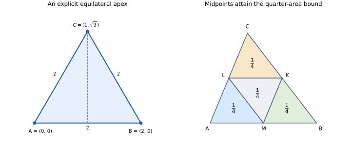

# Constructing an equilateral triangle

Given two distinct points, can we construct a third point whose distances
from them both equal the original distance? A picture suggests intersecting
two circles, but a proof must establish that a suitable point exists and
has the required properties.

We will work in the real coordinate plane. An explicit formula will provide
the point; two squared-distance identities will prove that it works. A final
worked extension will show the same coordinate method supporting an IMO
area inequality rather than only a numerical example.



The left figure shows the construction on a base of length two. The right
figure shows the equality configuration for the later area bound; each label
is an area divided by the area of the whole triangle.

## Distances begin with vectors

For $A=(a_1,a_2)$ and $B=(b_1,b_2)$, define the displacement
$B-A=(b_1-a_1,b_2-a_2)$ and the dot product
$u\cdot v=u_1v_1+u_2v_2$. Their squared distance is

$$D(A,B)=(B-A)\cdot(B-A)=(b_1-a_1)^2+(b_2-a_2)^2.$$

Squared distances compare lengths without introducing a square root at every
step. In the Euclidean plane they are nonnegative, so equality of squared
distances is equivalent to equality of lengths. This standalone opening
example from the [construction source](../../showcases/math_concepts_in_litex/2_euclidean_geometry/main.lit)
introduces the operations and proves their coordinate formula.

```litex
have points set = cart(R, R)
have fn vec(A, B cart(R, R)) cart(R, R) = (B(1) - A(1), B(2) - A(2))
have fn dot(u, v cart(R, R)) R = u(1) * v(1) + u(2) * v(2)
have fn distance_sq(A, B cart(R, R)) R = dot(vec(A, B), vec(A, B))

thm distance_sq_coordinate_formula:
    ? forall a, b cart(R, R):
        distance_sq(a, b) = (b(1) - a(1))^2 + (b(2) - a(2))^2
    vec(a, b) = (b(1) - a(1), b(2) - a(2))
    vec(a, b)(1) = b(1) - a(1)
    vec(a, b)(2) = b(2) - a(2)
    vec(a, b)(1) * vec(a, b)(1) = (b(1) - a(1)) * (b(1) - a(1)) = (b(1) - a(1))^2
    vec(a, b)(2) * vec(a, b)(2) = (b(2) - a(2)) * (b(2) - a(2)) = (b(2) - a(2))^2
    distance_sq(a, b) = dot(vec(a, b), vec(a, b))
    dot(vec(a, b), vec(a, b)) = vec(a, b)(1) * vec(a, b)(1) + vec(a, b)(2) * vec(a, b)(2) = (b(1) - a(1))^2 + (b(2) - a(2))^2
```

For $A=(0,0)$ and $B=(3,4)$, the formula gives $D(A,B)=9+16=25$.
The complete source checks this example after the theorem. The same formula
will now support a construction for arbitrary endpoints.

## Choosing the third point

Write $B-A=(x,y)$ and choose

$$
C=\frac{A+B}{2}+\frac{\sqrt3}{2}(-y,x).
$$

The first term is the midpoint. The vector $(-y,x)$ is perpendicular to
the base, so the second term moves away from it in a fixed orientation.
The source records the actual coordinate formula as a function:

<!-- litex-source: ../../showcases/math_concepts_in_litex/2_euclidean_geometry/main.lit -->
<!-- litex:skip-test -->
```litex
have fn equilateral_vertex(a, b cart(R, R)) cart(R, R) = ((a(1) + b(1)) / 2 - sqrt(3) * (b(2) - a(2)) / 2, (a(2) + b(2)) / 2 + sqrt(3) * (b(1) - a(1)) / 2)
```

Subtracting $A$ gives $C-A=((x-\sqrt3y)/2,(y+\sqrt3x)/2)$.
Expanding its squared length, the mixed terms cancel and $(\sqrt3)^2=3$:

$$
\begin{aligned}
D(A,C)
&=\frac{(x-\sqrt3y)^2+(y+\sqrt3x)^2}{4}\\
&=\frac{4x^2+4y^2}{4}=x^2+y^2=D(A,B).
\end{aligned}
$$

Similarly, $C-B=((-x-\sqrt3y)/2,(-y+\sqrt3x)/2)$.
Squaring again gives $D(B,C)=x^2+y^2$. These are the two identities proved
by `equilateral_vertex_distance_lemma` in the complete source.

If $A\ne B$, then $(x,y)\ne(0,0)$, hence $D(A,B)>0$.
Consequently $C$ equals neither endpoint. In fact the determinant of
$B-A$ and $C-A$ is $\sqrt3(x^2+y^2)/2>0$, so the three points are
not collinear. The source's equilateral predicate states the distinct-base
condition and the two congruences; these plane calculations explain why
they describe a nondegenerate equilateral triangle.

## From a formula to an existence proof

The construction remains defined when the endpoints coincide, but the
geometric theorem excludes that case. Here is its exact statement; the
preceding definitions belong to the linked complete source.

<!-- litex-source: ../../showcases/math_concepts_in_litex/2_euclidean_geometry/main.lit -->
<!-- litex:skip-test -->
```litex
thm euclid_book1_proposition_1:
    ? forall a, b cart(R, R):
        a != b
        =>:
            exist c cart(R, R) st {$is_equilateral_triangle(a, b, c)}
```

The proof supplies `equilateral_vertex(a, b)` as its witness after proving
the required congruences. For the base $(0,0)$ to $(2,0)$ it produces
$(1,\sqrt3)$; all three squared side lengths are $4$.
This establishes the mathematical construction of Euclid I.1 in an analytic
plane. It does not derive the real coordinate plane from synthetic axioms,
or prove a general straightedge-and-compass construction theorem.

## A further worked result from IMO geometry

Coordinates also organize the area argument in the repository's
[IMO 1966 Problem 6 development](../../examples/imo/geometry/imo_1966_p6/solution.lit).
Let $K,L,M$ lie strictly inside the sides $BC,CA,AB$ of a nondegenerate
triangle. We will show that at least one corner triangle $AML,BKM,CLK$
has at most one quarter of the area of $ABC$.

Write
$K=(1-x)B+xC$, $L=(1-y)C+yA$, $M=(1-z)A+zB$,
where $0<x,y,z<1$. Determinant bilinearity gives their area ratios:

$$r_A=z(1-y),\qquad r_B=x(1-z),\qquad r_C=y(1-x).$$

All are positive. If all three exceeded $1/4$, their product would exceed
$1/64$. But

$$
r_Ar_Br_C=x(1-x)y(1-y)z(1-z)\le(1/4)^3=1/64,
$$

because $t(1-t)=1/4-(t-1/2)^2\le1/4$ for every real $t$.
This contradiction proves the claim. At the three side midpoints all three
ratios equal $1/4$, so the constant is sharp.

The source proves the cyclic-product bound, extracts the affine witnesses
from segment membership, and derives the determinant factors. Its final
conclusion uses squared unsigned areas: $16\delta^2\le\Delta^2$,
where $\delta$ and $\Delta$ are twice the relevant areas up to sign.
Since $|\Delta|>0$, this is equivalent to
$|\delta|\le|\Delta|/4$. Keeping the squares makes the formal statement
independent of the orientation of the original triangle.

## Exercises

1. Find the other equilateral apex on the base $(0,0)$ to $(2,0)$.
2. What does the construction formula return if $A=B$? Which theorem
   premise excludes that case?
3. If $K,L,M$ are the side midpoints, compute the area of the central
   triangle $KLM$ as a fraction of the area of $ABC$.

## Answers

1. Reverse the sign of the perpendicular term: the other apex is
   $(1,-\sqrt3)$, again with all squared side lengths equal to $4$.
2. Both terms involving $B-A$ vanish and the midpoint is $A$, so it
   returns $A$. The theorem requires `a != b`.
3. Each corner triangle has one quarter of the original area. Their
   interiors are disjoint, and the remaining central triangle therefore
   also has one quarter of the area.

## Continue reading

The [construction guide](../../showcases/math_concepts_in_litex/2_euclidean_geometry/README.md)
records the chosen analytic model. The
[plane-geometry collection](../../showcases/2D_Geometry/README.md), maintained
by Jiachen Shen and Keyao Zhu, develops lines, circles and triangle lemmas
and links its other IMO problems. Their statements retain their own
configuration and nondegeneracy hypotheses; a scalar identity alone does
not replace a geometric configuration.

[Previous](06-probability.md) · [Contents](README.md)

