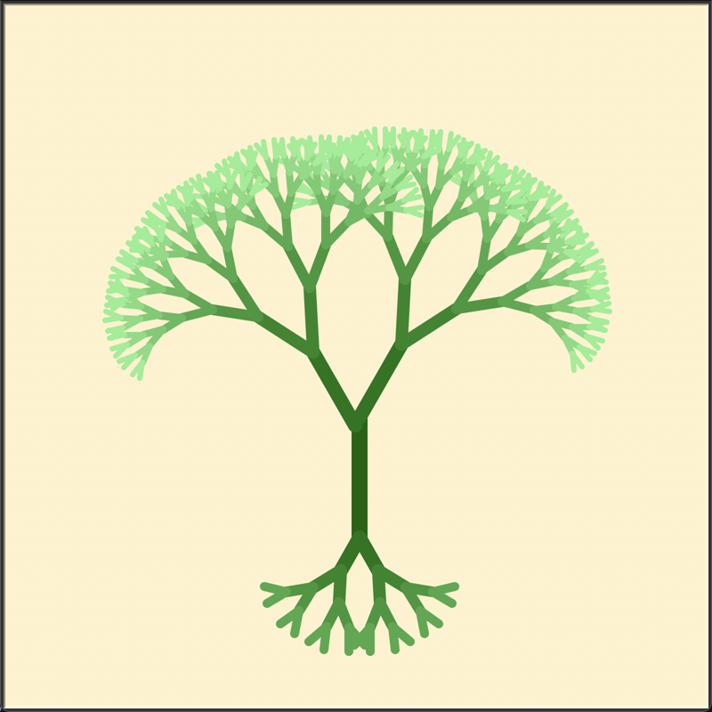

<div align="center">
  

# Litex

### 形式化数学的高级语言

[官网与在线体验](https://litexlang.com/) · [手册](Litex手册.md) · [安装](安装Litex.md) · [English](../README.md)
</div>

Litex 让你用接近通常数学写作的方式表达数学对象、定义、命题和证明。
原生检查器检查定义域与证明步骤，并让后续语句使用已经接受的事实。

```litex
have a R = 2
a + 1 = 3
```

第一行引入一个实数及其值，第二行陈述一个由当前上下文验证的事实。
持久 Session 允许你保留已接受的语句，在修正失败步骤后继续写作。

## 安装与运行

macOS 或 Linux：

```bash
brew install litexlang/tap/litex
```

Windows：

```powershell
scoop bucket add litex https://github.com/litexlang/scoop-litex
scoop install litex
```

其他安装方式见[安装指南](安装Litex.md)。

```bash
# 检查一条事实
litex -e '1 + 1 = 2'

# 开启交互 Session
litex -session

# 检查保存的证明文件
litex -f proof.lit
```

## 文档

| 任务 | 参考 |
| --- | --- |
| 学习语言 | [入门教程](学习Litex.md)、[速查表](Litex学习速查表.md) |
| 查语法、定义域和证明规则 | [手册](Litex手册.md) |
| 使用命令行与读取 JSON 输出 | [命令行参考](Litex命令行参考.md) |
| 使用智能体书写证明 | [智能体指南](Litex智能体指南.md)、[英文 primer](Litex_Agent_Primer.md) |
| 把支持的证明编译到 Lean | [编译器指南](Litex到Lean编译器指南.md) |
| 阅读数学例子 | [示例](../examples/README.md)、[数学示例章节](mathematical_sample_chapters/README.zh-CN.md)、[展示集](../showcases/README.md) |
| 查找中英文对应文档 | [文档索引](中文文档索引.md) |

## 当前范围

Litex 正在持续开发。Lean 后端可将受支持的证明路径编译后交给 Lean 独立检查；
具体覆盖范围和限制见[编译器指南](Litex到Lean编译器指南.md)。
原生检查器的[信任边界](Litex手册.md#trust-boundary)在手册中说明。

由沈嘉辰（Jiachen Shen）创建和维护。提交问题时请附最小复现例子：
[GitHub Issues](https://github.com/litexlang/golitex/issues)。
社区讨论见 [Zulip](https://litex.zulipchat.com/)。

采用 [Apache License 2.0](../LICENSE)。
