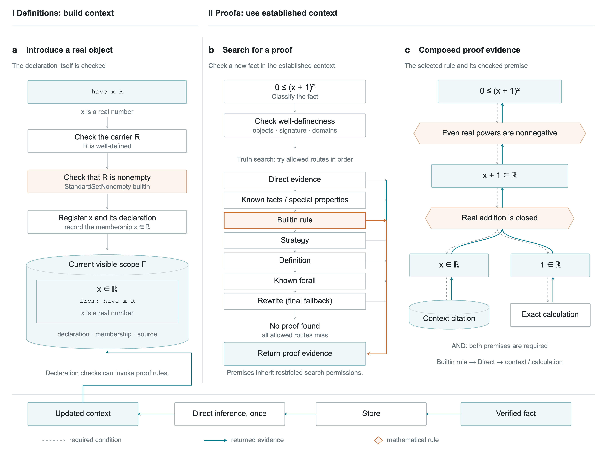

# Definitions build context; proofs use it

Continue with [from checked evidence to Lean](../lean_compilation/README.md)
to see how a recorded proof becomes Lean code and what `Litex.lean` supplies.

The figure separates two connected operations. **I: definitions/declarations**
introduce mathematical objects and extend the context. **II: proofs** use the
established context and checked rules to establish new facts. The same two-line
example makes both operations visible:

```litex
have x R
0 <= (x + 1)^2
```

Here `have x R` declares that **x is a real number**, recording `x ∈ ℝ` in the
mathematical context. `R` is the existing builtin real-number set. The object
declaration checks that this carrier is well-defined and nonempty, then
registers `x` and its declaration and stores its membership with its source.
The declaration's nonempty check itself uses a builtin proof rule.

The next line asks for a new fact. An order builtin asks a membership question,
Direct structural membership follows addition, and its leaves cite the
declaration's membership fact and a closed calculation. The picture shows how
definitions and proofs interact through the same context.

Open [the interactive figure](index.html) directly in a browser. It works offline
without a server, a Litex installation, external fonts, or network requests.
Choose Definitions or Proofs to jump between the two parts. Use Previous / Next
or Play for all nine steps, select a node with a click or Enter/Space, and switch
between English and Chinese. The selected node explains its role and identifies
the corresponding implementation or retained evidence. On narrow screens the
panels stack in reading order.

The Proofs part pairs a vertical guide with the dependency tree. Both share the
same steps as the top controls: read the goal, check formation, match the
even-power rule, reduce its real-base requirement through addition, find both
leaf proofs, and compose their evidence upward. Clicking a guide card or a tree
node updates the shared step. “Demonstrate from the goal” starts playback at the
goal; `?lang=zh&view=proof` opens that part directly. Downward requirements are
emphasized during discovery; upward evidence is emphasized at the final step.
The general verification-entry diagram remains in an expandable reference.

The separate [English discovery figure](proof-discovery.svg) and
[Chinese discovery figure](proof-discovery.zh.svg) show the same selected route
as a vertical static illustration. Matching PNG previews use the same names.
The match is concrete: the left endpoint is zero, the right side is a power,
and the literal exponent is even. The remaining real-base condition is proved
from `have x R` and exact numeral membership. This is a checked successful
dependency route, rather than a chronology of unrecorded failed candidates.

The [English SVG](proof-search.svg) and [Chinese SVG](proof-search.zh.svg) keep text
editable. Matching PDF and 600-dpi PNG files use the same names and geometry:

| Language | Editable vector | Vector PDF | Raster preview |
| --- | --- | --- | --- |
| English | [SVG](proof-search.svg) | [PDF](proof-search.pdf) | [PNG](proof-search.png) |
| Chinese | [SVG](proof-search.zh.svg) | [PDF](proof-search.zh.pdf) | [PNG](proof-search.zh.png) |



**Figure: definitions build context; proofs use it.** **I, a**, An object
declaration checks the real carrier and its nonemptiness, registers `x`, and
records `x ∈ ℝ` with its source in the context. The existing builtin `R` is used
as its carrier. **II, b**, After logical-shape dispatch and
well-definedness checks, the non-equality atomic pipeline tries its permitted
routes in order and returns a successful proof. **c**, The selected even-power
rule requires a real base. Structural addition combines the known membership
of `x` and the calculated membership of `1`. Dashed grey arrows denote required
conditions; solid teal arrows denote returned evidence. The lower flow records
publication after successful top-level checking, followed by direct inference
once and later reuse.

## Meaning and boundaries

- Part I illustrates **object definition/declaration** through `have x R`.
  It introduces an arbitrary real object and its membership; it does not choose
  a particular numerical value. The stored declaration and fact keep their
  distinct roles. Predicate and function definitions have their own interfaces.
- Definitions can invoke proof checks: introducing an arbitrary member needs a
  nonempty carrier, and the retained declaration actually uses the
  `StandardSetNonempty` builtin. The two parts show complementary responsibilities,
  not disjoint verifier implementations.
- The figure separates **search-stage permissions** from **proof-dependency
  depth**. A rule's premise is checked under its inherited ceiling. Direct
  structural traversal does not reopen the general rule dispatcher.
- The real-addition node is a mathematical closure rule implemented in
  `StructuralMembershipReason::Add`, a Direct route. It is not another nested
  `BuiltinRule` dispatcher call.
- Several proof routes are alternatives for one goal (OR); the premises of a
  selected rule must all hold (AND). The figure displays one actual successful
  dependency, not every possible alternative.
- WD checks may themselves request mathematical evidence. The main mathematical
  dependency is shown separately from those routine formation/domain subtrees.
- The pipeline shown is the **non-equality atomic** route used by the example.
  Equality, compound facts and template membership have their own branches.
- The pipeline order is audited against source, not inferred from a catalogue or
  presented as a recorded sequence of every failed search candidate. The viewer
  is a teaching projection and does not run Litex interactively.
- An accepted fact is stored before direct inference runs once; inferred results
  do not automatically trigger another inference chain. This example's
  `infers` list is empty. Failure to find a proof does not establish falsity.
- This is a standalone explanation of verification, not a replacement for the
  source-first Litex Reading interface.

## Verify and regenerate

From the repository root:

```sh
cargo build --release
target/release/litex -lang en -strict -f examples/proof_search/demo.lit
python3 examples/proof_search/build.py \
  --evidence-dir tmp/proof-search-figure-evidence
```

The builder checks the strict Normal and typed Reading outputs. It requires the
actual successful object-definition result, its carrier-WD and nonempty-check
stages, its registered symbol and membership store, and the real-set nonempty
builtin. The subsequent proof must cite that same membership identity. It also requires the
actual selected `EvenPowNonnegative` proof, follows its real-base premise to
`ByStructuralMembership → Add`, checks its `Known` / `Closed` children, and
confirms that the known leaf cites the `have` declaration. It writes compact
provenance and source digests to [acceptance.json](acceptance.json). Raw execution
records remain in the chosen temporary evidence directory.

`build.py` owns the vector layout and both figure languages. It generates the
overview and discovery SVGs and `index.html` from `index.template.html`; edit those sources rather
than the generated files. `viewer.js` owns only interaction and node explanations;
it does not infer proof relationships. Rebuild after changing the source, layout,
template or viewer. The mathematical snippet is unchanged from the checked
design; any future proof authoring must use the repository's persistent Session
workflow.

To rasterize the separate discovery illustrations without a browser, use a
local librsvg installation:

```sh
rsvg-convert -w 4323 -o examples/proof_search/proof-discovery.png \
  examples/proof_search/proof-discovery.svg
rsvg-convert -w 4323 -o examples/proof_search/proof-discovery.zh.png \
  examples/proof_search/proof-discovery.zh.svg
```

To export matching PDFs and PNGs with an optional local Playwright installation:

```sh
node examples/proof_search/export.cjs
```

Set `CHROME_EXECUTABLE` if using an installed Chromium-family browser instead of
Playwright's bundled browser. Browser dependencies are needed only for export;
the checked-in figures and interactive viewer need none. The PNG image dimensions
correspond to 600 dpi at the figure's 183-mm width. SVG and PDF retain text as
text. The layout follows the sans-serif lettering, lower-case panel labels,
editable vector text and restrained decoration described by the
[Nature figure specifications](https://research-figure-guide.nature.com/figures/preparing-figures-our-specifications/)
and [panel/export guide](https://research-figure-guide.nature.com/figures/building-and-exporting-figure-panels/).
It is Nature-inspired artwork, not an affiliation or a guarantee of acceptance.

## Implementation anchors

- [Object-declaration pipeline](../../src/execute/execute_have_obj_in_nonempty_set_stmt.rs).
- [Symbol registration and membership storage](../../src/execute/introduce_typed_parameters.rs).
- [Fact dispatch](../../src/execute/execute_fact_stmt/verify.rs).
- [Non-equality atomic search order](../../src/execute/execute_fact_stmt/verify_atomic_fact/verify_atomic_except_equality/search_atomic_except_equality_fact_proof.rs).
- [Search permissions](../../src/execute/execute_fact_stmt/verify_state.rs).
- [Structural membership](../../src/execute/execute_fact_stmt/verify_atomic_fact/search_structural_membership.rs).
- [Scoped context](../../src/exec_env/README.md).
- [Storage and direct inference](../../src/store_fact_and_infer/README.md).
- [Typed Reading evidence](../../src/reading/README.md).
