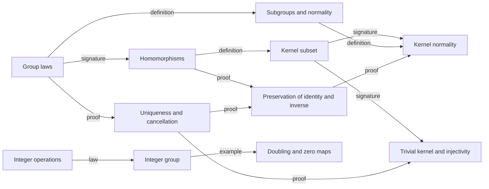

# Mathematical Organization

These original lectures ask which features of integer addition survive when
the elements and operation change. Group laws lead to cancellation, subgroups,
structure-preserving maps and their kernels. No particular textbook is being
translated.

The shared Group, five generic predicates, kernel template and twelve generic
theorems are owned by [std/algebra](../../std/algebra/math_collections.md).
The lecture imports them as `Algebra::group`; its integer operations, multiples
construction and applications remain local. There is no second lecture-local
Group declaration or duplicated general theorem family.

## Operations and groups

`Group<A nonempty_set>` packages `mul`, `one` and `inv` with associativity,
two-sided identity and inverse laws directly in the structure. The carrier is
nonempty because the structure contains an identity. Commutativity is a
separate property, not an extra group axiom. For the integer additive group,
`mul` is addition, `one` is zero and `inv` is negation.

The concrete integer laws motivate the abstract interface. Identity uniqueness,
inverse uniqueness, cancellation and solving a left multiplication equation
are consequences, rather than extra structure fields or assumed certificates.

## Subgroups

`is_subgroup(A, G, S)` applies to `S power_set(A)` and requires the identity,
closure under multiplication and closure under inverses. It reuses the ambient
operations. A new structure with different operations would obscure this
relationship. Integer multiples form a set-valued function; witness equations
prove closure. Nonnegative integers illustrate why closure under addition
alone does not suffice.

`is_normal_subgroup` adds closure under conjugation. This is a property of an
existing subgroup. In an abelian group every subgroup is normal, while the
kernel theorem below does not assume commutativity.

## Homomorphisms and kernels

`is_homomorphism(A, G, B, H, f)` imposes only preservation of multiplication
on a map `fn(x A) B`. Preservation of identities and inverses must be proved;
putting them in the definition would erase an important part of the argument.
The existing map remains an ordinary function, not a parallel record.

`\Algebra::group::kernel<A,B,H,f>` is the subset `{x A: f(x) = H.one}`.
Its carrier is the supplied domain `A`, so a declaration family is appropriate.
The domain group's operations are not needed just to form this set. This is a set,
not merely a predicate identifying candidate kernels. The kernel is a normal
subgroup; a homomorphism is injective precisely when its kernel is trivial.
The multiplication-by-two map and zero map on the integers connect these
general results back to calculations.

## Dependency and reading order

The graph gives the implementation order. Signature and definition edges build
the vocabulary; law and proof edges establish facts; example edges specialize
it. These lectures develop the group part of abstract algebra. Quotient-group
construction, Lagrange's theorem, rings, modules and Galois theory are outside
this slice, rather than implicit consequences of the kernel result.
All included definitions, constructions and proofs pass strict verification;
there are no user assumptions or outstanding proof holes in this slice.
