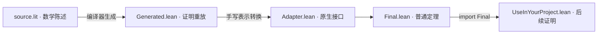

# 把 Litex 证明接入普通 Lean

这个 showcase 面向已经会写 Lean、希望复用 Litex 证明的用户。我们用一个带
非零分母条件的实数恒等式，以及保持定义域的分式线性对合，走完源码、生成证明、表示转换和普通 Lean 调用。
数学证明在 Litex 中完成；手写 Adapter 把它的接口转换成 Mathlib 的实数接口。

**这个例子展示互操作，不展示证明长度优势。** 普通 Mathlib 已有 `add_div`，
完整对照见 [DirectLean.lean](DirectLean.lean)。下面也记录了已接通的 Möbius
示例及其实际比较。

先看最终交付的 [Final.lean](Final.lean)：

```lean
theorem quotientDistributes (x y z : ℝ) (hz : z ≠ 0) :
    (x + y) / z = x / z + y / z := by
  exact Adapter.quotientDistributes x y z hz
```

这段声明位于 `LitexLeanExample` 命名空间。参数、前提和结论都是普通 Lean
数学对象；使用者通过这个定理继续写证明。



## 1. 在 Litex 中给出数学陈述

[source.lit](source.lit) 的完整内容是：

```litex
# For a nonzero real denominator, division distributes over addition.
forall x,y,z R:
    z != 0
    =>:
        (x+y)/z=x/z+y/z
```

`x R` 引入对象和属于 `R` 的事实。`z != 0` 同时是定理的前提和除法构造的
良定义依据。本例实际选中的是 `RationalWithNonzeroPremises`，即带非零前提的
有理式规范化。编译器将这条路线放入 Generated；后面的 Adapter 只转换表示。

## 2. 看懂生成定理要什么

[Generated.lean](Generated.lean) 是实际编译输出，保持原样。它的导出定理名是
`h_3`，所在命名空间由源码路径生成。这个名字来自原始 FactId。

生成定理对三个 host 类型和数学解释 `M` 都保持泛化。每个参数是一个
`Litex.Obj`，随后跟一个普通的成员事实；源码中的 `R` 没有被直接改写成
Lean 的 `ℝ` 类型。其调用参数在本例中的对应关系如下：

| 源码信息 | 生成签名 | Adapter 提供的值 |
|---|---|---|
| 对象 `x`、`y`、`z` | `_value_i1`、`_value_i2`、`_value_i3` | `a`、`b`、`c` |
| 三个 `R` 成员事实 | `h_16`、`h_17`、`h_18` | `ha`、`hb`、`hc` |
| `z != 0` | `h_1 : ¬ Litex.Same ...` | `h0` |
| 整个全称事实 | `h_3` | `generated` 的证明来源 |

生成签名中的一个除法子项是下面这样，换行仅用于阅读：

```lean
Litex.div _value_i1 _value_i3
  (Litex.realToComplex _value_i1 h_16)
  (Litex.realToComplex _value_i3 h_18)
  h_1
```

对象构造本身接收定义域和非零证明。运算的结果仍是认证对象；输出的等式是
`Litex.Same`。成员事实、运算 WD 和数学等式各自保留了自己的作用。

## 3. 手写 Adapter：输入、调用、输出

[Adapter.lean](Adapter.lean) 的公开定理已经采用与 Final 相同的原生陈述。
下面三步都在它的证明体内完成。

第一步，选择已证明的数值解释，包装 Lean 实数，并构造成员事实：

```lean
let M := Litex.NumericModel.model
let a := Litex.number (M := M) (x : ℂ)
have ha := Litex.NativeBridge.numberInR (M := M) x
```

`M` 指定对象的数学解释；本例选择 Core 中已实现的数值模型。实数嵌入复数，
再用 `Litex.number` 包装。这里的 host 是 `ℂ`，而 `ha` 说明这个对象表示一个
实数。这是 Adapter 对当前原生输入的具体实例化，生成定理仍保持一般性。

前提也有对应转换：

```lean
have hzC : (z : ℂ) ≠ 0 := fun h => hz (Complex.ofReal_injective h)
have h0 := Litex.NativeBridge.numberNonzero (M := M) (z : ℂ) hzC
```

第二步，调用实际生成的定理：

```lean
have generated :=
  LitexCompiled.file_showcases_x2f_litex_x5f_to_x5f_lean_x5f_adapter_x2f_source_x2e_lit.h_3
    (M := M) a ha b hb c hc h0
```

这一步取得恒等式的证明。后面的转换消费这个 `generated`，因此最终证明
真正依赖 Litex 编译输出。

第三步，回到原生等式。Adapter 用 `change` 展开 `Same` 的指称等式，随后只用
`M.add_numbers` 和 `M.div_numbers` 观察这次认证运算。最后经过两次单射性：

```text
M.number A = M.number B
    ↓ M.number_injective
A = B                       （复数等式）
    ↓ Complex.ofReal_injective，配合保持加法、除法的嵌入规律
实数等式
```

完整代码中的 `simp only` 只使用这些已列出的表示规律。Adapter 没有再用
`ring`、`field_simp` 或定理搜索证明商的分配律。

`Same` 不能对任意表示直接当作 Lean 的 `=` 使用。本例先把两端观察为数值，
再借助已证明的数值嵌入单射性取回原生等式。集合、函数需要各自的表示接口。

## 4. 在普通 Lean 证明中使用

[UseInYourProject.lean](UseInYourProject.lean) 只导入 `Final`。它把同一个定理
应用两次，得到三项求和版本：

```lean
theorem threeTerms (x y t z : ℝ) (hz : z ≠ 0) :
    (x + y + t) / z = x / z + y / z + t / z := by
  calc
    (x + y + t) / z = (x + y) / z + t / z :=
      LitexLeanExample.quotientDistributes (x + y) t z hz
    _ = x / z + y / z + t / z := by
      rw [LitexLeanExample.quotientDistributes x y z hz]
```

这个调用者不需要创建 Litex 对象、提供成员证明或直接引用 `h_3`。

## 和直接写 Lean 公平比较

同一恒等式在普通 Lean 中只需：

```lean
theorem quotientDistributes (x y z : ℝ) :
    (x + y) / z = x / z + y / z := by
  exact add_div x y z
```

Lean 的除法是全函数，这条恒等式甚至不需要非零前提。Litex 的这个源程序
要求分母非零以构造合法的除法对象，导出的接口保留这一条件。不能把生成证明
的长度当作 Lean 作者原本必须手写的工作量；本例的手写 Adapter 也有实际成本。

我们还检查了分式线性变换 `f(x)=(x+1)/(x-1)`：对于 `x≠1`，证明 `f(x)≠1`
及 `f(f(x))=x`。这个问题包含再次调用函数所需的定义域条件，但普通 Lean
依然很简洁。[DirectLean.lean](DirectLean.lean) 中已通过检查的证明体是：

```lean
  unfold mobius
  constructor
  · intro h
    field_simp [sub_ne_zero.mpr hx] at h
    linarith
  · field_simp [sub_ne_zero.mpr hx]
    ring
```

对应的[完整 Litex 源码](../../lean/examples/real_mobius_involution/statement.lit)
和[实际生成的 Lean](../../lean/examples/real_mobius_involution/statement.lean)
现已通过严格验证、真实编译、文件一致性和固定版本的 Lean 检查。原先阻塞的
差非零、商非零、差非零引用，以及 forall 对非等式原子结论和函数调用的匹配
均已接通。源码保留原来的数学证明，没有增加 `trust`。

源码中的关键定义域步骤是：

```litex
forall x R:
    x != 1
    =>:
        x - 1 != 0
```

商非零步骤保留分子与分母两个子证明：

```litex
forall x R:
    x != 0
    =>:
        2 / x != 0
```

[Final.lean](Final.lean) 已提供普通实数接口，证明体调用 Adapter：

```lean
noncomputable def mobius (x : ℝ) : ℝ := (x + 1) / (x - 1)

theorem mobiusInvolution (x : ℝ) (hx : x ≠ 1) :
    mobius x ≠ 1 ∧ mobius (mobius x) = x := by
  simpa only [mobius] using Adapter.mobiusInvolution x hx
```

Adapter 选择已有的 `Litex.NumericModel.model`，观察已认证的函数调用，并从
生成的定义域保持定理和对合定理取得原生结论。普通 Lake 项目、Final 和后续
调用均已通过；编译后的依赖审计确认这两个生成定理是实际证明依赖。原生定义
使用 Lean 的实数除法；与 Litex 的受限函数对应的证明只在 `x != 1` 的前提下使用。

**这是第二个已接通的 Litex → Lean 示例；它仍没有证明作者代码更短。**
直接 Lean 对照只有七句 tactic，当前 Litex 写法和手写 Adapter 也有成本。
Mathlib 自带的
[有理式与多项式自动化](https://leanprover-community.github.io/mathlib4_docs/Mathlib/Tactic/FieldSimp.html)
应当保留在对照中。

## 运行与修改

本例是完整仓库中的一个普通 Lake 项目。使用 Lean 4.31.0 和固定版本的
Mathlib；[lakefile.toml](lakefile.toml) 从仓库的 `lean/` 导入 `Litex` Core。
依赖配置没有本机路径或本地 scripts 依赖。

安装 Litex 的方法见[CLI 文档](../../docs/cli.md)。在**仓库根目录**重新生成：

```sh
cargo build --release
target/release/litex -strict -lang en -f showcases/litex_to_lean_adapter/source.lit
target/release/litex -strict -lean -f showcases/litex_to_lean_adapter/source.lit > showcases/litex_to_lean_adapter/Generated.lean
target/release/litex -strict -lean -f lean/examples/real_mobius_involution/statement.lit > lean/examples/real_mobius_involution/statement.lean
```

接着在这个 showcase 目录运行：

```sh
lake exe cache get
lake build
lake env lean -DwarningAsError=true Final.lean
lake env lean -DwarningAsError=true UseInYourProject.lean
```

修改自己的数学问题时，按以下顺序进行：

1. 在 `.lit` 文件中给出陈述和证明，让 Litex 验证通过。
2. 用实际编译器重新生成 Lean，查看新的导出签名、FactId 和前提。
3. 在 Adapter 中逐项编码原生输入和前提，调用生成定理，再用已证明的观察
   接口转换结论。生成文件由编译器维护。
4. 在 Final 中写出用户需要的普通数学陈述，证明体调用 Adapter。
5. 从只导入 Final 的文件测试后续证明。

向已有 Mathlib 项目接入时，先对齐本例的 Lean 4.31.0 和锁定的 Mathlib 版本
（具体 commit 见 lakefile.toml），再保持本例的模块名，放入 `Generated.lean`、
`Adapter.lean`、`Final.lean`，并把仓库的 `lean/Litex.lean` 作为 `Litex` 模块。
例如，Core 和三个模块都放在项目根目录时，可以在 `lakefile.toml` 中增加：

```toml
[[lean_lib]]
name = "Litex"
roots = ["Litex"]

[[lean_lib]]
name = "LitexExample"
roots = ["Final"]
globs = ["Generated", "Adapter", "Final"]
```

运行 `lake build LitexExample` 后，用户文件就可以 `import Final`。如果将手写
文件移到自己的模块目录，应相应调整 Adapter、Final 和调用者的 import。

## 文件与范围

| 文件 | 谁维护 | 读者在这里学什么 |
|---|---|---|
| [source.lit](source.lit) | 数学作者 | 带定义域条件的数学陈述 |
| [Generated.lean](Generated.lean) | Litex 编译器 | 实际证明接口、原 FactId 和 WD 参数 |
| [Adapter.lean](Adapter.lean) | 接口作者 | 编码输入、调用生成证明、观察结论 |
| [Final.lean](Final.lean) | Lean 库作者 | 纯 Mathlib 陈述和稳定的使用接口 |
| [UseInYourProject.lean](UseInYourProject.lean) | Lean 使用者 | 在后续证明中复用普通定理 |
| [DirectLean.lean](DirectLean.lean) | 对照作者 | 使用常见 Mathlib 接口直接证明，检验复杂度比较 |

本例使用数值模型上的手写 Adapter，保留源码的非零前提。
源码、生成文件和四层证明的检查结果见 [verification.json](verification.json)。
