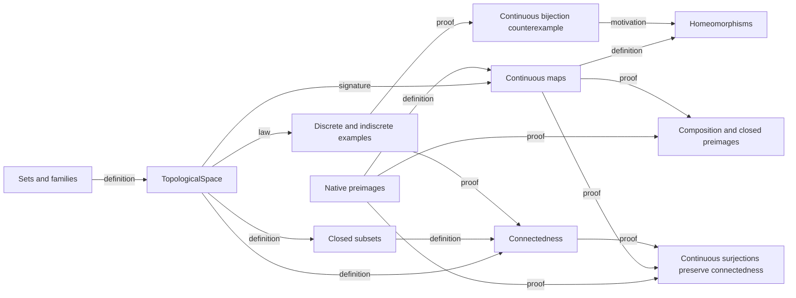

# Mathematical Organization

These original lectures ask what continuity means when distance is no longer
the starting point. Two topologies on the same two-point set provide a running
example. The general definitions allow empty spaces as well as nonempty ones.

## Open sets and a space

`TopologicalSpace<Ambient>` packages `carrier power_set(Ambient)` and
`opens power_set(power_set(carrier))`,
with the empty-set, whole-space, binary-intersection and arbitrary-union laws.
The ambient set supplies a universe for the carrier field; it adds no topology.
Taking it to be the carrier itself allows any set. This pair represents the
ordinary mathematical space, whereas a one-field structure containing only
the open-set collection is not supported by the current tuple-based syntax.
The laws belong directly to the structure. A predicate alone would describe
a proposed topology but would not supply the open-set collection used later.
Arbitrary unions use the native `family_union`; binary intersection together
with the whole-space law gives the usual finite-intersection convention.

The discrete topology has every subset open. The indiscrete topology has only
the empty set and the whole space open. The concrete carrier `{0, 1}` makes
their difference visible at the singleton `{0}`. No distance or ordering is
used to define either topology.

`is_closed(Ambient, space, F)` means that `set_minus(space.carrier, F)` is
open, with `F power_set(space.carrier)` in the signature. It is a property
of a subset, not a second collection of primitive data. Complements connect
open and closed descriptions.

## Maps and preimages

`is_continuous(A, B, source, target, f)` requires every target open set to
have an open preimage. Here `A` and `B` are the spaces' ambient sets.
The existing function is typed `fn(x source.carrier) target.carrier`;
continuity does not define a replacement function or assume injectivity. Native
`preimage_set(f, U)` constructs the inverse image of a subset, including when
the source is empty. A separate set-builder facade would duplicate that object.

A template for composition is justified because its source and target carriers
vary. Preimages under composition provide the proof that continuous maps
compose. Relative complements provide the closed-preimage theorem.

## Same points, different topology

The identity from the discrete two-point space to the indiscrete space is
continuous. Its inverse direction fails at `{0}`. This also explains why a
continuous bijection alone is insufficient to identify two topological spaces.
`is_homeomorphism` specifies two continuous maps whose composites are the
identities. Its inverse is explicit data. Merely requiring a continuous
bijection would omit the essential inverse-continuity condition. The two-point
swap gives a concrete homeomorphism distinct from the identity map.

## Connectedness

`is_connected(Ambient, space)` forbids a partition of the carrier into two
nonempty open sets. `is_clopen` packages openness with closedness for the
same subset. Spaces whose every open set is empty or the whole carrier are
connected; the indiscrete two-point space is the running instance. The
discrete two-point space admits the separation `{0}` and `{1}`, so it is not
connected, and `{0}` is a nontrivial clopen set.

`continuous_surjection_preserves_connectedness` is the Chapter 3 theorem:
a continuous surjection pulls a target separation back to a source
separation via preimage union and intersection identities, then returns an
empty preimage to an empty target piece. Subspace connectedness, path
connectedness and compactness remain outside this slice; compact images are
developed separately in the settings-first topology concepts showcase.

## Dependency and reading order

Read in this order: sets, space laws, concrete spaces, closed sets, preimages,
continuity, composition, homeomorphisms, connectedness and continuous
surjections. Edge labels distinguish definition, signature, law verification
and proof dependencies; motivation is explanatory. These are selected
elementary lectures, not a development of compactness, separation axioms,
subspace or product topologies, metric topology or algebraic topology.
All included definitions, constructions and proofs pass strict verification;
there are no user assumptions or outstanding proof holes in this slice.
