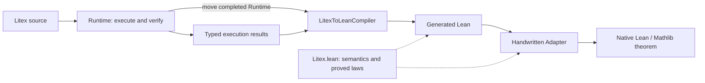

# Litex-to-Lean compiler architecture

This compiler turns the evidence from a successful Litex run into a Lean proof.
It preserves the source objects, construction conditions and selected proof
route. `lean/Litex.lean` gives those objects and facts their Lean meaning; a
handwritten adapter can expose the resulting theorem through an ordinary
Lean/Mathlib interface.

This README explains that architecture and its implementation owners. Complete
worked examples live in their own READMEs: [adding zero](../../docs/examples/litex_to_lean/add_zero/README.md),
[Newton's single-step identity](../../docs/examples/litex_to_lean/newton_residual/README.md)
and the [rational-map walkthrough](../../docs/Litex_To_Lean_Compiler_Guide.md#two-rational-maps-from-definitions-to-a-native-equivalence).
The [compiler guide](../../docs/Litex_To_Lean_Compiler_Guide.md) covers detailed
usage; [CLI documentation](../../docs/cli.md#lean-compiler-boundary) owns command
syntax and stdout/error behavior.

## The complete path



Runtime establishes what the source proved and retains the evidence for it.
The compiler renders that evidence using the semantic API. Lean checks the
resulting proof. Adapter then translates the interface into native concepts,
and the final Lean consumer cites Adapter. These are separate steps: emitting
Lean source does not run Lean or establish a native interface by itself.

## 1. Runtime produces the compiler input

The API sequence is:

```rust
let result = runtime.run_litex_code(&source)?;
let compiler = LitexToLeanCompiler::new(runtime);
let lean = compiler.compile_run(&result, &namespace)?;
```

The actual CLI owner is [run_compile_to_lean.rs](../run/run_compile_to_lean.rs).
Its current boundary is a standalone source file; compiling a module's proof
closure is not supported yet.
[RunLitexCodeResult](../run/run_command_outcome.rs) retains the ordered
statement results. Their successful branches contain the original subjects,
parameter introductions, assumptions, selected proofs, WD evidence and
store/inference results needed by their consumers. A successful run can still
contain a result variant the compiler does not support.

The compiler consumes these Rust values directly. JSON is a presentation of
the run, not its current replay input. Compilation is not a field-by-field
translation of displayed JSON: one recorded stage can require several Lean
expressions, and some of those expressions need earlier recorded evidence.

The original completed Runtime is moved into the compiler, without cloning.
It supplies read-only resolution of exact cited IDs and their subjects.
Current results are not a self-contained citation archive: some records retain
IDs whose payloads must still be resolved from Runtime or their captured local
environments. The compiler does not run verification again to fill a gap.

## 2. One compiler dispatches the original results

[LitexToLeanCompiler](litex_to_lean_compiler.rs) owns only Runtime:

```rust
pub struct LitexToLeanCompiler {
    pub(super) runtime: Runtime,
}
```

`compile_run(&self, result, namespace)` receives the run as an argument. The
compiler has no lifetime parameter, stored result, or persistent object/fact
registry. Branch methods receive their original result and source position,
then return temporary Lean text. The convenience function
[compile_run](compile_run.rs) follows the same ownership contract.

The dispatch structure follows the executor's result enums:

```text
RunLitexCodeResult.statement_results
  → ExecStmtResult
    → Definition: objects, predicates, functions, theorems
    → Fact: VerifyFactResult
      → Equality / AtomicExceptEquality / supported compound facts
      → selected proof and ordered child evidence
    → By / ReleaseAndExpand / ProofBlock: supported proof commands
  → each branch's constructor WD, assumptions, proofs and stores
```

This is a map of the supported dispatch paths, not a promise that every variant
of those enums compiles. [compile_stmt_result.rs](compile_stmt_result.rs)
dispatches statements; [compile_verify_fact_result.rs](compile_fact_stmt_result/compile_verify_fact_result.rs)
dispatches verification results. Their leaf files own the mathematical cases.
For example, the [equality consumer](compile_fact_stmt_result/compile_equality_result/compile_equality_result.rs)
first compiles the original left and right WD, then the selected equality proof.

### Original identities and source visibility

Emitted fact declarations use `h_<original FactId>`. Temporary requirement
proofs can be passed directly to constructors; they do not automatically become
stored facts. Parameters retain their original identifier identities.
A declaration's binders are derived from its original
source context; a later object cannot become an extra argument to an earlier
theorem. Different host representations may inhabit different Lean universes;
universe and parameter declarations are rendered from those source records.

[SourcePosition](source_position.rs) borrows the original owner, its parent
position and a `before` stage boundary. It answers which producers have already
completed at this point. This is why an internal Rust borrow lifetime exists
without a lifetime parameter on the owning compiler. The cursor does not own
a second environment or a collection of generated scopes.

A citation must satisfy both checks: its ID resolves to the expected subject,
and its producer is visible in the original result prefix. Future siblings,
uncompleted inference and facts local to a closed proof are unavailable even
if Runtime still contains their records. [source_queries.rs](source_queries.rs)
and the source-position checks enforce this distinction. Cached WD likewise
needs a visible certified construction; the cache entry alone is not a proof.

Lean binders, local proof blocks and necessary proof-valued `let`s preserve
these dependencies in the output. Indentation alone does not establish scope.

## 3. Litex.lean defines the object world

[Litex.lean](../../lean/Litex.lean) is the single public semantic core. Generated
files import it. Its main concepts have distinct responsibilities:

| Concept | Meaning |
| --- | --- |
| `M : Litex.Semantics` | An explicit interpretation: semantic values, membership, sethood, numbers, operations and their laws. |
| `Representation M α` | How a Lean host type represents values of `M`, and which host values are well-defined. |
| `Litex.Obj α` | A host value together with its WD proof, under that representation. |
| `Litex.denote a` | The semantic value represented by an object. |
| `Litex.In a A` | The ordinary proposition `M.mem (denote a) (denote A)`. |
| `Litex.Same a b` | Equality of semantic denotations, including objects with different host representations. |
| `Litex.IsSet a` | The proposition `M.isSet (denote a)`. |

Lean host types describe representations; membership describes mathematical
classification. Learning `In a R` therefore adds a fact without replacing `a`
by a value of Lean type `ℝ`. Supported numeric membership bridges provide the
`N ⊆ Z ⊆ Q ⊆ R ⊆ C` relationships while preserving the original object.

Every certified object is a set: `Representation.wd_isSet` derives sethood from
its WD. This applies to numbers and functions as well. It does not give every
arbitrary Lean type a representation, or make sethood alone sufficient for a
particular arithmetic constructor. For example, the number object representing
`1` has sethood, while a division additionally needs a nonzero denominator.

`Same` supports transport of facts through their semantic interpretations.
It is not an assertion that arbitrary host payloads are Lean-equal. A native
`=` conclusion requires a proved faithful observation, such as the numeric
embedding's injectivity.

### Construction conditions belong to objects

Core's object declaration packages the value and its construction evidence:

```lean
structure Obj {M : Semantics.{u}} (α : Type v) [Representation M α] where
  val : α
  wd : WD (M := M) val
```

Arithmetic and calls retain dedicated Litex representations. An addition
constructor receives two already certified objects and their complex-member
proofs; division also receives the denominator's nonzero proof. A function
call receives the function-space membership, argument membership and guard
proof. The resulting object stores its WD certificate. These proof arguments
justify the operation; they do not change its denotation.

The [object-WD compiler](compile_fact_stmt_result/compile_obj_well_defined_result/compile_obj_well_defined_result.rs)
replays the original children and domain evidence to supply those arguments.
An inference rule can also have its own recorded construction evidence; it
must not be disguised as a verifier WD stage that never occurred.

Functions have semantic graphs and certified call objects. `FunctionSignature`
records the supported input shape, actual output set, its sethood proof and
guard. `SetSemantics M` supplies bounded set constructors and extensionality;
`FunctionSemantics M` extends it with graph and application laws. The compiler
requests the additional interface when supported source constructions or
recorded inference require it. A formula body
may have an internal Lean interpretation function, while the source function
itself remains a certified Litex object.

### The model is explicit

Declaring `Semantics` states the laws an interpretation must satisfy. Generated
theorems are conditional on `M` and any required set/function instances; the
record declaration does not establish a model of all Litex mathematics.

Core also contains the concrete `NumericModel.model` and proved set/function
instances for the supported interface. It uses actual `ZFSet` values, an
injective complex-number encoding and ZF membership. Its sethood predicate is
`True` because the underlying values already are sets; membership and equality
remain substantive. A native adapter selects this model explicitly. It is not
a default interpretation or a completed model of every Litex object and rule.

## 4. Recorded proof rules become Lean proofs

The compiler dispatches the evidence route that Litex selected, including its
ordered requirements, orientations and original citations. Supported rules
use proved Core lemmas and logical proof construction. Some routes expand into
several lemmas or local steps; there is no required one-rule/one-line mapping.

For example, the equality consumer maps recorded `SameIr` evidence to
`Litex.sameRefl` after checking its endpoints. A selected rational-normalization
certificate instead uses the reviewed numeric observations and a fixed
normalization proof. It does not select an unrelated add-zero lemma merely
because the goal happens to be `a + 0 = a`. Fixed `ring` or guarded normalization
checks the recorded certificate family; it is not a second search for a proof
route missing from the source result.

Unsupported statements, objects, proof variants, references or scopes reject
the complete artifact. [LeanCompileError](lean_compile_error.rs) records the
route and, for statement failures, the statement index. The compiler returns
one complete source string or an error, without inserting an axiom, proof hole,
or invented premise to fill unsupported evidence.

The current consumers cover selected numeric, set, formula-function, predicate,
quantifier and theorem-reuse routes. Recursion is bounded to the reviewed unary
natural-index slice starting at index zero, with ordered `n = 0` and `n > 0`
cases and predecessor calls; the initial value need not be zero. Ordinary
zero-based induction also has a bounded consumer. Supporting
these constructors does not mean every proof using them can be compiled.
See the [guide](../../docs/Litex_To_Lean_Compiler_Guide.md) and individual example
READMEs for demonstrated combinations and their acceptance status.

To extend replay, start from an actual successful result variant and its
recorded premises. If a needed stage was computed but not returned, retain it
in its original producer before adding a consumer. Implement the corresponding
enum branch, use or prove the required Core law, and keep all original IDs,
construction checks and scope boundaries. Verify an actual source/generated
pair and a nearby missing-or-invalid-evidence rejection. Recognizing a desired
conclusion is not a substitute for supporting its recorded proof route.

## 5. Adapter exposes an ordinary Lean interface

A generated theorem speaks the Core vocabulary: generic objects, memberships,
`Same`, and an explicit semantic interpretation. A handwritten `Adapter.lean`
chooses the native inputs, constructs their certified representations, invokes
the generated theorem and converts its conclusion through proved bridges.

For generic numeric members, `NativeBridge.asComplex` and `asReal` observe the
original object using its membership proof. These observations are
noncomputable; they do not retype the object or promise executable extraction.
For native inputs, `Litex.number`
embeds the value. Bridges such as `addSame_iff` relate the resulting operation
to native arithmetic. These conversions preserve the generated proof as a
live dependency; Adapter does not independently reprove the mathematical result.

`Final.lean` then exposes ordinary Lean/Mathlib binders, hypotheses and a
conclusion. Only its proof body calls Adapter. The [add-zero walkthrough](../../docs/examples/litex_to_lean/add_zero/README.md)
shows the complete small implementation; [Newton](../../docs/examples/litex_to_lean/newton_residual/README.md)
adds a guarded function and a real-valued interface. These adapters are
handwritten; the compiler currently generates the proof-facing artifact.

## 6. Verification and ownership

Each check establishes a different part of the chain:

| Check | Evidence it establishes |
| --- | --- |
| Strict Litex execution | The source run succeeds under the CLI's strict-mode rules. |
| Actual compiler generation | The recorded evidence is accepted by implemented replay branches. |
| Byte-for-byte regeneration | The maintained generated file matches actual compiler output. |
| Lean checking of Core and generated output | The generated proposition has a Lean proof under its declared parameters. |
| Adapter/Final checking and dependency audit | The native theorem is checked and actually uses the generated proof through the reviewed model and bridges. |
| Axiom audit | The checked declarations use only the accepted foundation dependencies. |

Strict execution alone does not establish compiler coverage or a model for
every source foundation. A successful conditional generated theorem likewise
does not establish a concrete native theorem until the model and conversion
obligations are discharged. Report these gates separately.

The maintained files have these owners:

| Location | Responsibility |
| --- | --- |
| `src/compile_to_lean/` | Result dispatch, evidence validation and Lean emission. |
| `lean/Litex.lean` | Semantic interfaces, certified constructors, proved models and bridge laws. |
| `lean/examples/<problem>/` | Litex source and its actual generated Lean pair. |
| `docs/examples/litex_to_lean/<problem>/` | Worked-example README and public handwritten Adapter/Final files. |
| `scripts/litex_to_lean/` | Local-only check tools, pinned Lake environment and acceptance receipts. |

Keep the public `lean/` tree limited to Core and generated pairs. Change a
paired Lean file by regeneration through the CLI. For compiler changes, use
focused result/citation tests and the affected source/generated/native checks;
the local `scripts/litex_to_lean/check.py` gate is development tooling and is
not published with the repository. Full examples, mathematical
experiments and their progress records belong in their own documentation.

## Current mathematical reach

The implemented subset connects elementary algebra and real inequalities over
N/Z/Q/R/C and positive reals with basic sets, guarded numeric functions and
reusable theorems. The [coverage table and example navigation](../../docs/Litex_To_Lean_Compiler_Guide.md#current-mathematical-coverage-and-examples)
([中文](../../docs/Litex到Lean编译器指南.md#当前覆盖的数学范围与示例)) identify representative
checked source/generated pairs and distinguish complete examples from bounded
rule checks. Start with [adding zero through Adapter](../../docs/examples/litex_to_lean/add_zero/README.md),
then explore the [example collection](../../lean/examples/).
