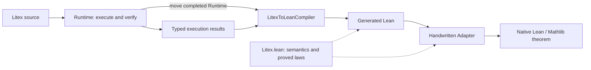

# Litex-to-Lean compiler architecture

This compiler turns the evidence from a successful Litex run into a Lean proof.
It preserves the source objects, construction conditions and selected proof
route. `lean/Litex.lean` gives those objects and facts their Lean meaning; a
handwritten adapter can expose the resulting theorem through an ordinary
Lean/Mathlib interface.

This README explains that architecture and its implementation owners. Complete
worked examples live in their own READMEs: [adding zero](../../docs/examples/litex_to_lean/add_zero/README.md),
[Newton's single-step identity](../../docs/examples/litex_to_lean/newton_residual/README.md)
and the [rational-map walkthrough](../../docs/Litex_To_Lean_Compiler_Guide.md#two-rational-maps-from-definitions-to-a-native-equivalence).
The [compiler guide](../../docs/Litex_To_Lean_Compiler_Guide.md) covers detailed
usage; [CLI documentation](../../docs/cli.md#lean-compiler-boundary) owns command
syntax and stdout/error behavior.
The [coverage inventory and phase plan](../../docs/Litex_To_Lean_Coverage_Plan.md)
tracks remaining statement, object and builtin-theorem entrypoints separately
and records which new routes have passed Lean.

## The complete path



Runtime establishes what the source proved and retains the evidence for it.
The compiler renders that evidence using the semantic API. Lean checks the
resulting proof. Adapter then translates the interface into native concepts,
and the final Lean consumer cites Adapter. These are separate steps: emitting
Lean source does not run Lean or establish a native interface by itself.

## 1. Runtime produces the compiler input

The API sequence is:

```rust
let result = runtime.run_litex_code(&source)?;
let compiler = LitexToLeanCompiler::new(runtime);
let lean = compiler.compile_run(&result, &namespace)?;
```

The actual CLI owner is [run_compile_to_lean.rs](../run/run_compile_to_lean.rs).
Its current boundary is a standalone source file; compiling a module's proof
closure is not supported yet.
[RunLitexCodeResult](../run/run_command_outcome.rs) retains the ordered
statement results. Their successful branches contain the original subjects,
parameter introductions, assumptions, selected proofs, WD evidence and
store/inference results needed by their consumers. A successful run can still
contain a result variant the compiler does not support.

The compiler consumes these Rust values directly. JSON is a presentation of
the run, not its current replay input. Compilation is not a field-by-field
translation of displayed JSON: one recorded stage can require several Lean
expressions, and some of those expressions need earlier recorded evidence.

The original completed Runtime is moved into the compiler, without cloning.
It supplies read-only resolution of exact cited IDs and their subjects.
Current results are not a self-contained citation archive: some records retain
IDs whose payloads must still be resolved from Runtime or their captured local
environments. The compiler does not run verification again to fill a gap.

## 2. One compiler dispatches the original results

[LitexToLeanCompiler](litex_to_lean_compiler.rs) owns only Runtime:

```rust
pub struct LitexToLeanCompiler {
    pub(super) runtime: Runtime,
}
```

`compile_run(&self, result, namespace)` receives the run as an argument. The
compiler has no lifetime parameter, stored result, or persistent object/fact
registry. Branch methods receive their original result and source position,
then return temporary Lean text. The convenience function
[compile_run](compile_run.rs) follows the same ownership contract.

The dispatch structure follows the executor's result enums:

```text
RunLitexCodeResult.statement_results
  → ExecStmtResult
    → Definition: objects, predicates, functions, theorems
    → Fact: VerifyFactResult
      → Equality / AtomicExceptEquality / supported compound facts
      → selected proof and ordered child evidence
    → By / ReleaseAndExpand / ProofBlock: supported proof commands
  → each branch's constructor WD, assumptions, proofs and stores
```

This is a map of the supported dispatch paths, not a promise that every variant
of those enums compiles. [compile_stmt_result.rs](compile_stmt_result.rs)
dispatches statements; [compile_verify_fact_result.rs](compile_fact_stmt_result/compile_verify_fact_result.rs)
dispatches verification results. Their leaf files own the mathematical cases.
For example, the [equality consumer](compile_fact_stmt_result/compile_equality_result/compile_equality_result.rs)
first compiles the original left and right WD, then the selected equality proof.

Top-level `abstract_prop` declarations compile as arbitrary predicate parameters.
For example, `abstract_prop marked(x)` introduces
`(abstract_prop_1 : (Fin 1 → M.Value) → Prop)`; `$marked(a)` applies it to
`![Litex.denote a]`. The finite vector retains the declared arity, including
zero. Since predicates act on denotations, `Litex.Same` transports both a
property and its negation through ordinary Lean equality congruence.
The declaration supplies no truth or defining clauses.

The [abstract-predicate consumer](compile_def_abstract_prop_stmt_result.rs)
checks the original signature and argument WD. Predicate parameters and their
applications come from each declaration's original top-level source prefix,
alongside existing object parameters; no registry is added. Stored evidence
still uses `h_<FactId>`. Examples cover [equality transport and theorem calls](../../lean/examples/abstract_property_transport/),
[function guards](../../lean/examples/abstract_function_guard/) and
[mixed object/predicate contexts](../../lean/examples/abstract_property_context/).
Local and qualified abstract declarations remain unsupported.

Top-level structures with two or more independent fields use the existing Cartesian
representation, restricted by a bounded set builder when `<=>` supplies
conditions. `&CoordinatePair` is a set object;
its members keep their generic host representations. Field names select the
declaration's ordered coordinates, and a field access compiles to a certified
`Litex.cartCall`. The [declaration consumer](compile_def_struct_stmt_result.rs)
checks field WD and local parameter inferences before emitting the carrier.
The [membership consumer](compile_struct_membership.rs) consumes either the
literal tuple's ordered field proofs or the recorded complete Cartesian
membership, followed by the recorded proofs of every defining condition.

For quantified structure parameters, the [field consumer](compile_struct_fields.rs)
replays automatic opening: Cartesian membership, field/coordinate equalities,
then field memberships, defining conditions and their inferences, with the original FactIds.
Numerical observation of a field cites a released numeric membership before
the field can be used as a scalar in rational normalization. Examples cover
[coordinate arithmetic](../../lean/examples/coordinate_pair_fields/),
[distinct field carriers](../../lean/examples/indexed_point_fields/),
[an ambient arbitrary set](../../lean/examples/arbitrary_carrier_pairs/) and
[nested tuple membership](../../lean/examples/nested_coordinate_membership/).
The same field consumer handles `have p &CoordinatePair`, typed aliases such as
`have origin &CoordinatePair = (0, 0)`, and [explicit structure release](compile_release_struct_def_result.rs).
Ordinary `have` consumes its recorded nonempty check. A typed alias checks its
original hypothetical-parameter preflight separately, then emits the actual
value, membership and field stores. The preflight is applied to the checked
values so Lean can infer the host universes even inside a local block. Its
private facts never escape into the value's proof. Layer-prefix cursors preserve the order of multiple structure
parameters and reject references to later layers.

See [chosen pairs](../../lean/examples/chosen_coordinate_fields/),
[the origin](../../lean/examples/origin_coordinate_fields/),
[explicit release](../../lean/examples/released_coordinate_fields/) and
[local objects](../../lean/examples/local_coordinate_objects/).
The [condition consumer](compile_struct_conditions.rs) checks condition WD in
source order. Earlier conditions remain available to later constructors: in
the [positive ratio](../../lean/examples/positive_ratio_conditions/), the
nonzero denominator fact supplies the quotient's WD. Published universal laws
retain their original parameter and FactIds. Membership and release use the
proved `Litex.inSetBuilder_iff` bridge; they add no model laws.
Examples also cover [positive points](../../lean/examples/positive_point_conditions/),
[equal coordinates](../../lean/examples/equal_coordinate_conditions/),
[chain conditions](../../lean/examples/ordered_coordinate_conditions/),
[conjunctions](../../lean/examples/first_quadrant_conditions/) and
[global/local choice](../../lean/examples/chosen_positive_points/).
Conditions currently use supported atomic, flat conjunction and chain facts.
Structure headers also support set, nonempty-set and object parameters, including later
parameters typed by an earlier set. The [header consumer](compile_struct_header.rs)
replays their original introductions, argument WD and instantiated type proofs.
`struct Pair<A set>` becomes a Lean family with an object argument and its
sethood proof. Membership, release and published laws substitute the actual
arguments using source IDs. See [generic pairs](../../lean/examples/parameterized_pairs/),
[parameterized equality](../../lean/examples/parameterized_equal_pairs/),
[real thresholds](../../lean/examples/threshold_points/),
[a designated element of a set](../../lean/examples/designated_coordinate_pairs/) and
[global/local bindings](../../lean/examples/chosen_parameterized_pairs/).
`A nonempty_set` passes the original `Litex.IsNonempty A` hypothesis. The
shared quantified-head consumer preserves that kind in `forall`, named
theorems and their explicit calls. See [nonempty pairs](../../lean/examples/nonempty_parameterized_pairs/),
[their equality condition](../../lean/examples/nonempty_equal_pairs/) and
[the nonempty product theorem](../../lean/examples/nonempty_cartesian_theorem/).
Fields may also depend on earlier fields:

```litex
struct ElementPair<A set>:
    x A
    y x
```

The [dependent-field consumer](compile_dependent_struct.rs) emits an ordered
`Litex.DependentFields` family and proves its formation from the declaration's
original WD and parameter inferences. `Litex.dependentCart` collects its valid
flat tuples using the optional `IndexedUnionSemantics M` interface. The existing
ZF-based `NumericModel` implements this interface; `SetSemantics` is unchanged.
Only files declaring dependent fields acquire the additional model requirement.

Tuple membership replays each instantiated field obligation in order. Release
projects the certified field carriers and publishes the original FactIds.
Source numeric coordinates are connected to finite indices by one certificate
per declaration. See [element pairs](../../lean/examples/member_coordinate_pairs/),
[equal coordinates](../../lean/examples/repeated_coordinate_fields/),
[three dependent coordinates](../../lean/examples/repeated_coordinate_triples/),
[reciprocal WD](../../lean/examples/reciprocal_coordinate_fields/),
[defining conditions](../../lean/examples/positive_repeated_coordinates/),
[nonliteral membership](../../lean/examples/equal_coordinates_membership/) and
[choice and local aliases](../../lean/examples/chosen_repeated_coordinates/).

Structures require at least two fields. Self/forward field dependencies,
finite-set header kinds, quantified conditions, nested field paths,
function-call receivers and local/qualified structure definitions remain
unsupported. Field access and release require a directly declared structure
parameter or typed alias.

The [additive-shift consumer](compile_fact_stmt_result/compile_atomic_except_equality_result/compile_additive_shift.rs)
shows how a selected strategy becomes a Core theorem application. For
`AddLeftNonpositiveShiftRight`, it checks and compiles the recorded proofs of
`b <= r` and `a <= 0`, in that order, then applies
`Litex.addLeOfLeOfNonposSwap` to the original sum object. The constructor keeps
its own WD. [Upper-bound examples](../../lean/examples/weak_additive_upper_bounds/)
show all these inputs in the generated Lean. The
[numeric-bound consumer](compile_fact_stmt_result/compile_atomic_except_equality_result/compile_numeric_bound_weaken.rs)
resolves the exact cited bound and checks its integer endpoint before applying
order transitivity; it never searches for another bound.

The [componentwise-addition consumer](compile_fact_stmt_result/compile_atomic_except_equality_result/compile_componentwise_additive_order.rs)
replays two inequalities in their recorded order. It checks the addend pairing
and each comparison's strictness, then applies `Litex.addLeAdd`,
`addLeAddSwap`, `addLtAddOfLtOfLe` or `addLtAddOfLeOfLt` to the original sum
objects. The [three-term bound](../../lean/examples/three_term_sum_bound/)
combines two such steps and reuses the result through a named theorem.

The [shared-subtraction consumer](compile_fact_stmt_result/compile_atomic_except_equality_result/compile_subtraction_order.rs)
also retains the difference's real-domain evidence from formation. Its Core
law consumes that evidence, the recorded order proof and the common operand's
semantic equality. This works even when the common operand is declared in `C`
and only its differences are known to lie in `R`.
[Strict transitivity](compile_fact_stmt_result/compile_atomic_except_equality_result/compile_strict_order_transitivity.rs)
resolves the two recorded FactIds and validates their endpoints and strictness
flags before applying `ltTrans`, `ltLeTrans` or `leLtTrans`.

The [preimage consumers](compile_function_preimage.rs) compile `preimage(f, y)`
and `preimage_set(f, Y)` from the recorded complete function signature and
bounded-construction WD. Membership, projections and input-carrier containment
use `preimageMembers` / `preimageSetMembers`. Their Core representation depends
only on the function graph and target; the signature supplies a proof of
formation. Inferred calls retain the original input and domain evidence, with
proof elimination confined to proof-valued bindings. See the
[guarded reciprocal](../../lean/examples/guarded_reciprocal_preimages/) and
[two-input quotient](../../lean/examples/binary_quotient_preimages/) pairs.

The [composition consumer](compile_composition.rs) replays `compose(f, g)` / `f ∘ g`.
`CompositionObj` stores the original two objects; its denotation is their graph
composition. Its WD contains complete operand signatures and the universally
checked compatibility of `g`'s output with `f`'s domain. The compiler consumes
the recorded expanded lambda and body-call WD, then uses `composeInFnSet` and
`composeCall` for membership and beta steps. Cached calls use the original WD
and source equality paths; available constructor fields are referenced directly.
No new Runtime state or result registry is involved. The checked examples include
[a guarded two-input function](../../lean/examples/squared_gap_composition/),
[a nonzero outer guard](../../lean/examples/double_reciprocal_composition/) and
[arbitrary function parameters](../../lean/examples/abstract_function_composition/).
The [composition-law consumer](compile_fact_stmt_result/compile_equality_result/compile_composition_equality.rs)
also replays associativity, left/right identity and equality to the defining
lambda. Right identity checks the captured complete-domain match, including
guards. Range containment replays `CompositionRangeSubset`. See the
[graph laws](../../lean/examples/composition_graph_laws/),
[guarded identities](../../lean/examples/guarded_composition_identities/) and
[abstract associativity](../../lean/examples/abstract_composition_associativity/).
The [complete-domain consumer](compile_function_domain.rs) also replays the two
inclusions retained in `FunctionDomainComparisonProof::MutualInclusion`. It
validates their binders, memberships and guards, emits their original FactIds,
and derives domain equality with the existing set-extensionality law. The same
consumer serves right identity, `by fn_extension`, and `fn_set_member`; inclusion
proofs retain their original local scope. No Runtime or result changes are needed.

`by fn_extension` accepts one or two nondependent inputs, including `R+`. It
unpacks the original complete domain, applies the recorded pointwise proof and
transports along the proved tuple reconstruction. Examples include
[differently written positive guards](../../lean/examples/equal_positive_shifts/),
[reordered exclusions](../../lean/examples/reordered_function_domains/),
[binary sums and positive inputs](../../lean/examples/equal_binary_sums/), and
[guarded quotient formulas](../../lean/examples/equal_guarded_quotients/).
Dependent domains, more than two inputs to `by fn_extension`, and unsupported
complete-domain source variants still reject. Composition construction retains
its separate restriction on changing the packed-domain representation.

`fn_set_member` compiles these domain comparisons before the recorded return
obligations, through both `release thm` and selected `by thm` calls. Its source
signature uses the shared complete-domain consumer for formula functions,
cited arbitrary functions and compositions; the finite-function path retains
its separate index-set contract. Examples: [reordered guards](../../lean/examples/reordered_function_membership/),
[positive domains](../../lean/examples/positive_function_membership/),
[arbitrary functions](../../lean/examples/abstract_function_membership_domains/),
and [a composed quotient](../../lean/examples/composed_quotient_membership/).


Functions supplied as parameters may return another function with a fixed
signature. The compiler now replays chained calls, including a separate domain
check at each layer. `ApplicationReturn` supplies the original signature citation,
argument WD, guards and local WD registrations to the shared complete-domain
consumer. No replacement WD result is constructed. See [returned values](../../lean/examples/returned_function_values/),
[ranges](../../lean/examples/returned_function_ranges/), [preimages](../../lean/examples/returned_function_preimages/)
and [complex-valued membership](../../lean/examples/returned_function_membership/).
These pairs exercise `forall`, named `thm` and selected `by thm` with returned
functions. A `have fn` definition can also return a newly constructed anonymous
function, or accept and return an existing
function. See [a returned shift and its evaluation](../../lean/examples/selected_shift_function/)
and [the identity operator on functions](../../lean/examples/function_identity_operator/).
The `AnonymousFnInDeclaredFnSet` consumer checks the whole signature modulo
binder renaming, including guards and the return set, then cites
`Litex.formulaFnInFnSet` for the original WD-certified constructor. Its
[signature examples](../../lean/examples/literal_function_signatures/) include
unary and binary nonzero guards. Function-set objects are emitted as value
expressions with a proof-valued header `let`, so nested signatures reduce during
Lean elaboration.

Nested numeric functions can capture enclosing parameters. The compiler
interprets the original graph under the outer and inner parameter IDs while
retaining the original constructor WD and return-membership proof. Recorded
beta substitution preserves inner binders; remaining call groups are validated
against `continued_body`, then transported through `callValue` by congruence.
Examples cover [real and positive shifts](../../lean/examples/captured_shift_functions/),
[division with outer or inner guards](../../lean/examples/captured_division_functions/),
[a binary returned function](../../lean/examples/captured_binary_functions/) and
[immediate inner application](../../lean/examples/nested_function_application/).
Dependent carrier sets and complete-domain recovery after multiple call layers
remain pending.

The [sketch consumer](compile_sketch_stmt_result.rs) shows a branch with no
exported conclusion. It compiles the original child results inside a private
proof block, using their captured environment only to resolve exact citations.
The block ends with `True.intro`; its facts and objects stay local. No new
Core law or result fields are needed for this scope wrapper.

Binary intersection uses the existing bounded-separation semantics.
`IntersectObj` retains the two source objects; its denotation selects elements
of the first that belong to the second. The
[intersection consumer](compile_fact_stmt_result/compile_atomic_except_equality_result/compile_intersection.rs)
replays ordered membership and subset evidence. Its
[inference consumer](compile_intersection_inference.rs) publishes both recorded
membership projections under their original FactIds, so later statements and
theorem bodies can cite them. See [nested membership and theorem reuse](../../lean/examples/intersection_reassociation/).

The [set-equality consumer](compile_fact_stmt_result/compile_equality_result/compile_set_identities.rs)
dispatches the selected union/intersection identity to a proved Core law. It
validates the constructor, operands and orientation, then projects children
from the original formed object. Conditional intersection simplification
compiles the recorded subset proof at its original scope. The compiler does
not search for a different set identity or rebuild the children's WD.

`SetMinusObj` also uses bounded separation, retaining the original two objects.
The [difference consumer](compile_fact_stmt_result/compile_atomic_except_equality_result/compile_set_minus.rs)
compiles membership and nonmembership children in their recorded order. Its
[inference consumer](compile_set_minus_inference.rs) publishes base membership,
exclusion, and an optional singleton disequality under the original FactIds.
The [union-distribution consumer](compile_fact_stmt_result/compile_equality_result/compile_union_distribution.rs)
checks each distributed factor before composing the distribution, commutativity
and congruence laws; a source result is not accepted merely because it names a builtin.

The [subset consumers](compile_fact_stmt_result/compile_atomic_except_equality_result/compile_subset_bounds.rs)
replay transitivity, common upper bounds and monotonicity using the recorded
child proofs at their original stages. The
[componentwise union consumer](compile_fact_stmt_result/compile_atomic_except_equality_result/compile_union_subset_componentwise.rs)
checks direct or crossed operand pairing against those children. The producer
omits syntactically reflexive pairs; only those pairs emit `Litex.subsetRefl`.
Child indices count actual proofs, so omitted pairs do not shift citation scopes.
The [nonmembership consumer](compile_fact_stmt_result/compile_atomic_except_equality_result/compile_set_nonmembership.rs)
likewise checks the element and each factor before applying its Core law.

The [tuple-release consumer](compile_release_tuple_def_result.rs) is one complete
example of this dispatch. It reads the existing finite shape and domain result,
compiles the return and coordinate proofs, then emits the ordered stores. Its
[finite-function membership adapter](compile_finite_function_membership.rs)
connects these checked premises to proved laws in `Litex.lean`.
[Source/generated pairs](../../lean/examples/released_tuple_coordinates/) show
this path; [coverage notes](../../docs/Litex_To_Lean_Coverage_Plan.md#tuple-definition-release-2026-10-24)
record the checked cases and remaining boundaries.

[Cartesian release](compile_release_cart_def_result.rs) reuses the ordinary
equality compiler on its captured verification. The selected definition adapter
checks the exact finite domain and coordinate conditions, then applies the Core
membership equivalence. It publishes the original equality FactId after the
verification stages. [Examples](../../lean/examples/released_cartesian_definition/)
include subsequent citations; the [coverage notes](../../docs/Litex_To_Lean_Coverage_Plan.md#cartesian-definition-release-2026-10-24)
also cover empty products and arbitrary set parameters.

### Original identities and source visibility

Emitted fact declarations use `h_<original FactId>`. Temporary requirement
proofs can be passed directly to constructors; they do not automatically become
stored facts. Parameters retain their original identifier identities.
A declaration's binders are derived from its original
source context; a later object cannot become an extra argument to an earlier
theorem. Different host representations may inhabit different Lean universes;
universe and parameter declarations are rendered from those source records.

[SourcePosition](source_position.rs) borrows the original owner, its parent
position and a `before` stage boundary. It answers which producers have already
completed at this point. This is why an internal Rust borrow lifetime exists
without a lifetime parameter on the owning compiler. The cursor does not own
a second environment or a collection of generated scopes.

A citation must satisfy both checks: its ID resolves to the expected subject,
and its producer is visible in the original result prefix. Future siblings,
uncompleted inference and facts local to a closed proof are unavailable even
if Runtime still contains their records. [source_queries.rs](source_queries.rs)
and the source-position checks enforce this distinction. Cached WD likewise
needs a visible certified construction; the cache entry alone is not a proof.

Lean binders, local proof blocks and necessary proof-valued `let`s preserve
these dependencies in the output. Indentation alone does not establish scope.

Local quantifiers use inferred carrier universes. At an exported proof boundary,
`litex_complete` checks the supplied proof and defaults any remaining universe
metavariables that do not occur in the public theorem type. This handles an
unused local quantified lemma without adding proof-only universe parameters to
the exported declaration. It neither searches for a proof nor changes public
carrier parameters.

### Recent result consumers

- `ForallFactWithIff` replays its two recorded universal implications. Stored
  forward and reverse facts cite the corresponding projection. The
  [equivalence example](../../lean/examples/equivalence_directions/statement.lit)
  includes shared premises and a theorem-local equivalence.
- [Negated universals](compile_fact_stmt_result/compile_not_forall_result.rs)
  consume the recorded counterexample existence proof, checking the original
  binders, domain prefix and ordered CNF/DNF negation. The generated conclusion
  is `¬ ∀`, and its stored counterexample is emitted under the inference's
  original FactId. See [a singleton counterexample](../../lean/examples/not_every_element_is_one/statement.lit)
  and [a guarded reciprocal](../../lean/examples/reciprocal_counterexample/statement.lit).
  Quantifiers inside this proposition range over canonical semantic objects,
  as existing existential statements do; free objects retain their generic
  host types. Ordinary verified facts and local proof steps are covered.
  Separate NotForall WD consumers for assumptions/contra remain unsupported.
- [Negative existence](compile_fact_stmt_result/compile_exist_fact_result/compile_not_exist_result.rs)
  renders `not exist` as the negation of the existing semantic existential.
  Contradiction proofs consume their captured reverse assumption, obtained
  witnesses and closing contradiction; later uses cite the saved negative fact.
  Captured De Morgan forall inferences receive their original FactIds.
  See [the singleton exclusion](../../lean/examples/no_one_in_zero_singleton/statement.lit),
  [guarded division](../../lean/examples/nonzero_reciprocal_reflexivity/statement.lit),
  [a theorem, claim and theorem call](../../lean/examples/incompatible_existential_equalities/statement.lit),
  and [an existential body containing alternatives](../../lean/examples/no_self_unequal_alternative/statement.lit).
  The latter follows the producer's `NoInfer` result. Automatic universal
  applications are covered by the shared existential consumer below.
- [Unique existence](compile_fact_stmt_result/compile_exist_fact_result/compile_exist_unique_result.rs)
  pairs the existing existential with pairwise semantic uniqueness. A `witness
  exist!` consumes its recorded two-candidate forall proof; exact citations,
  `obtain`, named theorems, `claim` and explicit `by thm` preserve that pair.
  The inference's component equalities follow from the checked tuple equality.
  See [one real witness](../../lean/examples/unique_real_zero/statement.lit),
  [two coordinates](../../lean/examples/unique_real_pair/statement.lit),
  [a reciprocal with a free parameter](../../lean/examples/unique_reciprocal_value/statement.lit),
  [a saved theorem](../../lean/examples/unique_real_theorem/statement.lit), and
  [a universally quantified theorem call](../../lean/examples/unique_copy_theorem/statement.lit).
  The bijective-preimage builtin and functions selected by `have fn … by exist!`
  remain separate consumers.
- [Automatic existential theorem applications](compile_fact_stmt_result/compile_exist_fact_result/compile_exist_known_forall.rs)
  replay the recorded universal citation, selected conclusion, argument matches,
  memberships and domain proofs for `exist`, `exist!` and `not exist`.
  Unique existence also supplies ordinary existence by projecting its witness
  component. See [a unique copy](../../lean/examples/automatic_unique_copy/statement.lit),
  [a guarded reciprocal](../../lean/examples/automatic_unique_reciprocal/statement.lit),
  [two coordinates and existence weakening](../../lean/examples/automatic_unique_pair/statement.lit),
  and [an excluded copy](../../lean/examples/automatic_excluded_copy/statement.lit).
  `obtain` reuses the retained constructor WD for both positive families.
- [Registration](compile_register_stmt_result.rs) emits the verified `forall`
  law under its original FactId. Reflexive and symmetric rewrite results cite
  that visible law and replay their recorded premises. All three registration
  declarations compile; registered transitive-chain inference remains outside
  this increment. Concrete predicates may have arbitrary `set` parameters;
  see [registered equality](../../lean/examples/registered_equality/statement.lit).
- [Min/max construction](compile_fact_stmt_result/compile_obj_well_defined_result/compile_min_max.rs)
  consumes two child objects and their ordered real-membership proofs.
  `Litex.min` and `Litex.max` retain those proofs in the resulting object's WD.
  Four equality branches use proved idempotence/commutativity lemmas; structural
  membership retains a common carrier. The [example](../../lean/examples/real_min_max/statement.lit)
  checks real and integer membership, nesting and a `let` alias.
  [Closed evaluation](../../lean/examples/min_max_evaluation/statement.lit)
  uses a proved native min/max denotation and checks the returned exact value.
  [Bounds and monotonicity](../../lean/examples/min_max_bounds/statement.lit)
  replay `MinLowerBound`, `MaxUpperBound`, `MinWeakMonotone`, and `MaxWeakMonotone`.
  A fixed operand uses its recorded `SameArgument`; a changing operand consumes
  the original ordered comparison proof. The four conditional selection rules
  consume their exact weak-order premise and support either equality orientation;
  see [ordered selection](../../lean/examples/ordered_min_max_selection/statement.lit).
  Formula functions use the same `minMaxValue` denotation as these constructors.
  [Lower/upper functions](../../lean/examples/ordered_min_max_functions/statement.lit)
  exercise `have fn`, call unfolding, a concrete `prop`, conditional `thm`,
  `let`, and `by thm` together, retaining the existing function WD and call ABI.
- [Real sign](compile_fact_stmt_result/compile_obj_well_defined_result/compile_sign.rs)
  consumes one child WD and its real-membership proof. Its denotation uses
  Mathlib's `Real.sign`; the proved integer codomain supplies ordinary numeric
  observations. `SignOfPositive` and `SignOfNegative` consume the recorded
  strict-order premise, including reversed equality statements.
  [Sign values and membership](../../lean/examples/real_sign/statement.lit) and
  [a shifted direction function](../../lean/examples/shifted_sign_function/statement.lit)
  cover exact calculation, function bodies, nested expansion and theorem calls.
  The sign-of-product and sign-of-negation rule consumers remain unsupported.
- [Floor and ceiling](compile_fact_stmt_result/compile_obj_well_defined_result/compile_rounding.rs)
  retain one child WD and its real-domain proof, with denotation laws proved
  through Mathlib's `Int.floor` and `Int.ceil`. Integer identities consume the
  original integer-membership premise; monotonicity consumes the original
  argument comparison. The four defining bounds cite proved Core lemmas.
  [Exact values and integer identities](../../lean/examples/rounding_integers/statement.lit),
  [bounds and monotonicity](../../lean/examples/rounding_bounds/statement.lit), and
  [rounding functions](../../lean/examples/shifted_rounding_function/statement.lit)
  cover negative fractions, nesting, formula bodies and named theorem calls.
- [Integer division](compile_fact_stmt_result/compile_obj_well_defined_result/compile_integer_division.rs)
  keeps distinct WD contracts: `quot(a, d)` requires `a ∈ Z`, `d ∈ N+`;
  `a % d` requires integer operands and a nonzero divisor. `QuotObj` and `ModObj`
  denote native integer Euclidean division/remainder through proved bridges.
  Consumers replay quotient identities, both product orientations of the
  quotient/remainder decomposition, remainder bounds and argument congruence.
  See [signed values and declarations](../../lean/examples/signed_integer_division/statement.lit),
  [decomposition and bounds](../../lean/examples/quotient_remainder_decomposition/statement.lit),
  and [functions and fact reuse](../../lean/examples/integer_division_functions/statement.lit).
  Positive-natural assumptions emit their original positive, nonnegative and
  nonzero FactIds. Functions with `N+` domains use the existing set-domain
  signature, retaining that exact domain. The special gcd-modulus WD route
  remains unsupported alongside the gcd constructor.
- Builtin `Calculation::ClosedDecimal` and `ClosedRational` reuse the existing
  exact closed-equality bridge. Their recorded normal forms must match both
  original endpoints; a changed calculation certificate is rejected.

The registration rewrite tests additionally select the Runtime's actual rewrite
result directly: ordinary source verification can find a predicate-definition
proof first. These selected-stage fixtures test that consumer separately from
the source/generated examples' winning routes.

## 3. Litex.lean defines the object world

[Litex.lean](../../lean/Litex.lean) is the single public semantic core. Generated
files import it. Its main concepts have distinct responsibilities:

| Concept | Meaning |
| --- | --- |
| `M : Litex.Semantics` | An explicit interpretation: semantic values, membership, sethood, numbers, operations and their laws. |
| `Representation M α` | How a Lean host type represents values of `M`, and which host values are well-defined. |
| `Litex.Obj α` | A host value together with its WD proof, under that representation. |
| `Litex.denote a` | The semantic value represented by an object. |
| `Litex.In a A` | The ordinary proposition `M.mem (denote a) (denote A)`. |
| `Litex.Same a b` | Equality of semantic denotations, including objects with different host representations. |
| `Litex.IsSet a` | The proposition `M.isSet (denote a)`. |

Lean host types describe representations; membership describes mathematical
classification. Learning `In a R` therefore adds a fact without replacing `a`
by a value of Lean type `ℝ`. Supported numeric membership bridges provide the
`N ⊆ Z ⊆ Q ⊆ R ⊆ C` relationships while preserving the original object.

Every certified object is a set: `Representation.wd_isSet` derives sethood from
its WD. This applies to numbers and functions as well. It does not give every
arbitrary Lean type a representation, or make sethood alone sufficient for a
particular arithmetic constructor. For example, the number object representing
`1` has sethood, while a division additionally needs a nonzero denominator.

`Same` supports transport of facts through their semantic interpretations.
It is not an assertion that arbitrary host payloads are Lean-equal. A native
`=` conclusion requires a proved faithful observation, such as the numeric
embedding's injectivity.

### Construction conditions belong to objects

Core's object declaration packages the value and its construction evidence:

```lean
structure Obj {M : Semantics.{u}} (α : Type v) [Representation M α] where
  val : α
  wd : WD (M := M) val
```

Arithmetic and calls retain dedicated Litex representations. An addition
constructor receives two already certified objects and their complex-member
proofs; division also receives the denominator's nonzero proof. A function
call receives the function-space membership, argument membership and guard
proof. The resulting object stores its WD certificate. These proof arguments
justify the operation; they do not change its denotation.

The [object-WD compiler](compile_fact_stmt_result/compile_obj_well_defined_result/compile_obj_well_defined_result.rs)
replays the original children and domain evidence to supply those arguments.
An inference rule can also have its own recorded construction evidence; it
must not be disguised as a verifier WD stage that never occurred.

Functions have semantic graphs and certified call objects. `FunctionSignature`
records the supported input shape, actual output set, its sethood proof and
guard. `SetSemantics M` supplies bounded set constructors and extensionality;
`FunctionSemantics M` extends it with graph and application laws. The compiler
requests the additional interface when supported source constructions or
recorded inference require it. A formula body
may have an internal Lean interpretation function, while the source function
itself remains a certified Litex object.

### The model is explicit

Declaring `Semantics` states the laws an interpretation must satisfy. Generated
theorems are conditional on `M` and any required set/function instances; the
record declaration does not establish a model of all Litex mathematics.

Core also contains the concrete `NumericModel.model` and proved set/function
instances for the supported interface. It uses actual `ZFSet` values, an
injective complex-number encoding and ZF membership. Its sethood predicate is
`True` because the underlying values already are sets; membership and equality
remain substantive. A native adapter selects this model explicitly. It is not
a default interpretation or a completed model of every Litex object and rule.

## 4. Recorded proof rules become Lean proofs

The compiler dispatches the evidence route that Litex selected, including its
ordered requirements, orientations and original citations. Supported rules
use proved Core lemmas and logical proof construction. Some routes expand into
several lemmas or local steps; there is no required one-rule/one-line mapping.

For example, the equality consumer maps recorded `SameIr` evidence to
`Litex.sameRefl` after checking its endpoints. A selected rational-normalization
certificate instead uses the reviewed numeric observations and a fixed
normalization proof. It does not select an unrelated add-zero lemma merely
because the goal happens to be `a + 0 = a`. Fixed `ring` or guarded normalization
checks the recorded certificate family; it is not a second search for a proof
route missing from the source result.

Unsupported statements, objects, proof variants, references or scopes reject
the complete artifact. [LeanCompileError](lean_compile_error.rs) records the
route and, for statement failures, the statement index. The compiler returns
one complete source string or an error, without inserting an axiom, proof hole,
or invented premise to fill unsupported evidence.

Top-level source `trust` and user `axiom` compile to explicit `h_<FactId>`
hypotheses. Later declarations receive those hypotheses as parameters, and a
named axiom can be cited, released or used by `by thm`. Their original WD and
inference stages are still checked. These source files require non-strict mode;
local trust closures and `trust have` are not yet supported.

Foundation statements use proved Core laws. `regularity` requires an optional
`RegularitySemantics` instance, supplied for the ZF model. Replacement constructs
a partial functional image using separation and `IndexedUnionSemantics`, with
the exact recorded uniqueness citation. Choice constructs a function graph;
Zorn applies Mathlib's bounded-chain theorem to the semantic members of a set.
The choice and Zorn results retain each premise's verification and WD/store pair,
so the compiler can reuse its FactId without repeating proof search. Their local
proof blocks do not export helper facts. See the [six checked examples and current
boundaries](../../docs/Litex_To_Lean_Coverage_Plan.md#explicit-assumptions-and-foundation-releases-2026-10-25).

The current consumers cover selected numeric, set, formula-function, predicate,
quantifier and theorem-reuse routes. Recursion is bounded to the reviewed unary
natural-index slice starting at index zero, with ordered `n = 0` and `n > 0`
cases and predecessor calls; the initial value need not be zero. Ordinary
zero-based induction also has a bounded consumer. Supporting
these constructors does not mean every proof using them can be compiled.
See the [guide](../../docs/Litex_To_Lean_Compiler_Guide.md) and individual example
READMEs for demonstrated combinations and their acceptance status.

To extend replay, start from an actual successful result variant and its
recorded premises. If a needed stage was computed but not returned, retain it
in its original producer before adding a consumer. Implement the corresponding
enum branch, use or prove the required Core law, and keep all original IDs,
construction checks and scope boundaries. Verify an actual source/generated
pair and a nearby missing-or-invalid-evidence rejection. Recognizing a desired
conclusion is not a substitute for supporting its recorded proof route.

## 5. Adapter exposes an ordinary Lean interface

A generated theorem speaks the Core vocabulary: generic objects, memberships,
`Same`, and an explicit semantic interpretation. A handwritten `Adapter.lean`
chooses the native inputs, constructs their certified representations, invokes
the generated theorem and converts its conclusion through proved bridges.

For generic numeric members, `NativeBridge.asComplex` and `asReal` observe the
original object using its membership proof. These observations are
noncomputable; they do not retype the object or promise executable extraction.
For native inputs, `Litex.number`
embeds the value. Bridges such as `addSame_iff` relate the resulting operation
to native arithmetic. These conversions preserve the generated proof as a
live dependency; Adapter does not independently reprove the mathematical result.

`Final.lean` then exposes ordinary Lean/Mathlib binders, hypotheses and a
conclusion. Only its proof body calls Adapter. The [add-zero walkthrough](../../docs/examples/litex_to_lean/add_zero/README.md)
shows the complete small implementation; [Newton](../../docs/examples/litex_to_lean/newton_residual/README.md)
adds a guarded function and a real-valued interface. These adapters are
handwritten; the compiler currently generates the proof-facing artifact.

## 6. Verification and ownership

Each check establishes a different part of the chain:

| Check | Evidence it establishes |
| --- | --- |
| Strict Litex execution | The source run succeeds under the CLI's strict-mode rules. |
| Actual compiler generation | The recorded evidence is accepted by implemented replay branches. |
| Byte-for-byte regeneration | The maintained generated file matches actual compiler output. |
| Lean checking of Core and generated output | The generated proposition has a Lean proof under its declared parameters. |
| Adapter/Final checking and dependency audit | The native theorem is checked and actually uses the generated proof through the reviewed model and bridges. |
| Axiom audit | The checked declarations use only the accepted foundation dependencies. |

Strict execution alone does not establish compiler coverage or a model for
every source foundation. A successful conditional generated theorem likewise
does not establish a concrete native theorem until the model and conversion
obligations are discharged. Report these gates separately.

The maintained files have these owners:

| Location | Responsibility |
| --- | --- |
| `src/compile_to_lean/` | Result dispatch, evidence validation and Lean emission. |
| `lean/Litex.lean` | Semantic interfaces, certified constructors, proved models and bridge laws. |
| `lean/examples/<problem>/` | Litex source and its actual generated Lean pair. |
| `docs/examples/litex_to_lean/<problem>/` | Worked-example README and public handwritten Adapter/Final files. |
| `scripts/litex_to_lean/` | Local-only check tools, pinned Lake environment and acceptance receipts. |

Keep the public `lean/` tree limited to Core and generated pairs. Change a
paired Lean file by regeneration through the CLI. For compiler changes, use
focused result/citation tests and the affected source/generated/native checks;
the local `scripts/litex_to_lean/check.py` gate is development tooling and is
not published with the repository. Full examples, mathematical
experiments and their progress records belong in their own documentation.

## Current mathematical reach

The implemented subset connects elementary algebra and real inequalities over
N/Z/Q/R/C and positive reals with basic sets, guarded numeric functions and
reusable theorems. The [coverage table and example navigation](../../docs/Litex_To_Lean_Compiler_Guide.md#current-mathematical-coverage-and-examples)
([中文](../../docs/Litex到Lean编译器指南.md#当前覆盖的数学范围与示例)) identify representative
checked source/generated pairs and distinguish complete examples from bounded
rule checks. Start with [adding zero through Adapter](../../docs/examples/litex_to_lean/add_zero/README.md),
then explore the [example collection](../../lean/examples/).
