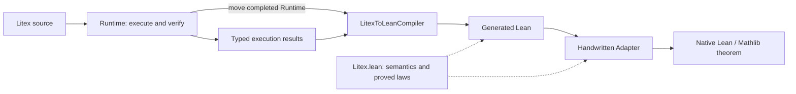

# Litex-to-Lean compiler architecture

This compiler turns the evidence from a successful Litex run into a Lean proof.
It preserves the source objects, construction conditions and selected proof
route. `lean/Litex.lean` gives those objects and facts their Lean meaning; a
handwritten adapter can expose the resulting theorem through an ordinary
Lean/Mathlib interface.

`lean/Litex.lean` is the stable `import Litex` entrypoint. Its implementation
is split into dependency-ordered files under `lean/Litex/`, preserving public
`Litex.*` names and source declarations. `BuiltinScalar` depends directly on
the scalar foundation; the larger semantic families retain conservative
source-order dependencies. Local Lean gates compile and fingerprint the entire
local import closure, rather than just the entrypoint.

This README explains that architecture and its implementation owners. Complete
worked examples live in their own READMEs: [adding zero](../../docs/examples/litex_to_lean/add_zero/README.md),
[Newton's single-step identity](../../docs/examples/litex_to_lean/newton_residual/README.md)
and the [rational-map walkthrough](../../docs/Litex_To_Lean_Compiler_Guide.md#two-rational-maps-from-definitions-to-a-native-equivalence).
The [compiler guide](../../docs/Litex_To_Lean_Compiler_Guide.md) covers detailed
usage; [CLI documentation](../../docs/cli.md#lean-compiler-boundary) owns command
syntax and stdout/error behavior.
The [coverage inventory and phase plan](../../docs/Litex_To_Lean_Coverage_Plan.md)
tracks remaining statement, object and builtin-theorem entrypoints separately
and records which new routes have passed Lean.

## The complete path



Runtime establishes what the source proved and retains the evidence for it.
The compiler renders that evidence using the semantic API. Lean checks the
resulting proof. Adapter then translates the interface into native concepts,
and the final Lean consumer cites Adapter. These are separate steps: emitting
Lean source does not run Lean or establish a native interface by itself.

## 1. Runtime produces the compiler input

The API sequence is:

```rust
let result = runtime.run_litex_code(&source)?;
let compiler = LitexToLeanCompiler::new(runtime);
let lean = compiler.compile_run(&result, &namespace)?;
```

The actual CLI owner is [run_compile_to_lean.rs](../run/run_compile_to_lean.rs).
Standalone sources use the API above. Beside `litex.config`, the CLI retains
original executed files and compiles each in its own `source_N` namespace.
Accepted module profiles cover qualified universal named-theorem calls,
concrete predicate formation/fold/inference, and original `let`/typed-alias
definitions with no free source context. Identifier unfolding replays the
original defining equality and selected residual; explicit object release
publishes only its actual stores and reuses the original constructor WD.
Producer namespaces remain attached to original declarations and guard facts;
local free hypotheses retain their hypothesis references. Qualified
`HaveFnEqual` profiles also replay the original anonymous-function and signature
formation, explicit release, checked arguments/guards and selected body
normalization through its exact equality citation and residual. Imported aliases
and same-named functions in distinct packages preserve their producer identity.
Other function/object/struct/template consumers and cross-file free parameter/axiom
contracts remain open. Ordinary fact visibility stays local
to each original file; imported declarations use separate qualified lookup.
[RunLitexCodeResult](../run/run_command_outcome.rs) retains the ordered
statement results. Their successful branches contain the original subjects,
parameter introductions, assumptions, selected proofs, WD evidence and
store/inference results needed by their consumers. A successful run can still
contain a result variant the compiler does not support.

The compiler consumes these Rust values directly. JSON is a presentation of
the run, not its current replay input. Compilation is not a field-by-field
translation of displayed JSON: one recorded stage can require several Lean
expressions, and some of those expressions need earlier recorded evidence.

The original completed Runtime is moved into the compiler, without cloning.
It supplies read-only resolution of exact cited IDs and their subjects.
Current results are not a self-contained citation archive: some records retain
IDs whose payloads must still be resolved from Runtime or their captured local
environments. The compiler does not run verification again to fill a gap.

## 2. One compiler dispatches the original results

[LitexToLeanCompiler](litex_to_lean_compiler.rs) owns only Runtime:

```rust
pub struct LitexToLeanCompiler {
    pub(super) runtime: Runtime,
}
```

`compile_run(&self, result, namespace)` receives the run as an argument. The
compiler has no lifetime parameter, stored result, or persistent object/fact
registry. Branch methods receive their original result and source position,
then return temporary Lean text. The convenience function
[compile_run](compile_run.rs) follows the same ownership contract.

The dispatch structure follows the executor's result enums:

```text
RunLitexCodeResult.statement_results
  → ExecStmtResult
    → Definition: objects, predicates, functions, theorems
    → Fact: VerifyFactResult
      → Equality / AtomicExceptEquality / supported compound facts
      → selected proof and ordered child evidence
    → By / ReleaseAndExpand / ProofBlock: supported proof commands
  → each branch's constructor WD, assumptions, proofs and stores
```

This is a map of the supported dispatch paths, not a promise that every variant
of those enums compiles. [compile_stmt_result.rs](compile_stmt_result.rs)
dispatches statements; [compile_verify_fact_result.rs](compile_fact_stmt_result/compile_verify_fact_result.rs)
dispatches verification results. Their leaf files own the mathematical cases.
For example, the [equality consumer](compile_fact_stmt_result/compile_equality_result/compile_equality_result.rs)
first compiles the original left and right WD, then the selected equality proof.
Constructor WD in a proposition is checked sequentially inside an explicit
`show Prop from by` block. `have` by existence emits the synthesized existential
once under its original `h_<fact_id>`; witness selection and the resulting facts
cite that proof instead of repeatedly expanding its dependent type.

Top-level `abstract_prop` declarations compile as arbitrary predicate parameters.
For example, `abstract_prop marked(x)` introduces
`(abstract_prop_1 : (Fin 1 → M.Value) → Prop)`; `$marked(a)` applies it to
`![Litex.denote a]`. The finite vector retains the declared arity, including
zero. Since predicates act on denotations, `Litex.Same` transports both a
property and its negation through ordinary Lean equality congruence.
The declaration supplies no truth or defining clauses.

The [abstract-predicate consumer](compile_def_abstract_prop_stmt_result.rs)
checks the original signature and argument WD. Predicate parameters and their
applications come from each declaration's original top-level source prefix,
alongside existing object parameters; no registry is added. Stored evidence
still uses `h_<FactId>`. Examples cover [equality transport and theorem calls](../../lean/examples/abstract_property_transport/),
[function guards](../../lean/examples/abstract_function_guard/) and
[mixed object/predicate contexts](../../lean/examples/abstract_property_context/).
Local and qualified abstract declarations remain unsupported.

Top-level structures with two or more independent fields use the existing Cartesian
representation, restricted by a bounded set builder when `<=>` supplies
conditions. `&CoordinatePair` is a set object;
its members keep their generic host representations. Field names select the
declaration's ordered coordinates, and a field access compiles to a certified
`Litex.cartCall`. The [declaration consumer](compile_def_struct_stmt_result.rs)
checks field WD and local parameter inferences before emitting the carrier.
The [membership consumer](compile_struct_membership.rs) consumes either the
literal tuple's ordered field proofs or the recorded complete Cartesian
membership, followed by the recorded proofs of every defining condition.

For quantified structure parameters, the [field consumer](compile_struct_fields.rs)
replays automatic opening: Cartesian membership, field/coordinate equalities,
then field memberships, defining conditions and their inferences, with the original FactIds.
Numerical observation of a field cites a released numeric membership before
the field can be used as a scalar in rational normalization. Examples cover
[coordinate arithmetic](../../lean/examples/coordinate_pair_fields/),
[distinct field carriers](../../lean/examples/indexed_point_fields/),
[an ambient arbitrary set](../../lean/examples/arbitrary_carrier_pairs/) and
[nested tuple membership](../../lean/examples/nested_coordinate_membership/).
The same field consumer handles `have p &CoordinatePair`, typed aliases such as
`have origin &CoordinatePair = (0, 0)`, and [explicit structure release](compile_release_struct_def_result.rs).
Ordinary `have` consumes its recorded nonempty check. A typed alias checks its
original hypothetical-parameter preflight separately, then emits the actual
value, membership and field stores. The preflight is applied to the checked
values so Lean can infer the host universes even inside a local block. Its
private facts never escape into the value's proof. Layer-prefix cursors preserve the order of multiple structure
parameters and reject references to later layers.

See [chosen pairs](../../lean/examples/chosen_coordinate_fields/),
[the origin](../../lean/examples/origin_coordinate_fields/),
[explicit release](../../lean/examples/released_coordinate_fields/) and
[local objects](../../lean/examples/local_coordinate_objects/).
The [condition consumer](compile_struct_conditions.rs) checks condition WD in
source order. Earlier conditions remain available to later constructors: in
the [positive ratio](../../lean/examples/positive_ratio_conditions/), the
nonzero denominator fact supplies the quotient's WD. Published universal laws
retain their original parameter and FactIds. Membership and release use the
proved `Litex.inSetBuilder_iff` bridge; they add no model laws.
Examples also cover [positive points](../../lean/examples/positive_point_conditions/),
[equal coordinates](../../lean/examples/equal_coordinate_conditions/),
[chain conditions](../../lean/examples/ordered_coordinate_conditions/),
[conjunctions](../../lean/examples/first_quadrant_conditions/) and
[global/local choice](../../lean/examples/chosen_positive_points/).
Conditions currently use supported atomic, flat conjunction and chain facts.
Structure headers also support set, nonempty-set and object parameters, including later
parameters typed by an earlier set. The [header consumer](compile_struct_header.rs)
replays their original introductions, argument WD and instantiated type proofs.
`struct Pair<A set>` becomes a Lean family with an object argument and its
sethood proof. Membership, release and published laws substitute the actual
arguments using source IDs. See [generic pairs](../../lean/examples/parameterized_pairs/),
[parameterized equality](../../lean/examples/parameterized_equal_pairs/),
[real thresholds](../../lean/examples/threshold_points/),
[a designated element of a set](../../lean/examples/designated_coordinate_pairs/) and
[global/local bindings](../../lean/examples/chosen_parameterized_pairs/).
`A nonempty_set` passes the original `Litex.IsNonempty A` hypothesis. The
shared quantified-head consumer preserves that kind in `forall`, named
theorems and their explicit calls. See [nonempty pairs](../../lean/examples/nonempty_parameterized_pairs/),
[their equality condition](../../lean/examples/nonempty_equal_pairs/) and
[the nonempty product theorem](../../lean/examples/nonempty_cartesian_theorem/).
Fields may also depend on earlier fields:

```litex
struct ElementPair<A set>:
    x A
    y x
```

The [dependent-field consumer](compile_dependent_struct.rs) emits an ordered
`Litex.DependentFields` family and proves its formation from the declaration's
original WD and parameter inferences. `Litex.dependentCart` collects its valid
flat tuples using the optional `IndexedUnionSemantics M` interface. The existing
ZF-based `NumericModel` implements this interface; `SetSemantics` is unchanged.
Only files declaring dependent fields acquire the additional model requirement.

Tuple membership replays each instantiated field obligation in order. Release
projects the certified field carriers and publishes the original FactIds.
Source numeric coordinates are connected to finite indices by one certificate
per declaration. See [element pairs](../../lean/examples/member_coordinate_pairs/),
[equal coordinates](../../lean/examples/repeated_coordinate_fields/),
[three dependent coordinates](../../lean/examples/repeated_coordinate_triples/),
[reciprocal WD](../../lean/examples/reciprocal_coordinate_fields/),
[defining conditions](../../lean/examples/positive_repeated_coordinates/),
[nonliteral membership](../../lean/examples/equal_coordinates_membership/) and
[choice and local aliases](../../lean/examples/chosen_repeated_coordinates/).

Structures require at least two fields. Self/forward field dependencies,
finite-set header kinds, quantified conditions, nested field paths,
function-call receivers and local/qualified structure definitions remain
unsupported. Field access and release require a directly declared structure
parameter or typed alias.

The [additive-shift consumer](compile_fact_stmt_result/compile_atomic_except_equality_result/compile_additive_shift.rs)
shows how a selected strategy becomes a Core theorem application. For
`AddLeftNonpositiveShiftRight`, it checks and compiles the recorded proofs of
`b <= r` and `a <= 0`, in that order, then applies
`Litex.addLeOfLeOfNonposSwap` to the original sum object. The constructor keeps
its own WD. [Upper-bound examples](../../lean/examples/weak_additive_upper_bounds/)
show all these inputs in the generated Lean. The
[numeric-bound consumer](compile_fact_stmt_result/compile_atomic_except_equality_result/compile_numeric_bound_weaken.rs)
resolves the exact cited bound and checks its integer endpoint before applying
order transitivity; it never searches for another bound.

The [componentwise-addition consumer](compile_fact_stmt_result/compile_atomic_except_equality_result/compile_componentwise_additive_order.rs)
replays two inequalities in their recorded order. It checks the addend pairing
and each comparison's strictness, then applies `Litex.addLeAdd`,
`addLeAddSwap`, `addLtAddOfLtOfLe` or `addLtAddOfLeOfLt` to the original sum
objects. The [three-term bound](../../lean/examples/three_term_sum_bound/)
combines two such steps and reuses the result through a named theorem.

The [shared-subtraction consumer](compile_fact_stmt_result/compile_atomic_except_equality_result/compile_subtraction_order.rs)
also retains the difference's real-domain evidence from formation. Its Core
law consumes that evidence, the recorded order proof and the common operand's
semantic equality. This works even when the common operand is declared in `C`
and only its differences are known to lie in `R`.
[Strict transitivity](compile_fact_stmt_result/compile_atomic_except_equality_result/compile_strict_order_transitivity.rs)
resolves the two recorded FactIds and validates their endpoints and strictness
flags before applying `ltTrans`, `ltLeTrans` or `leLtTrans`.

The [preimage consumers](compile_function_preimage.rs) compile `preimage(f, y)`
and `preimage_set(f, Y)` from the recorded complete function signature and
bounded-construction WD. Membership, projections and input-carrier containment
use `preimageMembers` / `preimageSetMembers`. Their Core representation depends
only on the function graph and target; the signature supplies a proof of
formation. Inferred calls retain the original input and domain evidence, with
proof elimination confined to proof-valued bindings. See the
[guarded reciprocal](../../lean/examples/guarded_reciprocal_preimages/) and
[two-input quotient](../../lean/examples/binary_quotient_preimages/) pairs.

The [composition consumer](compile_composition.rs) replays `compose(f, g)` / `f ∘ g`.
`CompositionObj` stores the original two objects; its denotation is their graph
composition. Its WD contains complete operand signatures and the universally
checked compatibility of `g`'s output with `f`'s domain. The compiler consumes
the recorded expanded lambda and body-call WD, then uses `composeInFnSet` and
`composeCall` for membership and beta steps. Cached calls use the original WD
and source equality paths; available constructor fields are referenced directly.
No new Runtime state or result registry is involved. The checked examples include
[a guarded two-input function](../../lean/examples/squared_gap_composition/),
[a nonzero outer guard](../../lean/examples/double_reciprocal_composition/) and
[arbitrary function parameters](../../lean/examples/abstract_function_composition/).
The [composition-law consumer](compile_fact_stmt_result/compile_equality_result/compile_composition_equality.rs)
also replays associativity, left/right identity and equality to the defining
lambda. Right identity checks the captured complete-domain match, including
guards. Range containment replays `CompositionRangeSubset`. See the
[graph laws](../../lean/examples/composition_graph_laws/),
[guarded identities](../../lean/examples/guarded_composition_identities/) and
[abstract associativity](../../lean/examples/abstract_composition_associativity/).
The [complete-domain consumer](compile_function_domain.rs) also replays the two
inclusions retained in `FunctionDomainComparisonProof::MutualInclusion`. It
validates their binders, memberships and guards, emits their original FactIds,
and derives domain equality with the existing set-extensionality law. The same
consumer serves right identity, `by fn_extension`, and `fn_set_member`; inclusion
proofs retain their original local scope. No Runtime or result changes are needed.

`by fn_extension` accepts one or two nondependent inputs, including `R+`. It
unpacks the original complete domain, applies the recorded pointwise proof and
transports along the proved tuple reconstruction. Examples include
[differently written positive guards](../../lean/examples/equal_positive_shifts/),
[reordered exclusions](../../lean/examples/reordered_function_domains/),
[binary sums and positive inputs](../../lean/examples/equal_binary_sums/), and
[guarded quotient formulas](../../lean/examples/equal_guarded_quotients/).
Dependent domains, more than two inputs to `by fn_extension`, and unsupported
complete-domain source variants still reject. Composition construction retains
its separate restriction on changing the packed-domain representation.

`fn_set_member` compiles these domain comparisons before the recorded return
obligations, through both `release thm` and selected `by thm` calls. Its source
signature uses the shared complete-domain consumer for formula functions,
cited arbitrary functions and compositions; the finite-function path retains
its separate index-set contract. Examples: [reordered guards](../../lean/examples/reordered_function_membership/),
[positive domains](../../lean/examples/positive_function_membership/),
[arbitrary functions](../../lean/examples/abstract_function_membership_domains/),
and [a composed quotient](../../lean/examples/composed_quotient_membership/).


Functions supplied as parameters may return another function with a fixed
signature. The compiler now replays chained calls, including a separate domain
check at each layer. `ApplicationReturn` supplies the original signature citation,
argument WD, guards and local WD registrations to the shared complete-domain
consumer. No replacement WD result is constructed. See [returned values](../../lean/examples/returned_function_values/),
[ranges](../../lean/examples/returned_function_ranges/), [preimages](../../lean/examples/returned_function_preimages/)
and [complex-valued membership](../../lean/examples/returned_function_membership/).
These pairs exercise `forall`, named `thm` and selected `by thm` with returned
functions. A `have fn` definition can also return a newly constructed anonymous
function, or accept and return an existing
function. See [a returned shift and its evaluation](../../lean/examples/selected_shift_function/)
and [the identity operator on functions](../../lean/examples/function_identity_operator/).
The `AnonymousFnInDeclaredFnSet` consumer checks the whole signature modulo
binder renaming, including guards and the return set, then cites
`Litex.formulaFnInFnSet` for the original WD-certified constructor. Its
[signature examples](../../lean/examples/literal_function_signatures/) include
unary and binary nonzero guards. Function-set objects are emitted as value
expressions with a proof-valued header `let`, so nested signatures reduce during
Lean elaboration.

Nested numeric functions can capture enclosing parameters. The compiler
interprets the original graph under the outer and inner parameter IDs while
retaining the original constructor WD and return-membership proof. Recorded
beta substitution preserves inner binders; remaining call groups are validated
against `continued_body`, then transported through `callValue` by congruence.
Examples cover [real and positive shifts](../../lean/examples/captured_shift_functions/),
[division with outer or inner guards](../../lean/examples/captured_division_functions/),
[a binary returned function](../../lean/examples/captured_binary_functions/) and
[immediate inner application](../../lean/examples/nested_function_application/).
Dependent carrier sets and complete-domain recovery after multiple call layers
remain pending.

The [sketch consumer](compile_sketch_stmt_result.rs) shows a branch with no
exported conclusion. It compiles the original child results inside a private
proof block, using their captured environment only to resolve exact citations.
The block ends with `True.intro`; its facts and objects stay local. No new
Core law or result fields are needed for this scope wrapper.

Binary intersection uses the existing bounded-separation semantics.
`IntersectObj` retains the two source objects; its denotation selects elements
of the first that belong to the second. The
[intersection consumer](compile_fact_stmt_result/compile_atomic_except_equality_result/compile_intersection.rs)
replays ordered membership and subset evidence. Its
[inference consumer](compile_intersection_inference.rs) publishes both recorded
membership projections under their original FactIds, so later statements and
theorem bodies can cite them. See [nested membership and theorem reuse](../../lean/examples/intersection_reassociation/).

The [set-equality consumer](compile_fact_stmt_result/compile_equality_result/compile_set_identities.rs)
dispatches the selected union/intersection identity to a proved Core law. It
validates the constructor, operands and orientation, then projects children
from the original formed object. Conditional intersection simplification
compiles the recorded subset proof at its original scope. The compiler does
not search for a different set identity or rebuild the children's WD.

`SetMinusObj` also uses bounded separation, retaining the original two objects.
The [difference consumer](compile_fact_stmt_result/compile_atomic_except_equality_result/compile_set_minus.rs)
compiles membership and nonmembership children in their recorded order. Its
[inference consumer](compile_set_minus_inference.rs) publishes base membership,
exclusion, and an optional singleton disequality under the original FactIds.
The [union-distribution consumer](compile_fact_stmt_result/compile_equality_result/compile_union_distribution.rs)
checks each distributed factor before composing the distribution, commutativity
and congruence laws; a source result is not accepted merely because it names a builtin.

The [subset consumers](compile_fact_stmt_result/compile_atomic_except_equality_result/compile_subset_bounds.rs)
replay transitivity, common upper bounds and monotonicity using the recorded
child proofs at their original stages. The
[componentwise union consumer](compile_fact_stmt_result/compile_atomic_except_equality_result/compile_union_subset_componentwise.rs)
checks direct or crossed operand pairing against those children. The producer
omits syntactically reflexive pairs; only those pairs emit `Litex.subsetRefl`.
Child indices count actual proofs, so omitted pairs do not shift citation scopes.
The [nonmembership consumer](compile_fact_stmt_result/compile_atomic_except_equality_result/compile_set_nonmembership.rs)
likewise checks the element and each factor before applying its Core law.

The [tuple-release consumer](compile_release_tuple_def_result.rs) is one complete
example of this dispatch. It reads the existing finite shape and domain result,
compiles the return and coordinate proofs, then emits the ordered stores. Its
[finite-function membership adapter](compile_finite_function_membership.rs)
connects these checked premises to proved laws in `Litex.lean`.
[Source/generated pairs](../../lean/examples/released_tuple_coordinates/) show
this path; [coverage notes](../../docs/Litex_To_Lean_Coverage_Plan.md#tuple-definition-release-2026-10-24)
record the checked cases and remaining boundaries.

[Cartesian release](compile_release_cart_def_result.rs) reuses the ordinary
equality compiler on its captured verification. The selected definition adapter
checks the exact finite domain and coordinate conditions, then applies the Core
membership equivalence. It publishes the original equality FactId after the
verification stages. [Examples](../../lean/examples/released_cartesian_definition/)
include subsequent citations; the [coverage notes](../../docs/Litex_To_Lean_Coverage_Plan.md#cartesian-definition-release-2026-10-24)
also cover empty products and arbitrary set parameters.

### Original identities and source visibility

Emitted fact declarations use `h_<original FactId>`. Temporary requirement
proofs can be passed directly to constructors; they do not automatically become
stored facts. Parameters retain their original identifier identities.
A declaration's binders are derived from its original
source context; a later object cannot become an extra argument to an earlier
theorem. Different host representations may inhabit different Lean universes;
universe and parameter declarations are rendered from those source records.

[SourcePosition](source_position.rs) borrows the original owner, its parent
position and a `before` stage boundary. It answers which producers have already
completed at this point. This is why an internal Rust borrow lifetime exists
without a lifetime parameter on the owning compiler. The cursor does not own
a second environment or a collection of generated scopes.

A citation must satisfy both checks: its ID resolves to the expected subject,
and its producer is visible in the original result prefix. Future siblings,
uncompleted inference and facts local to a closed proof are unavailable even
if Runtime still contains their records. [source_queries.rs](source_queries.rs)
and the source-position checks enforce this distinction. Cached WD likewise
needs a visible certified construction; the cache entry alone is not a proof.

Lean binders, local proof blocks and necessary proof-valued `let`s preserve
these dependencies in the output. Indentation alone does not establish scope.

Local quantifiers use inferred carrier universes. At an exported proof boundary,
`litex_complete` checks the supplied proof and defaults any remaining universe
metavariables that do not occur in the public theorem type. This handles an
unused local quantified lemma without adding proof-only universe parameters to
the exported declaration. It neither searches for a proof nor changes public
carrier parameters.

### Recent result consumers

- `ForallFactWithIff` replays its two recorded universal implications. Stored
  forward and reverse facts cite the corresponding projection. The
  [equivalence example](../../lean/examples/equivalence_directions/statement.lit)
  includes shared premises and a theorem-local equivalence.
- [Negated universals](compile_fact_stmt_result/compile_not_forall_result.rs)
  consume the recorded counterexample existence proof, checking the original
  binders, domain prefix and ordered CNF/DNF negation. The generated conclusion
  is `¬ ∀`, and its stored counterexample is emitted under the inference's
  original FactId. See [a singleton counterexample](../../lean/examples/not_every_element_is_one/statement.lit)
  and [a guarded reciprocal](../../lean/examples/reciprocal_counterexample/statement.lit).
  Quantifiers inside this proposition range over canonical semantic objects,
  as existing existential statements do; free objects retain their generic
  host types. Ordinary verified facts and local proof steps are covered.
  Separate NotForall WD consumers for assumptions/contra remain unsupported.
- [Negative existence](compile_fact_stmt_result/compile_exist_fact_result/compile_not_exist_result.rs)
  renders `not exist` as the negation of the existing semantic existential.
  Contradiction proofs consume their captured reverse assumption, obtained
  witnesses and closing contradiction; later uses cite the saved negative fact.
  Captured De Morgan forall inferences receive their original FactIds.
  See [the singleton exclusion](../../lean/examples/no_one_in_zero_singleton/statement.lit),
  [guarded division](../../lean/examples/nonzero_reciprocal_reflexivity/statement.lit),
  [a theorem, claim and theorem call](../../lean/examples/incompatible_existential_equalities/statement.lit),
  and [an existential body containing alternatives](../../lean/examples/no_self_unequal_alternative/statement.lit).
  The latter follows the producer's `NoInfer` result. Automatic universal
  applications are covered by the shared existential consumer below.
- [Unique existence](compile_fact_stmt_result/compile_exist_fact_result/compile_exist_unique_result.rs)
  pairs the existing existential with pairwise semantic uniqueness. A `witness
  exist!` consumes its recorded two-candidate forall proof; exact citations,
  `obtain`, named theorems, `claim` and explicit `by thm` preserve that pair.
  The inference's component equalities follow from the checked tuple equality.
  See [one real witness](../../lean/examples/unique_real_zero/statement.lit),
  [two coordinates](../../lean/examples/unique_real_pair/statement.lit),
  [a reciprocal with a free parameter](../../lean/examples/unique_reciprocal_value/statement.lit),
  [a saved theorem](../../lean/examples/unique_real_theorem/statement.lit), and
  [a universally quantified theorem call](../../lean/examples/unique_copy_theorem/statement.lit).
  The bijective-preimage builtin and functions selected by `have fn … by exist!`
  remain separate consumers.
- [Automatic existential theorem applications](compile_fact_stmt_result/compile_exist_fact_result/compile_exist_known_forall.rs)
  replay the recorded universal citation, selected conclusion, argument matches,
  memberships and domain proofs for `exist`, `exist!` and `not exist`.
  Unique existence also supplies ordinary existence by projecting its witness
  component. See [a unique copy](../../lean/examples/automatic_unique_copy/statement.lit),
  [a guarded reciprocal](../../lean/examples/automatic_unique_reciprocal/statement.lit),
  [two coordinates and existence weakening](../../lean/examples/automatic_unique_pair/statement.lit),
  and [an excluded copy](../../lean/examples/automatic_excluded_copy/statement.lit).
  `obtain` reuses the retained constructor WD for both positive families.
- [Registration](compile_register_stmt_result.rs) emits the verified `forall`
  law under its original FactId. Reflexive and symmetric rewrite results cite
  that visible law and replay their recorded premises. All three registration
  declarations compile; registered transitive-chain inference remains outside
  this increment. Concrete predicates may have arbitrary `set` parameters;
  see [registered equality](../../lean/examples/registered_equality/statement.lit).
- [Min/max construction](compile_fact_stmt_result/compile_obj_well_defined_result/compile_min_max.rs)
  consumes two child objects and their ordered real-membership proofs.
  `Litex.min` and `Litex.max` retain those proofs in the resulting object's WD.
  Four equality branches use proved idempotence/commutativity lemmas; structural
  membership retains a common carrier. The [example](../../lean/examples/real_min_max/statement.lit)
  checks real and integer membership, nesting and a `let` alias.
  [Closed evaluation](../../lean/examples/min_max_evaluation/statement.lit)
  uses a proved native min/max denotation and checks the returned exact value.
  [Bounds and monotonicity](../../lean/examples/min_max_bounds/statement.lit)
  replay `MinLowerBound`, `MaxUpperBound`, `MinWeakMonotone`, and `MaxWeakMonotone`.
  A fixed operand uses its recorded `SameArgument`; a changing operand consumes
  the original ordered comparison proof. The four conditional selection rules
  consume their exact weak-order premise and support either equality orientation;
  see [ordered selection](../../lean/examples/ordered_min_max_selection/statement.lit).
  Formula functions use the same `minMaxValue` denotation as these constructors.
  [Lower/upper functions](../../lean/examples/ordered_min_max_functions/statement.lit)
  exercise `have fn`, call unfolding, a concrete `prop`, conditional `thm`,
  `let`, and `by thm` together, retaining the existing function WD and call ABI.
- [Real sign](compile_fact_stmt_result/compile_obj_well_defined_result/compile_sign.rs)
  consumes one child WD and its real-membership proof. Its denotation uses
  Mathlib's `Real.sign`; the proved integer codomain supplies ordinary numeric
  observations. `SignOfPositive` and `SignOfNegative` consume the recorded
  strict-order premise, including reversed equality statements.
  [Sign values and membership](../../lean/examples/real_sign/statement.lit) and
  [a shifted direction function](../../lean/examples/shifted_sign_function/statement.lit)
  cover exact calculation, function bodies, nested expansion and theorem calls.
  The sign-of-product and sign-of-negation rule consumers remain unsupported.
- [Floor and ceiling](compile_fact_stmt_result/compile_obj_well_defined_result/compile_rounding.rs)
  retain one child WD and its real-domain proof, with denotation laws proved
  through Mathlib's `Int.floor` and `Int.ceil`. Integer identities consume the
  original integer-membership premise; monotonicity consumes the original
  argument comparison. The four defining bounds cite proved Core lemmas.
  [Exact values and integer identities](../../lean/examples/rounding_integers/statement.lit),
  [bounds and monotonicity](../../lean/examples/rounding_bounds/statement.lit), and
  [rounding functions](../../lean/examples/shifted_rounding_function/statement.lit)
  cover negative fractions, nesting, formula bodies and named theorem calls.
- [Integer division](compile_fact_stmt_result/compile_obj_well_defined_result/compile_integer_division.rs)
  keeps distinct WD contracts: `quot(a, d)` requires `a ∈ Z`, `d ∈ N+`;
  `a % d` requires integer operands and a nonzero divisor. `QuotObj` and `ModObj`
  denote native integer Euclidean division/remainder through proved bridges.
  Consumers replay quotient identities, both product orientations of the
  quotient/remainder decomposition, remainder bounds and argument congruence.
  See [signed values and declarations](../../lean/examples/signed_integer_division/statement.lit),
  [decomposition and bounds](../../lean/examples/quotient_remainder_decomposition/statement.lit),
  and [functions and fact reuse](../../lean/examples/integer_division_functions/statement.lit).
  Positive-natural assumptions emit their original positive, nonnegative and
  nonzero FactIds. Functions with `N+` domains use the existing set-domain
  signature, retaining that exact domain. The special gcd-modulus WD route
  remains unsupported alongside the gcd constructor.
- Builtin `Calculation::ClosedDecimal` and `ClosedRational` reuse the existing
  exact closed-equality bridge. Their recorded normal forms must match both
  original endpoints; a changed calculation certificate is rejected.

The registration rewrite tests additionally select the Runtime's actual rewrite
result directly: ordinary source verification can find a predicate-definition
proof first. These selected-stage fixtures test that consumer separately from
the source/generated examples' winning routes.

## 3. Litex.lean defines the object world

[Litex.lean](../../lean/Litex.lean) is the stable public entrypoint to the semantic
library. Generated files keep `import Litex`; dependency modules under
[lean/Litex/](../../lean/Litex/) preserve the `Litex.*` names. Its main concepts
have distinct responsibilities:

| Concept | Meaning |
| --- | --- |
| `M : Litex.Semantics` | An explicit interpretation: semantic values, membership, sethood, numbers, operations and their laws. |
| `Representation M α` | How a Lean host type represents values of `M`, and which host values are well-defined. |
| `Litex.Obj α` | A host value together with its WD proof, under that representation. |
| `Litex.denote a` | The semantic value represented by an object. |
| `Litex.In a A` | The ordinary proposition `M.mem (denote a) (denote A)`. |
| `Litex.Same a b` | Equality of semantic denotations, including objects with different host representations. |
| `Litex.IsSet a` | The proposition `M.isSet (denote a)`. |

Lean host types describe representations; membership describes mathematical
classification. Learning `In a R` therefore adds a fact without replacing `a`
by a value of Lean type `ℝ`. Supported numeric membership bridges provide the
`N ⊆ Z ⊆ Q ⊆ R ⊆ C` relationships while preserving the original object.

Every certified object is a set: `Representation.wd_isSet` derives sethood from
its WD. This applies to numbers and functions as well. It does not give every
arbitrary Lean type a representation, or make sethood alone sufficient for a
particular arithmetic constructor. For example, the number object representing
`1` has sethood, while a division additionally needs a nonzero denominator.

`Same` supports transport of facts through their semantic interpretations.
It is not an assertion that arbitrary host payloads are Lean-equal. A native
`=` conclusion requires a proved faithful observation, such as the numeric
embedding's injectivity.

### Construction conditions belong to objects

Core's object declaration packages the value and its construction evidence:

```lean
structure Obj {M : Semantics.{u}} (α : Type v) [Representation M α] where
  val : α
  wd : WD (M := M) val
```

Arithmetic and calls retain dedicated Litex representations. An addition
constructor receives two already certified objects and their complex-member
proofs; division also receives the denominator's nonzero proof. A function
call receives the function-space membership, argument membership and guard
proof. The resulting object stores its WD certificate. These proof arguments
justify the operation; they do not change its denotation.

The [object-WD compiler](compile_fact_stmt_result/compile_obj_well_defined_result/compile_obj_well_defined_result.rs)
replays the original children and domain evidence to supply those arguments.
An inference rule can also have its own recorded construction evidence; it
must not be disguised as a verifier WD stage that never occurred.

Functions have semantic graphs and certified call objects. `FunctionSignature`
records the supported input shape, actual output set, its sethood proof and
guard. `SetSemantics M` supplies bounded set constructors and extensionality;
`FunctionSemantics M` extends it with graph and application laws. The compiler
requests the additional interface when supported source constructions or
recorded inference require it. A formula body
may have an internal Lean interpretation function, while the source function
itself remains a certified Litex object.

Formula-body interpretations use the same proof-independent values as their
certified constructors. The [trace](../../lean/examples/matrix_trace_formula_functions/),
[finite inner product](../../lean/examples/finite_inner_product_formula_functions/)
and [Frobenius norm](../../lean/examples/frobenius_norm_formula_functions/)
pairs cover real/complex inputs, captured dimensions, empty dimensions and
arithmetic around the result. Their original dimension and membership evidence
still supplies constructor WD. Empty-dimension equalities replay the recorded
function expansion, matrix formula and empty finite sum in order. The compiler
checks their subjects and values; it does not rerun verification.
The same construction path supports [matrix products](../../lean/examples/matrix_product_formula_functions/),
[diagonal matrices](../../lean/examples/matrix_diagonal_formula_functions/) and
[outer products](../../lean/examples/matrix_outer_formula_functions/) in formula
bodies. These pairs also check coordinate access on the returned matrix;
the original call and index evidence remains required.

[Powers](../../lean/examples/matrix_power_formula_functions/),
[minors](../../lean/examples/matrix_minor_formula_functions/),
[adjugates](../../lean/examples/matrix_adjugate_formula_functions/) and
[inverses](../../lean/examples/matrix_inverse_formula_functions/) use the same
values inside formula bodies. Powers retain their natural-exponent evidence;
minors retain the positive order and deleted-row/column conditions. Inverse
construction consumes the original nonzero-determinant proof, including an
instantiated prior universal fact in the empty-matrix example. Structural
matching transports the determinant along its recorded child equalities;
constructor WD still comes from the original evidence.

Nonempty [trace](../../lean/examples/matrix_trace_evaluation/),
[inner-product](../../lean/examples/finite_inner_product_evaluation/),
[Euclidean-norm](../../lean/examples/euclidean_norm_evaluation/) and
[Frobenius-norm](../../lean/examples/frobenius_norm_evaluation/) calculations replay
the recorded index enumeration, coordinate calls and accumulated values. Nested
sums consume the existing evaluation records in order. Both ordinary equalities
and `eval` are checked; the trace example also reuses its result in a function
with a nonzero guard. These examples cover rational intermediate values and
exact square roots. The compiler checks the supplied records without rerunning
the evaluator or registering new intermediate objects.

### The model is explicit

Declaring `Semantics` states the laws an interpretation must satisfy. Generated
theorems are conditional on `M` and any required set/function instances; the
record declaration does not establish a model of all Litex mathematics.

Core also contains the concrete `NumericModel.model` and proved set/function
instances for the supported interface. It uses actual `ZFSet` values, an
injective complex-number encoding and ZF membership. Its sethood predicate is
`True` because the underlying values already are sets; membership and equality
remain substantive. A native adapter selects this model explicitly. It is not
a default interpretation or a completed model of every Litex object and rule.

## 4. Recorded proof rules become Lean proofs

The compiler dispatches the evidence route that Litex selected, including its
ordered requirements, orientations and original citations. Supported rules
use proved Core lemmas and logical proof construction. Some routes expand into
several lemmas or local steps; there is no required one-rule/one-line mapping.

For example, the equality consumer maps recorded `SameIr` evidence to
`Litex.sameRefl` after checking its endpoints. A selected rational-normalization
certificate instead uses the reviewed numeric observations and a fixed
normalization proof. It does not select an unrelated add-zero lemma merely
because the goal happens to be `a + 0 = a`. Fixed `ring` or guarded normalization
checks the recorded certificate family; it is not a second search for a proof
route missing from the source result.

The selected `ExtremumEquality` strategy consumes its two original ordered
weak-order proofs and applies `Litex.sameOfLeAntisymm`. The
[`extremum_order_strategy`](../../lean/examples/extremum_order_strategy/statement.lit)
pair exercises maximum and reversed minimum conclusions. The selected
`ComplexWithNonzeroPremises` strategy retains whole-denominator guards,
derives required multiplicative-factor nonzero proofs, and invokes the fixed
`litex_normalize_guarded_complex` adapter. The
[`complex_guarded_normalization`](../../lean/examples/complex_guarded_normalization/statement.lit)
pair covers an atomic denominator and an explicitly nonzero product. Both
pairs have strict source, deterministic generation and real Lean checks.
Coverage remains specific to the selected certificate and its checked guard
profiles. The selected `FiniteSetProductPointwiseEquality` strategy now borrows
its captured local environment, introduces the original parameter and membership
store, and replays the actual pointwise proof under that binder. The existing
finite-aggregate congruence law consumes this proof. Function objects retain
their own complete domains; the call/body bridge uses their certified graphs.
The [integer](../../lean/examples/finite_product_pointwise/statement.lit),
[mixed-domain](../../lean/examples/finite_product_mixed_domains/statement.lit)
and [real](../../lean/examples/finite_product_real_factors/statement.lit) pairs
have deterministic generation and pinned Lean checks. Tests reject changed
endpoints, missing or changed binder evidence, future references, escaped local
membership and a pointwise proof borrowed from a sibling scope. These examples
establish anonymous unary factor cases; named-function discovery and other
function/domain profiles remain separate work.

The selected `CosZeroIntegerOffset` strategy validates the original
`(angle - pi/2)/pi` subject, requirement IDs and order, and replays its integer
membership evidence. The native cosine-zero law then consumes that exact
offset. The [direct](../../lean/examples/cosine_integer_offset/statement.lit)
and [reversed](../../lean/examples/cosine_integer_offset_reversed/statement.lit)
pairs check both conclusion orientations; the latter preserves the original
equality transport within its membership child. Both actual selected results
have one requirement. The separate equality-plus-membership certificate
profile still needs actual generated acceptance. The existing `PiNonzero`
builtin also has a [checked pair](../../lean/examples/pi_nonzero/statement.lit),
so offset formation can replay its original denominator guard. These consumers
change no source search policy.

The selected `ModCongruence` strategy replays modulus identity, first-residue
equality and second-residue equality in that order. It validates the original
IDs and endpoints, retains each modulus's WD and applies the fixed
`integerModAddCongr`, `integerModSubCongr` or `integerModMulCongr` law. When the
producer elides a repeated residue wrapper, `integerModValueIdempotent` supplies
that exact semantic identity. Checked pairs cover
[all three operations](../../lean/examples/mod_congruence_operations/statement.lit),
[different equal modulus objects](../../lean/examples/mod_congruence_equal_moduli/statement.lit),
[partly reduced operands](../../lean/examples/mod_congruence_nested_residues/statement.lit)
and a [negative modulus](../../lean/examples/mod_congruence_negative_modulus/statement.lit).
The fully reduced compatibility clause retains its earlier equality route.
Ten focused tests also reject missing, reordered and mismatched evidence and
an unavailable later proof of the same modulus identity. All four actual pairs
have deterministic generation, pinned Lean checks and standard-axiom audits.

Unsupported statements, objects, proof variants, references or scopes reject
the complete artifact. [LeanCompileError](lean_compile_error.rs) records the
route and, for statement failures, the statement index. The compiler returns
one complete source string or an error, without inserting an axiom, proof hole,
or invented premise to fill unsupported evidence.

Top-level source `trust` and user `axiom` compile to explicit `h_<FactId>`
hypotheses. Later declarations receive those hypotheses as parameters, and a
named axiom can be cited, released or used by `by thm`. Their original WD and
inference stages are still checked. These source files require non-strict mode.
Top-level `trust have` similarly introduces certified objects and their membership
and body facts as explicit parameters. Local trust in `claim`, named theorems
and `sketch` is closed over the original enclosing binders and premises. For
example, trusting `x > 0` inside a theorem about admissible real `x` adds the
hypothesis that every admissible real is positive. The conclusion stays unchanged,
and later theorem calls pass that hypothesis by its original FactId. Closure
hypotheses range over semantic objects so calls work across host universes.
Local trust after witness extraction, local `trust have` and locally trusted
universal statements remain rejected until their closure/citation paths are
supported.

`template` retains `body: Box<ExecStmtResult>` and compiles its body through the
ordinary statement dispatcher. The current body slice is a single `have … = …`
object definition, including set aliases and guarded numeric expressions. Original
header WD and premises parameterize the generated object; instance WD supplies
the recorded arguments and guard proofs. Each published definition fact cites its
retained `source_fact_id`. Detailed JSON exposes the header evidence, ordinary
body result and publication links. Function, choice/witness and trust-have template
bodies remain explicit unsupported branches. See the
[guarded quotient](../../lean/examples/template_guarded_quotient/statement.lit)
and [local assumption](../../lean/examples/admissible_reals_assumption/statement.lit)
pairs.

Foundation statements use proved Core laws. `regularity` requires an optional
`RegularitySemantics` instance, supplied for the ZF model. Replacement constructs
a partial functional image using separation and `IndexedUnionSemantics`, with
the exact recorded uniqueness citation. Choice constructs a function graph;
Zorn applies Mathlib's bounded-chain theorem to the semantic members of a set.
The choice and Zorn results retain each premise's verification and WD/store pair,
so the compiler can reuse its FactId without repeating proof search. Their local
proof blocks do not export helper facts. See the [six checked examples and current
boundaries](../../docs/Litex_To_Lean_Coverage_Plan.md#explicit-assumptions-and-foundation-releases-2026-10-25).

The current consumers cover selected numeric, set, formula-function, predicate,
quantifier and theorem-reuse routes. Recursion is bounded to the reviewed unary
natural-index slice starting at index zero, with ordered `n = 0` and `n > 0`
cases and predecessor calls; the initial value need not be zero. Ordinary
zero-based induction also has a bounded consumer. Supporting
these constructors does not mean every proof using them can be compiled.
See the [guide](../../docs/Litex_To_Lean_Compiler_Guide.md) and individual example
READMEs for demonstrated combinations and their acceptance status.

To extend replay, start from an actual successful result variant and its
recorded premises. If a needed stage was computed but not returned, retain it
in its original producer before adding a consumer. Implement the corresponding
enum branch, use or prove the required Core law, and keep all original IDs,
construction checks and scope boundaries. Verify an actual source/generated
pair and a nearby missing-or-invalid-evidence rejection. Recognizing a desired
conclusion is not a substitute for supporting its recorded proof route.

## 5. Adapter exposes an ordinary Lean interface

A generated theorem speaks the Core vocabulary: generic objects, memberships,
`Same`, and an explicit semantic interpretation. A handwritten `Adapter.lean`
chooses the native inputs, constructs their certified representations, invokes
the generated theorem and converts its conclusion through proved bridges.

For generic numeric members, `NativeBridge.asComplex` and `asReal` observe the
original object using its membership proof. These observations are
noncomputable; they do not retype the object or promise executable extraction.
For native inputs, `Litex.number`
embeds the value. Bridges such as `addSame_iff` relate the resulting operation
to native arithmetic. These conversions preserve the generated proof as a
live dependency; Adapter does not independently reprove the mathematical result.

`Final.lean` then exposes ordinary Lean/Mathlib binders, hypotheses and a
conclusion. Only its proof body calls Adapter. The [add-zero walkthrough](../../docs/examples/litex_to_lean/add_zero/README.md)
shows the complete small implementation; [Newton](../../docs/examples/litex_to_lean/newton_residual/README.md)
adds a guarded function and a real-valued interface. These adapters are
handwritten; the compiler currently generates the proof-facing artifact.

## 6. Verification and ownership

Each check establishes a different part of the chain:

| Check | Evidence it establishes |
| --- | --- |
| Strict Litex execution | The source run succeeds under the CLI's strict-mode rules. |
| Actual compiler generation | The recorded evidence is accepted by implemented replay branches. |
| Byte-for-byte regeneration | The maintained generated file matches actual compiler output. |
| Lean checking of Core and generated output | The generated proposition has a Lean proof under its declared parameters. |
| Adapter/Final checking and dependency audit | The native theorem is checked and actually uses the generated proof through the reviewed model and bridges. |
| Axiom audit | The checked declarations use only the accepted foundation dependencies. |

Strict execution alone does not establish compiler coverage or a model for
every source foundation. A successful conditional generated theorem likewise
does not establish a concrete native theorem until the model and conversion
obligations are discharged. Report these gates separately.

The maintained files have these owners:

| Location | Responsibility |
| --- | --- |
| `src/compile_to_lean/` | Result dispatch, evidence validation and Lean emission. |
| `lean/Litex.lean` | Semantic interfaces, certified constructors, proved models and bridge laws. |
| `lean/examples/<problem>/` | Litex source and its actual generated Lean pair. |
| `docs/examples/litex_to_lean/<problem>/` | Worked-example README and public handwritten Adapter/Final files. |
| `scripts/litex_to_lean/` | Local-only check tools, pinned Lake environment and acceptance receipts. |

Keep the public `lean/` tree limited to Core and generated pairs. Change a
paired Lean file by regeneration through the CLI. For compiler changes, use
focused result/citation tests and the affected source/generated/native checks;
the local `scripts/litex_to_lean/check.py` gate is development tooling and is
not published with the repository. Full examples, mathematical
experiments and their progress records belong in their own documentation.

## Limits: replaying a complete proof

The [punctured cancellation source](../../lean/examples/function_limit_punctured_cancellation/statement.lit)
defines `f(x)=x²/x` on `x≠0`, proves accumulation at zero and the epsilon-delta
estimate, folds `$has_limit_at(f,0,0)`, then uses `fn_lim(f,0)`.
The compiler follows those recorded stages:

| Result evidence | Compiler owner | Lean law or artifact |
| --- | --- | --- |
| Two verified definition clauses | [Definition consumer](compile_function_limit_definition.rs) | `finiteFunctionLimitOfForall`, applied to the original clause proofs |
| Function/point WD, real domain and convergence | [Function-limit consumer](compile_function_limit.rs) | Certified `finiteFunctionLimit` object |
| Selected candidate and equality evidence | Same equality consumer | `finiteFunctionLimitEqCandidate` |
| Generated epsilon estimate and the same function graph | Handwritten [Adapter](../../lean/examples/function_limit_punctured_cancellation/Adapter.lean) | Native `Tendsto` statement in [Final](../../lean/examples/function_limit_punctured_cancellation/Final.lean) |

The native proof depends on the generated theorem. Its adapter converts graph
membership and numeric observations; its limit estimate comes from Litex.
Finite and one-sided limits preserve nontrivial approach through the actual
domain. Infinite limits preserve directional unboundedness as well as the
original epsilon/threshold condition. Their selectors have fixed denotations
independent of which WD evidence certified them.

Explicit function-limit uniqueness, existence, selection, constant/identity laws,
epsilon introduction and accumulation/control projections use the
[function theorem consumer](compile_builtin_function_limit_theorem.rs).
The [real accumulation consumer](compile_real_limit_accumulation.rs) constructs
real-line witnesses without a function or limit hypothesis. Quantified premises
and released universals range over semantic objects; known instantiations and
renamings pass `semanticObject (denote a) (isSet a)`. This preserves the source
object and its original membership fact across Lean host universes.
It validates the reserved theorem ID, arguments, ordered premises, stores and
returned conclusion before applying the corresponding proved Core law.
The [sequence theorem consumer](compile_builtin_sequence_limit_theorem.rs)
handles the same certificates plus epsilon introduction, tail extraction,
Cauchy introduction/tail extraction and the two directions between convergence
and existence of a real candidate limit.
The two function-limit consumers share the domain-view emitter and accumulation
validator; both read the original captured signature and domain evidence.

The [unary](compile_function_limit_unary.rs) and
[binary](compile_function_limit_binary.rs) algebra consumers replay negation,
absolute value, real scaling, natural powers and the four arithmetic limit laws
for finite, one-sided and infinite approaches. Core proves the correspondence
between its epsilon estimates and Mathlib `Tendsto`, then applies the native
continuous-operation or division theorem on the same complete graph domain.
The compiler validates the recorded operation, pointwise formula, parameter
membership and domain equalities. Division retains separate proofs that the
limiting denominator and every denominator call are nonzero.

The [side](compile_function_limit_sides.rs),
[eventual](compile_function_limit_eventual.rs),
[comparison](compile_function_limit_order.rs),
[local equality](compile_function_limit_local.rs) and
[squeeze](compile_function_limit_squeeze.rs) consumers preserve the recorded
neighborhood and its strict side or infinite direction. Local equality keeps
the two complete domains separate and requires the target-domain accumulation
and local inclusion evidence. Squeeze keeps all three signatures and both
equal-domain proofs. These laws consume the source's selected premises through
their `h_<fact_id>` citations; Core proves the transfer laws.

The [polynomial chain](../../lean/examples/function_limit_polynomial_chain/)
combines identity, constant, power, addition, subtraction and multiplication
certificates. Its generated limit supplies the estimate used by a native
`polynomialProductLimit` theorem through Adapter/Final.

## Shared results and pointwise continuity

An expanded theorem call now emits one proof package and projects its returned
facts under their original `h_<fact_id>` names. Its package type uses the
callee's ordered `conclusions_wd`. The caller's `stored_wd` is replayed as each
result becomes visible; it can legitimately cite an earlier returned fact.
The [reciprocal example](../../lean/examples/shared_reciprocal_theorem_results/)
checks this dependency, and the [constant-sequence example](../../lean/examples/constant_sequence_properties_by_theorem/)
shares one call across five properties.

The [continuity consumer](compile_function_continuity.rs) checks the complete
real-function domain and the point's original membership evidence. The
[definition consumer](compile_function_continuity_definition.rs) replays its
stored epsilon-delta clause and definition folding. The inference result retains
the complete-domain proof used to construct that clause in `function_domain`.
The [theorem consumer](compile_builtin_continuity_theorem.rs) handles the eighteen
existing introduction/control/constant/identity and continuity/limit connection
rules for two-sided, left and right continuity.
The [unary](compile_function_continuity_unary.rs),
[binary](compile_function_continuity_binary.rs) and
[composition](compile_function_continuity_composition.rs) consumers add 27
existing IDs. They keep output-domain inclusions, the original pointwise
formula and its WD, scalar/exponent membership, and divisor nonzero evidence.
Composition also checks that inner values lie in the outer domain. The `R+`
domain bridge reconstructs positive membership from the normalized signature.
See [restricted division](../../lean/examples/function_continuity_divide_restricted_domain/),
[positive-domain composition](../../lean/examples/function_continuity_compose_positive_domain/)
and [the square continuity-to-limit chain](../../lean/examples/function_continuity_square_limit/).
One-sided neighborhoods include the point (`x ≤ p` or `p ≤ x`), matching Litex.
Examples cover [epsilon introduction](../../lean/examples/function_continuity_at_from_epsilon_by_theorem/),
[control extraction](../../lean/examples/function_continuity_at_control_by_theorem/),
[a guarded domain](../../lean/examples/function_continuity_guarded_citations/)
and [equality transport](../../lean/examples/function_continuity_semantic_transport/).
Core proves the equivalence with Mathlib `ContinuousWithinAt` on the same
closed-side domain. `NativeBridge.ofRealFunction` wraps a native `ℝ → ℝ`;
its call, observation and continuity laws prove the ordinary `ContinuousAt`
interface. The [constant](../../lean/examples/function_continuity_at_constant_by_theorem/Final.lean)
and [identity](../../lean/examples/function_continuity_at_identity_by_theorem/Final.lean)
native interfaces consume the generated proofs through Adapter.
Global and uniform continuity and Lipschitz conditions remain
separate routes.

The [accumulation consumer](compile_real_accumulation.rs) handles positive and
negative real-subset accumulation facts, their definition clauses and equality
transport. Formation requires `A ⊆ R` and `p ∈ R`; the predicate keeps its
original approach side. Conversion from continuity to a limit cites the
recorded accumulation fact. The [identity limit example](../../lean/examples/function_continuity_identity_limit/)
combines the function formula, continuity, accumulation, limit selection and a
subsequent arithmetic use in eight statements, generating 41,701 bytes of Lean.
Standard-set membership lifting also uses its recorded child proof for ordinary
objects as well as function calls.

For sequences, Core proves the epsilon-limit and Cauchy correspondences with
Mathlib. `NativeBridge.ofRealSequence` wraps a native `ℕ → ℝ` while preserving
Litex's positive-natural input domain. The [limit-to-Cauchy example](../../lean/examples/sequence_limit_cauchy_by_theorem/)
exports a native `CauchySeq` theorem through its handwritten Adapter/Final.

## Finite sequence extrema and object WD

The [selector consumer](compile_sequence_extremum.rs) replays both finite
`limsup` and `liminf` from the original candidate or existence evidence. Their
[definition consumer](compile_sequence_extremum_definition.rs) validates both
the eventual bound and hits on every tail; neither clause alone defines the
candidate. Core proves uniqueness and construction preserves the positive
natural index domain. Positive/negative facts, citations and selected-value
equality retain their original subjects and IDs.

Ten existing [explicit theorem routes](compile_builtin_sequence_extremum_theorem.rs)
cover constant sequences, existing limits, existence, selected candidates and
uniqueness for both extrema. The
[nested-object example](../../lean/examples/sequence_extrema_nested_objects/statement.lit)
uses the selectors in arithmetic, a tuple and a formula-function body. Its
nine source statements generate 50,663 bytes. Numeric selectors remain opaque
atoms in the recorded rational normalization; their original WD and proved
codomain supply the observations.

The current all-object/WD plan is tracked locally under
`scripts/litex_to_lean/plans/`. Constructor entries and their legal WD branches
are counted separately.

The [derivative consumer](compile_function_derivative.rs) constructs a derivative
only from the source's candidate or existence evidence. Core uses the original
interior-point and punctured difference-quotient definition, proves its
correspondence with `HasDerivAt`, and proves uniqueness. It does not replace
source WD with Mathlib's totalized `deriv`. The
[inference consumer](compile_function_derivative_definition.rs) replays the
stored interior, quotient-limit, existence and differentiability consequences.
The result retains the original domain lookup, including its optional route;
it adds no proof search or facts. Source fact IDs and projected run output are
unchanged. See [candidate selection](../../lean/examples/derivative_candidate_selection/),
[existence selection](../../lean/examples/derivative_existence_selection/),
[positive domains](../../lean/examples/derivative_positive_domain_selection/)
and [explicit guards](../../lean/examples/derivative_guarded_domain_selection/).
The [definition example](../../lean/examples/derivative_from_definition/) and
[positive-domain version](../../lean/examples/derivative_positive_from_definition/)
compile both original clauses through `by def`. A
[captured formula body](../../lean/examples/derivative_formula_body/) and
[nested-use example](../../lean/examples/derivative_nested_objects/) retain selector WD.

The [pointwise consumer](compile_pointwise_derivative.rs) replays the recorded
constant, variable, arithmetic, natural-power, exp/sin/cos/log/sqrt and chain
rules. [Composition](../../lean/examples/derivative_composition_candidate/)
uses the exact cited outer derivative; [selection](../../lean/examples/derivative_composition_selected/)
uses the original differentiability and selector WD. The
[interior consumer](compile_derivative_interior.rs) proves neighbourhood stability
from recorded guard operands and point facts. See the
[positive guard](../../lean/examples/derivative_guarded_positive_calculation/),
[nonzero guard](../../lean/examples/derivative_guarded_nonzero_calculation/),
[weak inequality with strict slack](../../lean/examples/derivative_guarded_weak_calculation/),
[interval](../../lean/examples/derivative_guarded_interval_calculation/) and
[absolute-value guard](../../lean/examples/derivative_guarded_absolute_calculation/).
It rejects a relative-continuity leaf without the neighbourhood evidence needed
for a classical derivative. Isolated-domain continuity and boundary membership
do not supply that evidence.

The current derivative checkpoint freshly checks 28 derivative-related and two
existing function-limit pairs: strict source verification, deterministic
generation, Lean/Mathlib 4.31.0 and 90 audited exports with only `propext`,
`Classical.choice` and `Quot.sound`. Core SHA256:
`f996608710475852e20b3e730ffe8f93f7810a182084c6522a5565ae93b43cae`.
Twenty focused derivative compiler tests pass. A local handwritten Adapter/Final
check consumes the generated square-derivative theorem and exports ordinary
`HasDerivAt (fun x : ℝ => x ^ 2) 6 3` and `deriv (fun x : ℝ => x ^ 2) 3 = 6`.
Explicit differentiation theorem calls and exhaustive constructor/WD context
coverage remain separate work.

## Current mathematical reach

The implemented subset connects elementary algebra and real inequalities over
N/Z/Q/R/C and positive reals with basic sets, guarded numeric functions and
reusable theorems. The [coverage table and example navigation](../../docs/Litex_To_Lean_Compiler_Guide.md#current-mathematical-coverage-and-examples)
([中文](../../docs/Litex到Lean编译器指南.md#当前覆盖的数学范围与示例)) identify representative
checked source/generated pairs and distinguish complete examples from bounded
rule checks. Start with [adding zero through Adapter](../../docs/examples/litex_to_lean/add_zero/README.md),
then explore the [example collection](../../lean/examples/). Real-set bounds,
extrema, real sequence limits and finite real function limits at finite points,
one-sided points and positive/negative infinity have checked compilation routes.
The [punctured cancellation example](../../lean/examples/function_limit_punctured_cancellation/)
also exposes its proved limit as an ordinary Mathlib theorem.


Template membership now replays the original declaration-owned carrier expansion
and its actual residual search, followed by the original converted and native
inference stores. Checked examples cover [Cartesian membership](../../lean/examples/template_membership_conversion/),
[nested instances](../../lean/examples/template_membership_nested/),
[function sets](../../lean/examples/template_membership_function/),
[guarded instances](../../lean/examples/template_membership_guarded/),
[identifier stopping](../../lean/examples/template_membership_identifier_stop/)
and [opaque local binders](../../lean/examples/template_membership_binder/).
All six strict sources regenerate identically and pass actual pinned Lean with
the standard three axioms. Twelve replay tests retain altered-evidence and stage
visibility controls. Further native inference combinations remain independent
profiles; this does not establish KnownStrategy or module proof closure.


The native determinant search routes now replay their original selected laws
and direct endpoint matches: [identity](../../lean/examples/native_determinant_identity/),
[transpose](../../lean/examples/native_determinant_transpose/),
[adjoint](../../lean/examples/native_determinant_adjoint/) and
[stored equality transport](../../lean/examples/native_determinant_transport/).
They share fixed schema validation and proved Core bridges with explicit theorem
calls while preserving each result's original stages. The checkpoint passes six
focused controls, all 1,674 compiler Rust tests and ten actual Lean pairs,
including existing theorem/inverse regressions and
[named exact coordinate evaluation](../../lean/examples/matrix_exact_named_determinant/).
That checkpoint establishes those three variants; subsequent accepted profiles are listed below.


Declared strategies now retain their actual original body introduction,
assumption WD/stores and proof steps separately from goal formation. The compiler
checks the dedicated declaration and replays its actual selected KnownStrategy
calls, without making it an ordinary source forall. Examples cover
[ordinary calls](../../lean/examples/strategy_known_application/),
[multiple conclusions](../../lean/examples/strategy_multiple_conclusions/),
[dependent arguments](../../lean/examples/strategy_dependent_arguments/),
[local declarations](../../lean/examples/strategy_local_declaration/),
[nested proof bodies](../../lean/examples/strategy_nested_proof/) and
[stored guards](../../lean/examples/strategy_guarded_transport/).
All six pairs pass strict verification, identical regeneration and actual pinned
Lean with the standard three axioms. Eight focused tests retain evidence and
scope corruption controls. The full 1,681-test compiler checkpoint includes the
first seven; the eighth passed separately with no strategy production changes.
Richer matching/callee profiles and module closure remain separate work.


Native matrix [power zero](../../lean/examples/native_matrix_power_zero/) and
[successor](../../lean/examples/native_matrix_power_successor/) now consume the
original law application and ordered exponent guard. The
[zero-rank](../../lean/examples/native_matrix_rank_zero/) and
[reverse identity-rank](../../lean/examples/native_matrix_rank_identity/)
profiles use the same replay pipeline. Pure schema validation and proved Core
emission are shared with explicit theorem calls. Five focused controls, all
1,691 compiler Rust tests and ten actual pinned Lean pairs pass. Seven of the
33 native matrix search laws have accepted profiles at this checkpoint; the
remaining 26 and further combinations require separate acceptance.


Rectangular rank invariance now replays both
[native transpose](../../lean/examples/native_matrix_rank_transpose/) and
[native reverse adjoint](../../lean/examples/native_matrix_rank_adjoint/), plus
[explicit transpose](../../lean/examples/matrix_rank_transpose/) and
[explicit adjoint](../../lean/examples/matrix_rank_adjoint/) theorem calls.
Two proved Core bridges reuse fixed Mathlib rank laws. Three focused controls,
all 1,696 compiler Rust tests and nine actual Lean pairs pass. Nine of the 33
native matrix laws have accepted profiles at this checkpoint; remaining variants
and richer combinations stay independently auditable.


Finite vector laws now replay
[reverse conjugate symmetry](../../lean/examples/native_inner_product_symmetry/)
and the norm-square law's actual selected
[self-inner-product conclusion](../../lean/examples/native_euclidean_norm_square/).
The [real-vector case](../../lean/examples/native_euclidean_norm_real_vector/)
first proves its complex carrier explicitly. Original
[symmetry](../../lean/examples/inner_product_conjugate_symmetry/) and
[norm theorem](../../lean/examples/euclidean_norm_square_inner/) calls retain
all their checked stages. One new proved Core symmetry bridge and the existing
norm-square bridge support these profiles. Four focused controls and ten actual
Lean pairs pass; the full 1,700-test compiler snapshot includes the first three
controls, with the fourth passing separately without task production changes.
Eleven of 33 native matrix laws have accepted profiles at this checkpoint.

Trace [addition](../../lean/examples/native_matrix_trace_add/),
[complex scaling](../../lean/examples/native_matrix_trace_scale/) and
[rectangular cyclicity](../../lean/examples/native_matrix_trace_cyclic/) now
consume their original independent six/four/six-premise schemas. The explicit
[linearity theorem](../../lean/examples/matrix_trace_linearity/) retains all
seven premises and both conclusions; the
[cyclic theorem](../../lean/examples/matrix_trace_cyclic/) also has a checked
rectangular named instantiation. Proved finite-sum and matrix-entry bridges
support these laws over every natural order, including
[zero](../../lean/examples/native_matrix_trace_zero_order/).
[Reverse goals](../../lean/examples/native_matrix_trace_reverse/) preserve the
actual selected orientation: cyclicity selects the left candidate forward with
swapped parameters. [Endpoint transport](../../lean/examples/native_matrix_trace_transport/)
uses its original stored equality. Ordinary
[trace/determinant normalization](../../lean/examples/matrix_square_scalar_normalization/)
observes each original certified constructor as an opaque complex scalar.
Ten focused controls, all 1,759 compiler tests and thirteen actual deterministic
pinned-Lean pairs pass; 22 audited exports use the standard three axioms.
The complete new Core was checked in this increment. Fourteen of 33 native
matrix laws now have accepted profiles; the remaining 19 and broader nested
certificate combinations stay open.

Multiplication by [identity on the left](../../lean/examples/native_matrix_mul_identity_left/),
[identity on the right](../../lean/examples/native_matrix_mul_identity_right/),
[zero on the left](../../lean/examples/native_matrix_mul_zero_left/) and
[zero on the right](../../lean/examples/native_matrix_mul_zero_right/) now
replays each original selected clause and its three/four ordered premises.
The explicit [identity](../../lean/examples/matrix_mul_identity/) and
[zero](../../lean/examples/matrix_mul_zero/) theorems retain both conclusions,
including a rectangular named instantiation. Proved finite-domain
extensionality and entry-sum laws preserve
[zero dimensions](../../lean/examples/native_matrix_mul_zero_dimensions/),
[reverse goals](../../lean/examples/native_matrix_mul_reverse/) and
[the original endpoint assumption](../../lean/examples/native_matrix_mul_transport/).
The [real-matrix profile](../../lean/examples/native_matrix_mul_real/) first
proves its complex carrier. Ten focused controls, all 1,769 compiler tests and
fourteen actual deterministic pinned-Lean pairs pass; 24 exports use only the
standard three axioms. The complete new Core is checked. Eighteen of 33 native
matrix laws now have accepted profiles; remaining 15 and richer combinations
require their own acceptance.

Multiplication [associativity](../../lean/examples/native_matrix_mul_associative/)
and [left](../../lean/examples/native_matrix_mul_distributive_left/)/
[right](../../lean/examples/native_matrix_mul_distributive_right/) distributivity
replay all nine original ordered premises and both complete endpoint matches.
Actual explicit [associativity](../../lean/examples/matrix_mul_associative/)
and [left](../../lean/examples/matrix_mul_distributive_left/)/
[right](../../lean/examples/matrix_mul_distributive_right/) releases preserve
their original proof/store/inference and conclusion-WD stages, including a
rectangular named call. Six proved finite-sum/entry/Core laws retain
[empty dimensions](../../lean/examples/native_matrix_algebra_zero_dimensions/),
[reverse goals](../../lean/examples/native_matrix_algebra_reverse/),
[assumed endpoint transport](../../lean/examples/native_matrix_algebra_transport/)
and [three proved real-matrix carrier intermediates](../../lean/examples/native_matrix_algebra_real/).
Nine focused controls, the final frozen 1,781-test compiler snapshot and fourteen
actual deterministic pinned-Lean pairs pass; 25 audited exports use only the
standard three axioms. The complete current Core is checked, and shared-file
consistency was re-established after another Session's changes. Twenty-one of 33
native matrix laws now have accepted profiles; remaining 12 and all broader
nested proof contracts require independent acceptance.

Matrix action [identity](../../lean/examples/native_matrix_apply_identity/) and
[composition](../../lean/examples/native_matrix_apply_compose/) now replay their
original two/eight ordered premises and complete endpoint/parent-WD evidence.
The explicit [identity](../../lean/examples/matrix_apply_identity/) and
[composition](../../lean/examples/matrix_apply_compose/) releases retain every
original proof/store/inference and conclusion-WD stage, including a rectangular
named call with an anonymous vector. Four proved Core laws preserve the complete
finite vector domain and support [reverse goals](../../lean/examples/native_matrix_apply_reverse/),
[zero input/intermediate/output dimensions](../../lean/examples/native_matrix_apply_zero_dimensions/),
[assumed endpoint transport](../../lean/examples/native_matrix_apply_transport/)
and [proved real matrix/vector carriers](../../lean/examples/native_matrix_apply_real/).
Eight focused controls, the frozen 1,795-test compiler snapshot and twelve actual
deterministic pinned-Lean pairs pass; 22 audited exports use only the standard
three axioms. The COMPLETE current Core is freshly checked. Twenty-three of 33
native matrix laws now have accepted profiles; remaining ten and broader nested
proof contracts require independent acceptance.

Product [transpose](../../lean/examples/native_matrix_transpose_mul/) and
[adjoint](../../lean/examples/native_matrix_adjoint_mul/) replay their distinct
five-argument/six-premise contracts, including reversed factor order and complete
source/output dimensions. The explicit [transpose](../../lean/examples/matrix_transpose_mul/)
and [adjoint](../../lean/examples/matrix_adjoint_mul/) releases retain all original
proof/store/inference/conclusion-WD stages and rectangular named calls. Five
proved entry/finite-sum/Core lemmas preserve [reverse goals](../../lean/examples/native_matrix_transform_reverse/),
[zero dimensions](../../lean/examples/native_matrix_transform_zero_dimensions/),
[assumed endpoint transport](../../lean/examples/native_matrix_transform_transport/)
and [proved real-matrix carriers](../../lean/examples/native_matrix_transform_real/).
Nine focused controls, the frozen 1,821-test compiler snapshot and twelve actual
deterministic pinned-Lean pairs pass; 28 audited exports use only the standard
three axioms. The accepted Core snapshot covers all 17 files in its import
closure, with each source and dependency object hashed. Twenty-five of 33 native
matrix laws have accepted profiles at this checkpoint; remaining eight and
broader nested proof contracts require independent acceptance.

Native [power addition](../../lean/examples/native_matrix_power_add/) and
[Frobenius scaling](../../lean/examples/native_frobenius_norm_scale/) retain
their original five/four-premise contracts, complete constructor WD and both
endpoint comparisons. Both p/q natural proofs remain independent, including
[repeated exponents](../../lean/examples/native_matrix_power_add_repeated_exponent/).
Actual [power](../../lean/examples/matrix_power_add/) and
[Frobenius](../../lean/examples/frobenius_norm_scale/) theorem releases preserve
all original ordered proof/store/inference stages and conclusion WD. Profiles
include reverse goals, zero exponents/dimensions/scalar, proved real carriers,
given endpoint equalities and named calls with a complex scalar. Ten focused
controls, the frozen 1,854-test compiler snapshot and thirteen actual deterministic
pinned-Lean pairs pass; 29 exports use the standard three axioms. The accepted
Core import closure contains 21 files, with every source and object retained by
hash. Twenty-seven of 33 native matrix laws now have accepted profiles; remaining
six and broader nested/logical/inference/module obligations stay open. The
earlier failed finite-subset snapshot and separately owned current repair are
recorded independently; this checkpoint includes the fresh complete regression.

The original native [determinant product](../../lean/examples/native_matrix_det_mul/)
and actual [explicit theorem](../../lean/examples/matrix_det_mul/) replay six
independent matrix-premise stages, square dimensions, determinant/product WD
and original endpoints. [Repeated factors](../../lean/examples/native_matrix_det_mul_repeated_factor/),
[reverse goals](../../lean/examples/native_matrix_det_mul_reverse/),
[zero order](../../lean/examples/native_matrix_det_mul_zero/),
[proved real carriers](../../lean/examples/native_matrix_det_mul_real/) and
[given endpoint transport](../../lean/examples/native_matrix_det_mul_transport/)
retain their original evidence. Five proved index/sum/finite-matrix bridges use
the fixed semantic constructors and Matrix.det_mul. Nine focused controls,
the frozen 1,863-test compiler snapshot and eleven actual deterministic
pinned-Lean pairs pass; 17 exports use only the standard three axioms. The
identical checked 21-file Core closure is retained by source/object hash.
Twenty-eight of 33 native matrix laws have accepted profiles; adjugate, inverse,
invertible-rank and broader nested proof obligations remain open.

Native [adjugate right](../../lean/examples/native_matrix_adjugate_right/) and
[left](../../lean/examples/native_matrix_adjugate_left/) retain distinct fixed
contracts: A*adj(A) and adj(A)*A. The [combined theorem](../../lean/examples/matrix_adjugate_identity/)
replays all three original premise stages, both conclusions, WD and publications.
Eight proved floor/minor/cofactor/finite-matrix lemmas preserve the original
adjugate definition, including natural order zero and singular matrices.
[Reverse](../../lean/examples/native_matrix_adjugate_reverse/),
[zero](../../lean/examples/native_matrix_adjugate_zero/),
[real-carrier](../../lean/examples/native_matrix_adjugate_real/) and
[given endpoint](../../lean/examples/native_matrix_adjugate_transport/) profiles
retain their original evidence. Ten focused controls, a frozen 1,879-test compiler
checkpoint and eleven actual deterministic pinned-Lean pairs pass; 23 exports
use the standard three axioms. The complete checked 22-file Core source/object
closure is retained. A preexisting formatting assertion was separately repaired
by its owner; both original source proofs also passed Lean independently.
Thirty of 33 native matrix laws have accepted profiles; inverse, invertible-rank
and the wider nested/logical/inference/module work remain open.

The later guarded [inverse right](../../lean/examples/native_matrix_inverse_right/)
and [left](../../lean/examples/native_matrix_inverse_left/) profiles preserve
the original four premises, including the exact determinant-nonzero proof.
The [combined theorem](../../lean/examples/matrix_inverse_laws/) retains both
conclusions and their original formation/publication stages. Reverse, zero,
real-carrier, endpoint and determinant-guard transport profiles are checked.
Twelve focused controls, a frozen 1,901-test compiler checkpoint and twelve
actual deterministic pinned-Lean pairs pass; 29 exports use only the standard
three axioms. The complete checked 23-file Core closure is retained in
`scripts/litex_to_lean/plans/contextual-proof-replay/inverse-batch-23.json`.
Thirty-two of 33 native variants have bounded accepted profiles at this
checkpoint; invertible rank and the original broader phases remain open.

The subsequent [guarded full-rank](../../lean/examples/native_matrix_rank_invertible/)
and [explicit theorem](../../lean/examples/matrix_rank_invertible/) profiles pass
the original determinant-nonzero proof to the fixed rank-of-unit bridge. All
four original premises, constructor WD, endpoint matches and execution/publication
stages remain mandatory, including zero order and real-carrier intermediates.
Ten focused controls, a frozen 1,915-test compiler checkpoint and twelve actual
deterministic pinned-Lean pairs pass; 27 exports use only the standard three
axioms. The complete checked 23-file Core closure is retained in
`scripts/litex_to_lean/plans/contextual-proof-replay/invertible-rank-batch-24.json`.
All 33 native matrix variants now have bounded accepted profiles. The broader
nested strategy, logical/inference, mathematical and module phases remain open.

The [nonempty function-space](../../lean/examples/function_space_nonempty_codomain/)
profiles replay four distinct selected strategies and all five original recursive
existence-certificate variants. Original carrier equalities, ordered Cartesian
factors, nested function signatures, empty parameter domains and scoped guard
exclusions remain mandatory. Sequence, finite-sequence, matrix and
[mixed nested](../../lean/examples/function_space_nonempty_mixed_empty/) cases
reuse their original constructor evidence. Thirteen evidence/scope controls and
a frozen 1,963-test compiler checkpoint pass. Thirty-one actual deterministic
pinned-Lean pairs audit 75 exports to the standard three axioms. The checked
24-file Core snapshot and exact scope are retained in
`scripts/litex_to_lean/plans/contextual-proof-replay/nonempty-batch-25.json`.
Later shared Core edits require their own check. The four-parameter function
probe still stops at shared `Function/Arity` formation; these bounded profiles
do not establish every enclosing WD or nested proof family.

The [nonempty function-graph](../../lean/examples/function_graph_nonempty_domain/)
consumer replays all three original domain evidence forms: nonempty parameter
carriers, a checked complete input, or an existing guarded-input existential.
It preserves the original function membership/signature, ordered input and
guard proofs, both integer-range-start certificates, source equality paths,
constructor WD and local scopes. Fifteen new profiles cover six complete-domain
source forms, including [returned functions](../../lean/examples/function_graph_nonempty_application/),
[identity matrices](../../lean/examples/function_graph_nonempty_matrix/) and a
[selected gradient](../../lean/examples/function_graph_nonempty_selector/).
Fourteen controls and a frozen 1,992-test compiler checkpoint pass. Twenty-six
actual deterministic pinned-Lean pairs audit 57 exports to the standard three
axioms; the complete checked 25-file Core snapshot is retained in
`scripts/litex_to_lean/plans/contextual-proof-replay/graph-nonempty-batch-26.json`.
Later shared Core edits require their own check. Template complete-domain
sources still depend on parent template statement support. The broader original
phases stay open.

The [finite-function complete-domain](../../lean/examples/finite_function_graph_cartesian/)
consumer now replays all four original tuple-shape sources: literal equality,
Cartesian membership, function codomain and recursive Cartesian coordinate.
It keeps the exact one-based domain and ordered union of the original carriers,
including repeated coordinates. The shared [range consumer](../../lean/examples/finite_function_graph_range/)
uses the same bridge. A completed original call can supply its proper prefix
through its original checked constructor; original stage and scope limits, full
tail WD and alternative return-domain evidence remain required. An
[earlier-call profile](../../lean/examples/finite_function_graph_prior_prefix/)
checks that alternative return branch in Lean.
Fourteen controls and a frozen 2,045-test compiler checkpoint pass. Twenty-nine
actual deterministic pinned-Lean pairs audit 60 exports to the standard three
axioms, including 12 new profiles with 16 exports. The complete checked 28-file
Core and all source, implementation, object and binary hashes are retained in
`scripts/litex_to_lean/plans/contextual-proof-replay/finite-domain-batch-27.json`.
Two earlier attempts passed every profile but rejected concurrent shared-file
or Core changes; their receipts are retained. Deeper returned-call formation,
template bodies and empty-range equality remain distinct boundaries. The original
seven-phase goal remains open.

The [function-range inclusion](../../lean/examples/function_range_widening/)
consumer now replays the original checked codomain inclusion and composes it with
the range's inclusion in its declared output. Original complete-domain stages
precede that child; constructor proofs, exact citations, argument equality paths,
guards and local scope remain checked. Fourteen new profiles cover seven original
non-template domain sources, including an [identity matrix](../../lean/examples/function_range_widening_native_matrix/),
a [returned function](../../lean/examples/function_range_widening_returned/),
[carrier equality](../../lean/examples/function_range_widening_carrier_alias/)
and a [selected gradient](../../lean/examples/function_range_widening_selector/).
Explicit proved carrier or union facts are retained where bounded source search
needs them; no assumptions or search rules were added.
Fifteen controls, a frozen 2,079-test compiler checkpoint with 83 required named
successes, and 27 actual deterministic pinned-Lean pairs pass. The pairs audit 81
exports to the standard three axioms, including 17 exports from the 14 new pairs.
The complete checked 29-file Core and all original plus tested-input hash guards
are retained in `scripts/litex_to_lean/plans/contextual-proof-replay/range-widening-batch-28.json`.
This accepts the recorded child/citation profiles. Empty-domain range equality
has the separate consumer and evidence below; broader nested certificate families
remain independently bounded.

The [empty-domain range equality](../../lean/examples/function_range_empty_carrier/)
consumer replays the original complete function source and the checked absence
of a complete input. [Excluded guards](../../lean/examples/function_range_empty_guard/),
[carrier equalities](../../lean/examples/function_range_empty_alias/),
[empty integer intervals](../../lean/examples/function_range_empty_ranges/),
[returned functions](../../lean/examples/function_range_empty_returned_guard/) and
[native zero matrices](../../lean/examples/function_range_empty_native_matrix/)
retain their original signatures, binder identities, constructor WD, citations,
guards and lexical scope. Both equality orientations are checked. Original
source stages precede the actual absence child. Only finite-function sources
use the proved domain transport for the zero-length integer interval.
The [subset consequence](../../lean/examples/function_range_empty_subset/)
reuses the equality inside an empty-parameter universal proof; this establishes
that logical path rather than WD publication or inferred-store coverage.
Fifteen new pairs with 20 exports and twelve affected old pairs with 22 exports
pass local strict execution, deterministic generation and pinned Lean before
promotion or regeneration. The final 33-pair gate audits 93 exports to the standard
three axioms. Seventeen evidence/scope controls and a coherent frozen 2,139-test
compiler checkpoint with 100 required named successes pass. The complete
31-file Core and all source, generated, object, binary and tested-input hash
guards pass. These profiles cover six original source forms and the recorded
absence children; they do not establish every nested proof family.

Nested exclusion proofs also replay an [original whole-forall citation](../../lean/examples/function_range_empty_known_forall/),
[two ordered binder renamings](../../lean/examples/function_range_empty_known_forall_binary/)
and a [returned function](../../lean/examples/function_range_empty_known_forall_returned/).
The [unpublished subordinate child](../../lean/examples/function_range_empty_known_forall_unpublished_sibling/)
and [stored universal in a closed sibling](../../lean/examples/function_range_empty_known_forall_stored_sibling/)
are distinct scope cases. Eight typed controls require exact citations, complete
parameter/conclusion WD and an ordered bijective rename; the stored-sibling
negative uses a matching source binder before requiring scope rejection.
These five pairs audit 12 exports. A fixed compiler/Core version checks them with
six related pairs, auditing 32 exports using only the standard three axioms.
This adds nested-route evidence; it claims no new complete compiler test checkpoint
beyond the separately recorded 2,139-test batch above.

The [empty function graph](../../lean/examples/function_graph_empty_carrier/)
consumer also replays `f = {}` when the selected complete input domain is empty.
It retains the original function membership, signature, input absence and both
equality orientations, including [guard exclusions](../../lean/examples/function_graph_empty_guard/),
[returned functions](../../lean/examples/function_graph_empty_returned_guard/),
[finite integer inputs](../../lean/examples/function_graph_empty_ranges/),
[composition](../../lean/examples/function_graph_empty_composition/) and
[native zero matrices](../../lean/examples/function_graph_empty_native_matrix/).
Original source stages precede the actual absence child; range and graph share
the source-owned domain interpretation and its existing finite-input transport.
A proved graph-extensionality lemma closes the checked proof without adding a
model axiom. Fifteen new pairs audit 21 exports; 25 actual pairs audit 49 exports
using only the standard three axioms. An additional positive-input profile passes
separately. Seventeen typed controls and a frozen 2,194-test compiler checkpoint
with 125 required named successes pass against the complete checked 32-file Core.
The verification uses the exact Cargo-frozen compiler artifact and checks its
source and copied bytes before and after the batch, preserving all source,
configuration, code, test and Core object checks during concurrent builds.
The [singleton function-space](../../lean/examples/function_space_singleton_carrier/)
consumer replays `fn(x {}) B = {{}}` from the original source space, exact
signature and empty-domain proof. Its certificate has no function member to
introduce. The proved bridge uses set extensionality and the unique empty graph;
[empty tuples and cart0](../../lean/examples/function_space_singleton_cart/),
[zero-dimensional matrix spaces](../../lean/examples/function_space_singleton_matrix/),
[positive guarded inputs](../../lean/examples/function_space_singleton_positive/) and
[known forall exclusions](../../lean/examples/function_space_singleton_known_forall/)
have checked profiles, together with reversed equality and carrier transport.
Thirteen new pairs audit 31 exports; 20 actual pairs audit 45 exports with only
the standard three axioms. Eighteen evidence controls and a frozen 2,216-test
compiler checkpoint with 143 required names pass against the complete checked
32-file Core. Exact compiler, source, configuration, test and Core object guards
remain enforced. The isolated 2,190-test acceptance is recorded separately.

The [constant anonymous function range](../../lean/examples/constant_function_range_basic/)
consumer requires the original complete source and an inhabited effective input
domain. It replays parameter-carrier witnesses, checked guarded arguments or an
existing existential input, then uses the source formula body to prove constant
calls and the singleton range. [Ordered input witnesses](../../lean/examples/constant_function_range_arguments_seeded/),
[existential inputs](../../lean/examples/constant_function_range_multiple_exist/),
[integer intervals](../../lean/examples/constant_function_range_closed_interval/)
and [subject equality paths](../../lean/examples/constant_function_range_alias/)
have actual profiles. The [body-family example](../../lean/examples/constant_function_range_body_families/)
also checks a set-valued constant and all four literal constructors.
Twelve new pairs audit 31 exports; 20 actual pairs audit 50 exports, with the
separate body-family pair auditing 15 more. Seventeen evidence controls and a
frozen 2,233-test compiler checkpoint with 160 required names pass against the
complete checked 32-file Core. The existing graph nonempty consumer retains its
original child ordering through the shared domain interpreter. Original source,
artifact, test, configuration and complete Core object guards pass.


The [finite sequence space](../../lean/examples/finite_seq_space_symbolic_closed/)
consumer replays the original one-based function-space equality with its checked
carrier and natural length. [Bounded positive inputs](../../lean/examples/finite_seq_space_symbolic_positive/),
[half-open integer inputs](../../lean/examples/finite_seq_space_half_open/) and
[an empty input carrier at length zero](../../lean/examples/finite_seq_space_zero/)
use proved domain equalities; the half-open profile also checks length zero.
[Returned natural lengths](../../lean/examples/finite_seq_space_returned_length/)
and [named nested carriers](../../lean/examples/finite_seq_space_nested_alias/)
retain their original formation evidence. The shared complete-domain validator
keeps its canonical closed-range contract. Eleven new pairs audit 30 exports;
20 actual pairs audit 63 exports with only the standard three axioms. Seventeen
controls and a frozen 2,250-test compiler checkpoint with 177 required names pass
against the complete checked 33-file Core. The original known-forall constructor
match needed by inline nested carriers is covered by the consumer below.

Known-forall applications can now replay a finite-sequence constructor match
from its original carrier and length children. The
[inline function-space carrier](../../lean/examples/known_finite_seq_real/)
uses the proved generic denotation congruence and original scoped formation
evidence. The right function signature keeps its separate strict alpha-equality
certificate. [Guarded carriers](../../lean/examples/known_finite_seq_guard/),
[grouped inputs](../../lean/examples/known_finite_seq_groups/),
[nested function spaces](../../lean/examples/known_finite_seq_nested_output/) and
[returned natural lengths](../../lean/examples/known_finite_seq_returned_length/)
have actual profiles. Ten new pairs audit 38 exports; 20 actual pairs audit 96
exports with only the standard three axioms. Sixteen evidence and scope controls
and a frozen 2,266-test compiler checkpoint with 193 required names pass against
the complete checked 33-file Core. Sequence-space matching is covered below.

The [sequence-space theorem application](../../lean/examples/known_sequence_real/)
now consumes its original single carrier match, set requirement and scoped
constructor WD. Its source first establishes the general sequence-space equality,
then reuses it at an alpha-renamed inline function-space carrier. The earlier
compiler rejected that second fact at `CompoundKnown/StructureConstructor`.
The proved fixed-domain congruence preserves the original positive-natural index
domain and arbitrary carrier representation. The right function signature keeps
its own strict alpha-equality evidence. [Guarded carriers](../../lean/examples/known_sequence_guard/),
[nested finite sequence carriers](../../lean/examples/known_sequence_nested_finite/)
and [returned interval bounds](../../lean/examples/known_sequence_returned_bound/)
have actual profiles. Ten new pairs audit 38 exports; 20 actual pairs audit 95
exports with only the standard three axioms. Sixteen evidence and scope controls
and a frozen 2,282-test compiler checkpoint with 209 required names pass against
the complete checked 34-file Core. Changing the target index set from `N+` to
`N`, or changing a carrier guard, remains an unproved source boundary.

The [union theorem application](../../lean/examples/known_set_union/) now
replays its original ordered operand matches and strict repeated-parameter
equalities. The source first proves general commutativity and then reuses it at
alpha-renamed function-space operands; the former compiler rejected the second
fact at `CompoundKnown/StructureConstructor`. The same consumer covers
[intersection idempotence](../../lean/examples/known_set_intersect/) and
[empty-set subtraction](../../lean/examples/known_set_minus/) through their
distinct proved denotation congruences.
[Nested association](../../lean/examples/known_set_union_assoc/),
[distribution](../../lean/examples/known_set_intersect_distribute/) and
[consecutive subtraction](../../lean/examples/known_set_minus_consecutive/)
preserve their original recursive children, scoped constructor WD and citations.
Twelve new pairs audit 48 exports; 20 actual pairs audit 73 exports with only the
standard three axioms. Twenty evidence and scope controls and a frozen 2,302-test
compiler checkpoint with 229 required names pass against the complete checked
35-file Core. The existing arithmetic constructor helper retains its contract.

The [powerset theorem application](../../lean/examples/known_unary_power/) replays
the original repeated-parameter equality and single bound match. The source first
proves general self-membership, then reuses it at alpha-renamed function-space
carriers;the former compiler rejected the second statement at
`CompoundKnown/StructureConstructor`. The same structural consumer composes
[singleton-family union](../../lean/examples/known_unary_family/) and
[nested literal constructors](../../lean/examples/known_unary_family_nested/)
using their original scoped formation evidence. The shared WD stage traversal
also exposes FamilyUnion's retained child proofs and requirements.
[Two-element literals](../../lean/examples/known_unary_power_literal_pair/) keep
their original pairwise-distinctness premise;no freshness proof is invented.
[Returned finite bounds](../../lean/examples/known_unary_power_returned_bound/),
guarded and grouped carriers have actual profiles. Eleven new pairs audit 44
exports;19 actual pairs audit 74 exports with only the standard three axioms.
Twenty evidence/scope controls and a frozen 2322-test compiler checkpoint
with 249 required names pass against the complete checked 35-file Core.
These profiles cover their selected original routes;other constructor matches
and native identity payloads retain separate coverage boundaries.

The [self symmetric-difference application](../../lean/examples/known_symdiff_self/)
now replays its original ordered operands and strict repeated-parameter equality.
The general identity already compiled;the former compiler rejected the second
statement at `CompoundKnown/StructureConstructor`. The
[defining identity application](../../lean/examples/known_symdiff_definition/)
also preserves the recursive union and both difference matches. A generic proved
denotation congruence uses the existing symmetricDifferenceValue interpretation.
The shared WD traversal exposes only retained constructor children/requirements.
[Nested operands](../../lean/examples/known_symdiff_definition_nested/),
[distinct literal pairs](../../lean/examples/known_symdiff_self_literal_pair/) and
[returned finite bounds](../../lean/examples/known_symdiff_definition_returned_bound/)
have actual profiles. Twelve new pairs audit 44 exports;20 actual pairs audit 75
exports with only the standard three axioms. Twenty-three evidence/scope controls
and a frozen 2345-test compiler checkpoint with 272 required names pass against
the complete checked 35-file Core. These are original structural-matching profiles.
The selected native identity coverage is described below.

All ten selected native symmetric-difference identity payloads now have consumers.
The [commutativity tracer](../../lean/examples/native_symdiff_commutative/) formerly
failed at `SymDiff/SelectedIdentity`;it now uses a proved generic set-membership
law after exact schema and original constructor-WD checks. Empty operands,
cancellation,association,union minus intersection,and intersection distribution
retain their selected native rules. Source self/definition consumers are preserved.
[Finite rational differences](../../lean/examples/native_symdiff_finite_rationals/)
consume the original left/right/result values in source order. Common numeric
observations bind those certificates to original objects and original literal
distinctness;Lean checks finite membership cases rather than discovering a new
proof route. [Reversed results](../../lean/examples/native_symdiff_finite_reversed/),
[permuted lists](../../lean/examples/native_symdiff_finite_permuted/),empty inputs,
and closed rational/arithmetic/real/integer/hyperbolic values have actual profiles.
The [returned-bound profile](../../lean/examples/native_symdiff_distribution_returned_bound/)
keeps its explicit proved distribution dependency and original function-return WD.
Forty new pairs audit 87 exports;48 actual pairs audit 118
exports with only the standard three axioms. Nineteen focused controls and a frozen
2364-test compiler checkpoint with 291 mandatory names pass against the checked
36-file Core. These results cover selected native schemas and recorded
numeric certificates;other contextual replay families remain independent.

Scalar and vector Euclidean limit selectors now replay candidates or existence,
positive dimensions and the complete original function domain. The source
accumulation and epsilon-delta clauses, signed citations and exact definition
folding have checked consumers. Vector values retain their finite-function
representation and remain callable by coordinate; tuple and captured-function
contexts are included.

The common checkpoint checks eight vector, seven scalar and two derivative
pairs afresh on Core `eebffe45838c28214dafdeeb3c5d4453b110505a3216823b588e9e5a8e7d7807`
with Lean/Mathlib 4.31.0. All 21 audited exports use only `Classical.choice`,
`Quot.sound` and `propext`; all 1,704 compiler Rust tests pass. Local receipt:
`scripts/litex_to_lean/.draft/obj-wd-completion-ten-hours-2026-10-30/euclidean-common-checkpoint.json`.
See [scalar selection](../../lean/examples/multivariable_scalar_limit_selection/), [vector selection](../../lean/examples/multivariable_vector_limit_selection/)
and [vector coordinates](../../lean/examples/multivariable_vector_limit_coordinate_call/). This checkpoint covers those
result routes. Automatic multivariable strategies, explicit analysis theorem
consumers, ten further mathematical selectors and the exhaustive legal
constructor/WD-branch audit remain open.


Original module replay now has accepted profiles for an
[export prefix](../../lean/examples/module_export_prefix/),
[transitive import and alias](../../lean/examples/module_import_chain/),
[diamond reuse](../../lean/examples/module_diamond/),
[package-local name collisions](../../lean/examples/module_alias_collision/),
[non-export target](../../lean/examples/module_nonexport_target/) and
[shared set/function foundations](../../lean/examples/module_mixed_foundations/).
The loader retains actual results; each file keeps its ordinary fact scope and
emits in a separate namespace. Qualified universal named-theorem calls validate
the original callee and caller configuration, with no free source context.
At the initial module checkpoint, eleven focused controls, a 1,720-test compiler snapshot, 37 loader regressions
and nine actual deterministic/pinned-Lean pairs pass; 57 exports use only the
standard three axioms. The mixed-foundation test extension passed separately
after the full snapshot without task production changes. Later accepted
[predicate](../../lean/examples/module_nested_predicates/),
[object release](../../lean/examples/module_identifier_guarded_value/) and
[function](../../lean/examples/module_function_guarded/) profiles preserve their
original qualified bindings and evidence. Cross-file free parameters/axioms and
other qualified object/struct/template/registration/strategy contracts remain
open; the full module phase still requires its remaining contracts and audit.


Coordinate partial derivatives and gradient vectors now have checked formation,
candidate/existence selection, signed citations, generic coordinates/dimensions,
nested objects and original-definition consumers. See
[partial derivative selection](../../lean/examples/partial_derivative_selection/),
[the difference-quotient definition](../../lean/examples/partial_derivative_from_definition/)
and [a gradient from its partial derivatives](../../lean/examples/gradient_from_partials/).
The gradient contract is the vector of coordinate partials; exporting Mathlib
`HasGradientAt` additionally requires total differentiability.

The final common-Core gate passes 31 strict source/generated pairs, deterministic
regeneration and real Lean/Mathlib 4.31.0 checks. All 54 audited exports use only
`Classical.choice`, `Quot.sound` and `propext`; all 1,726 compiler Rust tests pass.
Core: `eb4de89a59c07de704e6e19ce8dd7fc0f6377ed48d6b4629ff0168d53dbb28bd`.
Receipt: `scripts/litex_to_lean/.draft/calculus-final-2026-10-30/checkpoint.json`.

Anonymous-function constructors now reuse completed alpha-equivalent literals
after the new occurrence's original WD has been checked. Free captures, domains,
guards and bodies must still match. The expanded partial-derivative definition
falls from 1,327,481 to approximately 755,000 bytes. Generated declarations over
500 KB receive a local, finite one-million-heartbeat elaboration budget; smaller
declarations and importing files retain their options.

Jacobian and divergence have since gained checked compiler entries: seven
Jacobian pairs and six divergence pairs pass actual Lean, with three focused
compiler tests for each family. Their selectors retain the original domains,
dimensions and candidate/existence evidence; Jacobian means the matrix of
coordinate partials and does not imply total differentiability.

Curl, ordered second partials, Hessian and Laplacian now have checked replay
paths. A common checkpoint passes 27 strict source/generated pairs and audits
37 exports using only `Classical.choice`, `Quot.sound` and `propext`; 1,455 tests
under the `compile_to_lean::tests` filter pass. The frozen semantic-library hash
is `2afaee826c44c248731742cddc746a9dd1d3946dbb1a95e9248d5c422c8ab315`.
Hessian preserves the order of differentiation; symmetry requires a separate
proof. Laplacian uses the diagonal second-partial sum. Existential clauses reuse
checked object locals, including the full six-partial curl definition.

Scalar and total differentials now replay their interior and punctured remainder
definitions, candidate/existence selection, original domains and matrix-coordinate
calls. Each has six checked source/generated pairs. Total differentials preserve
independent input/output dimensions and use a vector remainder bound. A shared
checkpoint checks 16 pairs and audits 21 exports with only the standard three
axioms; all 1,854 tests selected by `cargo test --release compile_to_lean --lib` pass. The full total-differential definition generates 767 KB of Lean; generation
with the frozen release compiler took 43 seconds, and Lean checking took 41 seconds.

Riemann integral now replays the source's bounded Darboux approximation,
original function domain, candidate/existence evidence and oriented endpoints.
The selector has a proved unique value; reversed and zero-width intervals keep
their source meaning. Eleven integral pairs and three related pairs pass strict
source verification, deterministic generation and real Lean checking; all eighteen
exported declarations use only the standard three axioms. See
[candidate selection](../../lean/examples/riemann_integral_selection/),
[existence-based WD](../../lean/examples/riemann_integral_existence/) and
[a guarded domain](../../lean/examples/riemann_integral_guarded_domain/).
The typed definition/inference results now retain their already-computed function
domain; AST, Runtime state and search behavior are unchanged.
The [combined-object example](../../lean/examples/riemann_integral_nested_objects/)
reuses an integral in addition, a tuple and a captured function body;
[fractional endpoints](../../lean/examples/riemann_integral_rational_endpoints/)
preserve exact fractions and decimals. Object payloads remain explicit, with WD
inside the proof field. The batch compiler regression passed 1,968 tests; after
this final representation fix, all fourteen Riemann tests passed again. Seven
unchanged outputs reused earlier checks from the same semantic library and toolchain.

The compiler no longer imposes a three-input limit on nonempty, independent
function parameters. It uses the existing tuple representation, preserving each
argument's WD and guard evidence and the grouping of successive calls. See
[a four-input weighted sum](../../lean/examples/four_variable_weighted_sum/),
[a guarded quotient](../../lean/examples/four_argument_guarded_quotient/),
[a function argument](../../lean/examples/four_argument_callback/),
[a returned function](../../lean/examples/captured_four_argument_function/),
[arbitrary-set coordinates](../../lean/examples/four_set_coordinate_function/) and
[an integral-valued function body](../../lean/examples/integral_offset_function/).
These six pairs and three related pairs pass strict source verification,
deterministic generation and Lean checking; 33 exports use only the standard
three axioms. Six byte-identical checks reuse the same Core and toolchain.
Three focused Rust tests check replay and corrupted argument/substitution evidence.
The batch regression passes all 1,992 tests selected by `cargo test --lib compile_to_lean`.
No Core, AST, Runtime state/search or result-contract changes were needed.
Empty complete-domain returns are covered by the examples below.
Dependent function parameter carriers are rejected by the current source parser;
they have no successful WD result to replay in this audit.

Definition-body substitution also covers derivatives, sequence limits, limsup,
liminf and all five real function-limit approaches. It preserves the operation,
approach, function and point identities, together with the original existence
premises. See [derivative offsets](../../lean/examples/derivative_offset_function/),
[sequence-limit offsets](../../lean/examples/sequence_limit_offset_functions/) and
[function-limit offsets](../../lean/examples/function_limit_offset_functions/).
These three files contain nine declaration/call scenarios. They and six related
derivative pairs pass strict source, deterministic generation and actual Lean;
37 exports use only the standard three axioms. The final batch reuses three
identical checks against the same Core/toolchain. All 22 focused tests pass
after the final derivative payload fix; the preceding 1,992-test batch is recorded
separately. Derivative existence and interior-domain conditions remain mandatory.
The generated object's value is explicit and its WD occupies only the proof field.


Empty complete input domains now support formula functions such as
`have fn empty_constant(k {}) {} = 0`. The compiler replays the original
empty-carrier or excluded-guard certificate before introducing the function's
own parameters and guards. Header, return-carrier and body WD are still checked.
Examples cover [empty carriers](../../lean/examples/empty_domain_formula_functions/),
[empty ranges](../../lean/examples/empty_range_formula_functions/),
[proved empty carriers](../../lean/examples/empty_carrier_formula_functions/),
[incompatible guards](../../lean/examples/excluded_guard_formula_functions/) and
[captured returned functions](../../lean/examples/captured_empty_formula_functions/).
These five pairs and seven related pairs pass strict source, deterministic
generation and real Lean; 53 audited exports use only the standard three axioms.
Undefined bodies, illegal calls and membership in the empty set remain rejected.

Function-body substitution now also covers coordinate partials, scalar and total
differentials, gradients, Jacobians, Hessians, divergence, curl, Laplacians, and
scalar/vector multivariable limits. Each call preserves the original function,
point, dimensions, coordinate order and candidate/existence evidence. See
[partial-derivative offsets](../../lean/examples/partial_derivative_offset_function/),
[scalar-valued functions](../../lean/examples/multivariable_scalar_offset_functions/),
[matrix-valued functions](../../lean/examples/multivariable_matrix_value_functions/) and
[vector-valued functions](../../lean/examples/multivariable_vector_value_functions/).
These four source/generated pairs contain eleven declaration/call scenarios and
pass strict source verification, deterministic generation and real Lean checking.
Missing existence, a candidate at another point and a candidate for another
coordinate remain rejected. The common batch checks 25 pairs and audits
74 exports using only the standard three axioms; all 2,047 compiler Rust tests
and fourteen negative CLI gates pass.

Proposition formation finishes each recorded constructor/WD binding before
introducing the next local. This avoids accumulating postponed proof checks
while Lean closes quantified premises. The shared renderer serves equality
and other facts; no operation-specific branch or second proof store is needed.
Proof terms used as equality-chain receivers retain explicit inferable types.
The curl-from-partials and Hessian-from-partials examples pass with this output.

Function formation also binds its original input carriers once, using the existing
stage cursor. Header membership checks and the body cite those completed objects;
return carriers and bodies keep their parameter/guard scope. No new registry or
Runtime state is involved. The full total-differential definition now passes two
independent generations and real Lean checking: its output is 520,433 bytes,
down from 772,181. The 26-pair related batch audits 75 exports with only the
standard three axioms; two unchanged checks reuse identical bytes and Core.

Riemann endpoint folding now replays the shared exact numeric laws after the
original endpoint WD. The [closed-endpoint example](../../lean/examples/riemann_integral_closed_endpoints/)
covers absolute values, rounding, integer powers, exact square roots, integer
operations and the closed special values of exp/log and hyperbolic functions.
Its eight statements pass strict source, deterministic generation, actual Lean
and axiom auditing. Reversed and equal endpoints retain the source definition;
`ln(0)` remains rejected during WD.

The current object inventory has no mathematical constructor without an entry.
Exhaustive legal WD branches and closure contexts remain under audit. Integral
builtin-theorem consumers and exhaustive closed-endpoint evaluation coverage
remain open. The full definition-folding route is checked below.
A native adapter equating this Darboux definition with Mathlib's interval integral
is separate unfinished work.

[Darboux enclosure citations](../../lean/examples/darboux_enclosure_citation/)
retain the interval inclusion, positive partition size and three exact guarded
function signatures, for both the predicate and its negation.
[Stored subtraction bounds](../../lean/examples/subtract_closed_bound/)
reuse the original fact ID and exact offset certificate, preserving direction
and strictness. [Bound-variable renaming](../../lean/examples/renamed_range_binders/)
is supported in function ranges, integer-range sums and products. These pairs
pass actual Lean checking. The [full Darboux definition fold](../../lean/examples/riemann_integral_from_definition/)
also passes: it replays all six original definition clauses, including the
quantified partition functions, lower and upper sums, and zero-width condition.


Integer-range sums, products and folds replay the original lower-endpoint or
interval-inclusion proof for natural, positive and arbitrary covered input
carriers. Finite aggregates and folds replay the original universal or enumerated
guards on their actual index set. Positive-real fold accumulation uses a proved
function-domain equivalence. See [positive range inputs](../../lean/examples/positive_range_aggregates/),
[covered inputs](../../lean/examples/covered_range_fold/),
[guarded finite aggregates](../../lean/examples/guarded_finite_aggregates/) and
[positive finite folds](../../lean/examples/positive_finite_fold/).

Aggregate output closure preserves the recorded callback carrier. Positive range
sums and products retain positivity; possibly empty finite sums retain their base
carrier. Empty products remain positive. Negative and nonzero callback outputs
also support base-carrier closure. The [positive range output](../../lean/examples/positive_range_output/),
[finite output](../../lean/examples/positive_finite_output/) and
[refined output](../../lean/examples/refined_aggregate_output/) pairs pass strict
source verification, deterministic generation, real Lean checking and export
axiom auditing. These checks cover the recorded routes, not every aggregate WD branch.

Captured sums, function spaces and real intervals keep their source representations
and WD. See
[guarded summation](../../lean/examples/guarded_symbolic_sum/),
[a prefix-sum function](../../lean/examples/captured_range_sum/),
[a captured function space](../../lean/examples/captured_function_space/) and
[a set-valued interval function](../../lean/examples/captured_real_interval/).

[Integer interval functions](../../lean/examples/captured_integer_interval/) and
[captured interval functions](../../lean/examples/captured_integer_window/)
preserve their parameterized endpoints. Their numeric subset proofs retain the
original lower-endpoint evidence for N and N+.
[Disjunctive bounded sets](../../lean/examples/disjunctive_set_builder/) support
atomic and chained alternatives, membership and condition projection.
[Guarded disjunctions](../../lean/examples/guarded_disjunctive_set/) retain earlier
conditions needed for division WD. These source/generated pairs pass real Lean.

Examples: [curl from partials](../../lean/examples/curl_from_partials/),
[local second derivative](../../lean/examples/second_partial_from_definition/),
[Hessian from ordered partials](../../lean/examples/hessian_from_second_partials/) and
[Laplacian from the diagonal sum](../../lean/examples/laplacian_from_second_partials/).


Qualified concrete predicate replay now covers
[positive real predicates](../../lean/examples/module_positive_predicate/),
[nested pairs and existential witnesses](../../lean/examples/module_nested_predicates/),
[guarded division](../../lean/examples/module_guarded_predicate/),
[dependent parameter domains](../../lean/examples/module_dependent_predicate/),
[imported aliases](../../lean/examples/module_import_predicates/) and
[separate package definitions](../../lean/examples/module_predicate_alias_collision/).
Original declaration WD, fold requirements and inferred stores retain their
source identities and order. Module references keep their producer namespace
even in copied existential clauses; all four original parameter kinds preserve
their exact predicates. Eight focused controls, a 1,730-test frozen compiler
snapshot and ten actual Lean pairs pass, auditing 121 exports with the standard
three axioms. The final ordinary-set fixture extension passed separately on
the same test binary; the unchanged checked Core was reused by hash. Qualified
objects/structs/templates and foreign free/abstract/axiom contexts remain open.

See the remainder-definition examples for [scalar differentials](../../lean/examples/scalar_differential_from_definition/) and [total differentials](../../lean/examples/total_differential_from_definition/).


### Builtin scalar laws and original verification evidence

Proved adapters under `lean/Litex/Builtin*.lean` replay absolute values, square
roots, elementary set identities, finite cardinalities, complex projections,
logarithms, principal trigonometric intervals and signed order rules. Examples
include [triangle bounds](../../lean/examples/absolute_triangle/),
[known root arguments](../../lean/examples/square_root_known_product/),
[principal inverse functions](../../lean/examples/arcsine_sine_principal/),
[integer power laws](../../lean/examples/integer_power_product_same_base/) and
[logarithm signs](../../lean/examples/natural_log_positive_above_one/).
The power laws retain separate original natural and nonzero integer branches;
arbitrary real exponents remain outside the represented power domain.

The scalar identity consumers also replay [absolute difference symmetry](../../lean/examples/absolute_difference_symmetry/),
[floor/ceiling integer translation](../../lean/examples/floor_integer_translation/),
[min/max absorption](../../lean/examples/minimum_maximum_absorption/) and
[zero reflection](../../lean/examples/sign_zero_reflection/). Translation keeps
the original integer membership proof; zero reflection keeps the original real
membership and stored property-equality path. The [quotient-square implication](../../lean/examples/square_root_quotient_square/)
replays the original defined square root, nonzero quotient denominator and
checked equation before squaring. [Modular natural powers](../../lean/examples/remainder_natural_power/)
preserve the original integer base, positive natural modulus and natural
exponent, including zero.

Explicit finite-sum [pointwise substitution](../../lean/examples/finite_sum_pointwise_substitution/)
and [weak comparison](../../lean/examples/finite_sum_pointwise_order/) replay
the original set equality and universal member premise, with their ordered
stores and conclusion WD. These consumers accept named callbacks on a common
finite set or on [originally equal finite sets](../../lean/examples/finite_sum_equal_sets_substitution/).
The shared known-fact consumer also transports [finiteness along stored set equalities](../../lean/examples/finite_set_equality_chain_transport/).

The [finite summand bound](../../lean/examples/finite_summand_nonnegative/)
keeps its original summand equality, membership and universal nonnegativity
premise. Its [equal-value profile](../../lean/examples/finite_summand_equal_value/)
uses the recorded equality to bound a different callback value. Integer-range
[sum comparison](../../lean/examples/range_sum_equal_endpoints_order/) retains
both original endpoint equalities and the ordered interval guards.

The disjunction consumer now replays all three recorded real trichotomy orders,
[weak totality](../../lean/examples/real_weak_totality/),
[natural zero-or-one](../../lean/examples/natural_zero_or_at_least_one/),
[equality-or-strict comparison](../../lean/examples/weak_bound_equality_or_strict/),
[absolute sign alternatives](../../lean/examples/absolute_sign_split/) and
[integer discrete alternatives](../../lean/examples/integer_discrete_successor/).
It preserves original branch WD, membership carriers, weak-bound citations,
branch order and equality orientation. The semantic bridge laws live in
`Litex.BuiltinDisjunction`; child evidence remains borrowed from the original
ordered verification result.

Explicit builtin calls include prime divisibility, reduced fractions with the
original positive-denominator/gcd uniqueness contract, and
[finite bijective indices](../../lean/examples/finite_set_bijective_index/),
including the empty set. Divisibility inference replays its original remainder
and integer-multiple stores. Carrier inclusion shares the existing membership
compiler, including positive-natural to positive-real evidence.

The [complete residue consumer](../../lean/examples/complete_residues_three/)
validates that the original disjunction contains each residue exactly once for
its recorded positive literal modulus. It retains the original remainder WD,
branch positions and equality orientations, then enumerates only the proved
integer residue bounds through the native `remainderResidueWitness` bridge.

[Classical implication disjunctions](../../lean/examples/classical_implication_shift/)
replay their original local assumption, formation, publication, inferred facts
and selected conclusion in order. A borrowed scope cursor keeps those producers
private. The outer conclusion proposition uses its original Or-branch formation;
constructor evidence derived inside the implication stays inside its proof.

The indexed Cartesian choice theorems accept either
[nonemptiness of every family member](../../lean/examples/indexed_choice_from_family/)
or [pointwise nonempty factors](../../lean/examples/indexed_choice_pointwise/).
They replay the original universal premise and its publication, preserving
the constructor's nonempty index, nonempty family and saved function signature.
The proved graph construction in `Litex.BuiltinChoice` uses standard classical
choice and the existing function/indexed-union interpretation laws. Generated
theorems retain those explicit semantic parameters.

[Intersection member facts](../../lean/examples/family_intersection_member_facts/)
replay the original sethood, nonempty-family and intersection-membership proofs,
then publish the original guarded factor forall for subsequent instantiation.
The native elimination proof borrows construction evidence from that required
membership locally and preserves the forall's implicit host/representation
binders. It also supports a [singleton family](../../lean/examples/family_intersection_singleton_member/).

The explicit [structure-member release](../../lean/examples/struct_member_literal/)
replays the same original checked membership premise used by ordinary structure
membership, including all field domains and constructor WD. It also accepts a
[generic Cartesian member](../../lean/examples/struct_member_cartesian/).
The premise and released conclusion may share their original fact ID; the
compiler keeps that ID unavailable until the prerequisite has been checked and
published, preventing a circular citation.

The [enumeration-sum bridge](../../lean/examples/range_sum_bijective_enumerations_general/)
compares named callbacks over a common integer interval and an arbitrary finite
target. It preserves both callback equations, endpoint equations, outer-function
and target equations, finiteness and both bijections. A repeated bijection may
inherit its WD from a prior citation; the compiler also borrows the enumerator's
original typed parameter membership to establish that its calls land in the
target. The bijection proposition alone does not supply that typing fact.
Concrete literal-set profiles remain under elaboration-performance investigation.

[Self inner-product positivity](../../lean/examples/inner_product_positive_theorem/)
preserves the original natural dimension and complex-vector memberships, then
proves all three recorded conclusions: real membership, a nonnegative real
projection and a zero imaginary projection. Its native adapter uses the checked
Euclidean norm square and finite magnitude-square sum. Actual examples also cover
[selected membership](../../lean/examples/inner_product_positive_selected/) and
the [zero-dimensional vector](../../lean/examples/inner_product_positive_empty/).

Each consumer checks the exact selected schema, original ordered children,
constructor WD and prior scoped citations. It does not run a replacement Litex
verification or use a Lean proof search to fill a missing certificate. The
negative endpoints in the absolute-value projection examples use the source
`0-x` representation; those examples do not establish every unary-negation
spelling or every composed interval-evidence route.

Formula-function bodies also cover [finite extrema](../../lean/examples/finite_extremum_functions/),
[real rays](../../lean/examples/captured_real_rays/),
[sequence spaces](../../lean/examples/captured_sequence_sets/) and
[point preimages](../../lean/examples/captured_function_fibers/), preserving their original WD.
A [function returning a sequence](../../lean/examples/returned_sequence_values/)
can be called and then indexed, retaining its original guard and positive-natural
index fact even when the sequence carrier is an arbitrary set.
[Nested returned values](../../lean/examples/nested_returned_sequence_values/)
also cover consecutive sequence, finite-vector and matrix layers. Each index
uses its own original positive-natural or bounded-range membership evidence.

[Mixed returned calls](../../lean/examples/mixed_returned_calls/) can alternate
function application and sequence or finite-vector indexing. Each function
layer retains its own parameter membership and domain guards.

[Curried integer-window functions](../../lean/examples/returned_integer_window_beta/)
can evaluate an anonymous function returned by an earlier call. The compiler
replays the recorded receiver equality and original call WD, including guarded
and multi-argument calls.

[Matrix formula functions](../../lean/examples/matrix_formula_bodies/) include
transpose, conjugate transpose, addition, subtraction and scaling, with original
dimension and carrier evidence. The pair covers captured dimensions and a zero-row
matrix. Matrix and sequence membership inference already emits a function-space
object named from its source fact ID. Later signatures can reuse that object
when only their bound parameter names differ. Their own WD is still validated,
and the earlier producer must remain visible in the current scope. Deeply nested
matrix objects also reuse completed child constructors when their representations
agree. This reduces repeated output; repeated evidence validation can still make
deeply nested formulas slow to compile.

[Zero-matrix formula functions](../../lean/examples/zero_matrix_formula_functions/)
cover fixed and captured dimensions, zero rows, and a returned matrix's coordinate
call, such as `zero_shape(0)(1,2) = 0`. For this returned known-call route, the
compiler replays the recorded receiver equality, transports the application, and
uses the recorded component proof. Both calls retain their original WD. This
example does not cover field or template receivers.

[Function templates](../../lean/examples/template_real_translation/) now compile
their ordinary `have fn … = …` body with captured parameters. Examples cover
[nonzero scaling](../../lean/examples/template_guarded_scaling/),
[an arbitrary carrier and constant](../../lean/examples/template_constant_function/),
[a returned function](../../lean/examples/template_returned_function/),
[a template call inside another formula](../../lean/examples/template_formula_composition/),
and [real-to-complex return membership](../../lean/examples/template_real_to_complex/).
Template aliases and quantified calls retain their original declaration,
substitution, domain and return evidence; the compiler does not run verification again.
The same local declaration path also supports a
[formula defined and called inside a sketch](../../lean/examples/local_formula_sketch/).

[Record function evaluation](../../lean/examples/record_function_evaluation/)
also compiles `tagged.action(2) = 3` when the record has a stored tuple value.
The field projection replays that tuple equality before applying the original
function-call and calculation records. This covers a single field path and a
known tuple source. Nested tuple-value evaluation, records obtained from returned/template tuple
sources, rechecked template domains and alternative template signatures that
differ from the captured signature remain separate unsupported routes.

[Record formula functions](../../lean/examples/record_function_formula/) can
apply a stored function to an arbitrary argument and prove the defining equation.
The same route covers [nonzero domains](../../lean/examples/guarded_record_function_formula/),
[nested record fields](../../lean/examples/nested_record_function_formula/),
and [a real result used as a complex result](../../lean/examples/record_function_complex_result/).
Field WD now retains `projection_steps`: the already checked structure carrier
and field index at each step. The compiler validates these against the original
declarations and passes each coordinate's membership proof to the next projection.
This adds a field to detailed execution/reading results; source syntax and verifier
search behavior stay the same.

[Parameterized nested operations](../../lean/examples/generic_nested_binary_operation/)
reuse the field constructor checked in the original structure declaration.
Each projection binds its actual parameters and WD proofs once, then applies
the next declaration's constructor with those arguments. This supports
[three nested levels](../../lean/examples/generic_nested_operation_tower/),
[an operation after another field](../../lean/examples/generic_selected_operation/),
and [constraints on both records](../../lean/examples/generic_pointed_operation/).
The [generic-field fixture](../../examples/wd/struct_field_instantiation.lit)
also compiles and passes Lean. This path consumes existing results and uses
the existing Core laws.

A structure argument can also depend on an earlier field:
`point A; operation &AnchoredOperation<A, point>`.
The compiler renders the structure's denotation under the original ordered
field bindings, while the original field WD certifies each constructor.
Examples cover a [selected function domain](../../lean/examples/dependent_record_function_domain/),
a [constrained subrecord and carrier equality](../../lean/examples/dependent_record_selected_point/),
[nested dependent coordinates](../../lean/examples/nested_dependent_record_fields/),
and [a third field indexed by a projection from the second](../../lean/examples/dependent_record_field_chain/).
The `FieldInDeclaredSet` result supplies membership in the declared field type;
its recorded set equality transports membership to the requested set. Captured
function ranges may depend on outer parameters, but ranges depending on that
function's own inputs still require a dependent-function interface.

Named formula functions can return records whose fields are then called or
evaluated. The [returned function and tag](../../lean/examples/returned_record_function_fields/)
example compiles `make(2).op(3) = 5` and `make(2).tag = 0`.
The [guarded factory](../../lean/examples/guarded_returned_record_fields/)
preserves the factory's nonzero requirement when calling the returned field.
Field WD exposes the original receiver and ordered argument stages to the
existing scope cursor. The compiler checks the declared call domain, uses the
call's output membership, and replays the recorded tuple equality and coordinate.
Both generated files pass Lean; Core and Runtime are unchanged.

Template instances also expose their declared record fields. The compiler
applies the template's original membership publication to the same checked
arguments used by its object constructor. A generic record constructor is
instantiated from its original WD under the template header. Template function
results consume their recorded signature matches, body substitution and tuple
coordinate proof. Examples cover [an affine operation](../../lean/examples/template_record_function_fields/),
[a nonzero template parameter](../../lean/examples/template_record_guarded_fields/),
[a generic pair instance](../../lean/examples/template_generic_record_fields/),
and [a generic factory](../../lean/examples/template_generic_factory_fields/).
The unchanged [full factory/template fixture](../../examples/wd/struct_return_field_access.lit)
now compiles and passes Lean, including `\shifted<2>.op(3) = 5` and
`\pair<R>(2, 3).first = 2`.

[Nested returned records](../../lean/examples/nested_returned_record_fields/)
also evaluate `outer(2).inner.op(3) = 5` and release their declared fields.
The compiler composes the recorded shorter-receiver beta, intermediate call
and tuple-coordinate proofs; checked intermediate objects become local Lean
bindings. The same path handles an [inner tuple literal](../../lean/examples/nested_literal_record_fields/)
and a [nonzero constructor condition](../../lean/examples/nested_guarded_record_fields/).
[Arbitrary function parameters](../../lean/examples/arbitrary_record_function_fields/)
use their declared function signature and field domains without a formula body.
These four source/generated pairs pass Lean with the existing Core.

Template bodies can now define [piecewise functions over arbitrary sets](../../lean/examples/template_piecewise_declared_type/)
and [functions with nonzero template parameters](../../lean/examples/template_piecewise_guarded/).
The compiler reuses the ordinary body dispatcher, then publishes the original
case equations with both template and function parameters. Calls consume the
recorded instance WD, selected branch, guard and residual equality.

Templates can also [obtain a function from an existential predicate](../../lean/examples/template_obtained_function/)
or [select a scalar witness](../../lean/examples/template_obtained_value/).
The object and its published facts use the same chosen witness; a function
witness retains its declared signature. All four pairs pass Lean with unchanged
Core. This covers single-witness obtain bodies; induction remains a separate
compiler route.

A unique witness may be a [record field](../../lean/examples/unique_record_field/),
and a [record-valued witness](../../lean/examples/unique_record_with_field/) may
have conditions on its own fields. The compiler interprets the two uniqueness
candidates using the original existential's field WD and the recorded variable
substitutions. It does not need new parameter-introduction results for the
candidates created by uniqueness inference.

[Templates can define functions by unique existence](../../lean/examples/template_unique_record_field/),
including [nonzero template and call conditions](../../lean/examples/template_unique_guarded_scalar/).
The original body result supplies existence, uniqueness and the function's
signature. Published theorems follow the stored forall order: all template and
function parameters, then all domain conditions. Calls reuse those publications
and their original argument matches.

Selected template functions also work inside formula bodies:
`have fn selected_again(a R: a != 0) R = \selected_scalar<a>(3)`.
The compiler keeps the template and call WD, and compares function signatures
independently of fresh local guard FactIds. The original property-formation
results supply constructors needed when applying a published template theorem.
Core uses the same selected witness under the substituted arguments; rewrapping
a numeric argument preserves its value by a proved bridge law.
Examples cover a [real result](../../lean/examples/selected_template_real_composition/),
a [complex result](../../lean/examples/selected_template_complex_composition/),
a [captured record field](../../lean/examples/selected_template_field_composition/),
and a [binary selected function](../../lean/examples/selected_template_binary_composition/).
Single-witness `obtain` templates also work inside formula bodies. Examples cover
a [real witness](../../lean/examples/obtained_template_real_composition/),
a [reciprocal with a nonzero condition](../../lean/examples/obtained_template_reciprocal/),
an [obtained function](../../lean/examples/obtained_template_function_composition/),
and [an element of an arbitrary set](../../lean/examples/obtained_template_generic_copy/).
`Litex.obtainedObject` requires the original existence proof and denotes
`Litex.obtainedValue` for the same canonical object predicate. Core proves that
this is the original chosen witness. The compiler retains existential proof
binders, template guards and original publication IDs. When a cited universal
conclusion is a conjunction, the recorded component index selects its Lean
projection; the same captured arguments and guards supply the template object.

Templates can also introduce a single object with `have x S` or
`have x S: ...`. The first consumes the recorded nonempty-set proof; the second
consumes the recorded existential. Their values and published facts use the same
`obtainedObject`, including when captured by a formula body. Examples cover
[membership in an arbitrary nonempty set](../../lean/examples/template_nonempty_member/),
[selection from a singleton](../../lean/examples/template_singleton_selection/),
[selection of a function](../../lean/examples/template_function_space_member/),
and [selection of a larger real](../../lean/examples/template_larger_real/).
When a call uses an existing function-set membership fact, the compiler replays
that exact citation and its argument WD, including for a template call head.

Recursive template functions use the existing `Litex.RecursiveNatFn` representation.
The supported shape has one natural argument, a zero case and a successor case
guarded by `n > 0` or `n >= 1`. The compiler retains the original smaller-argument
conditions, return proofs and published case equations. Formula bodies denote
the same recursive graph; selected unfolding checks the recorded branch and
recursive template substitution before citing its published equation.
Examples cover a [real seed](../../lean/examples/template_recursive_constant/),
[repeated addition](../../lean/examples/template_recursive_accumulation/),
[a reciprocal seed](../../lean/examples/template_recursive_reciprocal/),
[a returned sequence](../../lean/examples/template_recursive_returned_sequence/),
and [natural zero with a successor bound](../../lean/examples/template_recursive_natural_zero/).
General recursive measures, nested cases and proof-local recursive declarations
remain outside this template-body coverage.
Object reconstruction for argument matching against a published recursive case
equation also remains unsupported; direct selected unfolding has its own checked route.


Function images and both inverse-image constructors now retain their original
known-forall argument matches. The [image tracer](../../lean/examples/function_range_empty_subtraction/)
formerly verified in Litex but rejected statement2 at
`CompoundKnown/StructureConstructor`. It now composes the original function
binding and rebound equality using `functionRangeValueCongr`. The
[point inverse image](../../lean/examples/point_preimage_empty_subtraction/) and
[set inverse image](../../lean/examples/set_preimage_empty_subtraction/) preserve
function-then-target order and distinct equality versus membership predicates.
All six set-constructor argument transports also compose the original child
equalities through their fixed denotation functions. This avoids requiring an
outer polymorphic container proof term to determine a child host type.
Three generic congruences consume existing denotations;original scoped WD,
callable signatures,requirements and citations remain mandatory.

The verifier's exact-carrier evidence can split a shared parameter type group
into singleton groups. Its original selected matching proof remains checked.
The compiler compares the same ordered binders,carriers,guards and codomain
through that packaging;empty groups,duplicate IDs and altered signatures are
rejected. [Multiple-argument images](../../lean/examples/function_range_groups_empty_subtraction/)
therefore keep the original mathematical signature. Twenty-three new pairs audit
86 exports,including guarded,complex,nested,
independent alpha/numeric target and empty-input matching cases. Three returned-
function profiles reuse existing WD/inference routes;they do not establish new
returned-operand constructor matches. The 35-pair
checkpoint audits 145 exports with only the standard three
axioms. Twenty-five focused controls and 2389 full compiler
tests pass,with 316 mandatory names and the complete checked 37-file
Core. Other contextual replay constructors retain separate coverage boundaries.

Nine older generated pairs were refreshed and checked by Lean before replacement.
The mathematical source statements retain their original meaning.


Composition argument replay now consumes the original outer-then-inner
known-forall matches and ordered equality children. The
[empty-subtraction tracer](../../lean/examples/composed_function_empty_subtraction/)
formerly verified in Litex but rejected at `CompoundKnown/StructureConstructor`.
The compiler now composes the captured child equalities through the proved
`compositionValueCongr`; it retains both complete callable signatures,the
original operand WD and expanded compatibility lambda/body evidence.
Compatibility uses the original inner function denotation and packed arguments,
including [multiple arguments](../../lean/examples/composed_function_grouped_inner_empty_subtraction/)
and [returned outer functions](../../lean/examples/composed_function_returned_outer_empty_subtraction/).
It does not re-render that operand as a raw function graph or select the first
provider-call argument. This is original-evidence consumption,not a global
raw-literal/object representation coherence guarantee.

Value-level matching requires the actual target's WD. Substituted source
constructors are already formed in the cited source theorem;the compiler does
not invent another WD certificate for a hypothetical substitution. The existing
NotEqual,membership,IsSet and subset transports use the original denotation
equalities and source proof. Fifteen new pairs audit 53 exports;
all exercise the new composition congruence,including three returned-operand
profiles. The both-returned source keeps explicit intermediate call and
composition equalities. Guards,positive carriers,complex values,repeated
operands,nesting and graph power-set membership are covered by these profiles.
Twenty-eight focused controls and 2417 full compiler tests
pass,including 344 mandatory names. The 29-pair checkpoint audits
165 exports against the complete checked 37-file
Core with only the standard three axioms. Other contextual replay branches
remain independently scoped.


Image and inverse-image equality replay now consumes the original
`MatchingOneArgByOne` children. The [image equality tracer](../../lean/examples/equal_function_images/)
formerly verified in Litex but rejected at
`Equality/MatchingOneArgByOne/Constructor`:

```litex
forall replay43_f,replay43_g fn(replay43_x R) R:
    replay43_f=replay43_g
    =>:
        fn_range(replay43_f)=fn_range(replay43_g)
```

The compiler replays the captured function equality and applies the existing
`functionRangeValueCongr`. [Point inverse images](../../lean/examples/equal_point_preimages_both/)
and [set inverse images](../../lean/examples/equal_set_preimages_both/) retain
function-then-target child order and use `pointPreimageValueCongr` and
`setPreimageValueCongr`. Point equality and target-set membership remain distinct.
Both actual parent constructions retain their complete callable interfaces and
bounded-builder proofs. Each child retains its original subject, WD, citation and
lexical producer stage. These are new consumers of existing proved laws; the
Core and native proof search are unchanged.

Twenty-nine new pairs audit 29 exports. All 29 actual
outputs exercise their family congruence. They include guards, multiple and mixed real/complex arguments, changed
targets, oriented multi-edge equality paths, returned functions and empty set
targets. Three composition profiles retain an explicit intermediate composition
equality. The image example is:

```litex
forall eq43_f,eq43_g,eq43_h fn(eq43_x R) R:
    eq43_f=eq43_g
    =>:
        compose(eq43_f,eq43_h)=compose(eq43_g,eq43_h)
        fn_range(compose(eq43_f,eq43_h))=fn_range(compose(eq43_g,eq43_h))
```

Without the composition-equality line, the three direct goals fail in a fresh
native run. They had passed in the cumulative authoring Session. Both source
forms and exact failed receipts are retained locally; the repair adds no premises. Twenty focused controls and 2437 full compiler tests
pass, with 364 mandatory names. The 41-pair checkpoint audits
77 exports against the complete checked 37-file
Core with only the standard three axioms. Other constructor-equality families
retain separate coverage boundaries.


Set-constructor equality replay now consumes the original ordered children for
union, intersection, difference, symmetric difference, power set, family union and
family intersection. The [nonempty-family tracer](../../lean/examples/equal_family_intersections/)
formerly verified in Litex but rejected at
`Equality/MatchingOneArgByOne/Constructor`:

```litex
forall eq44_A,eq44_B nonempty_set:
    eq44_A=eq44_B
    =>:
        family_intersect(eq44_A)=family_intersect(eq44_B)
```

The compiler composes the recorded operand equalities through the existing fixed
denotation functions. Both original parent constructions and all child WD,
citations and lexical stages remain checked. Family intersection keeps each
original nonempty requirement; an equality of denotations supplies no replacement
formation proof. [Nested](../../lean/examples/equal_family_intersections_nested/)
and [returned-family](../../lean/examples/equal_family_intersections_returned/)
examples therefore consume the original nonempty evidence in their contexts.

The returned-family example also exposed a general nonempty-predicate
instantiation gap. The [universal-member tracer](../../lean/examples/nonempty_universal_members/)
isolates it:

```litex
forall replay44_N set,replay44_y replay44_N:
    forall replay44_x replay44_N:
        $is_nonempty_set(replay44_x)
    =>:
        $is_nonempty_set(replay44_y)
```

Original argument replacement and existential-predicate transport now replay
that fact using its recorded membership requirement and cited universal.
The nested-family example retains the existing zero-premise
`PowerSetNonempty` rule. Its new Core proof `powerSetObjNonempty` uses the empty
set as a member of an original checked power-set object. The
[power-set tracer](../../lean/examples/nonempty_power_sets/) includes an empty
bound; the power set itself remains nonempty. These are general proof consumers,
with no native rule or WD fallback added for a particular family example.

Forty-seven set profiles exercise the new equality consumers; two separate
profiles exercise the nonempty replay dependencies. They include changed or
repeated operands, oriented equality paths, nested constructors, function graphs
and seven returned-operand cases. The 49 new pairs audit 51 exports.
Thirty focused tests and 2467 full compiler tests pass, with
394 mandatory names. The 62-pair checkpoint audits
92 exports against the complete checked 37-file
Core with only the standard three axioms. Other constructor and predicate
replay families remain separately scoped.


Literal and sequence equality replay now consumes original `MatchingOneArgByOne`
children for finite set literals, sequence spaces, finite sequence spaces and
Cartesian products. The [symbolic-length tracer](../../lean/examples/equal_finite_sequence_spaces_both/)
formerly verified in Litex but rejected at
`Equality/MatchingOneArgByOne/Constructor`:

```litex
forall eq45_A,eq45_B set,eq45_n,eq45_m N:
    eq45_A=eq45_B
    eq45_n=eq45_m
    =>:
        finite_seq(eq45_A,eq45_n)=finite_seq(eq45_B,eq45_m)
```

The same source now compiles by replaying its two ordered equality children and
both actual parent WD trees through the existing `finiteSeqSameOfArgs` theorem.
The original sethood and natural-length requirements remain checked. Generic
[returned lengths](../../lean/examples/equal_finite_sequence_spaces_returned_length/)
retain the source natural-number membership; no host conversion or replacement
count witness is introduced. Sequence spaces use the existing
`seqSetSameOfCarrier` theorem on both actual checked parents.

[Literal pairs](../../lean/examples/equal_literal_pairs/) retain both source
distinctness proofs, while their ordered element equalities compose through
`insertValue`. [Cartesian products](../../lean/examples/equal_cartesian_products_ternary/)
compose their ordered factor equalities through `cartValue`. The congruence does
not sort or regroup operands. Nested and returned profiles keep their explicit
intermediate equalities and original lexical producer order.

All 34 new outputs exercise these consumers and audit 34 exports.
Twenty-three focused controls and 2490 full compiler tests
pass, including 417 mandatory names. The 49-pair checkpoint audits
87 exports against the existing checked 37-file
Core with only the standard three axioms. No Core or native rule changed in this
increment. Remaining equality constructor families have separate coverage.


Integer range and real interval equality replay now consumes original
`MatchingOneArgByOne` endpoint proofs. It distinguishes half-open and closed
integer ranges, all four bounded real interval kinds and four directed real
rays. The [integer-range tracer](../../lean/examples/equal_integer_ranges/)
formerly verified in Litex but rejected at
`Equality/MatchingOneArgByOne/Constructor`:

```litex
forall eq46_a,eq46_b,eq46_c,eq46_d Z:
    eq46_a=eq46_b
    eq46_c=eq46_d
    =>:
        range(eq46_a,eq46_c)=range(eq46_b,eq46_d)
```

The same source now compiles by composing its original ordered endpoint proofs
through the existing exact denotation predicate. Both parent WD trees retain
their original integer or real membership requirements. The implementation
preserves the open/closed and ray-direction flags; endpoint equality cannot
identify different kinds. [Repeated endpoints](../../lean/examples/equal_open_real_intervals_repeated/)
and [reversed ranges](../../lean/examples/equal_integer_ranges_reversed/) keep
their original formation evidence. [Mixed endpoint hosts](../../lean/examples/equal_integer_ranges_mixed/)
and [returned endpoints](../../lean/examples/equal_closed_lower_rays_returned/)
retain the source representations, membership proofs and producer order. No
numeric host conversion or replacement WD proof is introduced.

Four generic Lean drafts checked the exact denotation derivation for independent
endpoint hosts and arbitrary Bool interval/ray flags. No Core source changed in
this increment. All 60 new actual outputs exercise the intended congruence and
audit 60 exports. Twenty-seven controls and
2517 full compiler tests pass, including 444 mandatory names.
The 75-pair checkpoint audits 110 exports
against the complete checked 37-file Core with only the standard
three axioms. Negative checks retain both whole-run conclusion validation and
independent leaf kind rejection; they do not forge matching wrappers or stores.
Known-universal structural constructor matches remain separately scoped.


Known-universal integer ranges and real intervals now replay their original
`ByStructure` matching evidence. The [range instance](../../lean/examples/all_integer_ranges_in_collection/)
formerly rejected at `CompoundKnown/StructureConstructor`:

```litex
forall eq47_K set:
    forall eq47_a,eq47_b Z:
        range(eq47_a,eq47_b) $in eq47_K
    =>:
        range(0,2) $in eq47_K
```

The same source applies the exact cited universal and composes its original
ordered endpoint matches through the fixed denotation operation. Fixed and
repeated endpoints replay recorded strict calculation proofs. Generic/returned
endpoints preserve original representations and integer/real membership.
Guarded instances and second conclusions retain original domain proofs and
selected conclusion indices. Original source WD can come from a visible
assumed universal;its hypothetical truth stays local. Numeric leaf traversal is
private to the callee factory, retaining the existing builder/obtain selector boundary.

All 70 new pairs audit 70 exports. Thirty-three focused controls and
2550 full compiler tests pass, including 477 mandatory names.
The 95-pair checkpoint audits 130 exports against the
exact reused 37-file Core. Four affected old actual pairs pass separately;
three older outputs refresh after kernel and axiom checks. Only the standard
three axioms appear. No Core, native, producer, result, AST, Env, Runtime or
source-search contract change was authored. Generated statements quantify
explicitly over M : Litex.Semantics. Cartesian-product universal matching
has its own acceptance below.


Known-universal Cartesian products now replay their original `ByStructure`
matches. The [binary instance](../../lean/examples/known_cartesian_binary/)
formerly verified in Litex but rejected `CompoundKnown/StructureConstructor`:

```litex
forall sc48_K set:
    forall sc48_A,sc48_B set:
        cart(sc48_A,sc48_B) $in sc48_K
    =>:
        cart(R,Z) $in sc48_K
```

The same source now applies the exact cited universal and consumes its ordered
argument matches,type/domain evidence and strict fixed/repeated equalities.
A private closed Fin.cases vector equality preserves nested child endpoints
and composes the existing cartValue operation. The pointwise helper is unchanged.
Actual target WD remains original;the universal forms its instantiated source.
Sixteen new pairs audit sixteen exports. Twenty-six focused controls cover
arity/order,bindings,substitution,type/domain records,strict equality,citations,
selected conclusions and actual parent/child formation. Existing lexical-scope
controls remain among503 mandatory regression tests.
The independent frozen merged Main48 checkpoint passes2576 full compiler tests
and115 actual generated Lean pairs/150 exports against the exact reused
37-file Core. Immutable48 passes2550 compiler tests against its36-file Core.
Both generated batches were freshly checked by pinned Lean and standard-three
axiom audits. The mutable workspace whole-input closure is not accepted by
these frozen receipts;independent reader.js drift was retained and rejected
by the original Main input guard. Public generated pairs match the checked
frozen output exactly. Generated statements retain explicit M : Litex.Semantics.
No Core,native,producer,result,AST,Env,Runtime or source-search contract changed
by this increment.
