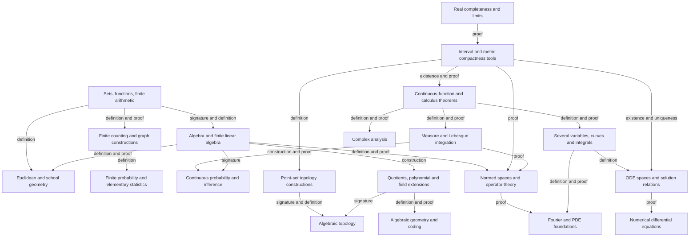

# Secondary and undergraduate mathematics curriculum map

Planning inventory v1, 2026-10-30. This is the subject scope for the continuing
std coverage goal. It is not a list of completed courses or a declaration of
new Litex interfaces. The [execution plan](coverage-plan.md) owns implementation
checkpoints; module READMEs describe delivered source mathematics.

## Scope and sources

The target includes ordinary secondary-school mathematics, the undergraduate
mathematics core, and the named advanced undergraduate electives below.
"Core" and "Advanced" are sequencing labels for this library, not claims that
every university requires the same subjects. Both labels remain in scope.
School and university topics share mathematical implementations; a second
textbook presentation does not require a duplicate public operation.

The inventory has nine school lanes and 26 undergraduate lanes. Each lane has
five stable chapter-cluster identifiers: 175 planning clusters in total. A
cluster can span several textbook chapters and must be subdivided into exact
source sections before implementation. This is a workload index, not an
estimate of theorem count, elapsed time or percentage already covered.

The following primary sources anchor breadth and level:

| Anchor | Source and role | Evidence boundary |
| --- | --- | --- |
| School-2022 | [Ministry of Education, compulsory-education standards notice](https://www.moe.gov.cn/srcsite/A26/s8001/202204/t20220420_619921.html) and its [mathematics standard](https://www.moe.gov.cn/srcsite/A26/s8001/202204/W020220420582346895190.pdf) | The notice and indexed standard establish the school scope and broad areas. The detailed standard was not fully retrieved in this planning pass; a clause-by-clause audit is pending. |
| School-2020 | [Official publisher's senior-secondary mathematics standard, 2017 edition revised 2020](https://www.pep.com.cn/xw/zt/rjwy/gzkb2020/202205/P020220517519489596282.pdf) | Indexed text identifies the main curricular strands. Direct PDF retrieval was unavailable; the table below is our mathematical decomposition, not a transcription of standard clauses. |
| CUPM | [MAA Curriculum Guide course-area index](https://maa.org/resource/cupm-guide/) | Public subject headings cross-check the breadth of the undergraduate inventory. Restricted individual reports were not inspected. |
| MIT | [Mathematics degree chart](https://catalog.mit.edu/degree-charts/mathematics-course-18/) and [subject descriptions](https://catalog.mit.edu/subjects/18/) | A representative university cross-check for core/elective breadth; it is not a universal degree requirement. |
| Calculus text | [OpenStax Calculus, scope and volume contents](https://openstax.org/books/calculus-volume-3/pages/preface) | A textbook-scale cross-check for calculus organization; no chapter proofs or exercises are claimed translated. |
| MSOR | [QAA Mathematics, Statistics and Operational Research benchmark](https://www.qaa.ac.uk/the-quality-code/subject-benchmark-statements/subject-benchmark-statement-mathematics-statistics-and-operational-research) | Cross-check that statistical and optimization content is represented separately from pure mathematics. |

The subject organization, chapter clusters, proposed probes and implementation
waves below are a library design synthesized from conventional mathematics and
the actual repository inventory. They are not attributed verbatim to any one
curriculum. Exact editions, section mappings and theorem lists remain work.
Program-specific undergraduate additions should receive explicit identifiers
rather than being silently counted as present or excluded.

## What counts as coverage

A chapter cluster starts as **unassessed**. An existing module link is evidence
of reusable starting material, not a chapter pass. Record the following stages
separately when auditing a particular textbook chapter:

| Stage | Required evidence |
| --- | --- |
| Source mapped | Edition and sections; definitions, constructions, core propositions, proof methods and representative applications explicitly enumerated. |
| Interface designed | Correct carriers, domains, codomains, hypotheses and semantic roles; natural downstream use; names checked against existing public and reserved names. |
| Source checked | Actual definitions/constructions and complete proofs accepted in the real module context, with visible reliance on native foundations. No new trust or conclusion-shaped assumptions. |
| Import usable | Independent callers use the actual objects and theorems with the original generality, rather than assuming the result or supplying an unconstructed object. |
| Chapter accepted | All required items above, representative computations/constructions/applications, and nearest false or out-of-domain controls pass their appropriate gates. Documentation and explicit remaining boundaries agree. |

Examples and exercises supply coverage obligations; their raw count is not a
completion metric. A chapter's standard methods must be usable on representative
problems, including existence or construction when the mathematics promises it.
An algorithm needs mathematical correctness and the advertised termination,
convergence or error result, not merely a formula for one update.

Only chapter-accepted required items count toward completion of a lane. Mark a
lane complete only after auditing every mapped required chapter. Report core,
advanced and school profiles separately while preserving their union as the
goal. Do not invent a global coverage percentage before the source mapping and
item-level audit exist. None of the complete lanes is certified by this plan.

Real experiments, data collection, diagrams, mathematical history and exposition
also occur in textbooks. Record their role and the formalizable mathematical
content; a theorem about a supplied data set does not certify a sampling process
or a historical narrative. This distinction does not remove their underlying
mathematics from the applications inventory.

## Secondary-school map

School-2022 anchors the junior-secondary base and School-2020 the senior-secondary
extension. Elementary arithmetic needed by these courses is included in S01.
The probes below are intended acceptance examples unless a current checkpoint
explicitly records their verification. The S02.2 parameter family is now checked.

| Lane | Chapter clusters | Existing source starting point; remaining curriculum audit | Intended representative use |
| --- | --- | --- | --- |
| S01 Numbers and algebraic expressions | **S01.1** Integers, rational/real numbers, order and absolute value; **S01.2** Fractions, ratios, percentages and proportional quantities; **S01.3** Polynomial expressions, identities and factorization; **S01.4** Rational expressions, radicals, integer/rational powers and their domains; **S01.5** Estimation, bounds, scientific notation and arithmetic error. | Native arithmetic is a dependency. [number_theory](number_theory/README.md) supplies some integer results. A systematic school algebra API and chapter audit are still needed. | Simplify a radical/rational expression while preserving excluded denominator values; justify an approximation bound. |
| S02 Equations, systems and inequalities | **S02.1** Linear equations and simultaneous systems; **S02.2** Quadratic equations, discriminants, roots and Vieta relations; **S02.3** Rational, radical and absolute-value equations with extraneous-root control; **S02.4** Linear/quadratic/rational inequalities and interval solutions; **S02.5** Parameter cases, basic inequalities and constrained word problems. | [real_quadratics](real_quadratics/README.md) now supplies the explicit S02.2 real-equation spine and parameter family. [algebra](algebra/README.md) and [matrix](matrix/README.md) supply other prerequisites. The remaining equation/inequality clusters are open. | Give every real solution of a parameterized quadratic, including zero leading coefficient and repeated-root cases. |
| S03 Functions and elementary sequences | **S03.1** Domains, ranges, graphs and piecewise functions; **S03.2** Composition, inverses, monotonicity, parity and periodicity; **S03.3** Linear, quadratic, reciprocal and power functions; **S03.4** Exponential/logarithmic functions and equations; **S03.5** Arithmetic/geometric sequences, finite sums, elementary derivatives and their applications. | Native functions and analysis plus [real_series](real_series/README.md) and finite-sum modules provide partial dependencies. Finite school sequences must not inherit infinite-series hypotheses. | Derive a finite geometric-sum formula with the ratio-one case and justify a derivative-based monotonicity or optimization conclusion. |
| S04 Synthetic plane geometry | **S04.1** Incidence, angles, parallel lines and ruler/compass constructions; **S04.2** Triangle congruence, bisectors, medians and perpendiculars; **S04.3** Similarity, ratios and Pythagoras; **S04.4** Quadrilaterals, polygons and geometric transformations; **S04.5** Circles, cyclic angles, tangents, lengths and areas. | No dedicated synthetic-plane-geometry source package was inventoried. Vector or metric primitives are not a substitute for the chapter proofs. | Construct a perpendicular bisector, prove triangle similarity and derive a tangent/circle relation with nondegeneracy explicit. |
| S05 Coordinate and analytic geometry | **S05.1** Coordinates, lines, slopes, incidence and distances; **S05.2** Circles, line intersections and tangency; **S05.3** Parabolas and focus/directrix descriptions; **S05.4** Ellipses, hyperbolas and their geometric parameters; **S05.5** Parametric/polar descriptions, loci and coordinate proofs. | [real_multivariable](real_multivariable/README.md) supplies coordinates and paths. Conic objects and their geometric equivalences need a dedicated source audit/construction. | Prove a nondegenerate conic's coordinate equation equivalent to its geometric definition and classify a line intersection. |
| S06 Spatial geometry and vectors | **S06.1** Points, lines, planes and incidence in space; **S06.2** Parallelism, perpendicularity, projections, angles and distances; **S06.3** Plane/spatial vectors, coordinates, dot/cross products; **S06.4** Polyhedra, sections, surface area and volume; **S06.5** Cylinders, cones, spheres, similarity and measurement. | [real_multivariable](real_multivariable/README.md) includes cross products and coordinate operations; [metric](metric/README.md) is reusable. Spatial incidence and solid-geometry chapters remain distinct obligations. | Derive point-to-plane distance and a tetrahedron volume from the same geometric model, including degeneracy. |
| S07 Trigonometry and elementary complex numbers | **S07.1** Right-triangle ratios and radian measure; **S07.2** Trigonometric functions, graphs and inverse branches; **S07.3** Addition/multiple-angle identities and trigonometric equations; **S07.4** Sine/cosine laws, triangle solution and area; **S07.5** Complex arithmetic, modulus/argument, polar form, powers and roots. | Native real/complex operations and [matrix](matrix/README.md) do not by themselves establish this textbook progression. Branch and zero-value conventions need explicit audit. | Solve a triangle with the ambiguous sine-law case, and describe all roots of a nonzero complex number with distinctness. |
| S08 Counting, elementary probability and statistics | **S08.1** Addition/product rules, permutations, combinations and binomial counting; **S08.2** Finite events, conditional probability, independence and Bayes; **S08.3** Random variables, binomial/normal models, expectation and variance; **S08.4** Frequency tables, quantiles, mean, dispersion and data summaries; **S08.5** Sampling, basic inference, correlation and regression. | [combinatorics](combinatorics/README.md) and [probability](probability/README.md) are substantial partial foundations. Numeric binomial laws do not yet establish subset counting; moments do not constitute statistical inference. | Count k-element subsets, derive a Bernoulli-sum law from independence and justify a stated elementary sampling inference. |
| S09 Sets, proof, algorithms and modelling | **S09.1** Sets, logic, quantifiers, necessary/sufficient conditions; **S09.2** Direct proof, cases, contradiction, converse and counterexamples; **S09.3** Induction, elementary recursive algorithms and constructions; **S09.4** Equations/functions as models with units and domain checks; **S09.5** Integrated geometric, counting and optimization problems. | Native proof mechanisms and [relations](relations/README.md) support some formal work. Usable proof syntax is not a formalized logic textbook or a validated real-world model. | Derive and check a complete model from explicit assumptions, then exhibit a counterexample when one essential assumption is removed. |

## Undergraduate core and elective map

The chapters are mathematical obligations, not proposed package names. Every
link in the starting-point column denotes partial source material only. "No
dedicated package" describes this std inventory and makes no claim about the
absence of particular native primitives.

| Lane and sequencing label | Chapter clusters | Existing source starting point | Intended representative use |
| --- | --- | --- | --- |
| U01 Foundations and proof — Core | **U01.1** Logic, quantifiers and proof methods; **U01.2** Sets, functions, images, restrictions and inverses; **U01.3** Relations, equivalence, partitions and orders; **U01.4** Finite/countable cardinality and diagonal arguments; **U01.5** Induction, recursion and construction principles. | [relations](relations/README.md), [combinatorics](combinatorics/README.md) and native sets/functions. | Construct the equivalence relation from an actual partition and prove the two constructions correspond, rather than assuming the desired relation. |
| U02 Single-variable calculus and real analysis — Core | **U02.1** Real completeness, sequences, subsequences and limits; **U02.2** Continuity, compact intervals, intermediate/extreme values and uniform continuity; **U02.3** Differentiation, Rolle/MVT, Taylor, asymptotics and applications; **U02.4** Riemann integration, FTC, techniques and improper integrals; **U02.5** Series, power series, function sequences, uniform convergence and exchange of limits. | Native analysis; [real_series](real_series/README.md), [real_integral_laws](real_integral_laws/README.md), [metric_sequences](metric_sequences/README.md), [real_regularity](real_regularity/README.md). | Prove existence of a zero from sign change and continuity; derive a Taylor approximation with its actual remainder bound. |
| U03 Multivariable and vector calculus — Core | **U03.1** Euclidean limits, continuity, paths and vector-valued maps; **U03.2** Total derivatives, Jacobians, chain/inverse/implicit function theorems; **U03.3** Higher derivatives, Hessians, mixed partials and constrained extrema; **U03.4** Multiple integrals, Fubini and change of variables; **U03.5** Line/surface integrals, Green, divergence and Stokes. | [real_multivariable](real_multivariable/README.md), [real_regularity](real_regularity/README.md) and analysis-law modules, including C² mixed-partial exchange. Ordered rectangular integrals do not establish Fubini. | Justify a polar change of variables on an actual region and apply a vector integral theorem with its boundary/orientation hypotheses. |
| U04 Linear algebra and matrix theory — Core | **U04.1** Spaces, subspaces, bases, dimension, maps, kernel/image and rank-nullity; **U04.2** Linear systems, elimination, determinants and matrix representations; **U04.3** Eigenvalues, characteristic/minimal polynomials and canonical forms; **U04.4** Dual spaces, multilinear maps and bilinear/quadratic forms; **U04.5** Inner products, Gram–Schmidt, projections, least squares, spectral theorem and SVD. | [algebra](algebra/README.md), notably linear_dimension.lit and coordinate_maps.lit; [matrix](matrix/README.md). Rank-nullity already exists. Eigenpair predicates do not establish spectral decomposition. | Construct an orthonormal basis and a least-squares projection, then use the appropriate spectral theorem over its stated field. |
| U05 Abstract algebra — Core and Advanced continuation | **U05.1** Groups, subgroups, actions, cosets, quotients, Lagrange and Sylow; **U05.2** Rings, ideals, quotient rings and isomorphism theorems; **U05.3** Polynomial rings, divisibility, PID/UFD and factorization; **U05.4** Field extensions, finite fields and algebraic elements; **U05.5** Splitting fields, Galois correspondence and solvability. | [algebra](algebra/README.md) supplies groups, fields, unital rings, ideals and homomorphisms, not the full quotient/polynomial/extension sequence. | Construct a quotient and its universal map, then construct a finite field or splitting field in the appropriate later chapter. |
| U06 Elementary and introductory algebraic number theory — Core and Advanced continuation | **U06.1** Divisibility, Euclidean algorithm, primes and unique factorization; **U06.2** Congruences, units, Bezout, modular inverses and CRT; **U06.3** Fermat/Euler results, orders and primitive roots; **U06.4** Quadratic residues and reciprocity; **U06.5** Diophantine equations, continued fractions, Pell and introductory algebraic integers. | [number_theory](number_theory/README.md) supplies general Bezout and coprime two-modulus CRT. General systems, factorization and later chapters need separate audit. | Solve a compatible noncoprime congruence system with a proved solution class; derive a Pell solution through continued fractions. |
| U07 Discrete mathematics and combinatorics — Core | **U07.1** Bijections, permutations, subsets, binomial/multinomial counting; **U07.2** Double counting, fibers and indexed inclusion-exclusion; **U07.3** Recurrences and ordinary/exponential generating functions; **U07.4** Posets, incidence algebras and Möbius inversion; **U07.5** Partitions, Catalan families and introductory extremal/probabilistic methods. | [combinatorics](combinatorics/README.md), including the accepted numeric binomial/complex expansion and finite-fiber extension. Subset counting, Vandermonde and the later clusters remain. | Construct a counting bijection and derive a recurrence plus its generating-function solution without taking the counted formula as an assumption. |
| U08 Graph theory and mathematical algorithms — Core and Advanced continuation | **U08.1** Paths, connectivity, trees and handshaking; **U08.2** Matchings, flows, cuts and extremal graph bounds; **U08.3** Coloring, planarity and Euler formulas; **U08.4** Traversal, spanning-tree and shortest-path algorithms with correctness; **U08.5** Directed/Eulerian/Hamiltonian graphs and introductory spectral methods. | [graph_theory](graph_theory/README.md) supplies finite simple undirected graphs, actual unordered edges, degree/fiber counts, handshaking, regular edge counts, complement and induced constructions. Paths, connectivity, odd-degree subset parity and tree algorithms remain. | Prove a spanning-tree construction correct and derive a max-flow/min-cut certificate on an actual finite network. |
| U09 Metric spaces and point-set topology — Core and Advanced continuation | **U09.1** Metrics, Cauchy sequences, completeness and completion; **U09.2** Topological bases, products, subspaces and quotients; **U09.3** Connectedness, compactness, separation and continuous maps; **U09.4** Countability, metrization and standard separation results; **U09.5** Function spaces, uniform convergence and compactness criteria. | [metric](metric/README.md), [metric_sequences](metric_sequences/README.md), [topology](topology/README.md), including compact-to-Hausdorff inverse continuity. | Construct a product or quotient topology, prove its mapping property and distinguish sequential claims from full topological claims. |
| U10 Complex analysis — Core | **U10.1** Complex limits, differentiability and Cauchy–Riemann equations; **U10.2** Contour integrals and Cauchy theorems; **U10.3** Analytic functions, power/Laurent series and singularities; **U10.4** Residues, argument principle and zero counting; **U10.5** Conformal maps, harmonic functions and applications. | Native complex arithmetic; no dedicated complex-analysis source package inventoried. Real differentiability and a complex-valued binomial theorem do not supply holomorphic theory. | Evaluate a contour integral by residues and justify the relevant analytic, orientation and singularity conditions. |
| U11 Ordinary differential equations and dynamics — Core | **U11.1** First-order separable, linear, exact and standard reducible equations; **U11.2** Higher-order linear equations, Wronskians and variation of parameters; **U11.3** Linear systems, matrix exponentials and fundamental solutions; **U11.4** Local existence/uniqueness, continuous dependence and Grönwall; **U11.5** Equilibria, stability, phase portraits and elementary nonlinear dynamics. | Native derivatives and [metric_sequences](metric_sequences/README.md) are dependencies; no ODE source package inventoried. A general fixed-point theorem is not yet an ODE existence proof. | Construct a solution to an initial-value problem and derive local uniqueness under an explicit Lipschitz condition. |
| U12 Partial differential equations and mathematical physics — Advanced | **U12.1** Classification, well-posedness and characteristics; **U12.2** Heat/wave equations, separation and initial/boundary data; **U12.3** Laplace/Poisson equations and maximum principles; **U12.4** Green functions, fundamental solutions and transform methods; **U12.5** Energy estimates, uniqueness and introductory weak formulations. | Analysis/linear algebra are partial prerequisites; no PDE source package inventoried. | Solve a bounded-domain heat or wave problem and prove the advertised boundary/initial data and uniqueness. |
| U13 Measure theory and Lebesgue integration — Advanced, prerequisite for later probability | **U13.1** Sigma-algebras, measures, outer measure and measurable sets; **U13.2** Measurable functions and simple/nonnegative/Lebesgue integrals; **U13.3** Monotone/dominated convergence and Fatou; **U13.4** Product measures, Tonelli and Fubini; **U13.5** Lp spaces, signed measures and introductory Radon–Nikodym theory. | [probability](probability/README.md) is finite; [real_integral_laws](real_integral_laws/README.md) is Riemann-based. No measure source package inventoried. | Derive a valid limit-under-integral result with a verified domination function; contrast a failed domination case. |
| U14 Probability and stochastic processes — Core and Advanced continuation | **U14.1** Discrete laws, joint variables, event and variable independence; **U14.2** Continuous distributions, densities, CDFs and changes of variables; **U14.3** Expectations, transforms, conditional distributions and conditional expectation; **U14.4** Laws of large numbers and central limit theorems with explicit hypotheses; **U14.5** Random walks, Markov chains, Poisson processes and introductory martingales/Brownian motion. | [probability](probability/README.md) has finite conditioning, moments, event independence, inequalities and pushforwards. Countable/continuous laws and process constructions remain separate work. | Derive a Bernoulli-sum law from an actual independent family, and later prove an iid finite-variance limit theorem on a constructed probability space. |
| U15 Mathematical statistics — Core | **U15.1** Sampling models, empirical distributions and sample-statistic laws; **U15.2** Estimation, likelihood, Bayesian estimation, consistency and efficiency; **U15.3** Sufficiency, unbiased estimation, information and confidence procedures; **U15.4** Hypothesis tests, likelihood ratios, exact/asymptotic calibration; **U15.5** Regression, least squares, ANOVA and introductory experimental design. | Finite moments/covariance in [probability](probability/README.md) are dependencies. No statistics source package inventoried; summaries alone do not establish inference. | Prove the coverage of a stated confidence procedure or the size/power of a test under its actual sampling model. |
| U16 Numerical analysis — Core | **U16.1** Approximation errors, conditioning, stability and rounding models; **U16.2** Bisection, Newton and scalar nonlinear equations; **U16.3** Numerical linear algebra, factorizations and iterative solvers; **U16.4** Interpolation, approximation, splines and quadrature with error bounds; **U16.5** Numerical ODE methods, convergence and stability. | [numerical_analysis](numerical_analysis/README.md) proves positive square-root Newton convergence and bounds; [metric_sequences](metric_sequences/README.md) supplies general contractions. | Prove an actual quadrature or ODE scheme's error bound, preserving its smoothness and step-size conditions. |
| U17 Optimization and operations research — Core/Advanced applied sequence | **U17.1** Convex sets/functions, separation and optimality; **U17.2** Unconstrained optimization and descent/Newton methods; **U17.3** Constraints, multipliers, KKT and convex duality; **U17.4** Linear programming, Farkas, simplex and strong duality; **U17.5** Integer/dynamic programming and network optimization. | Linear algebra, calculus, finite graphs and fixed-point tools are partial prerequisites; no optimization source package inventoried. | Supply primal/dual feasible objects and prove optimality and equality of values under the exact theorem hypotheses. |
| U18 Analytic, affine, projective and non-Euclidean geometry — Core/Advanced geometry sequence | **U18.1** Affine/Euclidean spaces, transformations and isometries; **U18.2** Conics/quadrics and classification by coordinate change; **U18.3** Projective space, homogeneous coordinates and duality; **U18.4** Incidence, cross-ratio and projective conic geometry; **U18.5** Hyperbolic models and transformation-group geometry. | [algebra](algebra/README.md), [matrix](matrix/README.md), [real_multivariable](real_multivariable/README.md) and the school geometry plan. No dedicated geometry package inventoried. | Construct a projective transformation and prove an invariant, or verify a hyperbolic model's stated geometric properties. |
| U19 Differential geometry — Advanced | **U19.1** Regular curves, arc length and Frenet frames; **U19.2** Regular surfaces, parametrizations and tangent spaces; **U19.3** First/second fundamental forms and Gaussian/mean curvature; **U19.4** Geodesics, covariant differentiation and local geometry; **U19.5** Gauss–Bonnet and introductory manifold maps. | Vector calculus and [real_regularity](real_regularity/README.md) are partial prerequisites; no differential-geometry package inventoried. | Compute a surface's curvature from an actual regular chart and prove the geometric invariant does not depend on an admissible reparametrization. |
| U20 Functional analysis — Advanced | **U20.1** Normed/Banach spaces and bounded linear operators; **U20.2** Hilbert spaces, orthogonality, projection and representation; **U20.3** Hahn–Banach, uniform boundedness, open mapping and closed graph; **U20.4** Compact/self-adjoint operators and introductory spectral theory; **U20.5** Integral/operator equations and variational applications. | Algebraic vector spaces and metric completeness are partial foundations. Banach's contraction theorem alone does not provide a Banach-space course. | Construct a Hilbert-space projection or solve an operator equation using the precise boundedness, compactness and completeness assumptions. |
| U21 Fourier analysis and mathematical transforms — Advanced | **U21.1** Orthogonal expansions, finite Fourier transforms and FFT correctness; **U21.2** Fourier series, convergence and Parseval; **U21.3** Fourier transforms, inversion and Plancherel; **U21.4** Convolution, Laplace/Z transforms and differential/difference equations; **U21.5** Introductory distributions, delta and weak derivatives. | Complex arithmetic, series, integration and linear algebra are partial dependencies; no transform source package inventoried. | Prove a Fourier representation under explicit convergence hypotheses and use it to solve a stated equation. |
| U22 Mathematical logic, set theory and computability — Advanced | **U22.1** Formal propositional syntax, semantics, soundness and completeness; **U22.2** First-order structures, satisfaction and completeness; **U22.3** Compactness and introductory model theory; **U22.4** Axiomatic sets, ordinals, cardinals and choice principles; **U22.5** Computability, undecidability and incompleteness. | Native proof syntax is an implementation dependency, not a source model of logic or a metatheorem. No dedicated logic package inventoried. | Define an actual object-language syntax and interpretation, then prove a soundness or undecidability result at the stated level. |
| U23 Mathematical modelling and applications — Core/Advanced applied sequence | **U23.1** Units, dimensional analysis, scaling and explicit model assumptions; **U23.2** Discrete/continuous population, growth and kinetic models; **U23.3** Mechanics, networks and decision models; **U23.4** Interest, annuities, risk and introductory financial/actuarial models; **U23.5** Inverse/data models, identifiability, sensitivity and regularization. | Existing algebra, probability, iteration and graph modules supply some reusable mathematics. No general modelling package or course acceptance is claimed. | Derive a model's equations from stated mathematical assumptions, prove a qualitative property and quantify its approximation or parameter sensitivity. |
| U24 Elementary algebraic topology — Advanced elective | **U24.1** Homotopies, loops and fundamental groups; **U24.2** Covering spaces and lifting; **U24.3** Simplicial complexes, chains and homology; **U24.4** Introductory singular homology and exact sequences; **U24.5** Degree, Euler characteristic and elementary topological applications. | [topology](topology/README.md) is point-set foundation only; algebraic constructions are prerequisites still to build. | Compute a circle's fundamental group or a finite complex's homology with an actual construction and its invariance proof. |
| U25 Elementary algebraic geometry — Advanced elective | **U25.1** Multivariate polynomial rings, ideals and elimination; **U25.2** Affine algebraic sets and coordinate rings; **U25.3** Radical ideals and introductory Nullstellensatz correspondence; **U25.4** Projective algebraic sets and homogeneous coordinates; **U25.5** Plane curves, tangents, multiplicity and introductory intersection results. | General ring definitions are only early prerequisites. Polynomial/quotient/field-extension mathematics and the geometry interfaces need construction first. | Relate a concrete polynomial ideal to its algebraic set and prove the appropriate correspondence under its field assumptions. |
| U26 Coding and information theory — Advanced applied elective | **U26.1** Finite fields, linear codes and encoders/decoders; **U26.2** Hamming distance and coding bounds; **U26.3** Cyclic, BCH and Reed–Solomon constructions; **U26.4** Entropy, relative entropy and mutual information; **U26.5** Source/channel coding and elementary asymptotic coding results. | Finite probability, finite linear algebra and counting are partial prerequisites; no coding/information source package inventoried. | Construct a code and prove its correction guarantee, then justify an information bound on an actual finite distribution. |

## Current repository evidence

The resumed 2026-10-30 inventory found 21 top-level std packages and 1023
named theorems in their directly exported source files. Validation exports and
local journals were excluded. The `basics` compatibility package has no public
declarations. These are source counts, not fresh verification of all modules.

Reusable areas already include finite-dimensional algebra (including
rank-nullity), finite probability, real series, metric completeness and Banach
iteration, parts of general topology and higher real analysis. Geometry,
complex analysis, ODE/PDE, statistical inference, measure theory, optimization
and the advanced elective families do not acquire course coverage from those
nearby definitions. Their starting dependencies are explicitly linked above.

The new [real quadratic module](real_quadratics/README.md) adds five functions
and 23 named source theorems. Its 28 strict source statements, 65 imported
statements, nine independent README statements and 16 final-only refusals pass.
All 23 theorem contracts, the full real parameter family, an attained product
bound and three source examples are checked. This establishes the explicit
S02.2 real-equation obligations; it does not certify a complete school algebra
course or all exercises in the referenced sections.

The user paused execution on 2026-10-30 and requested removal of this round's
tests and temporary verification material. The following acceptance counts
are historical; mathematical source and the curriculum plan remain.

The graph counting extension preserves the original graph data and adds 13
named theorems. Its 60 source statements, 147 imported statements, independent
examples of 5 and 11 statements, and 28 final-only refusals pass. Actual
unordered edges have two vertices and two opposite arcs; degree sum counts
arcs and is twice the edge cardinality. U08.1.01 and .05 are checked, while
.10 is partial and the path/tree/odd-degree-subset obligations remain open.
The additional native-divisibility convenience proof is unpublished in the
source-owned graph todo; no kernel repair was made.

The latest combinatorics extension has 61 named theorems, including 30 added
ones. The resumed 2026-10-30 gate passes 69 strict source statements, 71 clean
imported statements and all 30 full-domain theorem contracts. A fresh Session
replays the 71 positives and rejects 20 final-only controls at intended phases.
The prior round's removed artifacts remain absent. This establishes the listed
binomial/fiber interfaces, not subset counting, Vandermonde or all U07.

For example, the actual source contains the following theorem header (proof
omitted here; this is an excerpt, not a new runnable declaration):

```litex
thm binomial_expansion:
    ? forall n N,x,y C:
        sum(0,n,fn(k N) C {\binomial_terms<n,x,y>(k)})=(x+y)^n
```

That is evidence for numeric binomial expansion. S08.1/U07.1 still require
the separate combinatorial construction and theorem
`|{A subset X : |A|=k}| = B(|X|,k)` for finite X and natural k. This last formula
is a mathematical specification, not checked Litex syntax or a delivered
theorem. Treating the expansion header as a complete counting chapter would
skip the actual missing construction and proof.

## Interface discipline for the next chapter specifications

These cards fix mathematical roles before public names or executable syntax
are chosen. Every card is **planned**, not checked. Each next implementation
slice must expand its card with exact source sections and verified use probes.

| Concept | Intended interface and domain | Immediate use and rejected shortcut | Dependencies and outstanding work |
| --- | --- | --- | --- |
| A line or nondegenerate conic | An actual geometric object in the chosen Euclidean/affine carrier; incidence is an independent relation. Put a line's nonzero direction or a conic's nondegeneracy in its definition. | Intersect actual objects and prove incidence. A predicate asserting that supplied coordinates have the desired final answer is not a construction. | Coordinates, scalar field and geometric model; construction/equivalence proofs. Synthetic and coordinate presentations need a proved bridge. |
| Polynomial over a field/ring | Actual finite coefficient data with evaluation and operations; keep the coefficient structure explicit. Specify trailing-zero equality and the zero polynomial's degree convention before exposing degree. | Form a polynomial quotient or characteristic polynomial. A supplied root list or factorization certificate alone does not construct factorization. | Finite sequences/support, ring operations, polynomial equality and division existence; no public name is chosen by this card. |
| Intermediate value | For a<=b, a real-domain f covering [a,b], continuity on that interval and y between f(a),f(b), prove existence of c in [a,b] with f(c)=y. | Obtain a zero of t^3+t-1 in [0,1]. Do not assume a root or make root existence part of the input object's definition. | Real completeness and interval continuity; exact endpoint/constant-interval cases and source proof remain to audit. |
| Initial-value solution | A function on an actual time interval into the chosen state space, satisfying the derivative equation and initial condition. Prove local existence and uniqueness under the appropriate continuity/Lipschitz assumptions. | Construct and compare two solutions to the same IVP. A predicate on a supplied solution is useful but does not establish the existence theorem. | Actual spaces of functions, completeness, integration and estimates; selected solution values require the relevant uniqueness result. |
| Sampling model and estimator | A probability model for the actual sample, parameter domains and a measurable estimator; an estimator is a function of that sample. | Prove coverage, size or risk under the specified distribution. Mean/variance definitions or a numerical fitted coefficient do not establish inference. | Finite/countable/continuous probability as appropriate, product/independence constructions and distributional calculations. |
| Minimizer and selected optimum | Feasibility and optimality are relations. Prove existence, for example from nonempty compact feasibility and continuity. Select a canonical optimizer only after uniqueness or an explicitly justified tie-break construction. | Construct a least-squares optimizer with its correct rank assumptions. A universal single-valued argmin without existence/uniqueness is not an admissible shortcut. | Linear algebra, convexity/topology and existence; distinguish minimum value from minimizer and solution set. |

Use a `struct` for bundled mathematical data and its direct laws, `prop` for
independent relations, and actual functions for values callers compute with.
Use templates only when parameters change the declaration family. Named `thm`
interfaces express proved results, not a replacement for constructing objects.
No mathematical distinction may be hidden behind overloaded public names.
In particular, a Dirac probability measure and a delta distribution must not
silently share a function contract.

## Mathematical dependency spine

The diagram is a build-order guide for the named foundations, not an import
graph and not a theorem that all content in a lane depends on every predecessor.
Edges are labeled by their intended mathematical role. Split a broad lane into
its chapter stages before scheduling; elementary real topology does not wait
for a completed abstract topology course.



There is no new trust/axiom edge authorized by this plan. Audit any required
choice, quotient, completion or existence principle before consuming it.
Reuse an established native foundation where its exact contract applies;
otherwise prove the needed source result or expose the unresolved obligation.
Do not insert an assumption just to break a dependency cycle.
Axiom systems represented as object-language data in U22 do not authorize
adding ambient mathematical assumptions to std.

## Implementation waves

Waves introduce and close specific chapter portions, not every topic of an
entire lane at once. Later chapters can depend on earlier stages of their own
lane without creating a cycle. Every cluster remains in the inventory until
its chapter acceptance is established.

| Wave | Mathematical work | Completion obligation |
| --- | --- | --- |
| W0 Source mapping and audit | Expand all 175 clusters into exact textbook sections and source objects/results; retain the current 1023-declaration inventory as a starting index only. Prioritize the first slices below without declaring unaudited chapters complete. | Per-chapter source/definition/theorem/use lists; exact existing anchors and remaining mathematical obligations. |
| W1 School spine and shared finite foundations | S01–S09, U01, elementary U04/U18; develop geometric objects and equation/function interfaces alongside finite counting, rather than postponing school geometry indefinitely. | Algebraic domain cases, actual geometric constructions and representative school applications, using shared library definitions. |
| W2 Undergraduate foundations | Real sequence/continuity/calculus foundations of U02, metric/topological stages of U09, core U04/U05/U06/U07/U08, finite probability stages of U14 and elementary sampling stages of U15. Reuse the accepted binomial/fiber extension without treating it as complete counting coverage. | Actual constructions and main theorems, including interval existence results, linear representations/inner products, quotient/polynomial prerequisites and graph paths/counting. |
| W3 Missing core courses | Continue U03; build U10 and U11 source spines; establish U13 measure prerequisites before rigorous continuous U14 and later U15; expand U16/U17/U18 and U23 applications. | Complete representative chapter chains, including analytic functions, IVP existence, continuous distributions, calibrated inference and numerical error theorems. |
| W4 Advanced analysis and geometry | U12, U19, U20 and U21; deeper optimization/numerical chapters of U17/U16 and their modelling uses. | Correct function spaces, actual solutions/approximations, and the hypotheses of integral, spectral and convergence results. |
| W5 Advanced algebra, foundations and applications | Later U05/U06, U22, U24, U25 and U26, plus advanced stochastic/model chapters in U14/U23. Introduce their prerequisites earlier when needed. | Formal constructions and the named introductory core theorems for each elective, rather than empty module placeholders. |
| W6 Curriculum closure audit | Revisit every school/core/advanced cluster and source mapping, including chapter methods and applications. | All required items have adequate current evidence; report any missing item explicitly and leave the overall goal unfinished while one remains. |

This order does not assert that a numerical example certifies a whole course.
Rotate across the missing subject spines after coherent slices, rather than
growing only the already convenient branches. Share interfaces across courses
and preserve general fields, exact domains, zero/empty cases and meaningful
nondegeneracy throughout.

## Next bounded planning handoff

The [chapter specifications](chapter-specifications.md) cover S02.2
(quadratics), S04.2 (triangles), U02.2 (continuous functions on intervals), U04.5
(inner products), U10.1 (complex differentiability), U11.1 (first-order ODE) and
U15.1 (sampling models), together with their prerequisite clusters S04.1,
U02.3, U02.4, U04.2, U05.3, U07.1 and U14.1. The breadth extension adds U03.2,
U05.1, U08.1, U09.2, U13.1, U16.4 and U17.1, bringing the specifications to
21 clusters / 210 planned requirements. These are not checked source or
accepted chapters. Showcase geometry and ODE proofs are identified as
existing material to audit and extract; absence of a dedicated std module
does not imply absence of repository mathematics.

Next expand S01.3 (school polynomial identities/factorization), S03.5
(elementary sequences and derivative applications), S04.3 (similarity/Pythagoras),
U06.1 (divisibility/primes/factorization), U10.2 (contours/Cauchy), U11.4
(general IVP existence/dependence) and U13.2 (measurable functions/Lebesgue integration). Retain exact source
sections, carriers, main results, actual uses and false boundaries. Finish the
mapping of supplements in the first cards before calling them source-complete.
Public names and module architecture remain to be decided before code changes.

All authored files for this work stay under `std/`. General verifier work is a
separately authorized task owned by shared `verify`, not a scenario-specific WD
branch inside library work. The planning increment changes Markdown only; it
does not launch proof/test processes or restore the deleted round artifacts.
