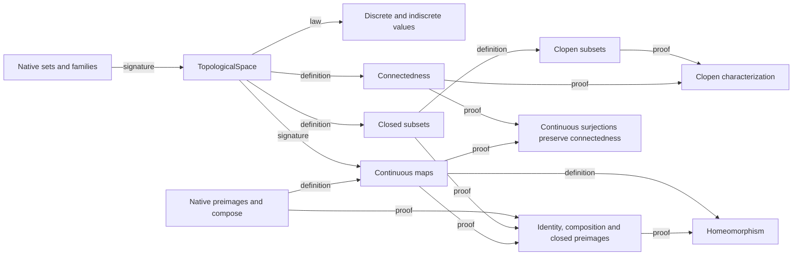

# Spaces, continuous maps and connectedness

A topological space supplies data which later mathematics must project: a
carrier and a family of open subsets. TopologicalSpace<Ambient set> packages
carrier in power_set(Ambient), opens in power_set(power_set(carrier)), and
the empty/whole/binary-intersection/arbitrary-union laws directly. The ambient
set only bounds the carrier; choosing Ambient equal to the carrier represents
every space, including an empty one. A separate law predicate would duplicate
the structure's own invariant.

The discrete and indiscrete spaces on X are actual supplied space values,
not propositions about a candidate. Their tuples are respectively
(X,power_set(X)) and (X,union({{}},{X})). The named proofs
discrete_topology_laws(X) and indiscrete_topology_laws(X) establish that these
tuples belong to TopologicalSpace<X>; template-indexed values discrete_space<X>
and indiscrete_space<X> expose the constructions. Imported callers explicitly
release the named law before typing a constructed space, because imports do
not merge ambient proofs. For the named value route, the current verifier also
needs its explicit tuple equation before membership checking and the typed
alias's tuple equation before field projections. The complete imported caller
records both bridges; the README's small example uses the tuple directly.
No arbitrary topology is selected. The union of two singleton families works
for empty X; a two-element literal {{},X} would require distinct elements.

Closedness is a property of a supplied subset: its relative complement is
open. is_topologically_continuous(A,B,source,target,f) is a property of a
supplied map whose exact domain/codomain are the two stored carriers. Native
preimage_set constructs inverse images; native compose(g,f) applies f first.
Only the identity-map family needs a source function definition. Duplicating
compose as a source template would introduce a needless second construction.

Homeomorphism is the relation between two supplied spaces and mutually inverse
continuous maps. Both continuity directions and both inverse equations belong
to its definition. A continuous bijection alone is insufficient. Connectedness
forbids two nonempty disjoint open pieces covering the carrier. Clopen subsets
are both open and closed; triviality of all clopen subsets characterizes
connectedness. Continuous surjections preserve connectedness, while arbitrary
continuous maps only preserve connectedness of their image, not the full target.

The dependency graph uses signature, definition, law and proof edges:

The implementation follows this order, grouping generic preimage facts before
their topological uses rather than preserving intervening concrete lecture
examples. There is no dependency cycle or source trust boundary. The following groups
extend those foundations without assuming metric/subspace/product topology.

## Separation and compactness extension

The added theorem groups keep the same TopologicalSpace and actual carriers.
The package retains one main export: current triple-colon imported calls
require exactly one export, so adding file exports would break existing users.
A separating open is an existential relation about supplied ordered points:
`has_separating_open(A,space,x,y)` means an open contains x and excludes y.
T0 requires one orientation for distinct points, T1 the stated orientation
for every ordered pair, and Hausdorff disjoint open neighborhoods. No new
space value or witness selector is introduced. T1 is equivalent to every
singleton being closed. Discrete spaces are Hausdorff; homeomorphisms preserve
Hausdorff separation. Trivial-open spaces with two distinct points fail T0. These are ordinary source predicates/theorems.

A restriction is a map, so restricted_map<X,Y,f,K> is a function on the actual
subset K, including empty K, with values f(x) in Y. It changes the complete
input domain; merely asserting a smaller function type for f would be wrong.
Its range is the image f(K). Restriction range monotonicity is shared by the
finite-subcover arguments; evaluation/type equations use the definition itself.

Compactness is a property of a supplied subset K of the actual space carrier.
Every indexed open cover, with an arbitrary index set, must admit a finite
subset of those same indices whose restricted cover still covers K. Compact
space means compact carrier. Empty/singleton subsets start finite-union and
finite-cardinality induction; no finite-only definition of compactness is used.
Continuous-image compactness pulls a target cover back, takes a finite source
subcover, then uses the same finite indices in the target. Surjectivity is
needed for a conclusion about the entire target. Homeomorphisms preserve
compactness. Spaces with only trivial opens are compact even with infinite
carriers, so compactness does not imply Hausdorff separation.

The added dependency edges are definition (separating open -> separation
predicates; restriction -> indexed subcover -> compactness) and proof
(Hausdorff -> T1 -> T0/closed singletons; empty/singleton -> union -> finite
subsets; preimages + source compactness -> compact image -> surjective and
homeomorphic transport). Construction remains independent of separation:
compact images require no Hausdorff premise. These source interfaces and independent full-domain callers are verified.
The main example also proves discrete R noncompact from its singleton cover
indexed by R, and checks an actual carrier {0,1} inside ambient R. No trust or
new native rule was needed. The two draft source exports were consolidated
into main before acceptance to preserve the original triple-colon API.
