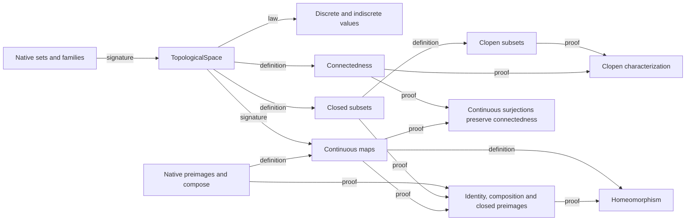
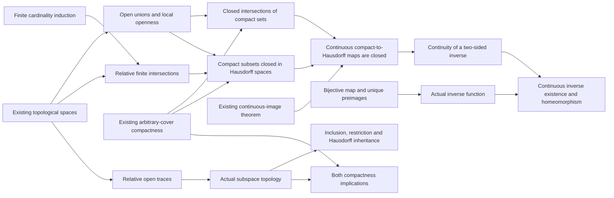

# Spaces, continuous maps and connectedness

A topological space supplies data which later mathematics must project: a
carrier and a family of open subsets. TopologicalSpace<Ambient set> packages
carrier in power_set(Ambient), opens in power_set(power_set(carrier)), and
the empty/whole/binary-intersection/arbitrary-union laws directly. The ambient
set only bounds the carrier; choosing Ambient equal to the carrier represents
every space, including an empty one. A separate law predicate would duplicate
the structure's own invariant.

The discrete and indiscrete spaces on X are actual supplied space values,
not propositions about a candidate. Their tuples are respectively
(X,power_set(X)) and (X,union({{}},{X})). The named proofs
discrete_topology_laws(X) and indiscrete_topology_laws(X) establish that these
tuples belong to TopologicalSpace<X>; template-indexed values discrete_space<X>
and indiscrete_space<X> expose the constructions. Imported callers explicitly
release the named law before typing a constructed space, because imports do
not merge ambient proofs. For the named value route, the current verifier also
needs its explicit tuple equation before membership checking and the typed
alias's tuple equation before field projections. The complete imported caller
records both bridges; the README's small example uses the tuple directly.
No arbitrary topology is selected. The union of two singleton families works
for empty X; a two-element literal {{},X} would require distinct elements.

Closedness is a property of a supplied subset: its relative complement is
open. is_topologically_continuous(A,B,source,target,f) is a property of a
supplied map whose exact domain/codomain are the two stored carriers. Native
preimage_set constructs inverse images; native compose(g,f) applies f first.
Only the identity-map family needs a source function definition. Duplicating
compose as a source template would introduce a needless second construction.

Homeomorphism is the relation between two supplied spaces and mutually inverse
continuous maps. Both continuity directions and both inverse equations belong
to its definition. A continuous bijection alone is insufficient. Connectedness
forbids two nonempty disjoint open pieces covering the carrier. Clopen subsets
are both open and closed; triviality of all clopen subsets characterizes
connectedness. Continuous surjections preserve connectedness, while arbitrary
continuous maps only preserve connectedness of their image, not the full target.

The dependency graph uses signature, definition, law and proof edges:

The implementation follows this order, grouping generic preimage facts before
their topological uses rather than preserving intervening concrete lecture
examples. There is no dependency cycle or source trust boundary. The following groups
extend those foundations without assuming metric/subspace/product topology.

## Separation and compactness extension

The added theorem groups keep the same TopologicalSpace and actual carriers.
The package retains one main export: current triple-colon imported calls
require exactly one export, so adding file exports would break existing users.
A separating open is an existential relation about supplied ordered points:
`has_separating_open(A,space,x,y)` means an open contains x and excludes y.
T0 requires one orientation for distinct points, T1 the stated orientation
for every ordered pair, and Hausdorff disjoint open neighborhoods. No new
space value or witness selector is introduced. T1 is equivalent to every
singleton being closed. Discrete spaces are Hausdorff; homeomorphisms preserve
Hausdorff separation. Trivial-open spaces with two distinct points fail T0. These are ordinary source predicates/theorems.

A restriction is a map, so restricted_map<X,Y,f,K> is a function on the actual
subset K, including empty K, with values f(x) in Y. It changes the complete
input domain; merely asserting a smaller function type for f would be wrong.
Its range is the image f(K). Restriction range monotonicity is shared by the
finite-subcover arguments; evaluation/type equations use the definition itself.

Compactness is a property of a supplied subset K of the actual space carrier.
Every indexed open cover, with an arbitrary index set, must admit a finite
subset of those same indices whose restricted cover still covers K. Compact
space means compact carrier. Empty/singleton subsets start finite-union and
finite-cardinality induction; no finite-only definition of compactness is used.
Continuous-image compactness pulls a target cover back, takes a finite source
subcover, then uses the same finite indices in the target. Surjectivity is
needed for a conclusion about the entire target. Homeomorphisms preserve
compactness. Spaces with only trivial opens are compact even with infinite
carriers, so compactness does not imply Hausdorff separation.

The added dependency edges are definition (separating open -> separation
predicates; restriction -> indexed subcover -> compactness) and proof
(Hausdorff -> T1 -> T0/closed singletons; empty/singleton -> union -> finite
subsets; preimages + source compactness -> compact image -> surjective and
homeomorphic transport). Construction remains independent of separation:
compact images require no Hausdorff premise. These source interfaces and independent full-domain callers are verified.
The main example also proves discrete R noncompact from its singleton cover
indexed by R, and checks an actual carrier {0,1} inside ambient R. No trust or
new native rule was needed. The two draft source exports were consolidated
into main before acceptance to preserve the original triple-colon API.

## Closed compact sets, closed maps and continuous inverse existence

The current source retains the earlier space, map, separation and arbitrary
indexed-cover contracts. It adds 26 named theorems, bringing the module to 73
named theorems in 102 strict statements. The existing 66-statement prefix and
one-export configuration are preserved.

Binary open unions follow by applying the arbitrary-union axiom to the union
of the singleton families `{U}` and `{V}`. This representation includes U=V.
The local openness criterion forms the family of every open neighborhood
contained in a supplied subset and proves that its union is that subset.

For compact K and closed F, an open cover of `intersect(K,F)` is augmented
by unioning each cover member with the open complement of F. If the
intersection is nonempty, its cover supplies one actual index for points
outside F; an empty intersection uses the earlier empty-compact theorem.
Compactness of K then supplies a finite set of the same original indices.
At a point in F, the added complement contributes nothing, so those original
opens cover the intersection. A closed subset F of K follows by
`intersect(K,F)=F`. No finite bound on the original cover index set is used.

The relative indexed intersection is a supplied subset of space.carrier:

    {x in space.carrier : for every index in J, x belongs to cover(index)}.

The universal condition is the concrete predicate is_in_space_intersection;
the builder itself remains quantifier-free. J is any subset of arbitrary
Index and cover maps Index to actual opens. Empty J gives the carrier, rather
than an absolute universal set or the empty set. Insertion and equal-index-set
identities support induction on the finite cardinality of J, using binary
open intersections and the carrier-open axiom at zero. Only the openness
theorem requires J finite; the relative object also exists for infinite J.

For a compact subset K of a Hausdorff space and a point x outside K, index
all pairs of opens `(U,V)` with x in U and disjoint U,V. The second-coordinate
opens cover K by Hausdorff separation. Compactness chooses a finite subcover;
the relative intersection of the corresponding first-coordinate opens is an
open neighborhood of x disjoint from K. The local openness criterion shows
the complement of K open, hence K closed. The proof does not ask for a
function selecting a separating pair at every point.

Closed subsets of a compact source are compact. A continuous map takes them
to compact subsets of the target; Hausdorff separation makes those images
closed. This proves is_closed_map without injectivity or surjectivity. Images
use the existing restricted_map and fn_range, so their complete domains are
explicit.

If f,g are mutually inverse, the inverse image under g of a source subset F
is exactly the image of F under f. A closed f therefore gives closed
preimages for g, and the earlier closed-preimage continuity criterion proves
g continuous. With compact source, Hausdorff target and continuous f, this
establishes the supplied-inverse homeomorphism theorem.

The full continuous-bijection theorem does not require a supplied inverse.
Surjectivity gives a preimage for each target point; injectivity proves its
uniqueness. A local `have fn ... by exist!` constructs the inverse, its defining
property gives one inverse equation, and injectivity gives the other. The
closed-map argument supplies its continuity. The result is an actual function
g together with is_homeomorphism(f,g), including empty source and target.

## Actual subspaces and compactness transport

For K a subset of the actual carrier, is_relative_open(A,space,K,U) means that
U is the trace `intersect(K,V)` of an ambient open V. It includes U subset K
in its own signature. The subspace_open_family is the actual set of those U;
subspace_space is the checked tuple `(K,subspace_open_family)` and has type
TopologicalSpace<K>. This particular value has carrier K; the existing
TopologicalSpace type still uses its ambient parameter only as a bound.

Empty and whole traces and the intersection identity establish the elementary
axioms. For an arbitrary family of relative opens, form the family of every
ambient open whose trace belongs to that family. Its union is ambient-open,
and its trace is exactly the union of the relative opens. This gives the
arbitrary-union axiom without selecting an extension for each member.

The inclusion is an actual function on the constructed carrier with value x
in the original carrier. The source first proves the point-carrier fact and
then defines that function with the exact domain; it does not retype a
larger-domain identity function as a smaller-domain map. Its preimage formula
is the ambient-open trace, proving continuity. Composition restricts any
continuous ambient map. Traces of Hausdorff separating neighborhoods prove
Hausdorff separation in the subspace.

Ambient compactness of K and compactness of its constructed subspace are
proved equivalent by two theorems. In the forward direction, for a relative
cover indexed by I, use all pairs `(index,V)` whose ambient-open trace equals
the given relative cover member. These ambient opens cover K. Compactness
selects finitely many pairs, and their first-coordinate image is a finite
subset of the original I covering the subspace. In the reverse direction,
trace an ambient cover onto K, use subspace compactness, then use the same
finite indices in the original cover. Empty subsets and arbitrary index sets
remain in both statements.

The new dependency spine is:

## Current verification and boundaries

`python3 std/topology/validation/check.py` passes 102 strict source statements,
123 imported consumer statements and 12 final-only refusal controls in a fresh
persistent strict Session. Every new theorem has a full-domain generic caller.
The constructor/projection/point facts needed for nested imported values are
proved explicitly in the caller, rather than imported as unchecked premises.

The concrete cycle 0->1->2->0 on a compact Hausdorff discrete space yields an
obtained inverse with values 1->0, 2->1, 0->2 and proved continuity. Additional
cases check a proper subspace, empty subspaces, both compactness directions,
an infinite index set with finite or empty selected indices, an infinite
relative-intersection object, and an empty-to-empty continuous bijection.
An infinite indiscrete space is compact while its singleton is compact and
proved not closed; this exhibits the Hausdorff boundary.

Refusals enforce the four inverse-existence premises, the supplied inverse
equations, closedness for compact-subset transport, Hausdorff separation for
compact-set closedness, actual subspace/inclusion carriers, finite selected
indices for the openness theorem, the correct empty relative intersection,
and complete function domains. No source trust, axiom, native rule or file
outside std is introduced. Product and quotient topology, generated metric
topology and path foundations remain unsupported by this source batch.
